# Comparative Testing Technique Analysis

**Techniques:** Fuzzing, MT, PBT  
*Generated: 2026-08-23 16:00 UTC*

---

## Dataset Overview

Detection rate = repos with ≥ 1 pattern match ÷ total analysed. All rates are lower-bound estimates.
All subsequent comparisons use only detected repos unless stated otherwise.

| Technique | Analysed | Detected | Detection rate | Median detections | Mean detections |
|---|---|---|---|---|---|
| **Fuzz Testing (Fuzzing)** | 1,850 | 534 | 28.9% | 4 | 29.2 |
| **Metamorphic Testing (MT)** | 1,103 | 186 | 16.9% | 2 | 21.8 |
| **Property-Based Testing (PBT)** | 2,287 | 712 | 31.1% | 3 | 14.3 |

---

## Adoption Overview

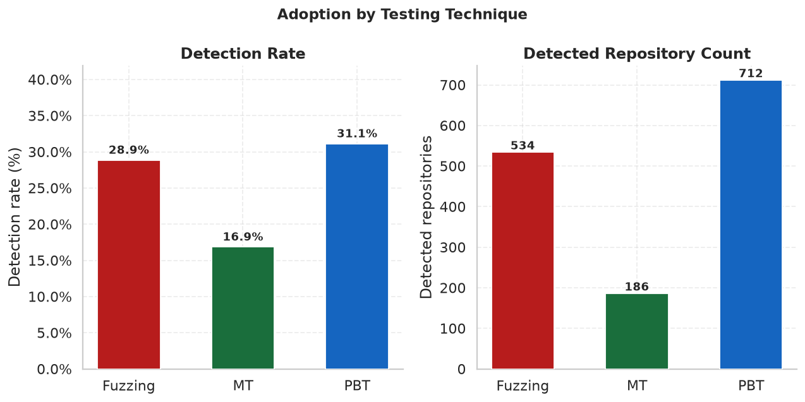
*Detection rate and detected repo count by technique*

### Detection Depth

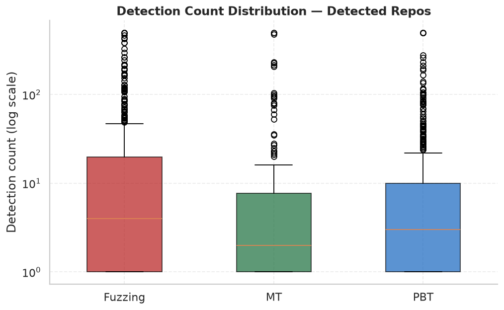
*Detection count distribution per technique (log scale)*

| Technique | Median detections | Mean detections | Max |
|---|---|---|---|
| Fuzzing | 4 | 29.2 | 500 |
| MT | 2 | 21.8 | 500 |
| PBT | 3 | 14.3 | 500 |

### Code vs Non-Code Mentions

Proportion of signal matches in code files (test + source) vs non-code (docs + config + other).

| Technique | Code matches | Non-code matches |
|---|---|---|
| Fuzzing | 82.6% | 17.4% |
| MT | 81.7% | 18.3% |
| PBT | 87.3% | 12.7% |

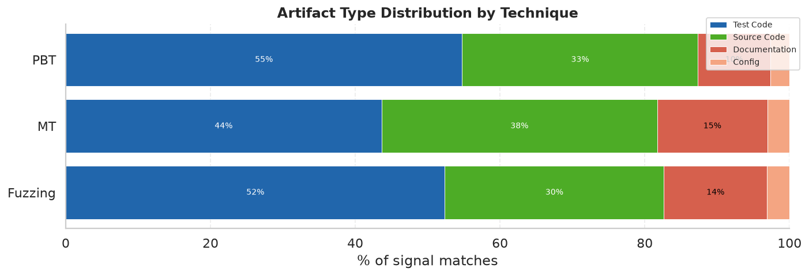
*Artifact type distribution by technique*

### Technique Coverage Ratios (Detected Repos)

| Technique | Median line density | Median file ratio |
|---|---|---|
| Fuzzing | 0.0% | 0.8% |
| MT | 0.0% | 0.9% |
| PBT | 0.0% | 0.9% |

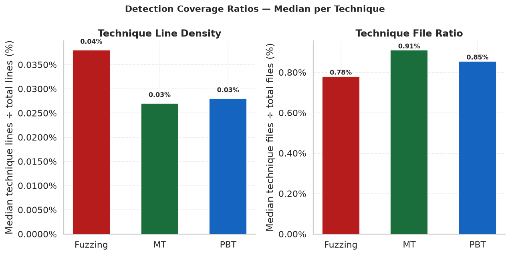
*Technique line density and file ratio distributions per technique*

### Contributor Activity (Detected Repos)

| Technique | Median contributors | Mean contributors | Max |
|---|---|---|---|
| Fuzzing | 2 | 3.3 | 31 |
| MT | 2 | 3.5 | 32 |
| PBT | 2 | 3.2 | 85 |

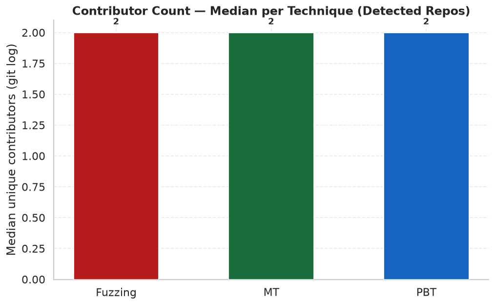
*Contributor count — median per technique (detected repos)*

---

## Usage Patterns

### Project Role Comparison

| Project Role | Fuzzing | MT | PBT |
|---|---|---|---|
| Actual Usage | 50.6% | 41.9% | 47.1% |
| Framework | 14.8% | 14.0% | 18.8% |
| Mixed | 10.9% | 15.1% | 14.3% |
| Research Artifact | 18.2% | 24.2% | 14.9% |
| Unknown | 5.6% | 4.8% | 4.9% |

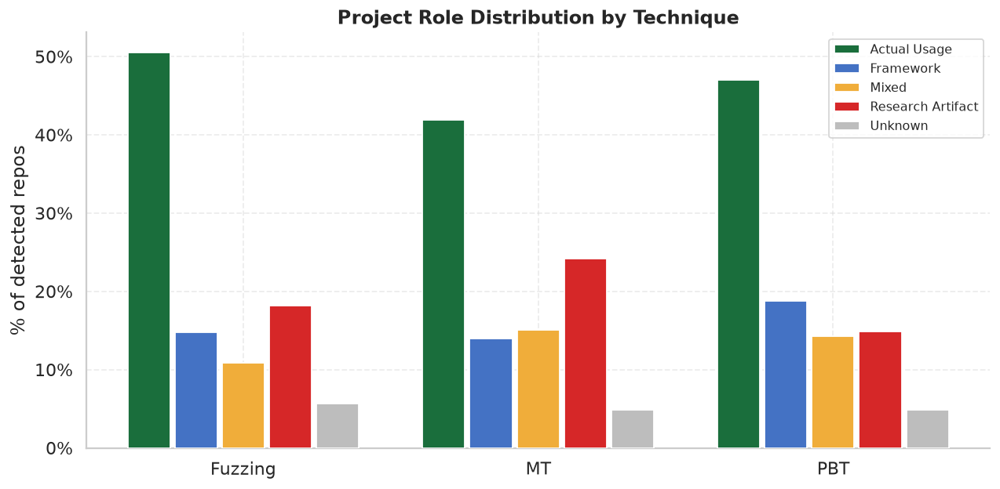
*Project role distribution by technique*

### Detection Distribution

Signal location in test infrastructure across techniques.

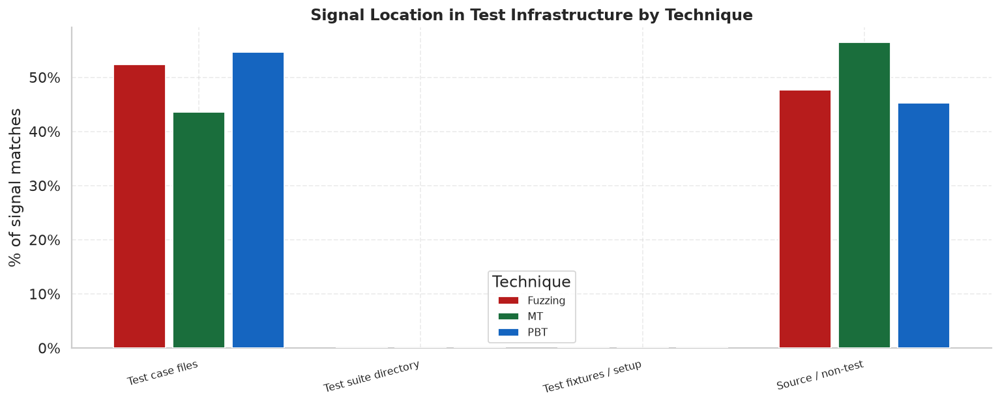
*Signal location in test infrastructure by technique*

### Language Distribution

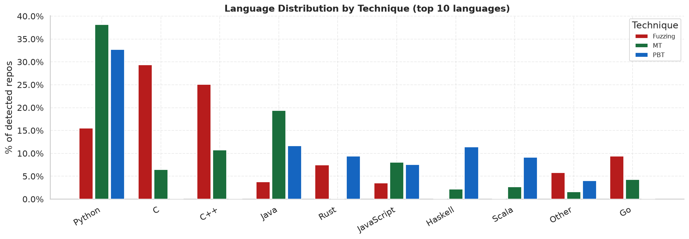
*Language distribution per technique (top 10 languages, % of detected repos)*

### Artifact Type Distribution

*Artifact type distribution by technique (stacked)*

### File Extension Breakdown

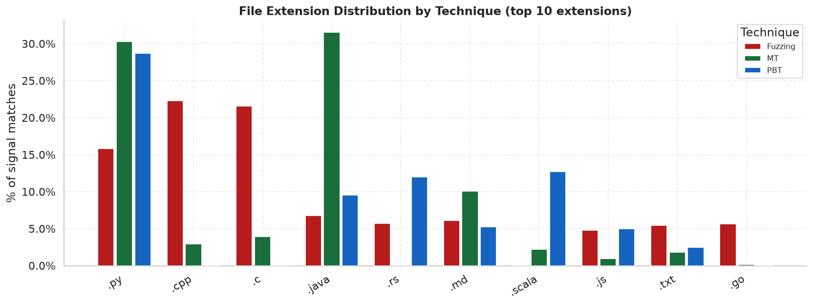
*File extension distribution by technique (top 10 extensions)*

### Application Domain

Domains inferred from repo name, description, and GitHub topics. A repo can match multiple domains.

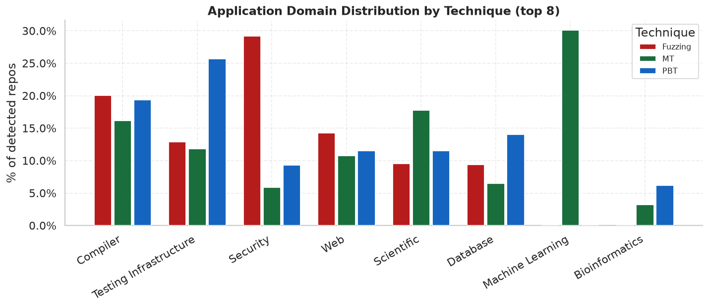
*Application domain distribution per technique (top 8 domains, % of detected repos)*

---

## Timeline

### Repository Creation Trend

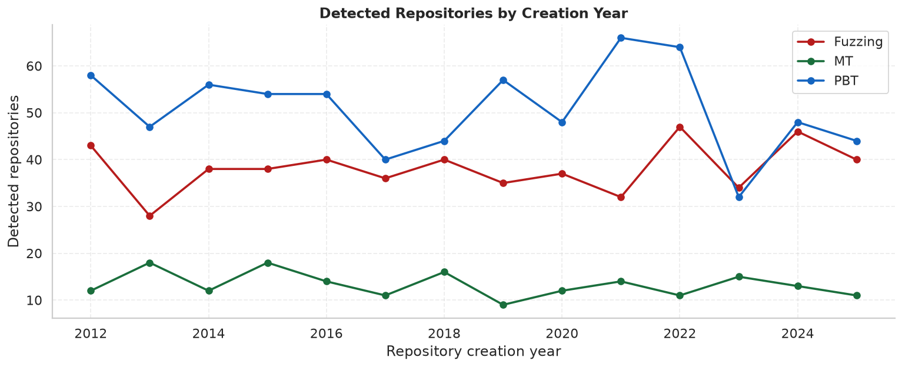
*Detected repos by creation year per technique*

### Technique Commit Activity

Commit metrics derived from up to 500 most-recent commits per repo.

| Technique | Median first commit yr | Median last commit yr | Median span | Median commit ratio |
|---|---|---|---|---|
| Fuzzing | 2019 | 2020 | 0.4 yrs | 9.2% |
| MT | 2018 | 2019 | 0.4 yrs | 8.4% |
| PBT | 2019 | 2020 | 0.4 yrs | 9.0% |

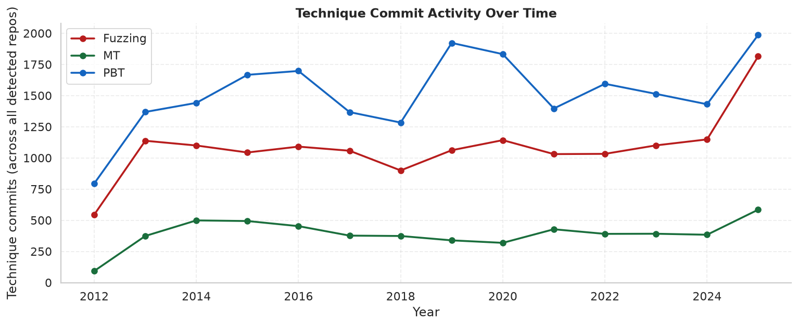
*Technique commit activity over time per technique*

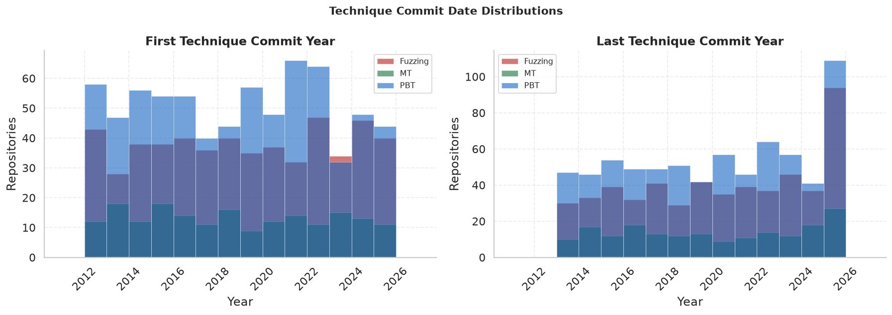
*First and last technique commit year distributions per technique*

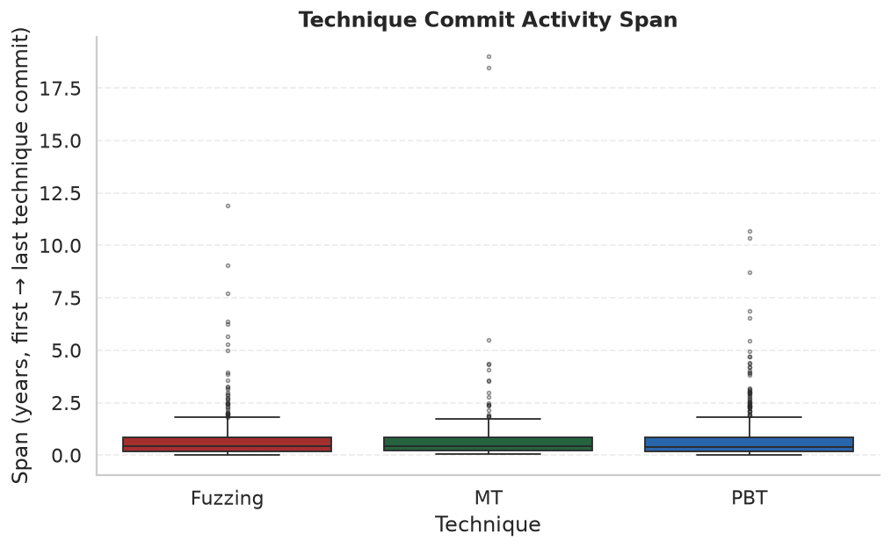
*First-to-last commit duration per technique (years)*

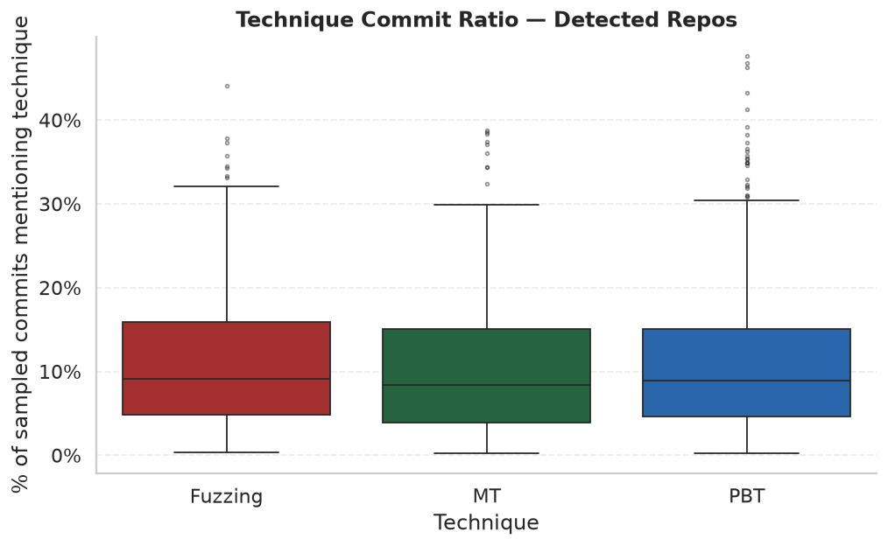
*Technique commit ratio per technique*

