# Fuzzing — GitHub Mining Report

*Fuzzing · Generated: 2026-09-06 15:17 UTC*

---

## Pipeline Summary

| Stage | Count |
|---|---|
| Candidates found via search | 1,850 |
| Cloned | 1,850 |
| Clone errors | 0 |
| Analysed | 1,850 |
| **Detected** | **534 (28.9%)** |
| Not detected | 1,316 (71.1%) |

| Search | Value |
|---|---|
| Total queries run | 10 |
| Total API hits | 59,045 |

> *Detected* = ≥ 1 pattern match found in the cloned default branch. Not detected means no matching signal was found in our patterns — not that the technique is absent (non-standard terminology, non-default branches, or vendored code all cause misses). All figures are lower-bound estimates.

### Search Surfaces Used

Each surface corresponds to a distinct GitHub Search API endpoint.

| Surface | What is searched |
|---|---|
| **Code** | Contents of source files on the default branch |
| **Repo** | Repository name, description, topic tags, and README |
| **Commit** | Commit message text (not the diff/code itself) |
| **Issue** | Issue titles and body text |

### Results per Search Surface

Total distinct results found across all search queries for each surface.
Only repositories proceed to cloning and local analysis.

| Surface | Results found |
|---|---|
| **Code files** | 31,854 |
| **Repositories** | 18,102 |
| **Commits** | 4,987 |
| **Issues** | 4,102 |

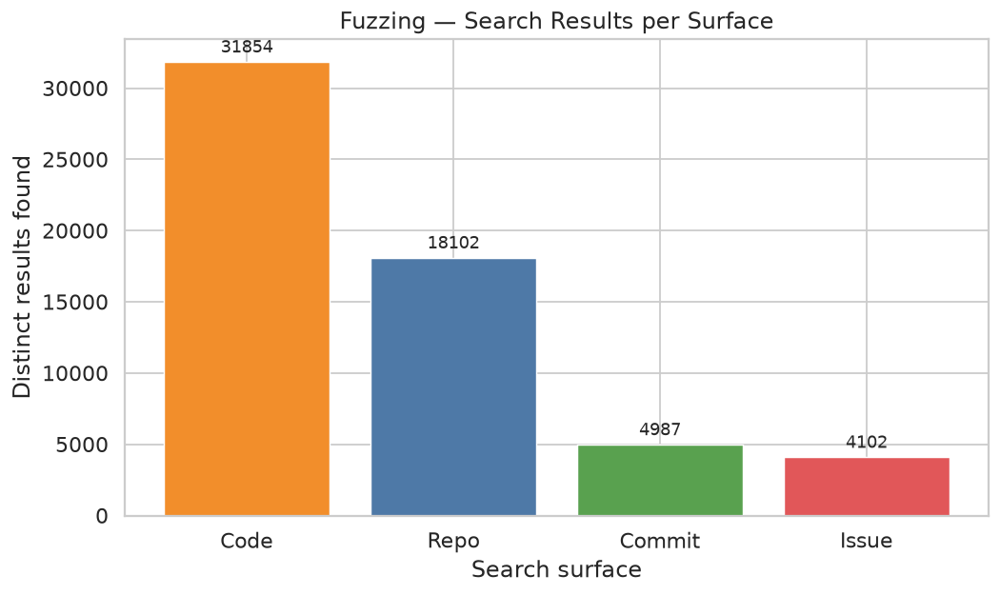
*Fuzzing — search results per surface*

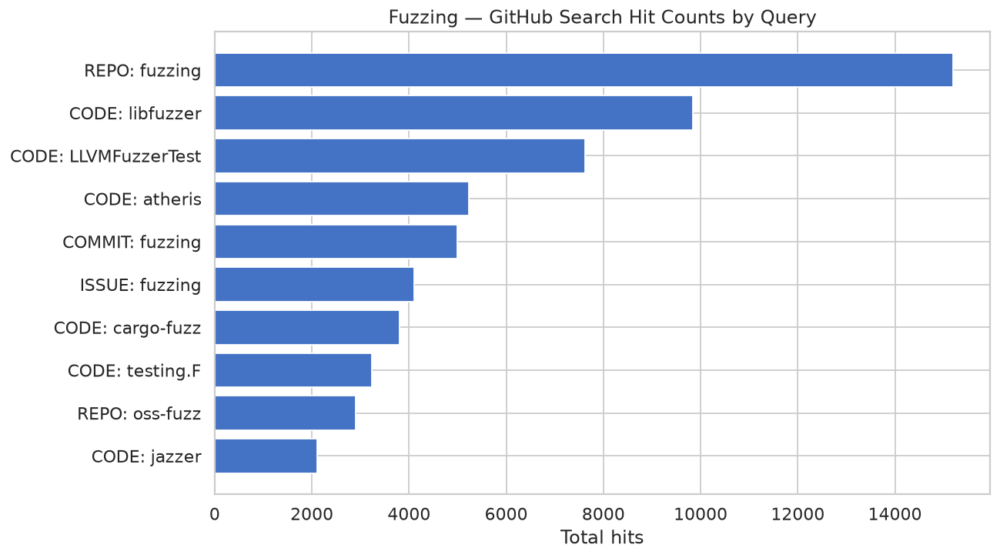
*Fuzzing — raw search hit counts per query*

---

## Adoption Overview

### Detection Count Distribution

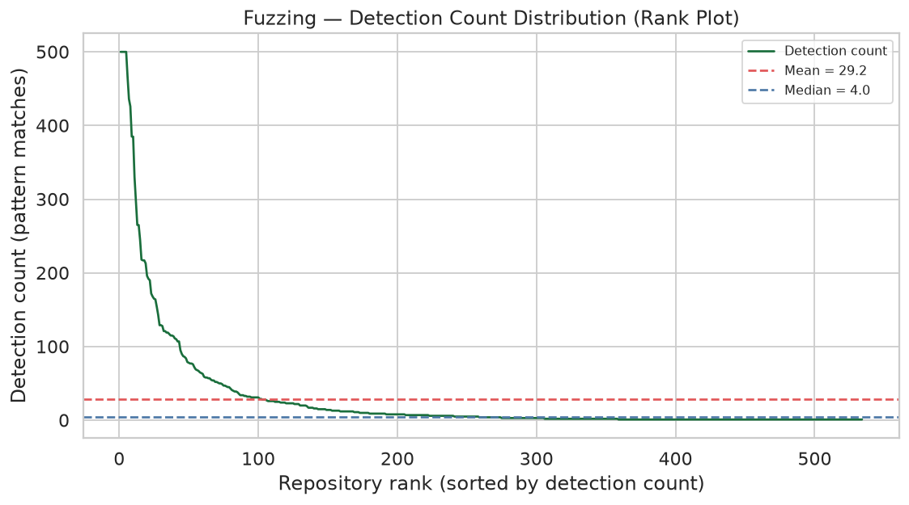
*Fuzzing — detection count distribution (detected repos)*

| Metric | Value |
|---|---|
| Total analysed | 1,850 |
| Total detected | 534 (28.9%) |
| Not detected | 1,316 (71.1%) |
| Median detection count | 4.0 |
| Mean detection count | 29.2 |
| Maximum detection count | 500 |
| Single-match detections | 176 (33.0%) |

### Project Metadata (Detected vs Not Detected)

| Metric | Detected (n=534) | Not Detected (n=1,316) |
|---|---|---|
| Median stars | 10.5 | 4.0 |
| Mean stars | 49.6 | 12.1 |
| Max stars | 1,530 | 376 |
| Median repo age (yrs) | 7.0 | 9.0 |
| Max repo age (yrs) | 14 | 16 |
| Median files scanned | 165.5 | 102.0 |
| Max files scanned | 300 | 200 |

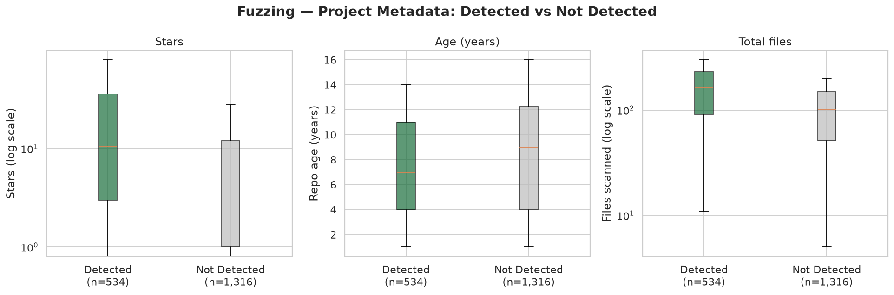
*Fuzzing — project metadata: detected vs not-detected (stars, age, files)*

### Contributor Activity

Unique author email addresses from sampled git history (≤ 500 commits per repo).

| Metric | Value |
|---|---|
| Repos with contributor data | 534 |
| Median contributors | 2.0 |
| Mean contributors | 3.3 |
| Max contributors | 31 |
| Single-contributor repos | 247 (46.3%) |
| Repos with > 10 contributors | 31 (5.8%) |

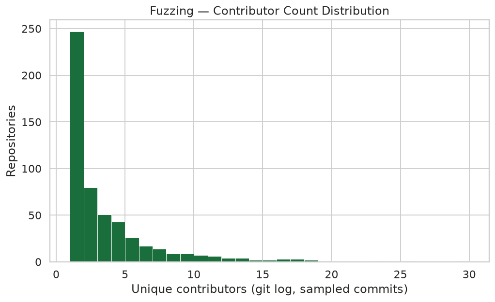
*Fuzzing — contributor count distribution*

---

## Usage Patterns

### Project Role Classification

Repos are classified by where technique signals appear in the directory tree. Not-detected repos are excluded from the use-case stats below.

| Classification | Repos | % of detected |
|---|---|---|
| Actual Usage | 270 | 50.6% |
| Framework / Library | 79 | 14.8% |
| Mixed | 58 | 10.9% |
| Research Artifact | 97 | 18.2% |
| Unknown | 30 | 5.6% |
| **Not Detected (excluded)** | 1,316 | — |

| Classification | Description |
|---|---|
| Actual Usage | Signals in test dirs (`tests/`, `spec/`, `*_test.*`). Technique is actively used in the project's testing. |
| Framework / Library | Signals in source dirs (`src/`, `lib/`, `core/`). The project implements or extends the technique. |
| Mixed | Signals in both source and test dirs. Technique used as both implementation target and test method. |
| Research Artifact | Signals alongside paper markers (`paper`, `evaluation`, `artifact`). Replication study or benchmarking repo. |
| Unknown | No clear dir-based classification. |

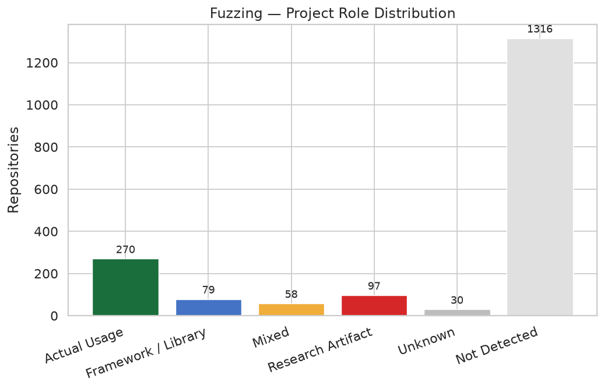
*Fuzzing — project role distribution (including not-detected)*

### Detection Distribution

How technique signals are distributed within repos: signal type, code coverage, spread across files, and density per file.

#### Code vs Non-Code Mentions

Signal matches classified by where they appear in the repository file tree.

| Category | Matches | % |
|---|---|---|
| Code (test code + source code) | 12,259 | 82.6% |
| Non-code (docs + config + other) | 2,579 | 17.4% |

#### Technique Coverage Ratios

Proportion of each detected repo's content containing technique signals.

| Metric | Value |
|---|---|
| Median technique line density | 0.0% |
| Median technique file ratio | 0.8% |
| Repos with > 10% file coverage | 15 |

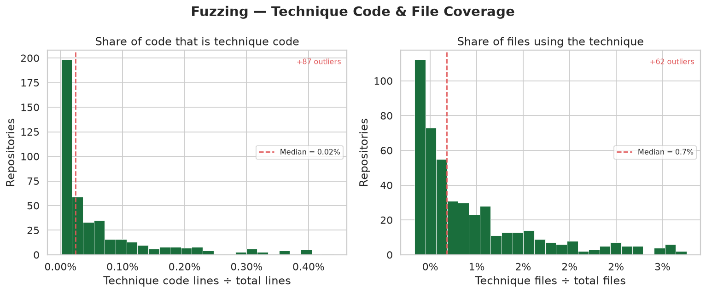
*Fuzzing — technique code share and file coverage (detected repos)*

| Spread Metric | Value |
|---|---|
| Single-file signal repos | 78 (22.3%) |
| Median avg matches per technique file | 2.5 |
| Mean avg matches per technique file | 22.2 |
| Median max matches in a single file | 5.0 |
| Mean signal concentration (max/total) | 156.2% |
| Median unique pattern types per repo | 1.0 |
| Mean unique pattern types per repo | 2.0 |

| Files with signals | Repos |
|---|---|
| 1 | 78 |
| 2 | 86 |
| 3–5 | 171 |
| 6–10 | 13 |
| 11–20 | 1 |
| >20 | 0 |

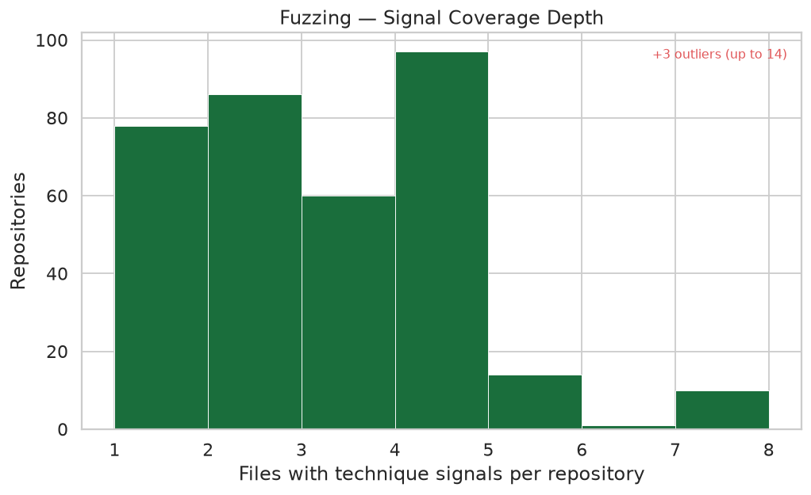
*Fuzzing — signal coverage depth (files per repo)*

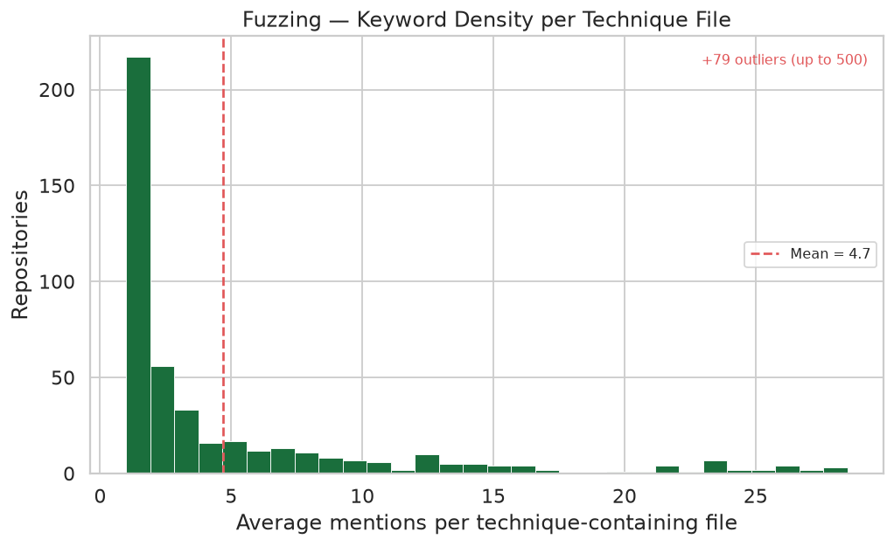
*Fuzzing — keyword density per technique file*

### Language Distribution

| Language | Detected repos | % |
|---|---|---|
| C | 157 | 29.4% |
| C++ | 134 | 25.1% |
| Python | 83 | 15.5% |
| Go | 50 | 9.4% |
| Rust | 40 | 7.5% |
| Other | 31 | 5.8% |
| Java | 20 | 3.7% |
| JavaScript | 19 | 3.6% |

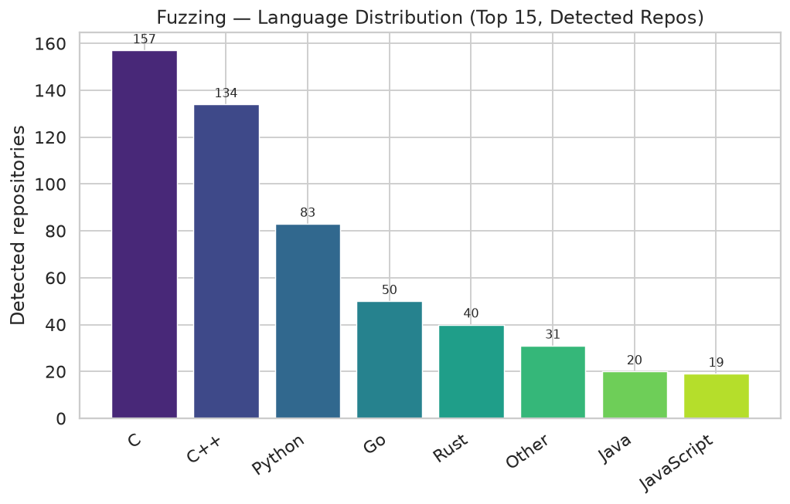
*Fuzzing — language distribution (top 15)*

### Artifact Type Distribution

Where in the file tree signals appear across all 14,805 total matches.

| Artifact Type | Matches | % |
|---|---|---|
| Test Code | 7,772 | 52.4% |
| Source Code | 4,487 | 30.2% |
| Documentation | 2,119 | 14.3% |
| Config | 460 | 3.1% |

| Artifact Type | Files included |
|---|---|
| Test Code | Files in test directories (`tests/`, `spec/`, `*test*`, `*_spec.*`) |
| Source Code | Non-test source files (`src/`, `lib/`, `*.py`, `*.java`, `*.cpp`, etc.) |
| Documentation | Markdown, RST, and plain-text docs (`*.md`, `*.rst`, `*.txt`, `docs/`) |
| Config | Config and build files (`*.yml`, `*.toml`, `*.ini`, `*.gradle`, `Makefile`) |

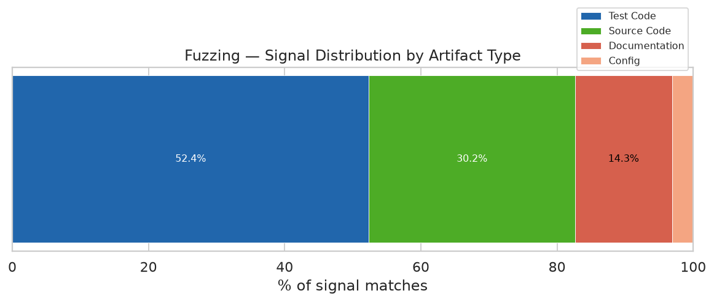
*Fuzzing — signal distribution by artifact type*

### File Extension Breakdown

Extension-level breakdown of files containing technique signals (top 15 by match count).

| Extension | Signal matches |
|---|---|
| `.cpp` | 3,297 |
| `.c` | 3,198 |
| `.py` | 2,340 |
| `.java` | 1,004 |
| `.md` | 909 |
| `.rs` | 844 |
| `.go` | 837 |
| `.txt` | 812 |
| `.js` | 707 |
| `.rst` | 397 |
| `.gradle` | 118 |
| `.yml` | 92 |
| `.toml` | 90 |
| `.ini` | 80 |
| `./makefile` | 80 |

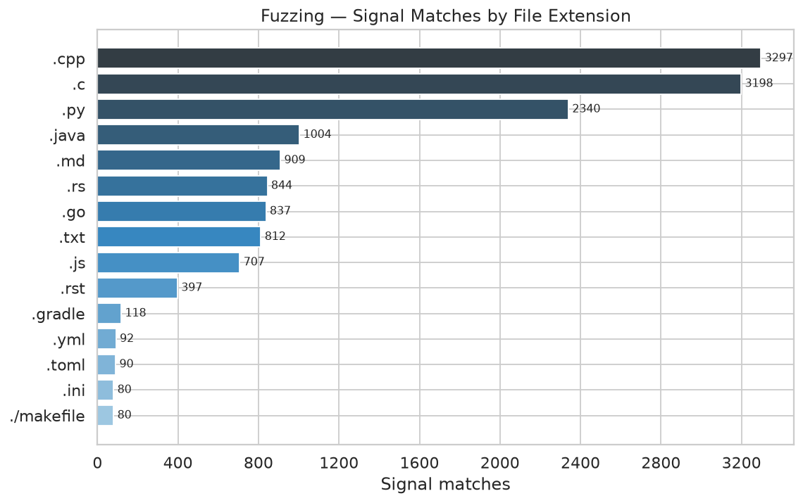
*Fuzzing — signal matches by file extension*

### Application Domain

Inferred from repo name, description, GitHub topics, and README text (keyword matching). A repo can match multiple domains.

| Domain | Repos | % of detected |
|---|---|---|
| Security | 156 | 29.2% |
| Compiler | 107 | 20.0% |
| Web | 76 | 14.2% |
| Testing Infrastructure | 69 | 12.9% |
| Scientific | 51 | 9.6% |
| Database | 50 | 9.4% |

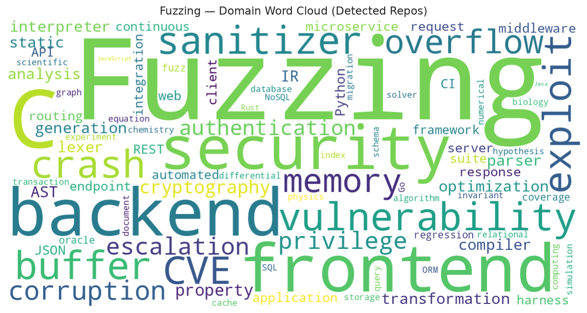
*Fuzzing — domain word cloud (detected repos)*

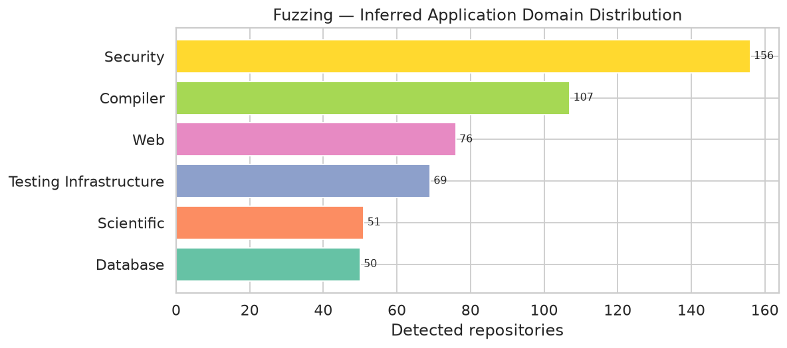
*Fuzzing — inferred domain distribution*

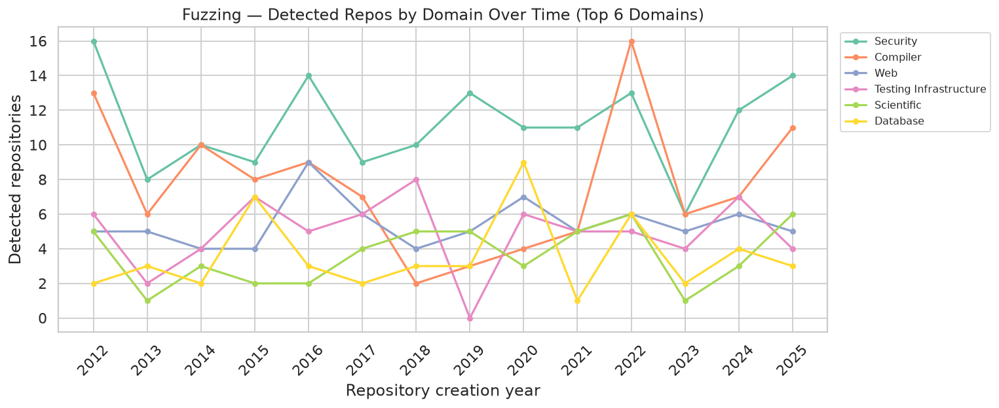
*Fuzzing — detected repos by domain and creation year*

---

## Timeline

### Repository Creation Trend

| Year | Detected | Not detected | Total |
|---|---|---|---|
| 2010 | 0 | 80 | 80 |
| 2011 | 0 | 81 | 81 |
| 2012 | 43 | 76 | 119 |
| 2013 | 28 | 92 | 120 |
| 2014 | 38 | 91 | 129 |
| 2015 | 38 | 76 | 114 |
| 2016 | 40 | 70 | 110 |
| 2017 | 36 | 95 | 131 |
| 2018 | 40 | 62 | 102 |
| 2019 | 35 | 75 | 110 |
| 2020 | 37 | 87 | 124 |
| 2021 | 32 | 84 | 116 |
| 2022 | 47 | 76 | 123 |
| 2023 | 34 | 92 | 126 |
| 2024 | 46 | 83 | 129 |
| 2025 | 40 | 96 | 136 |

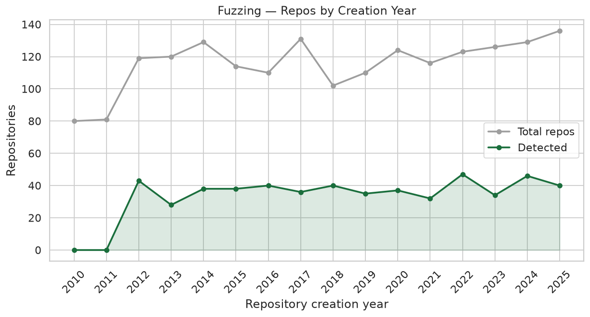
*Fuzzing — detected repos by creation year*

### Commit Activity

Computed from up to 500 most-recent commits per repo (git log, no merges).

| Metric | Value |
|---|---|
| Repos with commit data | 534 |
| Median commits sampled | 259.5 |
| Median first technique commit year | 2019.0 |
| Median last technique commit year  | 2020.0 |
| Median technique commit span       | 0.4 yrs |
| Mean technique commit span | 0.7 yrs |
| Median technique commit ratio | 9.2% |
| Mean technique commit ratio | 10.9% |
| Repos with > 10% technique commits | 245 (45.9%) |

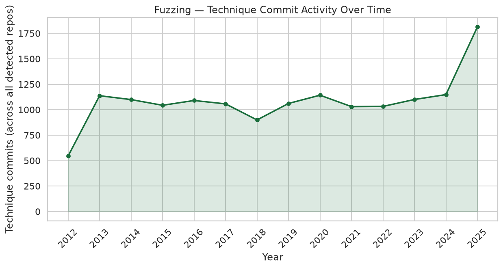
*Fuzzing — technique commit activity over time (commits per year)*

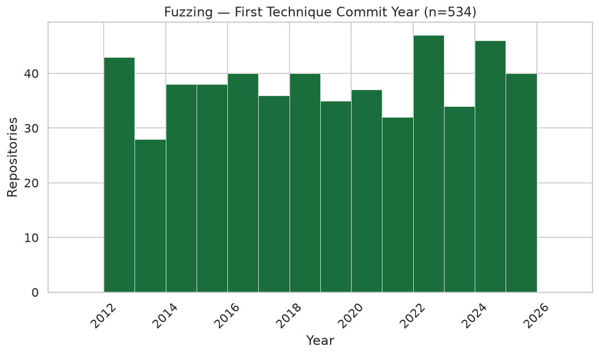
*Fuzzing — first technique commit year distribution*

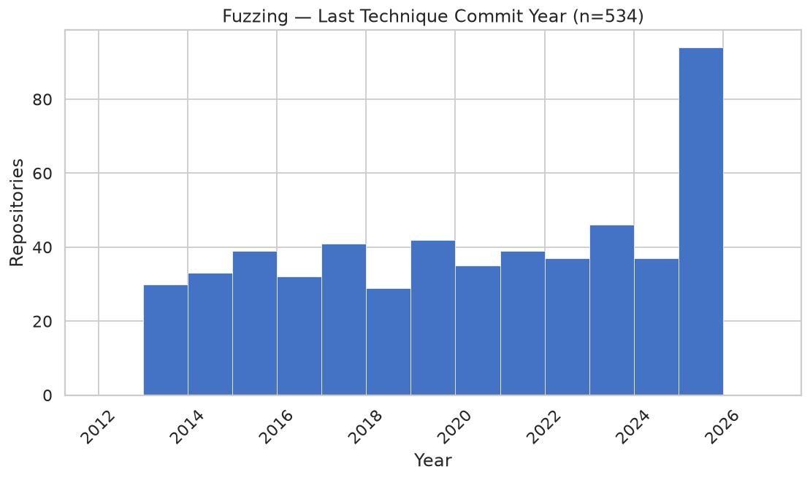
*Fuzzing — last technique commit year distribution*

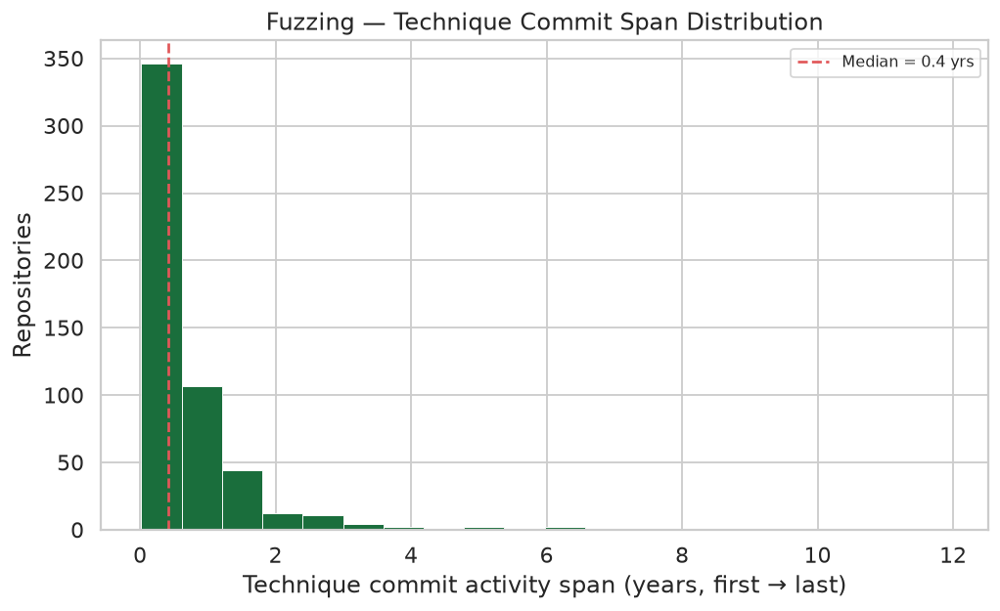
*Fuzzing — first-to-last commit duration distribution (years)*

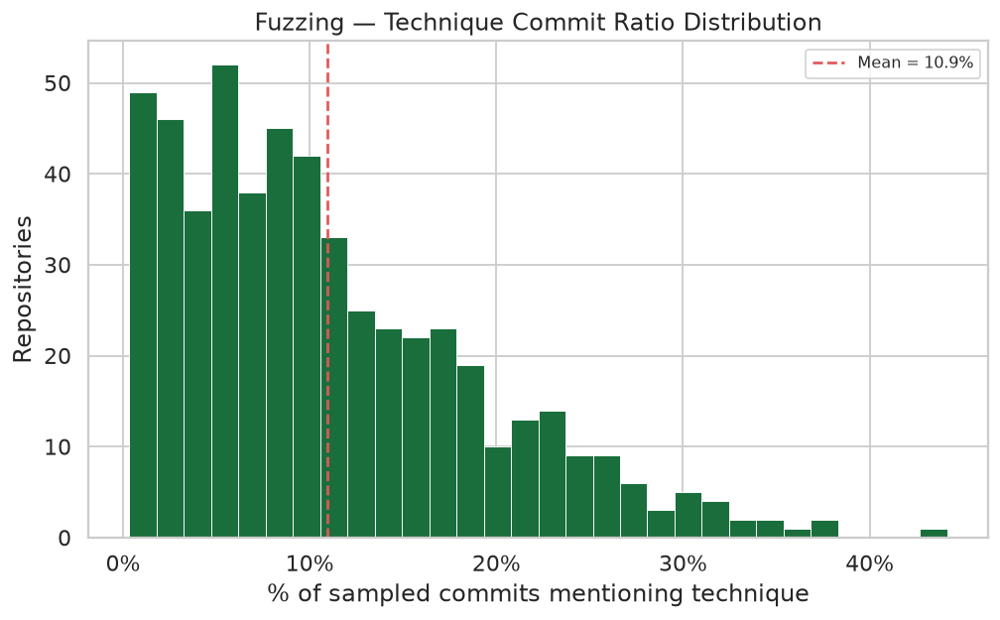
*Fuzzing — technique commit ratio distribution*

### Technique Commits by Year of Repository Life

Total technique commits in each year of a repo's existence, aggregated across all detected repos.
Shows whether technique adoption is concentrated early or sustained over time.

| Project life year | Technique commits |
|---|---|
| Yr 1 | 7,912 |
| Yr 2 | 6,862 |
| Yr 3 | 238 |
| Yr 4 | 142 |
| Yr 5 | 19 |
| Yr 6 | 20 |
| Yr 7 | 8 |
| Yr 8 | 4 |
| Yr 9 | 2 |
| Yr 10 | 1 |
| Yr 11 | 2 |

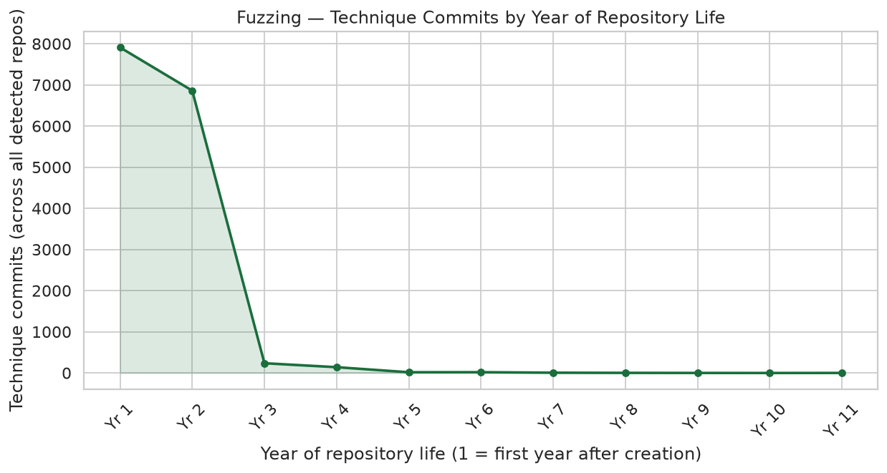
*Fuzzing — technique commits by year of repository life*

---

## Top Detected Repositories

Top 30 by detection count (then stars).

| Repository | Detections | Signal files | Project type | Language | Stars | Year |
|---|---|---|---|---|---|---|
| [cargo-fuzz/repo-fuzzing-0488](https://github.com/cargo-fuzz/repo-fuzzing-0488) | 500 | 2 | framework | C++ | 826 | 2024 |
| [compiler-fuzzing/repo-fuzzing-0364](https://github.com/compiler-fuzzing/repo-fuzzing-0364) | 500 | 1 | general usage | Go | 188 | 2022 |
| [atheris-corp/repo-fuzzing-0223](https://github.com/atheris-corp/repo-fuzzing-0223) | 500 | 1 | research artifact | Java | 135 | 2022 |
| [compiler-fuzzing/repo-fuzzing-0360](https://github.com/compiler-fuzzing/repo-fuzzing-0360) | 500 | 1 | general usage | Java | 44 | 2022 |
| [google/repo-fuzzing-0456](https://github.com/google/repo-fuzzing-0456) | 500 | 3 | general usage | C | 8 | 2025 |
| [sec-research/repo-fuzzing-0016](https://github.com/sec-research/repo-fuzzing-0016) | 466 | 1 | research artifact | Rust | 46 | 2022 |
| [sec-research/repo-fuzzing-0160](https://github.com/sec-research/repo-fuzzing-0160) | 436 | 1 | general usage | Python | 1 | 2019 |
| [microsoft/repo-fuzzing-0412](https://github.com/microsoft/repo-fuzzing-0412) | 426 | 1 | research artifact | C++ | 25 | 2021 |
| [libfuzzer-sys/repo-fuzzing-0147](https://github.com/libfuzzer-sys/repo-fuzzing-0147) | 385 | 6 | general usage | C | 74 | 2019 |
| [protocol-fuzz/repo-fuzzing-0481](https://github.com/protocol-fuzz/repo-fuzzing-0481) | 385 | 8 | research artifact | C++ | 15 | 2024 |
| [sec-research/repo-fuzzing-0397](https://github.com/sec-research/repo-fuzzing-0397) | 330 | 6 | general usage | Other | 7 | 2013 |
| [google-oss-fuzz/repo-fuzzing-0305](https://github.com/google-oss-fuzz/repo-fuzzing-0305) | 297 | 3 | general usage | C++ | 19 | 2012 |
| [fuzzbench/repo-fuzzing-0136](https://github.com/fuzzbench/repo-fuzzing-0136) | 265 | 1 | general usage | C | 59 | 2022 |
| [google-oss-fuzz/repo-fuzzing-0094](https://github.com/google-oss-fuzz/repo-fuzzing-0094) | 265 | 1 | research artifact | C++ | 20 | 2015 |
| [protocol-fuzz/repo-fuzzing-0409](https://github.com/protocol-fuzz/repo-fuzzing-0409) | 245 | 1 | general usage | Other | 2 | 2013 |
| [libfuzzer-sys/repo-fuzzing-0060](https://github.com/libfuzzer-sys/repo-fuzzing-0060) | 218 | 2 | general usage | C | 28 | 2021 |
| [google/repo-fuzzing-0384](https://github.com/google/repo-fuzzing-0384) | 217 | 1 | general usage | JavaScript | 52 | 2025 |
| [google-oss-fuzz/repo-fuzzing-0478](https://github.com/google-oss-fuzz/repo-fuzzing-0478) | 217 | 1 | framework | Python | 15 | 2015 |
| [protocol-fuzz/repo-fuzzing-0311](https://github.com/protocol-fuzz/repo-fuzzing-0311) | 213 | 1 | general usage | C++ | 2 | 2022 |
| [protocol-fuzz/repo-fuzzing-0100](https://github.com/protocol-fuzz/repo-fuzzing-0100) | 196 | 1 | mixed | JavaScript | 9 | 2022 |
| [google/repo-fuzzing-0475](https://github.com/google/repo-fuzzing-0475) | 192 | 1 | research artifact | C | 252 | 2013 |
| [google-oss-fuzz/repo-fuzzing-0046](https://github.com/google-oss-fuzz/repo-fuzzing-0046) | 190 | 1 | framework | C | 46 | 2022 |
| [protocol-fuzz/repo-fuzzing-0080](https://github.com/protocol-fuzz/repo-fuzzing-0080) | 172 | 1 | research artifact | Java | 11 | 2021 |
| [protocol-fuzz/repo-fuzzing-0297](https://github.com/protocol-fuzz/repo-fuzzing-0297) | 168 | 1 | research artifact | JavaScript | 5 | 2019 |
| [sec-research/repo-fuzzing-0375](https://github.com/sec-research/repo-fuzzing-0375) | 165 | 1 | mixed | Python | 5 | 2014 |
| [aflteam/repo-fuzzing-0402](https://github.com/aflteam/repo-fuzzing-0402) | 164 | 1 | framework | Other | 5 | 2015 |
| [google/repo-fuzzing-0039](https://github.com/google/repo-fuzzing-0039) | 154 | 1 | general usage | Python | 3 | 2018 |
| [aflteam/repo-fuzzing-0034](https://github.com/aflteam/repo-fuzzing-0034) | 143 | 1 | framework | C | 26 | 2024 |
| [cargo-fuzz/repo-fuzzing-0148](https://github.com/cargo-fuzz/repo-fuzzing-0148) | 129 | 1 | general usage | C++ | 9 | 2022 |
| [fuzzbench/repo-fuzzing-0317](https://github.com/fuzzbench/repo-fuzzing-0317) | 129 | 5 | general usage | JavaScript | 2 | 2017 |

---

## Pattern Activity

14,805 total pattern matches across 534 detected repositories.

| Pattern | Repos | Total matches |
|---|---|---|
| OSS-Fuzz config | 116 | 722 |
| Jazzer (Java) | 116 | 1,091 |
| LibFuzzer harness | 112 | 1,791 |
| AFL/AFL++ usage | 111 | 1,050 |
| cargo-fuzz | 111 | 2,718 |
| String: fuzz/fuzzer | 110 | 1,140 |
| Go native fuzz (testing.F) | 110 | 1,790 |
| Identifier: fuzz_/Fuzz | 109 | 1,760 |
| Import: atheris | 100 | 1,420 |
| Comment: fuzzing/fuzzer | 96 | 1,323 |

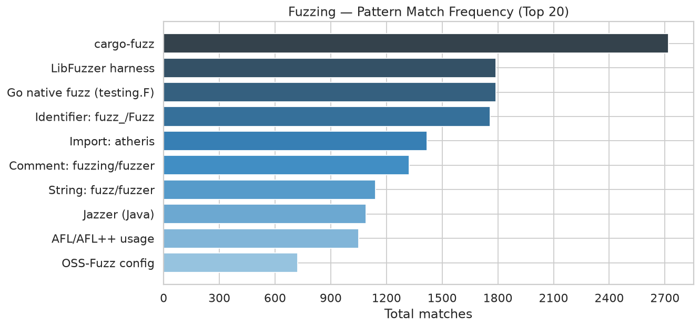
*Fuzzing — pattern match frequency*

---

## Appendix A — Not-Detected Repositories (1,316)

No Fuzzing pattern matches found in cloned default branch. Listed for manual review (sorted by stars).

| Repository | Language | Stars | Year | Found via |
|---|---|---|---|---|
| [network-sec/repo-nodet-0076](https://github.com/network-sec/repo-nodet-0076) | C | 376 | 2013 | pr |
| [protocol-fuzz/repo-nodet-0237](https://github.com/protocol-fuzz/repo-nodet-0237) | JavaScript | 326 | 2022 | commit |
| [google-oss-fuzz/repo-nodet-0284](https://github.com/google-oss-fuzz/repo-nodet-0284) | C | 283 | 2017 | pr |
| [microsoft/repo-nodet-0153](https://github.com/microsoft/repo-nodet-0153) | C++ | 259 | 2013 | pr |
| [atheris-corp/repo-nodet-1089](https://github.com/atheris-corp/repo-nodet-1089) | Python | 222 | 2021 | pr |
| [user-7157/repo-nodet-0442](https://github.com/user-7157/repo-nodet-0442) | C | 198 | 2011 | repo |
| [network-sec/repo-nodet-1000](https://github.com/network-sec/repo-nodet-1000) | Python | 184 | 2025 | commit |
| [user-6334/repo-nodet-0365](https://github.com/user-6334/repo-nodet-0365) | Go | 141 | 2024 | commit |
| [protocol-fuzz/repo-nodet-0458](https://github.com/protocol-fuzz/repo-nodet-0458) | Other | 141 | 2011 | issue |
| [user-6763/repo-nodet-0985](https://github.com/user-6763/repo-nodet-0985) | C++ | 133 | 2016 | pr |
| [cargo-fuzz/repo-nodet-1195](https://github.com/cargo-fuzz/repo-nodet-1195) | Other | 132 | 2012 | commit |
| [compiler-fuzzing/repo-nodet-0455](https://github.com/compiler-fuzzing/repo-nodet-0455) | Python | 121 | 2018 | commit |
| [sec-research/repo-nodet-0593](https://github.com/sec-research/repo-nodet-0593) | C++ | 110 | 2015 | pr |
| [cargo-fuzz/repo-nodet-0060](https://github.com/cargo-fuzz/repo-nodet-0060) | C++ | 109 | 2021 | repo |
| [aflteam/repo-nodet-0817](https://github.com/aflteam/repo-nodet-0817) | C++ | 105 | 2010 | issue |
| [google-oss-fuzz/repo-nodet-1166](https://github.com/google-oss-fuzz/repo-nodet-1166) | C++ | 104 | 2015 | repo |
| [atheris-corp/repo-nodet-0235](https://github.com/atheris-corp/repo-nodet-0235) | Python | 102 | 2025 | issue |
| [sec-research/repo-nodet-0815](https://github.com/sec-research/repo-nodet-0815) | C | 101 | 2023 | issue |
| [sec-research/repo-nodet-0812](https://github.com/sec-research/repo-nodet-0812) | C++ | 100 | 2021 | pr |
| [compiler-fuzzing/repo-nodet-0855](https://github.com/compiler-fuzzing/repo-nodet-0855) | Python | 99 | 2011 | pr |
| [libfuzzer-sys/repo-nodet-0164](https://github.com/libfuzzer-sys/repo-nodet-0164) | C | 98 | 2014 | pr |
| [google/repo-nodet-1143](https://github.com/google/repo-nodet-1143) | Python | 97 | 2015 | issue |
| [protocol-fuzz/repo-nodet-0128](https://github.com/protocol-fuzz/repo-nodet-0128) | C++ | 94 | 2011 | issue |
| [protocol-fuzz/repo-nodet-0546](https://github.com/protocol-fuzz/repo-nodet-0546) | Python | 92 | 2017 | repo |
| [microsoft/repo-nodet-0963](https://github.com/microsoft/repo-nodet-0963) | Other | 92 | 2016 | pr |
| [libfuzzer-sys/repo-nodet-1145](https://github.com/libfuzzer-sys/repo-nodet-1145) | C | 91 | 2023 | pr |
| [libfuzzer-sys/repo-nodet-1293](https://github.com/libfuzzer-sys/repo-nodet-1293) | C++ | 91 | 2012 | issue |
| [sec-research/repo-nodet-0332](https://github.com/sec-research/repo-nodet-0332) | JavaScript | 88 | 2012 | pr |
| [microsoft/repo-nodet-0357](https://github.com/microsoft/repo-nodet-0357) | C++ | 88 | 2013 | issue |
| [libfuzzer-sys/repo-nodet-1245](https://github.com/libfuzzer-sys/repo-nodet-1245) | Python | 88 | 2015 | pr |
| [user-2788/repo-nodet-0683](https://github.com/user-2788/repo-nodet-0683) | C | 87 | 2019 | repo |
| [google-oss-fuzz/repo-nodet-1234](https://github.com/google-oss-fuzz/repo-nodet-1234) | C | 86 | 2020 | repo |
| [network-sec/repo-nodet-0270](https://github.com/network-sec/repo-nodet-0270) | Java | 85 | 2018 | commit |
| [atheris-corp/repo-nodet-0377](https://github.com/atheris-corp/repo-nodet-0377) | Rust | 85 | 2025 | pr |
| [user-9260/repo-nodet-0430](https://github.com/user-9260/repo-nodet-0430) | Python | 82 | 2018 | pr |
| [microsoft/repo-nodet-0143](https://github.com/microsoft/repo-nodet-0143) | C++ | 81 | 2011 | issue |
| [aflteam/repo-nodet-0026](https://github.com/aflteam/repo-nodet-0026) | C | 79 | 2020 | repo |
| [protocol-fuzz/repo-nodet-1132](https://github.com/protocol-fuzz/repo-nodet-1132) | Java | 79 | 2016 | repo |
| [protocol-fuzz/repo-nodet-0360](https://github.com/protocol-fuzz/repo-nodet-0360) | JavaScript | 76 | 2012 | commit |
| [google-oss-fuzz/repo-nodet-0556](https://github.com/google-oss-fuzz/repo-nodet-0556) | C++ | 74 | 2014 | commit |
| [protocol-fuzz/repo-nodet-0879](https://github.com/protocol-fuzz/repo-nodet-0879) | C | 70 | 2021 | repo |
| [compiler-fuzzing/repo-nodet-0777](https://github.com/compiler-fuzzing/repo-nodet-0777) | Python | 69 | 2024 | pr |
| [protocol-fuzz/repo-nodet-1122](https://github.com/protocol-fuzz/repo-nodet-1122) | Python | 68 | 2025 | issue |
| [aflteam/repo-nodet-0511](https://github.com/aflteam/repo-nodet-0511) | Java | 67 | 2021 | repo |
| [libfuzzer-sys/repo-nodet-0898](https://github.com/libfuzzer-sys/repo-nodet-0898) | JavaScript | 67 | 2012 | repo |
| [protocol-fuzz/repo-nodet-0194](https://github.com/protocol-fuzz/repo-nodet-0194) | C | 66 | 2025 | issue |
| [sec-research/repo-nodet-0638](https://github.com/sec-research/repo-nodet-0638) | Go | 66 | 2020 | commit |
| [sec-research/repo-nodet-0978](https://github.com/sec-research/repo-nodet-0978) | Go | 66 | 2010 | issue |
| [compiler-fuzzing/repo-nodet-0179](https://github.com/compiler-fuzzing/repo-nodet-0179) | C | 65 | 2023 | pr |
| [network-sec/repo-nodet-0941](https://github.com/network-sec/repo-nodet-0941) | C++ | 65 | 2013 | pr |
| [compiler-fuzzing/repo-nodet-1046](https://github.com/compiler-fuzzing/repo-nodet-1046) | C++ | 65 | 2012 | commit |
| [google-oss-fuzz/repo-nodet-0960](https://github.com/google-oss-fuzz/repo-nodet-0960) | C++ | 64 | 2020 | pr |
| [cargo-fuzz/repo-nodet-0872](https://github.com/cargo-fuzz/repo-nodet-0872) | Python | 63 | 2025 | pr |
| [sec-research/repo-nodet-1098](https://github.com/sec-research/repo-nodet-1098) | Java | 62 | 2025 | issue |
| [google/repo-nodet-0544](https://github.com/google/repo-nodet-0544) | C | 60 | 2015 | pr |
| [aflteam/repo-nodet-0429](https://github.com/aflteam/repo-nodet-0429) | C | 59 | 2024 | repo |
| [fuzzbench/repo-nodet-0856](https://github.com/fuzzbench/repo-nodet-0856) | Go | 59 | 2014 | pr |
| [atheris-corp/repo-nodet-0789](https://github.com/atheris-corp/repo-nodet-0789) | Python | 58 | 2014 | commit |
| [fuzzbench/repo-nodet-0878](https://github.com/fuzzbench/repo-nodet-0878) | Java | 57 | 2012 | pr |
| [protocol-fuzz/repo-nodet-0980](https://github.com/protocol-fuzz/repo-nodet-0980) | Python | 56 | 2023 | commit |
| [protocol-fuzz/repo-nodet-0110](https://github.com/protocol-fuzz/repo-nodet-0110) | Java | 55 | 2024 | issue |
| [libfuzzer-sys/repo-nodet-0214](https://github.com/libfuzzer-sys/repo-nodet-0214) | C++ | 55 | 2017 | commit |
| [atheris-corp/repo-nodet-0673](https://github.com/atheris-corp/repo-nodet-0673) | Go | 55 | 2018 | repo |
| [aflteam/repo-nodet-0023](https://github.com/aflteam/repo-nodet-0023) | C++ | 53 | 2010 | commit |
| [google-oss-fuzz/repo-nodet-0126](https://github.com/google-oss-fuzz/repo-nodet-0126) | C | 53 | 2011 | commit |
| [protocol-fuzz/repo-nodet-0579](https://github.com/protocol-fuzz/repo-nodet-0579) | C | 53 | 2020 | commit |
| [user-3701/repo-nodet-1107](https://github.com/user-3701/repo-nodet-1107) | JavaScript | 53 | 2015 | issue |
| [google-oss-fuzz/repo-nodet-1203](https://github.com/google-oss-fuzz/repo-nodet-1203) | Java | 53 | 2012 | commit |
| [google/repo-nodet-0086](https://github.com/google/repo-nodet-0086) | C | 51 | 2013 | issue |
| [google/repo-nodet-0211](https://github.com/google/repo-nodet-0211) | C++ | 50 | 2020 | pr |
| [compiler-fuzzing/repo-nodet-0333](https://github.com/compiler-fuzzing/repo-nodet-0333) | C++ | 50 | 2025 | issue |
| [user-3141/repo-nodet-0988](https://github.com/user-3141/repo-nodet-0988) | Python | 48 | 2010 | pr |
| [fuzzbench/repo-nodet-1148](https://github.com/fuzzbench/repo-nodet-1148) | C++ | 48 | 2018 | issue |
| [aflteam/repo-nodet-1302](https://github.com/aflteam/repo-nodet-1302) | C | 48 | 2017 | repo |
| [cargo-fuzz/repo-nodet-1306](https://github.com/cargo-fuzz/repo-nodet-1306) | C++ | 48 | 2025 | pr |
| [network-sec/repo-nodet-0038](https://github.com/network-sec/repo-nodet-0038) | Python | 47 | 2013 | commit |
| [protocol-fuzz/repo-nodet-1278](https://github.com/protocol-fuzz/repo-nodet-1278) | C | 47 | 2024 | pr |
| [microsoft/repo-nodet-0487](https://github.com/microsoft/repo-nodet-0487) | C | 46 | 2013 | commit |
| [protocol-fuzz/repo-nodet-0902](https://github.com/protocol-fuzz/repo-nodet-0902) | C | 46 | 2020 | issue |
| [sec-research/repo-nodet-0079](https://github.com/sec-research/repo-nodet-0079) | Python | 45 | 2017 | repo |
| [protocol-fuzz/repo-nodet-0392](https://github.com/protocol-fuzz/repo-nodet-0392) | Rust | 45 | 2017 | issue |
| [microsoft/repo-nodet-0762](https://github.com/microsoft/repo-nodet-0762) | Rust | 44 | 2020 | commit |
| [microsoft/repo-nodet-0402](https://github.com/microsoft/repo-nodet-0402) | C++ | 42 | 2020 | repo |
| [microsoft/repo-nodet-0551](https://github.com/microsoft/repo-nodet-0551) | Java | 42 | 2011 | commit |
| [google-oss-fuzz/repo-nodet-0485](https://github.com/google-oss-fuzz/repo-nodet-0485) | C++ | 41 | 2022 | pr |
| [network-sec/repo-nodet-0948](https://github.com/network-sec/repo-nodet-0948) | Python | 41 | 2015 | commit |
| [google/repo-nodet-1312](https://github.com/google/repo-nodet-1312) | Rust | 41 | 2014 | issue |
| [network-sec/repo-nodet-0064](https://github.com/network-sec/repo-nodet-0064) | C++ | 40 | 2022 | issue |
| [microsoft/repo-nodet-0876](https://github.com/microsoft/repo-nodet-0876) | C | 40 | 2016 | issue |
| [protocol-fuzz/repo-nodet-1162](https://github.com/protocol-fuzz/repo-nodet-1162) | Python | 40 | 2020 | issue |
| [google/repo-nodet-0550](https://github.com/google/repo-nodet-0550) | Python | 39 | 2022 | repo |
| [libfuzzer-sys/repo-nodet-0080](https://github.com/libfuzzer-sys/repo-nodet-0080) | C | 38 | 2024 | pr |
| [microsoft/repo-nodet-0373](https://github.com/microsoft/repo-nodet-0373) | C++ | 38 | 2015 | issue |
| [sec-research/repo-nodet-0932](https://github.com/sec-research/repo-nodet-0932) | C++ | 38 | 2020 | commit |
| [atheris-corp/repo-nodet-0341](https://github.com/atheris-corp/repo-nodet-0341) | Python | 37 | 2022 | pr |
| [fuzzbench/repo-nodet-0457](https://github.com/fuzzbench/repo-nodet-0457) | Go | 37 | 2024 | pr |
| [libfuzzer-sys/repo-nodet-0530](https://github.com/libfuzzer-sys/repo-nodet-0530) | C++ | 37 | 2022 | repo |
| [libfuzzer-sys/repo-nodet-0285](https://github.com/libfuzzer-sys/repo-nodet-0285) | JavaScript | 36 | 2019 | issue |
| [cargo-fuzz/repo-nodet-0848](https://github.com/cargo-fuzz/repo-nodet-0848) | C++ | 36 | 2023 | repo |
| [microsoft/repo-nodet-1121](https://github.com/microsoft/repo-nodet-1121) | C++ | 36 | 2023 | pr |
| [libfuzzer-sys/repo-nodet-0353](https://github.com/libfuzzer-sys/repo-nodet-0353) | C | 33 | 2018 | pr |
| [sec-research/repo-nodet-0516](https://github.com/sec-research/repo-nodet-0516) | C++ | 33 | 2025 | pr |
| [cargo-fuzz/repo-nodet-0564](https://github.com/cargo-fuzz/repo-nodet-0564) | Python | 33 | 2017 | commit |
| [google/repo-nodet-0854](https://github.com/google/repo-nodet-0854) | Java | 33 | 2012 | pr |
| [microsoft/repo-nodet-1146](https://github.com/microsoft/repo-nodet-1146) | Python | 33 | 2020 | commit |
| [fuzzbench/repo-nodet-0001](https://github.com/fuzzbench/repo-nodet-0001) | JavaScript | 32 | 2017 | pr |
| [google/repo-nodet-0225](https://github.com/google/repo-nodet-0225) | C | 32 | 2024 | pr |
| [google-oss-fuzz/repo-nodet-0274](https://github.com/google-oss-fuzz/repo-nodet-0274) | Rust | 32 | 2021 | issue |
| [google-oss-fuzz/repo-nodet-0438](https://github.com/google-oss-fuzz/repo-nodet-0438) | C++ | 32 | 2023 | pr |
| [microsoft/repo-nodet-0256](https://github.com/microsoft/repo-nodet-0256) | Python | 31 | 2022 | repo |
| [atheris-corp/repo-nodet-0474](https://github.com/atheris-corp/repo-nodet-0474) | Java | 31 | 2010 | commit |
| [atheris-corp/repo-nodet-0622](https://github.com/atheris-corp/repo-nodet-0622) | C | 31 | 2016 | commit |
| [google/repo-nodet-0805](https://github.com/google/repo-nodet-0805) | Go | 31 | 2021 | commit |
| [google/repo-nodet-1130](https://github.com/google/repo-nodet-1130) | C++ | 31 | 2018 | commit |
| [protocol-fuzz/repo-nodet-0031](https://github.com/protocol-fuzz/repo-nodet-0031) | Rust | 30 | 2022 | issue |
| [cargo-fuzz/repo-nodet-0125](https://github.com/cargo-fuzz/repo-nodet-0125) | C++ | 30 | 2025 | issue |
| [microsoft/repo-nodet-0206](https://github.com/microsoft/repo-nodet-0206) | Go | 30 | 2011 | commit |
| [fuzzbench/repo-nodet-0476](https://github.com/fuzzbench/repo-nodet-0476) | C | 30 | 2015 | repo |
| [compiler-fuzzing/repo-nodet-0616](https://github.com/compiler-fuzzing/repo-nodet-0616) | C++ | 30 | 2017 | issue |
| [cargo-fuzz/repo-nodet-0737](https://github.com/cargo-fuzz/repo-nodet-0737) | Other | 30 | 2013 | repo |
| [google/repo-nodet-0752](https://github.com/google/repo-nodet-0752) | Python | 30 | 2024 | repo |
| [compiler-fuzzing/repo-nodet-0927](https://github.com/compiler-fuzzing/repo-nodet-0927) | JavaScript | 30 | 2013 | repo |
| [microsoft/repo-nodet-1004](https://github.com/microsoft/repo-nodet-1004) | C++ | 30 | 2011 | repo |
| [aflteam/repo-nodet-0299](https://github.com/aflteam/repo-nodet-0299) | C | 29 | 2012 | issue |
| [microsoft/repo-nodet-0708](https://github.com/microsoft/repo-nodet-0708) | C | 29 | 2015 | issue |
| [google/repo-nodet-0901](https://github.com/google/repo-nodet-0901) | Go | 29 | 2011 | pr |
| [microsoft/repo-nodet-0281](https://github.com/microsoft/repo-nodet-0281) | C | 28 | 2012 | issue |
| [libfuzzer-sys/repo-nodet-0369](https://github.com/libfuzzer-sys/repo-nodet-0369) | C | 28 | 2018 | pr |
| [google/repo-nodet-0486](https://github.com/google/repo-nodet-0486) | Python | 28 | 2023 | issue |
| [fuzzbench/repo-nodet-0790](https://github.com/fuzzbench/repo-nodet-0790) | Other | 28 | 2013 | commit |
| [fuzzbench/repo-nodet-0209](https://github.com/fuzzbench/repo-nodet-0209) | C++ | 27 | 2010 | issue |
| [user-3261/repo-nodet-0258](https://github.com/user-3261/repo-nodet-0258) | C | 27 | 2024 | pr |
| [google-oss-fuzz/repo-nodet-0497](https://github.com/google-oss-fuzz/repo-nodet-0497) | Java | 27 | 2014 | repo |
| [google/repo-nodet-0647](https://github.com/google/repo-nodet-0647) | Python | 27 | 2021 | issue |
| [google/repo-nodet-0850](https://github.com/google/repo-nodet-0850) | Java | 27 | 2014 | issue |
| [google/repo-nodet-0916](https://github.com/google/repo-nodet-0916) | Go | 27 | 2018 | issue |
| [compiler-fuzzing/repo-nodet-0665](https://github.com/compiler-fuzzing/repo-nodet-0665) | Python | 26 | 2019 | commit |
| [cargo-fuzz/repo-nodet-1036](https://github.com/cargo-fuzz/repo-nodet-1036) | Java | 26 | 2014 | pr |
| [sec-research/repo-nodet-0205](https://github.com/sec-research/repo-nodet-0205) | Python | 25 | 2025 | repo |
| [libfuzzer-sys/repo-nodet-0669](https://github.com/libfuzzer-sys/repo-nodet-0669) | C++ | 25 | 2019 | commit |
| [protocol-fuzz/repo-nodet-0687](https://github.com/protocol-fuzz/repo-nodet-0687) | C++ | 25 | 2016 | issue |
| [google-oss-fuzz/repo-nodet-0820](https://github.com/google-oss-fuzz/repo-nodet-0820) | Python | 25 | 2023 | issue |
| [user-9847/repo-nodet-1289](https://github.com/user-9847/repo-nodet-1289) | C++ | 25 | 2023 | pr |
| [microsoft/repo-nodet-0114](https://github.com/microsoft/repo-nodet-0114) | C | 24 | 2013 | issue |
| [fuzzbench/repo-nodet-0120](https://github.com/fuzzbench/repo-nodet-0120) | C | 24 | 2018 | issue |
| [google-oss-fuzz/repo-nodet-0167](https://github.com/google-oss-fuzz/repo-nodet-0167) | C++ | 24 | 2021 | pr |
| [aflteam/repo-nodet-0181](https://github.com/aflteam/repo-nodet-0181) | Python | 24 | 2013 | commit |
| [atheris-corp/repo-nodet-0494](https://github.com/atheris-corp/repo-nodet-0494) | C | 24 | 2021 | repo |
| [aflteam/repo-nodet-0528](https://github.com/aflteam/repo-nodet-0528) | C++ | 24 | 2024 | repo |
| [sec-research/repo-nodet-0600](https://github.com/sec-research/repo-nodet-0600) | JavaScript | 24 | 2022 | issue |
| [network-sec/repo-nodet-0940](https://github.com/network-sec/repo-nodet-0940) | Java | 24 | 2021 | pr |
| [microsoft/repo-nodet-1074](https://github.com/microsoft/repo-nodet-1074) | Python | 24 | 2015 | repo |
| [protocol-fuzz/repo-nodet-1160](https://github.com/protocol-fuzz/repo-nodet-1160) | C++ | 24 | 2014 | pr |
| [sec-research/repo-nodet-0059](https://github.com/sec-research/repo-nodet-0059) | Java | 23 | 2013 | issue |
| [sec-research/repo-nodet-0169](https://github.com/sec-research/repo-nodet-0169) | Go | 23 | 2016 | repo |
| [microsoft/repo-nodet-0219](https://github.com/microsoft/repo-nodet-0219) | Go | 23 | 2017 | pr |
| [microsoft/repo-nodet-0242](https://github.com/microsoft/repo-nodet-0242) | C++ | 23 | 2013 | pr |
| [libfuzzer-sys/repo-nodet-0375](https://github.com/libfuzzer-sys/repo-nodet-0375) | JavaScript | 23 | 2019 | repo |
| [protocol-fuzz/repo-nodet-0538](https://github.com/protocol-fuzz/repo-nodet-0538) | Go | 23 | 2021 | repo |
| [protocol-fuzz/repo-nodet-0808](https://github.com/protocol-fuzz/repo-nodet-0808) | Python | 23 | 2024 | commit |
| [aflteam/repo-nodet-1094](https://github.com/aflteam/repo-nodet-1094) | Other | 23 | 2012 | commit |
| [aflteam/repo-nodet-1241](https://github.com/aflteam/repo-nodet-1241) | C++ | 23 | 2025 | pr |
| [network-sec/repo-nodet-0140](https://github.com/network-sec/repo-nodet-0140) | C++ | 22 | 2016 | repo |
| [libfuzzer-sys/repo-nodet-0141](https://github.com/libfuzzer-sys/repo-nodet-0141) | C++ | 22 | 2016 | commit |
| [network-sec/repo-nodet-0188](https://github.com/network-sec/repo-nodet-0188) | Go | 22 | 2010 | repo |
| [google-oss-fuzz/repo-nodet-0664](https://github.com/google-oss-fuzz/repo-nodet-0664) | Rust | 22 | 2011 | pr |
| [user-6278/repo-nodet-0800](https://github.com/user-6278/repo-nodet-0800) | JavaScript | 22 | 2019 | pr |
| [fuzzbench/repo-nodet-0923](https://github.com/fuzzbench/repo-nodet-0923) | C | 22 | 2016 | pr |
| [microsoft/repo-nodet-0982](https://github.com/microsoft/repo-nodet-0982) | Python | 22 | 2021 | repo |
| [aflteam/repo-nodet-1011](https://github.com/aflteam/repo-nodet-1011) | Go | 22 | 2020 | issue |
| [microsoft/repo-nodet-1041](https://github.com/microsoft/repo-nodet-1041) | C++ | 22 | 2013 | repo |
| [atheris-corp/repo-nodet-1144](https://github.com/atheris-corp/repo-nodet-1144) | C | 22 | 2023 | issue |
| [libfuzzer-sys/repo-nodet-1169](https://github.com/libfuzzer-sys/repo-nodet-1169) | Other | 22 | 2024 | repo |
| [protocol-fuzz/repo-nodet-1200](https://github.com/protocol-fuzz/repo-nodet-1200) | C++ | 22 | 2010 | pr |
| [atheris-corp/repo-nodet-1235](https://github.com/atheris-corp/repo-nodet-1235) | C++ | 22 | 2024 | pr |
| [fuzzbench/repo-nodet-0103](https://github.com/fuzzbench/repo-nodet-0103) | Go | 21 | 2024 | pr |
| [sec-research/repo-nodet-0112](https://github.com/sec-research/repo-nodet-0112) | C++ | 21 | 2014 | repo |
| [atheris-corp/repo-nodet-0161](https://github.com/atheris-corp/repo-nodet-0161) | C++ | 21 | 2010 | commit |
| [atheris-corp/repo-nodet-0173](https://github.com/atheris-corp/repo-nodet-0173) | C++ | 21 | 2016 | pr |
| [network-sec/repo-nodet-0358](https://github.com/network-sec/repo-nodet-0358) | C | 21 | 2017 | pr |
| [fuzzbench/repo-nodet-0772](https://github.com/fuzzbench/repo-nodet-0772) | C++ | 21 | 2023 | repo |
| [aflteam/repo-nodet-0974](https://github.com/aflteam/repo-nodet-0974) | C++ | 21 | 2023 | repo |
| [fuzzbench/repo-nodet-1071](https://github.com/fuzzbench/repo-nodet-1071) | Python | 21 | 2014 | commit |
| [fuzzbench/repo-nodet-1135](https://github.com/fuzzbench/repo-nodet-1135) | Rust | 21 | 2022 | commit |
| [fuzzbench/repo-nodet-0077](https://github.com/fuzzbench/repo-nodet-0077) | Go | 20 | 2023 | repo |
| [google-oss-fuzz/repo-nodet-0092](https://github.com/google-oss-fuzz/repo-nodet-0092) | Go | 20 | 2019 | commit |
| [sec-research/repo-nodet-0190](https://github.com/sec-research/repo-nodet-0190) | Python | 20 | 2025 | repo |
| [google-oss-fuzz/repo-nodet-0238](https://github.com/google-oss-fuzz/repo-nodet-0238) | JavaScript | 20 | 2020 | commit |
| [atheris-corp/repo-nodet-0267](https://github.com/atheris-corp/repo-nodet-0267) | Python | 20 | 2022 | pr |
| [aflteam/repo-nodet-0368](https://github.com/aflteam/repo-nodet-0368) | C | 20 | 2024 | repo |
| [google/repo-nodet-0686](https://github.com/google/repo-nodet-0686) | C | 20 | 2010 | commit |
| [google/repo-nodet-0818](https://github.com/google/repo-nodet-0818) | Python | 20 | 2019 | pr |
| [fuzzbench/repo-nodet-0827](https://github.com/fuzzbench/repo-nodet-0827) | Other | 20 | 2014 | issue |
| [libfuzzer-sys/repo-nodet-0973](https://github.com/libfuzzer-sys/repo-nodet-0973) | C | 20 | 2025 | pr |
| [libfuzzer-sys/repo-nodet-0991](https://github.com/libfuzzer-sys/repo-nodet-0991) | Python | 20 | 2016 | issue |
| [sec-research/repo-nodet-1021](https://github.com/sec-research/repo-nodet-1021) | C++ | 20 | 2023 | repo |
| [cargo-fuzz/repo-nodet-1062](https://github.com/cargo-fuzz/repo-nodet-1062) | Rust | 20 | 2017 | pr |
| [atheris-corp/repo-nodet-1215](https://github.com/atheris-corp/repo-nodet-1215) | Python | 20 | 2023 | pr |
| [atheris-corp/repo-nodet-0254](https://github.com/atheris-corp/repo-nodet-0254) | C++ | 19 | 2021 | repo |
| [google-oss-fuzz/repo-nodet-0288](https://github.com/google-oss-fuzz/repo-nodet-0288) | Java | 19 | 2012 | repo |
| [sec-research/repo-nodet-0302](https://github.com/sec-research/repo-nodet-0302) | C++ | 19 | 2011 | commit |
| [cargo-fuzz/repo-nodet-0306](https://github.com/cargo-fuzz/repo-nodet-0306) | Python | 19 | 2022 | repo |
| [aflteam/repo-nodet-0327](https://github.com/aflteam/repo-nodet-0327) | C++ | 19 | 2011 | repo |
| [microsoft/repo-nodet-0443](https://github.com/microsoft/repo-nodet-0443) | C | 19 | 2012 | issue |
| [compiler-fuzzing/repo-nodet-0559](https://github.com/compiler-fuzzing/repo-nodet-0559) | JavaScript | 19 | 2010 | repo |
| [sec-research/repo-nodet-0563](https://github.com/sec-research/repo-nodet-0563) | Python | 19 | 2023 | repo |
| [fuzzbench/repo-nodet-0975](https://github.com/fuzzbench/repo-nodet-0975) | C | 19 | 2025 | commit |
| [fuzzbench/repo-nodet-1087](https://github.com/fuzzbench/repo-nodet-1087) | C++ | 19 | 2013 | pr |
| [sec-research/repo-nodet-1175](https://github.com/sec-research/repo-nodet-1175) | Python | 19 | 2023 | repo |
| [network-sec/repo-nodet-1191](https://github.com/network-sec/repo-nodet-1191) | C | 19 | 2017 | repo |
| [microsoft/repo-nodet-1266](https://github.com/microsoft/repo-nodet-1266) | C | 19 | 2025 | issue |
| [aflteam/repo-nodet-1307](https://github.com/aflteam/repo-nodet-1307) | Python | 19 | 2011 | commit |
| [protocol-fuzz/repo-nodet-0054](https://github.com/protocol-fuzz/repo-nodet-0054) | C++ | 18 | 2012 | repo |
| [compiler-fuzzing/repo-nodet-0136](https://github.com/compiler-fuzzing/repo-nodet-0136) | C | 18 | 2010 | repo |
| [google-oss-fuzz/repo-nodet-0201](https://github.com/google-oss-fuzz/repo-nodet-0201) | C | 18 | 2022 | repo |
| [user-4736/repo-nodet-0227](https://github.com/user-4736/repo-nodet-0227) | Python | 18 | 2019 | pr |
| [compiler-fuzzing/repo-nodet-0273](https://github.com/compiler-fuzzing/repo-nodet-0273) | C | 18 | 2020 | repo |
| [aflteam/repo-nodet-0295](https://github.com/aflteam/repo-nodet-0295) | C | 18 | 2017 | repo |
| [microsoft/repo-nodet-0313](https://github.com/microsoft/repo-nodet-0313) | C++ | 18 | 2010 | repo |
| [user-8901/repo-nodet-0344](https://github.com/user-8901/repo-nodet-0344) | C | 18 | 2014 | repo |
| [protocol-fuzz/repo-nodet-0351](https://github.com/protocol-fuzz/repo-nodet-0351) | Python | 18 | 2024 | issue |
| [protocol-fuzz/repo-nodet-0400](https://github.com/protocol-fuzz/repo-nodet-0400) | Go | 18 | 2023 | commit |
| [google-oss-fuzz/repo-nodet-0662](https://github.com/google-oss-fuzz/repo-nodet-0662) | C | 18 | 2014 | issue |
| [user-4145/repo-nodet-0681](https://github.com/user-4145/repo-nodet-0681) | Rust | 18 | 2025 | repo |
| [google/repo-nodet-0692](https://github.com/google/repo-nodet-0692) | C++ | 18 | 2016 | issue |
| [cargo-fuzz/repo-nodet-0757](https://github.com/cargo-fuzz/repo-nodet-0757) | C | 18 | 2021 | commit |
| [sec-research/repo-nodet-1092](https://github.com/sec-research/repo-nodet-1092) | C++ | 18 | 2013 | commit |
| [network-sec/repo-nodet-1227](https://github.com/network-sec/repo-nodet-1227) | C++ | 18 | 2018 | issue |
| [sec-research/repo-nodet-0177](https://github.com/sec-research/repo-nodet-0177) | Python | 17 | 2020 | repo |
| [cargo-fuzz/repo-nodet-0186](https://github.com/cargo-fuzz/repo-nodet-0186) | C++ | 17 | 2021 | repo |
| [google/repo-nodet-0444](https://github.com/google/repo-nodet-0444) | Go | 17 | 2017 | repo |
| [cargo-fuzz/repo-nodet-0505](https://github.com/cargo-fuzz/repo-nodet-0505) | Go | 17 | 2017 | pr |
| [cargo-fuzz/repo-nodet-0788](https://github.com/cargo-fuzz/repo-nodet-0788) | C++ | 17 | 2016 | repo |
| [fuzzbench/repo-nodet-1284](https://github.com/fuzzbench/repo-nodet-1284) | C | 17 | 2015 | issue |
| [user-9630/repo-nodet-0024](https://github.com/user-9630/repo-nodet-0024) | Python | 16 | 2012 | issue |
| [aflteam/repo-nodet-0042](https://github.com/aflteam/repo-nodet-0042) | Go | 16 | 2017 | repo |
| [aflteam/repo-nodet-0051](https://github.com/aflteam/repo-nodet-0051) | C++ | 16 | 2021 | repo |
| [network-sec/repo-nodet-0166](https://github.com/network-sec/repo-nodet-0166) | C | 16 | 2014 | commit |
| [cargo-fuzz/repo-nodet-0277](https://github.com/cargo-fuzz/repo-nodet-0277) | C | 16 | 2013 | repo |
| [protocol-fuzz/repo-nodet-0280](https://github.com/protocol-fuzz/repo-nodet-0280) | JavaScript | 16 | 2018 | pr |
| [compiler-fuzzing/repo-nodet-0389](https://github.com/compiler-fuzzing/repo-nodet-0389) | Python | 16 | 2011 | repo |
| [protocol-fuzz/repo-nodet-0565](https://github.com/protocol-fuzz/repo-nodet-0565) | Go | 16 | 2020 | pr |
| [compiler-fuzzing/repo-nodet-0826](https://github.com/compiler-fuzzing/repo-nodet-0826) | C++ | 16 | 2011 | repo |
| [protocol-fuzz/repo-nodet-0875](https://github.com/protocol-fuzz/repo-nodet-0875) | Python | 16 | 2011 | pr |
| [google/repo-nodet-0885](https://github.com/google/repo-nodet-0885) | Python | 16 | 2023 | repo |
| [aflteam/repo-nodet-1015](https://github.com/aflteam/repo-nodet-1015) | C | 16 | 2017 | commit |
| [cargo-fuzz/repo-nodet-1064](https://github.com/cargo-fuzz/repo-nodet-1064) | C | 16 | 2025 | commit |
| [google/repo-nodet-1137](https://github.com/google/repo-nodet-1137) | Rust | 16 | 2012 | repo |
| [sec-research/repo-nodet-1246](https://github.com/sec-research/repo-nodet-1246) | C++ | 16 | 2022 | commit |
| [cargo-fuzz/repo-nodet-0003](https://github.com/cargo-fuzz/repo-nodet-0003) | C | 15 | 2014 | pr |
| [network-sec/repo-nodet-0106](https://github.com/network-sec/repo-nodet-0106) | Rust | 15 | 2024 | repo |
| [atheris-corp/repo-nodet-0229](https://github.com/atheris-corp/repo-nodet-0229) | C++ | 15 | 2023 | commit |
| [atheris-corp/repo-nodet-0367](https://github.com/atheris-corp/repo-nodet-0367) | C++ | 15 | 2018 | commit |
| [google/repo-nodet-0489](https://github.com/google/repo-nodet-0489) | Rust | 15 | 2017 | pr |
| [libfuzzer-sys/repo-nodet-0653](https://github.com/libfuzzer-sys/repo-nodet-0653) | Rust | 15 | 2017 | issue |
| [sec-research/repo-nodet-0702](https://github.com/sec-research/repo-nodet-0702) | Java | 15 | 2012 | repo |
| [atheris-corp/repo-nodet-0727](https://github.com/atheris-corp/repo-nodet-0727) | Go | 15 | 2017 | repo |
| [aflteam/repo-nodet-0926](https://github.com/aflteam/repo-nodet-0926) | C++ | 15 | 2025 | issue |
| [sec-research/repo-nodet-0997](https://github.com/sec-research/repo-nodet-0997) | C | 15 | 2018 | commit |
| [google-oss-fuzz/repo-nodet-1013](https://github.com/google-oss-fuzz/repo-nodet-1013) | C++ | 15 | 2015 | repo |
| [google/repo-nodet-1027](https://github.com/google/repo-nodet-1027) | C++ | 15 | 2011 | commit |
| [network-sec/repo-nodet-1193](https://github.com/network-sec/repo-nodet-1193) | C++ | 15 | 2019 | issue |
| [sec-research/repo-nodet-1272](https://github.com/sec-research/repo-nodet-1272) | C++ | 15 | 2025 | repo |
| [libfuzzer-sys/repo-nodet-0012](https://github.com/libfuzzer-sys/repo-nodet-0012) | C++ | 14 | 2017 | pr |
| [atheris-corp/repo-nodet-0069](https://github.com/atheris-corp/repo-nodet-0069) | C++ | 14 | 2010 | issue |
| [google-oss-fuzz/repo-nodet-0071](https://github.com/google-oss-fuzz/repo-nodet-0071) | C++ | 14 | 2020 | repo |
| [libfuzzer-sys/repo-nodet-0108](https://github.com/libfuzzer-sys/repo-nodet-0108) | Go | 14 | 2017 | repo |
| [libfuzzer-sys/repo-nodet-0172](https://github.com/libfuzzer-sys/repo-nodet-0172) | Python | 14 | 2011 | repo |
| [atheris-corp/repo-nodet-0352](https://github.com/atheris-corp/repo-nodet-0352) | C | 14 | 2024 | issue |
| [user-2015/repo-nodet-0531](https://github.com/user-2015/repo-nodet-0531) | Python | 14 | 2013 | commit |
| [microsoft/repo-nodet-0548](https://github.com/microsoft/repo-nodet-0548) | Python | 14 | 2021 | commit |
| [fuzzbench/repo-nodet-0621](https://github.com/fuzzbench/repo-nodet-0621) | C | 14 | 2016 | commit |
| [cargo-fuzz/repo-nodet-0627](https://github.com/cargo-fuzz/repo-nodet-0627) | C | 14 | 2025 | issue |
| [sec-research/repo-nodet-0713](https://github.com/sec-research/repo-nodet-0713) | C | 14 | 2018 | repo |
| [fuzzbench/repo-nodet-0755](https://github.com/fuzzbench/repo-nodet-0755) | C | 14 | 2014 | commit |
| [aflteam/repo-nodet-0957](https://github.com/aflteam/repo-nodet-0957) | Java | 14 | 2024 | commit |
| [compiler-fuzzing/repo-nodet-0966](https://github.com/compiler-fuzzing/repo-nodet-0966) | Python | 14 | 2018 | commit |
| [network-sec/repo-nodet-1060](https://github.com/network-sec/repo-nodet-1060) | JavaScript | 14 | 2010 | commit |
| [fuzzbench/repo-nodet-1083](https://github.com/fuzzbench/repo-nodet-1083) | C | 14 | 2018 | pr |
| [google/repo-nodet-1093](https://github.com/google/repo-nodet-1093) | C++ | 14 | 2020 | commit |
| [user-2770/repo-nodet-1124](https://github.com/user-2770/repo-nodet-1124) | Go | 14 | 2017 | commit |
| [sec-research/repo-nodet-1133](https://github.com/sec-research/repo-nodet-1133) | C | 14 | 2014 | repo |
| [google-oss-fuzz/repo-nodet-1188](https://github.com/google-oss-fuzz/repo-nodet-1188) | C++ | 14 | 2016 | issue |
| [atheris-corp/repo-nodet-0043](https://github.com/atheris-corp/repo-nodet-0043) | C | 13 | 2015 | pr |
| [sec-research/repo-nodet-0074](https://github.com/sec-research/repo-nodet-0074) | C++ | 13 | 2010 | repo |
| [libfuzzer-sys/repo-nodet-0094](https://github.com/libfuzzer-sys/repo-nodet-0094) | Go | 13 | 2025 | issue |
| [user-8899/repo-nodet-0109](https://github.com/user-8899/repo-nodet-0109) | C | 13 | 2018 | pr |
| [libfuzzer-sys/repo-nodet-0152](https://github.com/libfuzzer-sys/repo-nodet-0152) | C++ | 13 | 2024 | commit |
| [protocol-fuzz/repo-nodet-0191](https://github.com/protocol-fuzz/repo-nodet-0191) | C | 13 | 2021 | repo |
| [microsoft/repo-nodet-0218](https://github.com/microsoft/repo-nodet-0218) | Java | 13 | 2010 | pr |
| [user-7466/repo-nodet-0226](https://github.com/user-7466/repo-nodet-0226) | C++ | 13 | 2024 | commit |
| [google-oss-fuzz/repo-nodet-0298](https://github.com/google-oss-fuzz/repo-nodet-0298) | C | 13 | 2014 | repo |
| [cargo-fuzz/repo-nodet-0301](https://github.com/cargo-fuzz/repo-nodet-0301) | C++ | 13 | 2024 | commit |
| [protocol-fuzz/repo-nodet-0319](https://github.com/protocol-fuzz/repo-nodet-0319) | Python | 13 | 2020 | commit |
| [network-sec/repo-nodet-0350](https://github.com/network-sec/repo-nodet-0350) | C++ | 13 | 2024 | issue |
| [libfuzzer-sys/repo-nodet-0383](https://github.com/libfuzzer-sys/repo-nodet-0383) | Rust | 13 | 2016 | issue |
| [compiler-fuzzing/repo-nodet-0417](https://github.com/compiler-fuzzing/repo-nodet-0417) | C | 13 | 2022 | commit |
| [sec-research/repo-nodet-0467](https://github.com/sec-research/repo-nodet-0467) | Go | 13 | 2014 | repo |
| [cargo-fuzz/repo-nodet-0482](https://github.com/cargo-fuzz/repo-nodet-0482) | C | 13 | 2022 | issue |
| [user-7257/repo-nodet-0506](https://github.com/user-7257/repo-nodet-0506) | Java | 13 | 2017 | pr |
| [cargo-fuzz/repo-nodet-0555](https://github.com/cargo-fuzz/repo-nodet-0555) | C++ | 13 | 2019 | pr |
| [user-6746/repo-nodet-0569](https://github.com/user-6746/repo-nodet-0569) | Go | 13 | 2019 | repo |
| [aflteam/repo-nodet-0634](https://github.com/aflteam/repo-nodet-0634) | C++ | 13 | 2010 | commit |
| [google/repo-nodet-0640](https://github.com/google/repo-nodet-0640) | Python | 13 | 2022 | repo |
| [user-9162/repo-nodet-0666](https://github.com/user-9162/repo-nodet-0666) | Python | 13 | 2025 | commit |
| [aflteam/repo-nodet-0726](https://github.com/aflteam/repo-nodet-0726) | Go | 13 | 2013 | issue |
| [protocol-fuzz/repo-nodet-0852](https://github.com/protocol-fuzz/repo-nodet-0852) | Rust | 13 | 2015 | repo |
| [google/repo-nodet-0864](https://github.com/google/repo-nodet-0864) | C++ | 13 | 2011 | issue |
| [protocol-fuzz/repo-nodet-0871](https://github.com/protocol-fuzz/repo-nodet-0871) | C | 13 | 2011 | commit |
| [cargo-fuzz/repo-nodet-0931](https://github.com/cargo-fuzz/repo-nodet-0931) | C++ | 13 | 2016 | issue |
| [atheris-corp/repo-nodet-0995](https://github.com/atheris-corp/repo-nodet-0995) | Python | 13 | 2012 | commit |
| [fuzzbench/repo-nodet-0996](https://github.com/fuzzbench/repo-nodet-0996) | Go | 13 | 2023 | pr |
| [fuzzbench/repo-nodet-1012](https://github.com/fuzzbench/repo-nodet-1012) | C | 13 | 2014 | issue |
| [microsoft/repo-nodet-1048](https://github.com/microsoft/repo-nodet-1048) | C++ | 13 | 2025 | repo |
| [microsoft/repo-nodet-1077](https://github.com/microsoft/repo-nodet-1077) | JavaScript | 13 | 2021 | repo |
| [atheris-corp/repo-nodet-1096](https://github.com/atheris-corp/repo-nodet-1096) | Java | 13 | 2022 | pr |
| [libfuzzer-sys/repo-nodet-1170](https://github.com/libfuzzer-sys/repo-nodet-1170) | Go | 13 | 2013 | pr |
| [user-7949/repo-nodet-1181](https://github.com/user-7949/repo-nodet-1181) | Rust | 13 | 2011 | commit |
| [libfuzzer-sys/repo-nodet-1208](https://github.com/libfuzzer-sys/repo-nodet-1208) | C | 13 | 2024 | commit |
| [google-oss-fuzz/repo-nodet-1259](https://github.com/google-oss-fuzz/repo-nodet-1259) | C | 13 | 2020 | commit |
| [sec-research/repo-nodet-1261](https://github.com/sec-research/repo-nodet-1261) | Rust | 13 | 2015 | pr |
| [aflteam/repo-nodet-1282](https://github.com/aflteam/repo-nodet-1282) | C | 13 | 2014 | pr |
| [network-sec/repo-nodet-0017](https://github.com/network-sec/repo-nodet-0017) | C | 12 | 2021 | commit |
| [sec-research/repo-nodet-0030](https://github.com/sec-research/repo-nodet-0030) | C++ | 12 | 2021 | commit |
| [google/repo-nodet-0065](https://github.com/google/repo-nodet-0065) | C++ | 12 | 2018 | commit |
| [compiler-fuzzing/repo-nodet-0119](https://github.com/compiler-fuzzing/repo-nodet-0119) | C++ | 12 | 2020 | issue |
| [fuzzbench/repo-nodet-0192](https://github.com/fuzzbench/repo-nodet-0192) | C | 12 | 2013 | pr |
| [google-oss-fuzz/repo-nodet-0217](https://github.com/google-oss-fuzz/repo-nodet-0217) | C++ | 12 | 2019 | repo |
| [protocol-fuzz/repo-nodet-0249](https://github.com/protocol-fuzz/repo-nodet-0249) | Python | 12 | 2021 | commit |
| [fuzzbench/repo-nodet-0261](https://github.com/fuzzbench/repo-nodet-0261) | Python | 12 | 2022 | pr |
| [cargo-fuzz/repo-nodet-0276](https://github.com/cargo-fuzz/repo-nodet-0276) | Go | 12 | 2014 | pr |
| [compiler-fuzzing/repo-nodet-0292](https://github.com/compiler-fuzzing/repo-nodet-0292) | C | 12 | 2018 | pr |
| [libfuzzer-sys/repo-nodet-0348](https://github.com/libfuzzer-sys/repo-nodet-0348) | C | 12 | 2016 | issue |
| [protocol-fuzz/repo-nodet-0366](https://github.com/protocol-fuzz/repo-nodet-0366) | Java | 12 | 2017 | pr |
| [aflteam/repo-nodet-0448](https://github.com/aflteam/repo-nodet-0448) | C | 12 | 2025 | pr |
| [protocol-fuzz/repo-nodet-0498](https://github.com/protocol-fuzz/repo-nodet-0498) | C++ | 12 | 2011 | pr |
| [atheris-corp/repo-nodet-0500](https://github.com/atheris-corp/repo-nodet-0500) | C++ | 12 | 2015 | commit |
| [fuzzbench/repo-nodet-0521](https://github.com/fuzzbench/repo-nodet-0521) | C | 12 | 2019 | commit |
| [cargo-fuzz/repo-nodet-0636](https://github.com/cargo-fuzz/repo-nodet-0636) | C | 12 | 2018 | repo |
| [fuzzbench/repo-nodet-0670](https://github.com/fuzzbench/repo-nodet-0670) | C | 12 | 2011 | issue |
| [aflteam/repo-nodet-0695](https://github.com/aflteam/repo-nodet-0695) | Go | 12 | 2012 | issue |
| [aflteam/repo-nodet-0703](https://github.com/aflteam/repo-nodet-0703) | Java | 12 | 2021 | commit |
| [cargo-fuzz/repo-nodet-0720](https://github.com/cargo-fuzz/repo-nodet-0720) | Java | 12 | 2019 | pr |
| [libfuzzer-sys/repo-nodet-0747](https://github.com/libfuzzer-sys/repo-nodet-0747) | C | 12 | 2024 | repo |
| [network-sec/repo-nodet-0764](https://github.com/network-sec/repo-nodet-0764) | C | 12 | 2011 | commit |
| [sec-research/repo-nodet-0814](https://github.com/sec-research/repo-nodet-0814) | C++ | 12 | 2010 | repo |
| [sec-research/repo-nodet-0904](https://github.com/sec-research/repo-nodet-0904) | Go | 12 | 2023 | pr |
| [fuzzbench/repo-nodet-0944](https://github.com/fuzzbench/repo-nodet-0944) | Go | 12 | 2015 | repo |
| [protocol-fuzz/repo-nodet-1010](https://github.com/protocol-fuzz/repo-nodet-1010) | Java | 12 | 2019 | commit |
| [cargo-fuzz/repo-nodet-1050](https://github.com/cargo-fuzz/repo-nodet-1050) | C | 12 | 2024 | commit |
| [aflteam/repo-nodet-1103](https://github.com/aflteam/repo-nodet-1103) | Go | 12 | 2021 | repo |
| [user-4907/repo-nodet-1128](https://github.com/user-4907/repo-nodet-1128) | Rust | 12 | 2022 | pr |
| [google-oss-fuzz/repo-nodet-1168](https://github.com/google-oss-fuzz/repo-nodet-1168) | Python | 12 | 2014 | issue |
| [google/repo-nodet-1202](https://github.com/google/repo-nodet-1202) | C++ | 12 | 2025 | issue |
| [aflteam/repo-nodet-0010](https://github.com/aflteam/repo-nodet-0010) | C++ | 11 | 2011 | repo |
| [atheris-corp/repo-nodet-0015](https://github.com/atheris-corp/repo-nodet-0015) | C | 11 | 2016 | issue |
| [protocol-fuzz/repo-nodet-0157](https://github.com/protocol-fuzz/repo-nodet-0157) | C++ | 11 | 2024 | repo |
| [compiler-fuzzing/repo-nodet-0216](https://github.com/compiler-fuzzing/repo-nodet-0216) | Python | 11 | 2016 | issue |
| [fuzzbench/repo-nodet-0239](https://github.com/fuzzbench/repo-nodet-0239) | Python | 11 | 2012 | repo |
| [sec-research/repo-nodet-0407](https://github.com/sec-research/repo-nodet-0407) | Python | 11 | 2011 | commit |
| [cargo-fuzz/repo-nodet-0461](https://github.com/cargo-fuzz/repo-nodet-0461) | JavaScript | 11 | 2021 | repo |
| [google-oss-fuzz/repo-nodet-0475](https://github.com/google-oss-fuzz/repo-nodet-0475) | Python | 11 | 2014 | issue |
| [fuzzbench/repo-nodet-0510](https://github.com/fuzzbench/repo-nodet-0510) | Go | 11 | 2010 | pr |
| [cargo-fuzz/repo-nodet-0522](https://github.com/cargo-fuzz/repo-nodet-0522) | Other | 11 | 2013 | issue |
| [compiler-fuzzing/repo-nodet-0590](https://github.com/compiler-fuzzing/repo-nodet-0590) | C++ | 11 | 2016 | pr |
| [compiler-fuzzing/repo-nodet-0609](https://github.com/compiler-fuzzing/repo-nodet-0609) | C | 11 | 2021 | commit |
| [network-sec/repo-nodet-0688](https://github.com/network-sec/repo-nodet-0688) | Go | 11 | 2011 | repo |
| [microsoft/repo-nodet-0729](https://github.com/microsoft/repo-nodet-0729) | Java | 11 | 2011 | pr |
| [user-6129/repo-nodet-0779](https://github.com/user-6129/repo-nodet-0779) | C | 11 | 2020 | pr |
| [cargo-fuzz/repo-nodet-0787](https://github.com/cargo-fuzz/repo-nodet-0787) | Java | 11 | 2017 | pr |
| [network-sec/repo-nodet-0853](https://github.com/network-sec/repo-nodet-0853) | C | 11 | 2025 | repo |
| [fuzzbench/repo-nodet-0863](https://github.com/fuzzbench/repo-nodet-0863) | Python | 11 | 2021 | commit |
| [microsoft/repo-nodet-0896](https://github.com/microsoft/repo-nodet-0896) | Rust | 11 | 2021 | repo |
| [fuzzbench/repo-nodet-0925](https://github.com/fuzzbench/repo-nodet-0925) | C++ | 11 | 2010 | issue |
| [google-oss-fuzz/repo-nodet-0933](https://github.com/google-oss-fuzz/repo-nodet-0933) | Python | 11 | 2021 | repo |
| [cargo-fuzz/repo-nodet-0959](https://github.com/cargo-fuzz/repo-nodet-0959) | C++ | 11 | 2022 | issue |
| [sec-research/repo-nodet-1100](https://github.com/sec-research/repo-nodet-1100) | C++ | 11 | 2020 | commit |
| [protocol-fuzz/repo-nodet-1123](https://github.com/protocol-fuzz/repo-nodet-1123) | Go | 11 | 2011 | pr |
| [compiler-fuzzing/repo-nodet-1142](https://github.com/compiler-fuzzing/repo-nodet-1142) | C | 11 | 2019 | issue |
| [sec-research/repo-nodet-1228](https://github.com/sec-research/repo-nodet-1228) | C | 11 | 2013 | commit |
| [google-oss-fuzz/repo-nodet-1253](https://github.com/google-oss-fuzz/repo-nodet-1253) | C | 11 | 2024 | repo |
| [google/repo-nodet-1260](https://github.com/google/repo-nodet-1260) | C++ | 11 | 2014 | issue |
| [libfuzzer-sys/repo-nodet-0072](https://github.com/libfuzzer-sys/repo-nodet-0072) | C | 10 | 2021 | issue |
| [sec-research/repo-nodet-0118](https://github.com/sec-research/repo-nodet-0118) | C++ | 10 | 2024 | commit |
| [sec-research/repo-nodet-0163](https://github.com/sec-research/repo-nodet-0163) | Python | 10 | 2017 | commit |
| [compiler-fuzzing/repo-nodet-0315](https://github.com/compiler-fuzzing/repo-nodet-0315) | Python | 10 | 2025 | issue |
| [user-9056/repo-nodet-0320](https://github.com/user-9056/repo-nodet-0320) | Rust | 10 | 2019 | commit |
| [network-sec/repo-nodet-0347](https://github.com/network-sec/repo-nodet-0347) | C++ | 10 | 2021 | issue |
| [microsoft/repo-nodet-0354](https://github.com/microsoft/repo-nodet-0354) | Python | 10 | 2016 | issue |
| [sec-research/repo-nodet-0376](https://github.com/sec-research/repo-nodet-0376) | Rust | 10 | 2014 | repo |
| [microsoft/repo-nodet-0433](https://github.com/microsoft/repo-nodet-0433) | C | 10 | 2023 | commit |
| [atheris-corp/repo-nodet-0446](https://github.com/atheris-corp/repo-nodet-0446) | Rust | 10 | 2022 | commit |
| [atheris-corp/repo-nodet-0601](https://github.com/atheris-corp/repo-nodet-0601) | Go | 10 | 2010 | pr |
| [fuzzbench/repo-nodet-0668](https://github.com/fuzzbench/repo-nodet-0668) | Go | 10 | 2014 | commit |
| [google-oss-fuzz/repo-nodet-0719](https://github.com/google-oss-fuzz/repo-nodet-0719) | Java | 10 | 2013 | issue |
| [aflteam/repo-nodet-0763](https://github.com/aflteam/repo-nodet-0763) | Python | 10 | 2013 | repo |
| [microsoft/repo-nodet-0892](https://github.com/microsoft/repo-nodet-0892) | C++ | 10 | 2022 | commit |
| [cargo-fuzz/repo-nodet-0914](https://github.com/cargo-fuzz/repo-nodet-0914) | Go | 10 | 2010 | repo |
| [libfuzzer-sys/repo-nodet-1002](https://github.com/libfuzzer-sys/repo-nodet-1002) | C | 10 | 2021 | commit |
| [network-sec/repo-nodet-1104](https://github.com/network-sec/repo-nodet-1104) | C++ | 10 | 2022 | issue |
| [google/repo-nodet-1118](https://github.com/google/repo-nodet-1118) | C++ | 10 | 2020 | commit |
| [aflteam/repo-nodet-1138](https://github.com/aflteam/repo-nodet-1138) | C++ | 10 | 2011 | repo |
| [sec-research/repo-nodet-1139](https://github.com/sec-research/repo-nodet-1139) | C++ | 10 | 2025 | repo |
| [libfuzzer-sys/repo-nodet-1141](https://github.com/libfuzzer-sys/repo-nodet-1141) | C++ | 10 | 2022 | repo |
| [compiler-fuzzing/repo-nodet-1186](https://github.com/compiler-fuzzing/repo-nodet-1186) | JavaScript | 10 | 2022 | commit |
| [compiler-fuzzing/repo-nodet-1198](https://github.com/compiler-fuzzing/repo-nodet-1198) | C | 10 | 2015 | pr |
| [sec-research/repo-nodet-1247](https://github.com/sec-research/repo-nodet-1247) | JavaScript | 10 | 2016 | commit |
| [user-8839/repo-nodet-1275](https://github.com/user-8839/repo-nodet-1275) | C | 10 | 2011 | pr |
| [libfuzzer-sys/repo-nodet-0089](https://github.com/libfuzzer-sys/repo-nodet-0089) | C | 9 | 2022 | issue |
| [fuzzbench/repo-nodet-0160](https://github.com/fuzzbench/repo-nodet-0160) | C | 9 | 2014 | issue |
| [user-1338/repo-nodet-0204](https://github.com/user-1338/repo-nodet-0204) | C | 9 | 2017 | repo |
| [user-9203/repo-nodet-0213](https://github.com/user-9203/repo-nodet-0213) | Python | 9 | 2020 | pr |
| [user-6565/repo-nodet-0236](https://github.com/user-6565/repo-nodet-0236) | C | 9 | 2011 | pr |
| [aflteam/repo-nodet-0275](https://github.com/aflteam/repo-nodet-0275) | JavaScript | 9 | 2024 | pr |
| [aflteam/repo-nodet-0279](https://github.com/aflteam/repo-nodet-0279) | C++ | 9 | 2016 | pr |
| [network-sec/repo-nodet-0361](https://github.com/network-sec/repo-nodet-0361) | C | 9 | 2022 | pr |
| [user-4876/repo-nodet-0370](https://github.com/user-4876/repo-nodet-0370) | Java | 9 | 2010 | issue |
| [user-1785/repo-nodet-0372](https://github.com/user-1785/repo-nodet-0372) | Rust | 9 | 2024 | issue |
| [network-sec/repo-nodet-0409](https://github.com/network-sec/repo-nodet-0409) | C | 9 | 2021 | commit |
| [google/repo-nodet-0554](https://github.com/google/repo-nodet-0554) | C++ | 9 | 2024 | commit |
| [microsoft/repo-nodet-0580](https://github.com/microsoft/repo-nodet-0580) | JavaScript | 9 | 2017 | issue |
| [google-oss-fuzz/repo-nodet-0582](https://github.com/google-oss-fuzz/repo-nodet-0582) | Python | 9 | 2011 | pr |
| [google/repo-nodet-0642](https://github.com/google/repo-nodet-0642) | C | 9 | 2019 | repo |
| [google-oss-fuzz/repo-nodet-0691](https://github.com/google-oss-fuzz/repo-nodet-0691) | C++ | 9 | 2010 | repo |
| [fuzzbench/repo-nodet-0797](https://github.com/fuzzbench/repo-nodet-0797) | C | 9 | 2023 | repo |
| [aflteam/repo-nodet-0860](https://github.com/aflteam/repo-nodet-0860) | Go | 9 | 2022 | commit |
| [cargo-fuzz/repo-nodet-0877](https://github.com/cargo-fuzz/repo-nodet-0877) | C | 9 | 2019 | commit |
| [compiler-fuzzing/repo-nodet-0910](https://github.com/compiler-fuzzing/repo-nodet-0910) | Go | 9 | 2024 | repo |
| [libfuzzer-sys/repo-nodet-0952](https://github.com/libfuzzer-sys/repo-nodet-0952) | Python | 9 | 2015 | issue |
| [microsoft/repo-nodet-1031](https://github.com/microsoft/repo-nodet-1031) | C++ | 9 | 2020 | pr |
| [sec-research/repo-nodet-1063](https://github.com/sec-research/repo-nodet-1063) | Go | 9 | 2021 | issue |
| [aflteam/repo-nodet-1117](https://github.com/aflteam/repo-nodet-1117) | Go | 9 | 2013 | commit |
| [aflteam/repo-nodet-1292](https://github.com/aflteam/repo-nodet-1292) | C++ | 9 | 2011 | commit |
| [network-sec/repo-nodet-0045](https://github.com/network-sec/repo-nodet-0045) | C | 8 | 2021 | commit |
| [user-2689/repo-nodet-0090](https://github.com/user-2689/repo-nodet-0090) | Other | 8 | 2022 | repo |
| [google-oss-fuzz/repo-nodet-0121](https://github.com/google-oss-fuzz/repo-nodet-0121) | JavaScript | 8 | 2017 | pr |
| [google-oss-fuzz/repo-nodet-0131](https://github.com/google-oss-fuzz/repo-nodet-0131) | Python | 8 | 2010 | commit |
| [google-oss-fuzz/repo-nodet-0149](https://github.com/google-oss-fuzz/repo-nodet-0149) | Python | 8 | 2023 | repo |
| [compiler-fuzzing/repo-nodet-0182](https://github.com/compiler-fuzzing/repo-nodet-0182) | C++ | 8 | 2025 | commit |
| [fuzzbench/repo-nodet-0221](https://github.com/fuzzbench/repo-nodet-0221) | C | 8 | 2020 | repo |
| [sec-research/repo-nodet-0243](https://github.com/sec-research/repo-nodet-0243) | Rust | 8 | 2019 | repo |
| [aflteam/repo-nodet-0260](https://github.com/aflteam/repo-nodet-0260) | C++ | 8 | 2019 | commit |
| [cargo-fuzz/repo-nodet-0278](https://github.com/cargo-fuzz/repo-nodet-0278) | C | 8 | 2011 | issue |
| [libfuzzer-sys/repo-nodet-0343](https://github.com/libfuzzer-sys/repo-nodet-0343) | JavaScript | 8 | 2019 | issue |
| [google-oss-fuzz/repo-nodet-0374](https://github.com/google-oss-fuzz/repo-nodet-0374) | C | 8 | 2013 | pr |
| [google/repo-nodet-0404](https://github.com/google/repo-nodet-0404) | C++ | 8 | 2023 | repo |
| [sec-research/repo-nodet-0420](https://github.com/sec-research/repo-nodet-0420) | Java | 8 | 2011 | repo |
| [cargo-fuzz/repo-nodet-0460](https://github.com/cargo-fuzz/repo-nodet-0460) | C++ | 8 | 2020 | repo |
| [protocol-fuzz/repo-nodet-0464](https://github.com/protocol-fuzz/repo-nodet-0464) | C++ | 8 | 2010 | pr |
| [google-oss-fuzz/repo-nodet-0469](https://github.com/google-oss-fuzz/repo-nodet-0469) | C | 8 | 2010 | pr |
| [google-oss-fuzz/repo-nodet-0479](https://github.com/google-oss-fuzz/repo-nodet-0479) | C++ | 8 | 2014 | repo |
| [fuzzbench/repo-nodet-0483](https://github.com/fuzzbench/repo-nodet-0483) | C++ | 8 | 2016 | commit |
| [google/repo-nodet-0575](https://github.com/google/repo-nodet-0575) | Go | 8 | 2023 | issue |
| [network-sec/repo-nodet-0576](https://github.com/network-sec/repo-nodet-0576) | Rust | 8 | 2020 | commit |
| [google/repo-nodet-0596](https://github.com/google/repo-nodet-0596) | C | 8 | 2023 | pr |
| [sec-research/repo-nodet-0630](https://github.com/sec-research/repo-nodet-0630) | C | 8 | 2019 | repo |
| [google/repo-nodet-0761](https://github.com/google/repo-nodet-0761) | Other | 8 | 2025 | issue |
| [sec-research/repo-nodet-0796](https://github.com/sec-research/repo-nodet-0796) | C | 8 | 2014 | repo |
| [network-sec/repo-nodet-0834](https://github.com/network-sec/repo-nodet-0834) | Python | 8 | 2025 | commit |
| [google-oss-fuzz/repo-nodet-0845](https://github.com/google-oss-fuzz/repo-nodet-0845) | C | 8 | 2019 | commit |
| [fuzzbench/repo-nodet-0851](https://github.com/fuzzbench/repo-nodet-0851) | Python | 8 | 2019 | pr |
| [google-oss-fuzz/repo-nodet-0924](https://github.com/google-oss-fuzz/repo-nodet-0924) | Go | 8 | 2014 | pr |
| [google/repo-nodet-0938](https://github.com/google/repo-nodet-0938) | C++ | 8 | 2022 | commit |
| [cargo-fuzz/repo-nodet-0942](https://github.com/cargo-fuzz/repo-nodet-0942) | C++ | 8 | 2017 | commit |
| [libfuzzer-sys/repo-nodet-0945](https://github.com/libfuzzer-sys/repo-nodet-0945) | Rust | 8 | 2010 | issue |
| [microsoft/repo-nodet-0947](https://github.com/microsoft/repo-nodet-0947) | Python | 8 | 2013 | commit |
| [sec-research/repo-nodet-0983](https://github.com/sec-research/repo-nodet-0983) | C++ | 8 | 2013 | issue |
| [protocol-fuzz/repo-nodet-1088](https://github.com/protocol-fuzz/repo-nodet-1088) | Java | 8 | 2020 | commit |
| [google-oss-fuzz/repo-nodet-1105](https://github.com/google-oss-fuzz/repo-nodet-1105) | C | 8 | 2015 | pr |
| [fuzzbench/repo-nodet-1125](https://github.com/fuzzbench/repo-nodet-1125) | JavaScript | 8 | 2021 | repo |
| [google/repo-nodet-1136](https://github.com/google/repo-nodet-1136) | C++ | 8 | 2021 | repo |
| [google-oss-fuzz/repo-nodet-1163](https://github.com/google-oss-fuzz/repo-nodet-1163) | C | 8 | 2019 | pr |
| [sec-research/repo-nodet-1190](https://github.com/sec-research/repo-nodet-1190) | C | 8 | 2021 | pr |
| [compiler-fuzzing/repo-nodet-1248](https://github.com/compiler-fuzzing/repo-nodet-1248) | Other | 8 | 2013 | commit |
| [sec-research/repo-nodet-1254](https://github.com/sec-research/repo-nodet-1254) | Python | 8 | 2016 | commit |
| [google/repo-nodet-1273](https://github.com/google/repo-nodet-1273) | Python | 8 | 2014 | repo |
| [aflteam/repo-nodet-0008](https://github.com/aflteam/repo-nodet-0008) | Java | 7 | 2016 | pr |
| [sec-research/repo-nodet-0018](https://github.com/sec-research/repo-nodet-0018) | C | 7 | 2014 | pr |
| [microsoft/repo-nodet-0022](https://github.com/microsoft/repo-nodet-0022) | Go | 7 | 2017 | repo |
| [user-5008/repo-nodet-0317](https://github.com/user-5008/repo-nodet-0317) | C | 7 | 2020 | issue |
| [fuzzbench/repo-nodet-0395](https://github.com/fuzzbench/repo-nodet-0395) | C++ | 7 | 2015 | repo |
| [protocol-fuzz/repo-nodet-0488](https://github.com/protocol-fuzz/repo-nodet-0488) | C++ | 7 | 2024 | commit |
| [compiler-fuzzing/repo-nodet-0512](https://github.com/compiler-fuzzing/repo-nodet-0512) | C | 7 | 2018 | commit |
| [libfuzzer-sys/repo-nodet-0523](https://github.com/libfuzzer-sys/repo-nodet-0523) | C++ | 7 | 2021 | commit |
| [atheris-corp/repo-nodet-0557](https://github.com/atheris-corp/repo-nodet-0557) | Python | 7 | 2024 | repo |
| [google-oss-fuzz/repo-nodet-0603](https://github.com/google-oss-fuzz/repo-nodet-0603) | Other | 7 | 2010 | commit |
| [google/repo-nodet-0604](https://github.com/google/repo-nodet-0604) | C | 7 | 2021 | issue |
| [cargo-fuzz/repo-nodet-0606](https://github.com/cargo-fuzz/repo-nodet-0606) | C | 7 | 2012 | commit |
| [google/repo-nodet-0635](https://github.com/google/repo-nodet-0635) | C | 7 | 2021 | repo |
| [libfuzzer-sys/repo-nodet-0661](https://github.com/libfuzzer-sys/repo-nodet-0661) | C | 7 | 2014 | repo |
| [google-oss-fuzz/repo-nodet-0735](https://github.com/google-oss-fuzz/repo-nodet-0735) | Python | 7 | 2013 | commit |
| [user-2913/repo-nodet-0746](https://github.com/user-2913/repo-nodet-0746) | C | 7 | 2015 | issue |
| [atheris-corp/repo-nodet-0768](https://github.com/atheris-corp/repo-nodet-0768) | Go | 7 | 2023 | pr |
| [protocol-fuzz/repo-nodet-0819](https://github.com/protocol-fuzz/repo-nodet-0819) | C++ | 7 | 2012 | issue |
| [microsoft/repo-nodet-0861](https://github.com/microsoft/repo-nodet-0861) | C++ | 7 | 2020 | repo |
| [network-sec/repo-nodet-0890](https://github.com/network-sec/repo-nodet-0890) | C++ | 7 | 2025 | pr |
| [aflteam/repo-nodet-0893](https://github.com/aflteam/repo-nodet-0893) | C | 7 | 2015 | issue |
| [libfuzzer-sys/repo-nodet-0943](https://github.com/libfuzzer-sys/repo-nodet-0943) | Java | 7 | 2023 | commit |
| [user-3883/repo-nodet-1008](https://github.com/user-3883/repo-nodet-1008) | Python | 7 | 2025 | repo |
| [cargo-fuzz/repo-nodet-1068](https://github.com/cargo-fuzz/repo-nodet-1068) | Other | 7 | 2016 | repo |
| [sec-research/repo-nodet-1070](https://github.com/sec-research/repo-nodet-1070) | Python | 7 | 2013 | pr |
| [libfuzzer-sys/repo-nodet-1086](https://github.com/libfuzzer-sys/repo-nodet-1086) | Python | 7 | 2014 | issue |
| [google-oss-fuzz/repo-nodet-1095](https://github.com/google-oss-fuzz/repo-nodet-1095) | C | 7 | 2014 | issue |
| [compiler-fuzzing/repo-nodet-1156](https://github.com/compiler-fuzzing/repo-nodet-1156) | Rust | 7 | 2019 | commit |
| [compiler-fuzzing/repo-nodet-1165](https://github.com/compiler-fuzzing/repo-nodet-1165) | C++ | 7 | 2025 | commit |
| [protocol-fuzz/repo-nodet-1174](https://github.com/protocol-fuzz/repo-nodet-1174) | C++ | 7 | 2018 | pr |
| [google/repo-nodet-1178](https://github.com/google/repo-nodet-1178) | C++ | 7 | 2011 | pr |
| [user-6018/repo-nodet-1211](https://github.com/user-6018/repo-nodet-1211) | Python | 7 | 2018 | commit |
| [aflteam/repo-nodet-1214](https://github.com/aflteam/repo-nodet-1214) | C++ | 7 | 2025 | repo |
| [aflteam/repo-nodet-1231](https://github.com/aflteam/repo-nodet-1231) | Rust | 7 | 2024 | issue |
| [fuzzbench/repo-nodet-1232](https://github.com/fuzzbench/repo-nodet-1232) | Python | 7 | 2016 | pr |
| [google/repo-nodet-1233](https://github.com/google/repo-nodet-1233) | Other | 7 | 2016 | repo |
| [fuzzbench/repo-nodet-1237](https://github.com/fuzzbench/repo-nodet-1237) | Java | 7 | 2021 | issue |
| [protocol-fuzz/repo-nodet-1267](https://github.com/protocol-fuzz/repo-nodet-1267) | C++ | 7 | 2021 | commit |
| [aflteam/repo-nodet-1287](https://github.com/aflteam/repo-nodet-1287) | C | 7 | 2011 | repo |
| [libfuzzer-sys/repo-nodet-0081](https://github.com/libfuzzer-sys/repo-nodet-0081) | C | 6 | 2020 | pr |
| [atheris-corp/repo-nodet-0096](https://github.com/atheris-corp/repo-nodet-0096) | C | 6 | 2015 | issue |
| [compiler-fuzzing/repo-nodet-0123](https://github.com/compiler-fuzzing/repo-nodet-0123) | Rust | 6 | 2020 | commit |
| [cargo-fuzz/repo-nodet-0202](https://github.com/cargo-fuzz/repo-nodet-0202) | C++ | 6 | 2014 | issue |
| [libfuzzer-sys/repo-nodet-0210](https://github.com/libfuzzer-sys/repo-nodet-0210) | C++ | 6 | 2016 | issue |
| [cargo-fuzz/repo-nodet-0268](https://github.com/cargo-fuzz/repo-nodet-0268) | C | 6 | 2011 | pr |
| [microsoft/repo-nodet-0316](https://github.com/microsoft/repo-nodet-0316) | C | 6 | 2023 | commit |
| [microsoft/repo-nodet-0331](https://github.com/microsoft/repo-nodet-0331) | Java | 6 | 2017 | pr |
| [network-sec/repo-nodet-0381](https://github.com/network-sec/repo-nodet-0381) | Go | 6 | 2020 | commit |
| [sec-research/repo-nodet-0384](https://github.com/sec-research/repo-nodet-0384) | C | 6 | 2019 | issue |
| [network-sec/repo-nodet-0397](https://github.com/network-sec/repo-nodet-0397) | Python | 6 | 2018 | issue |
| [google/repo-nodet-0434](https://github.com/google/repo-nodet-0434) | Rust | 6 | 2018 | repo |
| [compiler-fuzzing/repo-nodet-0435](https://github.com/compiler-fuzzing/repo-nodet-0435) | C | 6 | 2017 | repo |
| [protocol-fuzz/repo-nodet-0477](https://github.com/protocol-fuzz/repo-nodet-0477) | Rust | 6 | 2019 | commit |
| [user-4471/repo-nodet-0536](https://github.com/user-4471/repo-nodet-0536) | Java | 6 | 2023 | pr |
| [atheris-corp/repo-nodet-0561](https://github.com/atheris-corp/repo-nodet-0561) | C | 6 | 2011 | repo |
| [google/repo-nodet-0592](https://github.com/google/repo-nodet-0592) | C | 6 | 2017 | issue |
| [microsoft/repo-nodet-0619](https://github.com/microsoft/repo-nodet-0619) | Python | 6 | 2016 | pr |
| [google-oss-fuzz/repo-nodet-0652](https://github.com/google-oss-fuzz/repo-nodet-0652) | Python | 6 | 2018 | pr |
| [network-sec/repo-nodet-0705](https://github.com/network-sec/repo-nodet-0705) | C | 6 | 2019 | repo |
| [cargo-fuzz/repo-nodet-0730](https://github.com/cargo-fuzz/repo-nodet-0730) | Rust | 6 | 2025 | pr |
| [aflteam/repo-nodet-0809](https://github.com/aflteam/repo-nodet-0809) | Python | 6 | 2017 | commit |
| [google/repo-nodet-0870](https://github.com/google/repo-nodet-0870) | C++ | 6 | 2012 | commit |
| [sec-research/repo-nodet-0897](https://github.com/sec-research/repo-nodet-0897) | C | 6 | 2012 | commit |
| [cargo-fuzz/repo-nodet-0909](https://github.com/cargo-fuzz/repo-nodet-0909) | Python | 6 | 2012 | pr |
| [protocol-fuzz/repo-nodet-0934](https://github.com/protocol-fuzz/repo-nodet-0934) | Go | 6 | 2017 | issue |
| [atheris-corp/repo-nodet-0956](https://github.com/atheris-corp/repo-nodet-0956) | C | 6 | 2025 | issue |
| [cargo-fuzz/repo-nodet-0976](https://github.com/cargo-fuzz/repo-nodet-0976) | Python | 6 | 2023 | pr |
| [compiler-fuzzing/repo-nodet-0993](https://github.com/compiler-fuzzing/repo-nodet-0993) | C | 6 | 2020 | issue |
| [libfuzzer-sys/repo-nodet-1032](https://github.com/libfuzzer-sys/repo-nodet-1032) | Python | 6 | 2010 | pr |
| [sec-research/repo-nodet-1134](https://github.com/sec-research/repo-nodet-1134) | Rust | 6 | 2015 | pr |
| [sec-research/repo-nodet-1210](https://github.com/sec-research/repo-nodet-1210) | C | 6 | 2021 | commit |
| [libfuzzer-sys/repo-nodet-1239](https://github.com/libfuzzer-sys/repo-nodet-1239) | C | 6 | 2021 | issue |
| [fuzzbench/repo-nodet-1286](https://github.com/fuzzbench/repo-nodet-1286) | C++ | 6 | 2025 | pr |
| [compiler-fuzzing/repo-nodet-0020](https://github.com/compiler-fuzzing/repo-nodet-0020) | Go | 5 | 2021 | commit |
| [fuzzbench/repo-nodet-0021](https://github.com/fuzzbench/repo-nodet-0021) | C++ | 5 | 2025 | commit |
| [google/repo-nodet-0033](https://github.com/google/repo-nodet-0033) | Go | 5 | 2023 | pr |
| [protocol-fuzz/repo-nodet-0050](https://github.com/protocol-fuzz/repo-nodet-0050) | Go | 5 | 2023 | pr |
| [aflteam/repo-nodet-0058](https://github.com/aflteam/repo-nodet-0058) | Python | 5 | 2014 | pr |
| [google/repo-nodet-0063](https://github.com/google/repo-nodet-0063) | Python | 5 | 2022 | repo |
| [aflteam/repo-nodet-0070](https://github.com/aflteam/repo-nodet-0070) | C | 5 | 2021 | repo |
| [microsoft/repo-nodet-0083](https://github.com/microsoft/repo-nodet-0083) | Other | 5 | 2013 | repo |
| [fuzzbench/repo-nodet-0104](https://github.com/fuzzbench/repo-nodet-0104) | Rust | 5 | 2021 | issue |
| [aflteam/repo-nodet-0107](https://github.com/aflteam/repo-nodet-0107) | C++ | 5 | 2010 | commit |
| [google/repo-nodet-0127](https://github.com/google/repo-nodet-0127) | C | 5 | 2018 | issue |
| [compiler-fuzzing/repo-nodet-0132](https://github.com/compiler-fuzzing/repo-nodet-0132) | Python | 5 | 2013 | pr |
| [libfuzzer-sys/repo-nodet-0158](https://github.com/libfuzzer-sys/repo-nodet-0158) | C | 5 | 2017 | repo |
| [atheris-corp/repo-nodet-0197](https://github.com/atheris-corp/repo-nodet-0197) | Python | 5 | 2019 | repo |
| [atheris-corp/repo-nodet-0200](https://github.com/atheris-corp/repo-nodet-0200) | C | 5 | 2010 | issue |
| [atheris-corp/repo-nodet-0230](https://github.com/atheris-corp/repo-nodet-0230) | Rust | 5 | 2023 | repo |
| [google/repo-nodet-0248](https://github.com/google/repo-nodet-0248) | C | 5 | 2016 | pr |
| [atheris-corp/repo-nodet-0263](https://github.com/atheris-corp/repo-nodet-0263) | C | 5 | 2023 | issue |
| [aflteam/repo-nodet-0312](https://github.com/aflteam/repo-nodet-0312) | C++ | 5 | 2010 | issue |
| [protocol-fuzz/repo-nodet-0321](https://github.com/protocol-fuzz/repo-nodet-0321) | C++ | 5 | 2021 | pr |
| [aflteam/repo-nodet-0324](https://github.com/aflteam/repo-nodet-0324) | C | 5 | 2023 | issue |
| [compiler-fuzzing/repo-nodet-0335](https://github.com/compiler-fuzzing/repo-nodet-0335) | C | 5 | 2020 | pr |
| [protocol-fuzz/repo-nodet-0337](https://github.com/protocol-fuzz/repo-nodet-0337) | C | 5 | 2012 | commit |
| [cargo-fuzz/repo-nodet-0340](https://github.com/cargo-fuzz/repo-nodet-0340) | Rust | 5 | 2013 | pr |
| [sec-research/repo-nodet-0349](https://github.com/sec-research/repo-nodet-0349) | Other | 5 | 2012 | commit |
| [fuzzbench/repo-nodet-0356](https://github.com/fuzzbench/repo-nodet-0356) | C | 5 | 2021 | pr |
| [sec-research/repo-nodet-0379](https://github.com/sec-research/repo-nodet-0379) | Python | 5 | 2025 | commit |
| [aflteam/repo-nodet-0412](https://github.com/aflteam/repo-nodet-0412) | C++ | 5 | 2015 | pr |
| [atheris-corp/repo-nodet-0414](https://github.com/atheris-corp/repo-nodet-0414) | Rust | 5 | 2019 | pr |
| [atheris-corp/repo-nodet-0415](https://github.com/atheris-corp/repo-nodet-0415) | C | 5 | 2018 | commit |
| [user-4481/repo-nodet-0437](https://github.com/user-4481/repo-nodet-0437) | C | 5 | 2019 | pr |
| [protocol-fuzz/repo-nodet-0465](https://github.com/protocol-fuzz/repo-nodet-0465) | Java | 5 | 2013 | commit |
| [atheris-corp/repo-nodet-0484](https://github.com/atheris-corp/repo-nodet-0484) | C++ | 5 | 2011 | repo |
| [microsoft/repo-nodet-0502](https://github.com/microsoft/repo-nodet-0502) | JavaScript | 5 | 2023 | issue |
| [microsoft/repo-nodet-0514](https://github.com/microsoft/repo-nodet-0514) | Rust | 5 | 2014 | pr |
| [fuzzbench/repo-nodet-0527](https://github.com/fuzzbench/repo-nodet-0527) | JavaScript | 5 | 2010 | pr |
| [google/repo-nodet-0529](https://github.com/google/repo-nodet-0529) | C | 5 | 2023 | issue |
| [network-sec/repo-nodet-0535](https://github.com/network-sec/repo-nodet-0535) | C++ | 5 | 2012 | issue |
| [user-2319/repo-nodet-0539](https://github.com/user-2319/repo-nodet-0539) | Python | 5 | 2025 | repo |
| [google-oss-fuzz/repo-nodet-0547](https://github.com/google-oss-fuzz/repo-nodet-0547) | C++ | 5 | 2012 | commit |
| [user-2250/repo-nodet-0568](https://github.com/user-2250/repo-nodet-0568) | C++ | 5 | 2012 | issue |
| [compiler-fuzzing/repo-nodet-0583](https://github.com/compiler-fuzzing/repo-nodet-0583) | Python | 5 | 2011 | repo |
| [google/repo-nodet-0584](https://github.com/google/repo-nodet-0584) | Go | 5 | 2022 | commit |
| [atheris-corp/repo-nodet-0614](https://github.com/atheris-corp/repo-nodet-0614) | Python | 5 | 2019 | commit |
| [google/repo-nodet-0617](https://github.com/google/repo-nodet-0617) | C++ | 5 | 2023 | commit |
| [microsoft/repo-nodet-0618](https://github.com/microsoft/repo-nodet-0618) | C++ | 5 | 2011 | commit |
| [compiler-fuzzing/repo-nodet-0641](https://github.com/compiler-fuzzing/repo-nodet-0641) | C | 5 | 2012 | pr |
| [sec-research/repo-nodet-0660](https://github.com/sec-research/repo-nodet-0660) | C++ | 5 | 2013 | commit |
| [cargo-fuzz/repo-nodet-0672](https://github.com/cargo-fuzz/repo-nodet-0672) | C | 5 | 2012 | repo |
| [libfuzzer-sys/repo-nodet-0675](https://github.com/libfuzzer-sys/repo-nodet-0675) | Go | 5 | 2021 | issue |
| [libfuzzer-sys/repo-nodet-0709](https://github.com/libfuzzer-sys/repo-nodet-0709) | Go | 5 | 2013 | pr |
| [sec-research/repo-nodet-0715](https://github.com/sec-research/repo-nodet-0715) | Java | 5 | 2020 | issue |
| [fuzzbench/repo-nodet-0732](https://github.com/fuzzbench/repo-nodet-0732) | Python | 5 | 2014 | pr |
| [fuzzbench/repo-nodet-0780](https://github.com/fuzzbench/repo-nodet-0780) | C++ | 5 | 2023 | issue |
| [google/repo-nodet-0792](https://github.com/google/repo-nodet-0792) | C++ | 5 | 2020 | pr |
| [aflteam/repo-nodet-0806](https://github.com/aflteam/repo-nodet-0806) | Go | 5 | 2024 | issue |
| [cargo-fuzz/repo-nodet-0824](https://github.com/cargo-fuzz/repo-nodet-0824) | Python | 5 | 2018 | issue |
| [google/repo-nodet-0843](https://github.com/google/repo-nodet-0843) | Python | 5 | 2012 | issue |
| [cargo-fuzz/repo-nodet-0846](https://github.com/cargo-fuzz/repo-nodet-0846) | JavaScript | 5 | 2016 | pr |
| [microsoft/repo-nodet-0862](https://github.com/microsoft/repo-nodet-0862) | C | 5 | 2021 | repo |
| [google/repo-nodet-0873](https://github.com/google/repo-nodet-0873) | C++ | 5 | 2014 | commit |
| [aflteam/repo-nodet-0921](https://github.com/aflteam/repo-nodet-0921) | Go | 5 | 2012 | issue |
| [user-3546/repo-nodet-0946](https://github.com/user-3546/repo-nodet-0946) | Python | 5 | 2021 | repo |
| [google/repo-nodet-0984](https://github.com/google/repo-nodet-0984) | C++ | 5 | 2013 | pr |
| [user-5896/repo-nodet-0998](https://github.com/user-5896/repo-nodet-0998) | C++ | 5 | 2024 | issue |
| [sec-research/repo-nodet-1014](https://github.com/sec-research/repo-nodet-1014) | C++ | 5 | 2022 | pr |
| [cargo-fuzz/repo-nodet-1020](https://github.com/cargo-fuzz/repo-nodet-1020) | C | 5 | 2011 | repo |
| [sec-research/repo-nodet-1035](https://github.com/sec-research/repo-nodet-1035) | Python | 5 | 2014 | pr |
| [google-oss-fuzz/repo-nodet-1053](https://github.com/google-oss-fuzz/repo-nodet-1053) | Python | 5 | 2012 | issue |
| [network-sec/repo-nodet-1158](https://github.com/network-sec/repo-nodet-1158) | C++ | 5 | 2022 | commit |
| [network-sec/repo-nodet-1225](https://github.com/network-sec/repo-nodet-1225) | C | 5 | 2018 | repo |
| [network-sec/repo-nodet-1238](https://github.com/network-sec/repo-nodet-1238) | Rust | 5 | 2010 | pr |
| [fuzzbench/repo-nodet-1280](https://github.com/fuzzbench/repo-nodet-1280) | C | 5 | 2012 | repo |
| [protocol-fuzz/repo-nodet-1294](https://github.com/protocol-fuzz/repo-nodet-1294) | Rust | 5 | 2019 | pr |
| [google-oss-fuzz/repo-nodet-1315](https://github.com/google-oss-fuzz/repo-nodet-1315) | C | 5 | 2014 | issue |
| [compiler-fuzzing/repo-nodet-0027](https://github.com/compiler-fuzzing/repo-nodet-0027) | C | 4 | 2024 | repo |
| [atheris-corp/repo-nodet-0056](https://github.com/atheris-corp/repo-nodet-0056) | C | 4 | 2023 | repo |
| [user-7799/repo-nodet-0097](https://github.com/user-7799/repo-nodet-0097) | C++ | 4 | 2011 | issue |
| [network-sec/repo-nodet-0100](https://github.com/network-sec/repo-nodet-0100) | C | 4 | 2012 | repo |
| [libfuzzer-sys/repo-nodet-0111](https://github.com/libfuzzer-sys/repo-nodet-0111) | C | 4 | 2015 | commit |
| [google-oss-fuzz/repo-nodet-0115](https://github.com/google-oss-fuzz/repo-nodet-0115) | Go | 4 | 2020 | pr |
| [user-1349/repo-nodet-0133](https://github.com/user-1349/repo-nodet-0133) | Python | 4 | 2020 | issue |
| [google/repo-nodet-0134](https://github.com/google/repo-nodet-0134) | JavaScript | 4 | 2011 | issue |
| [compiler-fuzzing/repo-nodet-0146](https://github.com/compiler-fuzzing/repo-nodet-0146) | C | 4 | 2022 | repo |
| [microsoft/repo-nodet-0154](https://github.com/microsoft/repo-nodet-0154) | Go | 4 | 2019 | commit |
| [aflteam/repo-nodet-0156](https://github.com/aflteam/repo-nodet-0156) | Python | 4 | 2015 | repo |
| [google-oss-fuzz/repo-nodet-0183](https://github.com/google-oss-fuzz/repo-nodet-0183) | C | 4 | 2013 | commit |
| [google/repo-nodet-0223](https://github.com/google/repo-nodet-0223) | C | 4 | 2015 | issue |
| [microsoft/repo-nodet-0224](https://github.com/microsoft/repo-nodet-0224) | Python | 4 | 2018 | repo |
| [user-6625/repo-nodet-0233](https://github.com/user-6625/repo-nodet-0233) | C++ | 4 | 2015 | repo |
| [atheris-corp/repo-nodet-0240](https://github.com/atheris-corp/repo-nodet-0240) | C | 4 | 2025 | commit |
| [libfuzzer-sys/repo-nodet-0252](https://github.com/libfuzzer-sys/repo-nodet-0252) | C++ | 4 | 2015 | pr |
| [google-oss-fuzz/repo-nodet-0262](https://github.com/google-oss-fuzz/repo-nodet-0262) | C | 4 | 2015 | issue |
| [protocol-fuzz/repo-nodet-0271](https://github.com/protocol-fuzz/repo-nodet-0271) | Python | 4 | 2012 | commit |
| [google-oss-fuzz/repo-nodet-0289](https://github.com/google-oss-fuzz/repo-nodet-0289) | Python | 4 | 2025 | repo |
| [microsoft/repo-nodet-0291](https://github.com/microsoft/repo-nodet-0291) | C | 4 | 2015 | repo |
| [libfuzzer-sys/repo-nodet-0294](https://github.com/libfuzzer-sys/repo-nodet-0294) | Go | 4 | 2010 | issue |
| [microsoft/repo-nodet-0303](https://github.com/microsoft/repo-nodet-0303) | Rust | 4 | 2014 | pr |
| [google-oss-fuzz/repo-nodet-0307](https://github.com/google-oss-fuzz/repo-nodet-0307) | Rust | 4 | 2019 | repo |
| [sec-research/repo-nodet-0410](https://github.com/sec-research/repo-nodet-0410) | Python | 4 | 2013 | commit |
| [microsoft/repo-nodet-0411](https://github.com/microsoft/repo-nodet-0411) | Go | 4 | 2024 | pr |
| [atheris-corp/repo-nodet-0425](https://github.com/atheris-corp/repo-nodet-0425) | Java | 4 | 2019 | issue |
| [compiler-fuzzing/repo-nodet-0436](https://github.com/compiler-fuzzing/repo-nodet-0436) | C | 4 | 2024 | repo |
| [protocol-fuzz/repo-nodet-0468](https://github.com/protocol-fuzz/repo-nodet-0468) | Rust | 4 | 2024 | repo |
| [microsoft/repo-nodet-0495](https://github.com/microsoft/repo-nodet-0495) | Java | 4 | 2016 | issue |
| [libfuzzer-sys/repo-nodet-0543](https://github.com/libfuzzer-sys/repo-nodet-0543) | Python | 4 | 2017 | pr |
| [compiler-fuzzing/repo-nodet-0572](https://github.com/compiler-fuzzing/repo-nodet-0572) | C++ | 4 | 2025 | issue |
| [google/repo-nodet-0602](https://github.com/google/repo-nodet-0602) | Python | 4 | 2010 | repo |
| [user-5264/repo-nodet-0611](https://github.com/user-5264/repo-nodet-0611) | Python | 4 | 2015 | commit |
| [compiler-fuzzing/repo-nodet-0626](https://github.com/compiler-fuzzing/repo-nodet-0626) | Java | 4 | 2013 | repo |
| [google-oss-fuzz/repo-nodet-0628](https://github.com/google-oss-fuzz/repo-nodet-0628) | Other | 4 | 2022 | commit |
| [microsoft/repo-nodet-0651](https://github.com/microsoft/repo-nodet-0651) | C | 4 | 2022 | pr |
| [aflteam/repo-nodet-0656](https://github.com/aflteam/repo-nodet-0656) | Python | 4 | 2011 | pr |
| [google/repo-nodet-0659](https://github.com/google/repo-nodet-0659) | Other | 4 | 2020 | commit |
| [network-sec/repo-nodet-0680](https://github.com/network-sec/repo-nodet-0680) | C | 4 | 2019 | repo |
| [network-sec/repo-nodet-0717](https://github.com/network-sec/repo-nodet-0717) | C | 4 | 2012 | commit |
| [cargo-fuzz/repo-nodet-0718](https://github.com/cargo-fuzz/repo-nodet-0718) | C++ | 4 | 2014 | repo |
| [network-sec/repo-nodet-0736](https://github.com/network-sec/repo-nodet-0736) | Python | 4 | 2024 | repo |
| [fuzzbench/repo-nodet-0760](https://github.com/fuzzbench/repo-nodet-0760) | Rust | 4 | 2010 | pr |
| [user-2843/repo-nodet-0766](https://github.com/user-2843/repo-nodet-0766) | Go | 4 | 2021 | issue |
| [sec-research/repo-nodet-0767](https://github.com/sec-research/repo-nodet-0767) | Python | 4 | 2013 | commit |
| [google/repo-nodet-0770](https://github.com/google/repo-nodet-0770) | C++ | 4 | 2013 | issue |
| [user-5835/repo-nodet-0775](https://github.com/user-5835/repo-nodet-0775) | Go | 4 | 2025 | issue |
| [protocol-fuzz/repo-nodet-0781](https://github.com/protocol-fuzz/repo-nodet-0781) | C | 4 | 2024 | issue |
| [libfuzzer-sys/repo-nodet-0786](https://github.com/libfuzzer-sys/repo-nodet-0786) | Go | 4 | 2017 | issue |
| [network-sec/repo-nodet-0794](https://github.com/network-sec/repo-nodet-0794) | C++ | 4 | 2025 | issue |
| [user-2707/repo-nodet-0867](https://github.com/user-2707/repo-nodet-0867) | C++ | 4 | 2021 | issue |
| [microsoft/repo-nodet-0869](https://github.com/microsoft/repo-nodet-0869) | Other | 4 | 2024 | issue |
| [cargo-fuzz/repo-nodet-0880](https://github.com/cargo-fuzz/repo-nodet-0880) | Go | 4 | 2018 | repo |
| [microsoft/repo-nodet-0881](https://github.com/microsoft/repo-nodet-0881) | Rust | 4 | 2021 | pr |
| [network-sec/repo-nodet-0888](https://github.com/network-sec/repo-nodet-0888) | Rust | 4 | 2017 | issue |
| [fuzzbench/repo-nodet-0913](https://github.com/fuzzbench/repo-nodet-0913) | C++ | 4 | 2010 | repo |
| [protocol-fuzz/repo-nodet-0917](https://github.com/protocol-fuzz/repo-nodet-0917) | C | 4 | 2023 | pr |
| [sec-research/repo-nodet-0930](https://github.com/sec-research/repo-nodet-0930) | C | 4 | 2017 | repo |
| [libfuzzer-sys/repo-nodet-0958](https://github.com/libfuzzer-sys/repo-nodet-0958) | C++ | 4 | 2024 | repo |
| [libfuzzer-sys/repo-nodet-0968](https://github.com/libfuzzer-sys/repo-nodet-0968) | C++ | 4 | 2011 | issue |
| [google/repo-nodet-0981](https://github.com/google/repo-nodet-0981) | Go | 4 | 2011 | issue |
| [user-5649/repo-nodet-0999](https://github.com/user-5649/repo-nodet-0999) | Go | 4 | 2022 | issue |
| [protocol-fuzz/repo-nodet-1005](https://github.com/protocol-fuzz/repo-nodet-1005) | Python | 4 | 2013 | issue |
| [user-5963/repo-nodet-1023](https://github.com/user-5963/repo-nodet-1023) | JavaScript | 4 | 2012 | pr |
| [libfuzzer-sys/repo-nodet-1049](https://github.com/libfuzzer-sys/repo-nodet-1049) | C | 4 | 2013 | repo |
| [google-oss-fuzz/repo-nodet-1058](https://github.com/google-oss-fuzz/repo-nodet-1058) | JavaScript | 4 | 2014 | issue |
| [network-sec/repo-nodet-1061](https://github.com/network-sec/repo-nodet-1061) | Python | 4 | 2012 | issue |
| [cargo-fuzz/repo-nodet-1066](https://github.com/cargo-fuzz/repo-nodet-1066) | C++ | 4 | 2016 | repo |
| [atheris-corp/repo-nodet-1067](https://github.com/atheris-corp/repo-nodet-1067) | Python | 4 | 2013 | repo |
| [protocol-fuzz/repo-nodet-1091](https://github.com/protocol-fuzz/repo-nodet-1091) | Python | 4 | 2021 | pr |
| [fuzzbench/repo-nodet-1101](https://github.com/fuzzbench/repo-nodet-1101) | Other | 4 | 2014 | commit |
| [compiler-fuzzing/repo-nodet-1153](https://github.com/compiler-fuzzing/repo-nodet-1153) | C++ | 4 | 2012 | pr |
| [google/repo-nodet-1155](https://github.com/google/repo-nodet-1155) | C++ | 4 | 2012 | repo |
| [atheris-corp/repo-nodet-1185](https://github.com/atheris-corp/repo-nodet-1185) | Python | 4 | 2014 | repo |
| [fuzzbench/repo-nodet-1209](https://github.com/fuzzbench/repo-nodet-1209) | JavaScript | 4 | 2014 | commit |
| [network-sec/repo-nodet-1219](https://github.com/network-sec/repo-nodet-1219) | Python | 4 | 2012 | commit |
| [cargo-fuzz/repo-nodet-1229](https://github.com/cargo-fuzz/repo-nodet-1229) | Rust | 4 | 2022 | commit |
| [fuzzbench/repo-nodet-1249](https://github.com/fuzzbench/repo-nodet-1249) | C | 4 | 2019 | issue |
| [user-6896/repo-nodet-1252](https://github.com/user-6896/repo-nodet-1252) | C++ | 4 | 2022 | issue |
| [sec-research/repo-nodet-1255](https://github.com/sec-research/repo-nodet-1255) | C | 4 | 2020 | repo |
| [aflteam/repo-nodet-1257](https://github.com/aflteam/repo-nodet-1257) | C | 4 | 2018 | issue |
| [compiler-fuzzing/repo-nodet-1276](https://github.com/compiler-fuzzing/repo-nodet-1276) | C++ | 4 | 2023 | issue |
| [network-sec/repo-nodet-1297](https://github.com/network-sec/repo-nodet-1297) | Rust | 4 | 2014 | repo |
| [aflteam/repo-nodet-1300](https://github.com/aflteam/repo-nodet-1300) | JavaScript | 4 | 2013 | pr |
| [libfuzzer-sys/repo-nodet-1309](https://github.com/libfuzzer-sys/repo-nodet-1309) | C++ | 4 | 2022 | repo |
| [cargo-fuzz/repo-nodet-1313](https://github.com/cargo-fuzz/repo-nodet-1313) | Rust | 4 | 2011 | issue |
| [atheris-corp/repo-nodet-0009](https://github.com/atheris-corp/repo-nodet-0009) | JavaScript | 3 | 2014 | repo |
| [network-sec/repo-nodet-0025](https://github.com/network-sec/repo-nodet-0025) | C++ | 3 | 2017 | commit |
| [cargo-fuzz/repo-nodet-0032](https://github.com/cargo-fuzz/repo-nodet-0032) | C | 3 | 2014 | pr |
| [microsoft/repo-nodet-0035](https://github.com/microsoft/repo-nodet-0035) | C | 3 | 2013 | pr |
| [compiler-fuzzing/repo-nodet-0040](https://github.com/compiler-fuzzing/repo-nodet-0040) | C | 3 | 2012 | repo |
| [compiler-fuzzing/repo-nodet-0047](https://github.com/compiler-fuzzing/repo-nodet-0047) | C | 3 | 2015 | repo |
| [cargo-fuzz/repo-nodet-0061](https://github.com/cargo-fuzz/repo-nodet-0061) | C++ | 3 | 2014 | pr |
| [microsoft/repo-nodet-0087](https://github.com/microsoft/repo-nodet-0087) | C | 3 | 2011 | issue |
| [network-sec/repo-nodet-0093](https://github.com/network-sec/repo-nodet-0093) | Python | 3 | 2016 | pr |
| [cargo-fuzz/repo-nodet-0099](https://github.com/cargo-fuzz/repo-nodet-0099) | Go | 3 | 2024 | commit |
| [atheris-corp/repo-nodet-0215](https://github.com/atheris-corp/repo-nodet-0215) | Rust | 3 | 2019 | commit |
| [libfuzzer-sys/repo-nodet-0220](https://github.com/libfuzzer-sys/repo-nodet-0220) | Python | 3 | 2023 | pr |
| [compiler-fuzzing/repo-nodet-0231](https://github.com/compiler-fuzzing/repo-nodet-0231) | C | 3 | 2021 | issue |
| [microsoft/repo-nodet-0232](https://github.com/microsoft/repo-nodet-0232) | C | 3 | 2013 | pr |
| [libfuzzer-sys/repo-nodet-0253](https://github.com/libfuzzer-sys/repo-nodet-0253) | Rust | 3 | 2019 | repo |
| [user-3175/repo-nodet-0255](https://github.com/user-3175/repo-nodet-0255) | C++ | 3 | 2010 | commit |
| [libfuzzer-sys/repo-nodet-0264](https://github.com/libfuzzer-sys/repo-nodet-0264) | C | 3 | 2022 | commit |
| [libfuzzer-sys/repo-nodet-0269](https://github.com/libfuzzer-sys/repo-nodet-0269) | Python | 3 | 2014 | pr |
| [user-7280/repo-nodet-0286](https://github.com/user-7280/repo-nodet-0286) | Java | 3 | 2023 | pr |
| [microsoft/repo-nodet-0290](https://github.com/microsoft/repo-nodet-0290) | C | 3 | 2019 | issue |
| [microsoft/repo-nodet-0293](https://github.com/microsoft/repo-nodet-0293) | Go | 3 | 2020 | pr |
| [fuzzbench/repo-nodet-0300](https://github.com/fuzzbench/repo-nodet-0300) | C | 3 | 2020 | repo |
| [google-oss-fuzz/repo-nodet-0311](https://github.com/google-oss-fuzz/repo-nodet-0311) | Go | 3 | 2021 | pr |
| [aflteam/repo-nodet-0329](https://github.com/aflteam/repo-nodet-0329) | Go | 3 | 2020 | repo |
| [protocol-fuzz/repo-nodet-0336](https://github.com/protocol-fuzz/repo-nodet-0336) | Go | 3 | 2012 | commit |
| [atheris-corp/repo-nodet-0364](https://github.com/atheris-corp/repo-nodet-0364) | C | 3 | 2022 | repo |
| [aflteam/repo-nodet-0385](https://github.com/aflteam/repo-nodet-0385) | C | 3 | 2012 | issue |
| [microsoft/repo-nodet-0399](https://github.com/microsoft/repo-nodet-0399) | Python | 3 | 2018 | issue |
| [google/repo-nodet-0406](https://github.com/google/repo-nodet-0406) | Java | 3 | 2011 | pr |
| [microsoft/repo-nodet-0413](https://github.com/microsoft/repo-nodet-0413) | C++ | 3 | 2019 | issue |
| [user-8605/repo-nodet-0416](https://github.com/user-8605/repo-nodet-0416) | C | 3 | 2023 | issue |
| [protocol-fuzz/repo-nodet-0421](https://github.com/protocol-fuzz/repo-nodet-0421) | JavaScript | 3 | 2017 | commit |
| [aflteam/repo-nodet-0424](https://github.com/aflteam/repo-nodet-0424) | C | 3 | 2012 | pr |
| [google-oss-fuzz/repo-nodet-0451](https://github.com/google-oss-fuzz/repo-nodet-0451) | Rust | 3 | 2017 | issue |
| [microsoft/repo-nodet-0471](https://github.com/microsoft/repo-nodet-0471) | Go | 3 | 2020 | repo |
| [compiler-fuzzing/repo-nodet-0481](https://github.com/compiler-fuzzing/repo-nodet-0481) | C | 3 | 2013 | repo |
| [protocol-fuzz/repo-nodet-0513](https://github.com/protocol-fuzz/repo-nodet-0513) | Java | 3 | 2017 | commit |
| [atheris-corp/repo-nodet-0541](https://github.com/atheris-corp/repo-nodet-0541) | Python | 3 | 2018 | pr |
| [libfuzzer-sys/repo-nodet-0594](https://github.com/libfuzzer-sys/repo-nodet-0594) | C | 3 | 2025 | commit |
| [atheris-corp/repo-nodet-0597](https://github.com/atheris-corp/repo-nodet-0597) | C++ | 3 | 2024 | repo |
| [user-4062/repo-nodet-0608](https://github.com/user-4062/repo-nodet-0608) | Go | 3 | 2021 | repo |
| [protocol-fuzz/repo-nodet-0615](https://github.com/protocol-fuzz/repo-nodet-0615) | C | 3 | 2012 | commit |
| [aflteam/repo-nodet-0631](https://github.com/aflteam/repo-nodet-0631) | Python | 3 | 2013 | repo |
| [google/repo-nodet-0632](https://github.com/google/repo-nodet-0632) | C | 3 | 2015 | pr |
| [aflteam/repo-nodet-0633](https://github.com/aflteam/repo-nodet-0633) | Go | 3 | 2020 | repo |
| [libfuzzer-sys/repo-nodet-0639](https://github.com/libfuzzer-sys/repo-nodet-0639) | C++ | 3 | 2018 | issue |
| [aflteam/repo-nodet-0643](https://github.com/aflteam/repo-nodet-0643) | C | 3 | 2014 | pr |
| [google/repo-nodet-0646](https://github.com/google/repo-nodet-0646) | C++ | 3 | 2024 | pr |
| [fuzzbench/repo-nodet-0671](https://github.com/fuzzbench/repo-nodet-0671) | Python | 3 | 2011 | pr |
| [google/repo-nodet-0685](https://github.com/google/repo-nodet-0685) | C++ | 3 | 2025 | pr |
| [libfuzzer-sys/repo-nodet-0699](https://github.com/libfuzzer-sys/repo-nodet-0699) | C | 3 | 2024 | repo |
| [atheris-corp/repo-nodet-0700](https://github.com/atheris-corp/repo-nodet-0700) | C | 3 | 2019 | commit |
| [network-sec/repo-nodet-0707](https://github.com/network-sec/repo-nodet-0707) | Go | 3 | 2018 | commit |
| [libfuzzer-sys/repo-nodet-0716](https://github.com/libfuzzer-sys/repo-nodet-0716) | Rust | 3 | 2025 | pr |
| [google-oss-fuzz/repo-nodet-0738](https://github.com/google-oss-fuzz/repo-nodet-0738) | C | 3 | 2019 | pr |
| [network-sec/repo-nodet-0740](https://github.com/network-sec/repo-nodet-0740) | C++ | 3 | 2017 | issue |
| [libfuzzer-sys/repo-nodet-0753](https://github.com/libfuzzer-sys/repo-nodet-0753) | C | 3 | 2020 | repo |
| [fuzzbench/repo-nodet-0773](https://github.com/fuzzbench/repo-nodet-0773) | C++ | 3 | 2020 | issue |
| [protocol-fuzz/repo-nodet-0783](https://github.com/protocol-fuzz/repo-nodet-0783) | C | 3 | 2025 | commit |
| [aflteam/repo-nodet-0784](https://github.com/aflteam/repo-nodet-0784) | C++ | 3 | 2017 | repo |
| [microsoft/repo-nodet-0807](https://github.com/microsoft/repo-nodet-0807) | C | 3 | 2023 | pr |
| [google/repo-nodet-0810](https://github.com/google/repo-nodet-0810) | Python | 3 | 2014 | commit |
| [fuzzbench/repo-nodet-0811](https://github.com/fuzzbench/repo-nodet-0811) | C++ | 3 | 2022 | pr |
| [protocol-fuzz/repo-nodet-0836](https://github.com/protocol-fuzz/repo-nodet-0836) | Rust | 3 | 2024 | pr |
| [user-1888/repo-nodet-0895](https://github.com/user-1888/repo-nodet-0895) | Python | 3 | 2024 | repo |
| [sec-research/repo-nodet-0899](https://github.com/sec-research/repo-nodet-0899) | Rust | 3 | 2017 | issue |
| [google/repo-nodet-0906](https://github.com/google/repo-nodet-0906) | C++ | 3 | 2020 | issue |
| [network-sec/repo-nodet-0950](https://github.com/network-sec/repo-nodet-0950) | C | 3 | 2017 | pr |
| [sec-research/repo-nodet-0953](https://github.com/sec-research/repo-nodet-0953) | C++ | 3 | 2018 | issue |
| [compiler-fuzzing/repo-nodet-0961](https://github.com/compiler-fuzzing/repo-nodet-0961) | JavaScript | 3 | 2012 | issue |
| [aflteam/repo-nodet-0972](https://github.com/aflteam/repo-nodet-0972) | C | 3 | 2017 | pr |
| [network-sec/repo-nodet-0977](https://github.com/network-sec/repo-nodet-0977) | JavaScript | 3 | 2020 | repo |
| [compiler-fuzzing/repo-nodet-0994](https://github.com/compiler-fuzzing/repo-nodet-0994) | C | 3 | 2010 | commit |
| [protocol-fuzz/repo-nodet-1007](https://github.com/protocol-fuzz/repo-nodet-1007) | Go | 3 | 2010 | pr |
| [google/repo-nodet-1054](https://github.com/google/repo-nodet-1054) | C | 3 | 2019 | repo |
| [aflteam/repo-nodet-1055](https://github.com/aflteam/repo-nodet-1055) | C | 3 | 2013 | issue |
| [aflteam/repo-nodet-1114](https://github.com/aflteam/repo-nodet-1114) | C | 3 | 2022 | issue |
| [sec-research/repo-nodet-1119](https://github.com/sec-research/repo-nodet-1119) | C | 3 | 2016 | repo |
| [google/repo-nodet-1127](https://github.com/google/repo-nodet-1127) | Go | 3 | 2025 | commit |
| [microsoft/repo-nodet-1177](https://github.com/microsoft/repo-nodet-1177) | Other | 3 | 2024 | repo |
| [user-5844/repo-nodet-1183](https://github.com/user-5844/repo-nodet-1183) | C | 3 | 2022 | pr |
| [user-6790/repo-nodet-1206](https://github.com/user-6790/repo-nodet-1206) | C++ | 3 | 2024 | pr |
| [google/repo-nodet-1218](https://github.com/google/repo-nodet-1218) | Python | 3 | 2015 | issue |
| [cargo-fuzz/repo-nodet-1221](https://github.com/cargo-fuzz/repo-nodet-1221) | C++ | 3 | 2015 | commit |
| [google-oss-fuzz/repo-nodet-1244](https://github.com/google-oss-fuzz/repo-nodet-1244) | Rust | 3 | 2020 | repo |
| [microsoft/repo-nodet-1250](https://github.com/microsoft/repo-nodet-1250) | Python | 3 | 2014 | repo |
| [cargo-fuzz/repo-nodet-1256](https://github.com/cargo-fuzz/repo-nodet-1256) | C++ | 3 | 2010 | pr |
| [atheris-corp/repo-nodet-1295](https://github.com/atheris-corp/repo-nodet-1295) | C++ | 3 | 2019 | issue |
| [atheris-corp/repo-nodet-1303](https://github.com/atheris-corp/repo-nodet-1303) | Go | 3 | 2024 | pr |
| [atheris-corp/repo-nodet-0000](https://github.com/atheris-corp/repo-nodet-0000) | C++ | 2 | 2012 | commit |
| [cargo-fuzz/repo-nodet-0002](https://github.com/cargo-fuzz/repo-nodet-0002) | Python | 2 | 2020 | issue |
| [user-5522/repo-nodet-0004](https://github.com/user-5522/repo-nodet-0004) | Python | 2 | 2023 | commit |
| [sec-research/repo-nodet-0019](https://github.com/sec-research/repo-nodet-0019) | C | 2 | 2017 | pr |
| [atheris-corp/repo-nodet-0028](https://github.com/atheris-corp/repo-nodet-0028) | Other | 2 | 2025 | repo |
| [sec-research/repo-nodet-0037](https://github.com/sec-research/repo-nodet-0037) | C++ | 2 | 2022 | pr |
| [compiler-fuzzing/repo-nodet-0048](https://github.com/compiler-fuzzing/repo-nodet-0048) | C++ | 2 | 2014 | repo |
| [google-oss-fuzz/repo-nodet-0055](https://github.com/google-oss-fuzz/repo-nodet-0055) | C++ | 2 | 2011 | repo |
| [libfuzzer-sys/repo-nodet-0062](https://github.com/libfuzzer-sys/repo-nodet-0062) | C | 2 | 2011 | issue |
| [network-sec/repo-nodet-0084](https://github.com/network-sec/repo-nodet-0084) | C++ | 2 | 2015 | repo |
| [network-sec/repo-nodet-0088](https://github.com/network-sec/repo-nodet-0088) | Go | 2 | 2015 | commit |
| [user-9838/repo-nodet-0091](https://github.com/user-9838/repo-nodet-0091) | C | 2 | 2021 | repo |
| [network-sec/repo-nodet-0098](https://github.com/network-sec/repo-nodet-0098) | C | 2 | 2017 | pr |
| [protocol-fuzz/repo-nodet-0122](https://github.com/protocol-fuzz/repo-nodet-0122) | C | 2 | 2017 | commit |
| [fuzzbench/repo-nodet-0142](https://github.com/fuzzbench/repo-nodet-0142) | Python | 2 | 2025 | repo |
| [protocol-fuzz/repo-nodet-0145](https://github.com/protocol-fuzz/repo-nodet-0145) | C++ | 2 | 2015 | issue |
| [aflteam/repo-nodet-0148](https://github.com/aflteam/repo-nodet-0148) | JavaScript | 2 | 2014 | issue |
| [user-4159/repo-nodet-0150](https://github.com/user-4159/repo-nodet-0150) | Python | 2 | 2016 | repo |
| [sec-research/repo-nodet-0159](https://github.com/sec-research/repo-nodet-0159) | C | 2 | 2022 | issue |
| [microsoft/repo-nodet-0162](https://github.com/microsoft/repo-nodet-0162) | C++ | 2 | 2016 | commit |
| [fuzzbench/repo-nodet-0165](https://github.com/fuzzbench/repo-nodet-0165) | JavaScript | 2 | 2022 | issue |
| [google/repo-nodet-0168](https://github.com/google/repo-nodet-0168) | Other | 2 | 2015 | issue |
| [protocol-fuzz/repo-nodet-0175](https://github.com/protocol-fuzz/repo-nodet-0175) | C++ | 2 | 2013 | commit |
| [libfuzzer-sys/repo-nodet-0185](https://github.com/libfuzzer-sys/repo-nodet-0185) | Java | 2 | 2020 | commit |
| [protocol-fuzz/repo-nodet-0193](https://github.com/protocol-fuzz/repo-nodet-0193) | Python | 2 | 2024 | pr |
| [cargo-fuzz/repo-nodet-0212](https://github.com/cargo-fuzz/repo-nodet-0212) | Go | 2 | 2023 | commit |
| [atheris-corp/repo-nodet-0222](https://github.com/atheris-corp/repo-nodet-0222) | C++ | 2 | 2013 | commit |
| [fuzzbench/repo-nodet-0250](https://github.com/fuzzbench/repo-nodet-0250) | C | 2 | 2019 | pr |
| [sec-research/repo-nodet-0259](https://github.com/sec-research/repo-nodet-0259) | C++ | 2 | 2023 | repo |
| [atheris-corp/repo-nodet-0265](https://github.com/atheris-corp/repo-nodet-0265) | C | 2 | 2022 | issue |
| [aflteam/repo-nodet-0282](https://github.com/aflteam/repo-nodet-0282) | C | 2 | 2015 | pr |
| [compiler-fuzzing/repo-nodet-0308](https://github.com/compiler-fuzzing/repo-nodet-0308) | Rust | 2 | 2016 | issue |
| [aflteam/repo-nodet-0328](https://github.com/aflteam/repo-nodet-0328) | Python | 2 | 2023 | pr |
| [microsoft/repo-nodet-0338](https://github.com/microsoft/repo-nodet-0338) | Rust | 2 | 2016 | repo |
| [protocol-fuzz/repo-nodet-0378](https://github.com/protocol-fuzz/repo-nodet-0378) | C++ | 2 | 2015 | issue |
| [sec-research/repo-nodet-0393](https://github.com/sec-research/repo-nodet-0393) | Python | 2 | 2015 | repo |
| [protocol-fuzz/repo-nodet-0394](https://github.com/protocol-fuzz/repo-nodet-0394) | Rust | 2 | 2025 | repo |
| [protocol-fuzz/repo-nodet-0401](https://github.com/protocol-fuzz/repo-nodet-0401) | Python | 2 | 2018 | commit |
| [protocol-fuzz/repo-nodet-0463](https://github.com/protocol-fuzz/repo-nodet-0463) | C | 2 | 2011 | pr |
| [protocol-fuzz/repo-nodet-0473](https://github.com/protocol-fuzz/repo-nodet-0473) | C++ | 2 | 2021 | repo |
| [google/repo-nodet-0492](https://github.com/google/repo-nodet-0492) | C | 2 | 2025 | issue |
| [compiler-fuzzing/repo-nodet-0493](https://github.com/compiler-fuzzing/repo-nodet-0493) | Java | 2 | 2018 | commit |
| [google/repo-nodet-0501](https://github.com/google/repo-nodet-0501) | JavaScript | 2 | 2010 | pr |
| [fuzzbench/repo-nodet-0503](https://github.com/fuzzbench/repo-nodet-0503) | C | 2 | 2017 | issue |
| [network-sec/repo-nodet-0519](https://github.com/network-sec/repo-nodet-0519) | C | 2 | 2012 | pr |
| [cargo-fuzz/repo-nodet-0525](https://github.com/cargo-fuzz/repo-nodet-0525) | C++ | 2 | 2013 | pr |
| [cargo-fuzz/repo-nodet-0526](https://github.com/cargo-fuzz/repo-nodet-0526) | Go | 2 | 2019 | pr |
| [google-oss-fuzz/repo-nodet-0534](https://github.com/google-oss-fuzz/repo-nodet-0534) | C | 2 | 2015 | commit |
| [compiler-fuzzing/repo-nodet-0537](https://github.com/compiler-fuzzing/repo-nodet-0537) | C | 2 | 2019 | pr |
| [aflteam/repo-nodet-0542](https://github.com/aflteam/repo-nodet-0542) | C++ | 2 | 2022 | pr |
| [protocol-fuzz/repo-nodet-0545](https://github.com/protocol-fuzz/repo-nodet-0545) | Rust | 2 | 2020 | commit |
| [fuzzbench/repo-nodet-0549](https://github.com/fuzzbench/repo-nodet-0549) | C | 2 | 2017 | commit |
| [google/repo-nodet-0558](https://github.com/google/repo-nodet-0558) | C++ | 2 | 2011 | pr |
| [aflteam/repo-nodet-0562](https://github.com/aflteam/repo-nodet-0562) | C++ | 2 | 2013 | repo |
| [network-sec/repo-nodet-0573](https://github.com/network-sec/repo-nodet-0573) | C++ | 2 | 2016 | repo |
| [cargo-fuzz/repo-nodet-0577](https://github.com/cargo-fuzz/repo-nodet-0577) | Go | 2 | 2014 | commit |
| [atheris-corp/repo-nodet-0585](https://github.com/atheris-corp/repo-nodet-0585) | Python | 2 | 2022 | pr |
| [compiler-fuzzing/repo-nodet-0588](https://github.com/compiler-fuzzing/repo-nodet-0588) | JavaScript | 2 | 2013 | issue |
| [cargo-fuzz/repo-nodet-0591](https://github.com/cargo-fuzz/repo-nodet-0591) | C | 2 | 2010 | repo |
| [google/repo-nodet-0598](https://github.com/google/repo-nodet-0598) | Java | 2 | 2018 | issue |
| [network-sec/repo-nodet-0605](https://github.com/network-sec/repo-nodet-0605) | Python | 2 | 2020 | commit |
| [atheris-corp/repo-nodet-0629](https://github.com/atheris-corp/repo-nodet-0629) | Python | 2 | 2025 | repo |
| [libfuzzer-sys/repo-nodet-0644](https://github.com/libfuzzer-sys/repo-nodet-0644) | Go | 2 | 2012 | repo |
| [google-oss-fuzz/repo-nodet-0645](https://github.com/google-oss-fuzz/repo-nodet-0645) | Python | 2 | 2017 | commit |
| [microsoft/repo-nodet-0650](https://github.com/microsoft/repo-nodet-0650) | JavaScript | 2 | 2023 | commit |
| [user-1122/repo-nodet-0663](https://github.com/user-1122/repo-nodet-0663) | Go | 2 | 2020 | commit |
| [cargo-fuzz/repo-nodet-0667](https://github.com/cargo-fuzz/repo-nodet-0667) | Python | 2 | 2015 | issue |
| [sec-research/repo-nodet-0678](https://github.com/sec-research/repo-nodet-0678) | C++ | 2 | 2013 | pr |
| [libfuzzer-sys/repo-nodet-0694](https://github.com/libfuzzer-sys/repo-nodet-0694) | Rust | 2 | 2012 | issue |
| [network-sec/repo-nodet-0697](https://github.com/network-sec/repo-nodet-0697) | Python | 2 | 2010 | issue |
| [libfuzzer-sys/repo-nodet-0701](https://github.com/libfuzzer-sys/repo-nodet-0701) | C++ | 2 | 2024 | issue |
| [microsoft/repo-nodet-0721](https://github.com/microsoft/repo-nodet-0721) | Python | 2 | 2014 | pr |
| [cargo-fuzz/repo-nodet-0731](https://github.com/cargo-fuzz/repo-nodet-0731) | Python | 2 | 2018 | commit |
| [atheris-corp/repo-nodet-0739](https://github.com/atheris-corp/repo-nodet-0739) | JavaScript | 2 | 2012 | issue |
| [compiler-fuzzing/repo-nodet-0741](https://github.com/compiler-fuzzing/repo-nodet-0741) | C | 2 | 2015 | repo |
| [microsoft/repo-nodet-0744](https://github.com/microsoft/repo-nodet-0744) | C | 2 | 2018 | pr |
| [aflteam/repo-nodet-0745](https://github.com/aflteam/repo-nodet-0745) | Python | 2 | 2023 | pr |
| [cargo-fuzz/repo-nodet-0748](https://github.com/cargo-fuzz/repo-nodet-0748) | Java | 2 | 2013 | pr |
| [aflteam/repo-nodet-0749](https://github.com/aflteam/repo-nodet-0749) | Rust | 2 | 2025 | issue |
| [sec-research/repo-nodet-0758](https://github.com/sec-research/repo-nodet-0758) | Other | 2 | 2018 | pr |
| [cargo-fuzz/repo-nodet-0769](https://github.com/cargo-fuzz/repo-nodet-0769) | C | 2 | 2011 | issue |
| [user-9565/repo-nodet-0771](https://github.com/user-9565/repo-nodet-0771) | Rust | 2 | 2023 | issue |
| [protocol-fuzz/repo-nodet-0791](https://github.com/protocol-fuzz/repo-nodet-0791) | C | 2 | 2011 | repo |
| [compiler-fuzzing/repo-nodet-0793](https://github.com/compiler-fuzzing/repo-nodet-0793) | Rust | 2 | 2017 | repo |
| [atheris-corp/repo-nodet-0799](https://github.com/atheris-corp/repo-nodet-0799) | C++ | 2 | 2017 | commit |
| [google-oss-fuzz/repo-nodet-0813](https://github.com/google-oss-fuzz/repo-nodet-0813) | C | 2 | 2021 | pr |
| [user-4054/repo-nodet-0823](https://github.com/user-4054/repo-nodet-0823) | C | 2 | 2020 | repo |
| [user-8670/repo-nodet-0825](https://github.com/user-8670/repo-nodet-0825) | Rust | 2 | 2022 | repo |
| [cargo-fuzz/repo-nodet-0828](https://github.com/cargo-fuzz/repo-nodet-0828) | Rust | 2 | 2014 | commit |
| [protocol-fuzz/repo-nodet-0831](https://github.com/protocol-fuzz/repo-nodet-0831) | JavaScript | 2 | 2017 | issue |
| [compiler-fuzzing/repo-nodet-0832](https://github.com/compiler-fuzzing/repo-nodet-0832) | Rust | 2 | 2017 | issue |
| [network-sec/repo-nodet-0838](https://github.com/network-sec/repo-nodet-0838) | C++ | 2 | 2015 | repo |
| [sec-research/repo-nodet-0882](https://github.com/sec-research/repo-nodet-0882) | C | 2 | 2010 | issue |
| [google-oss-fuzz/repo-nodet-0883](https://github.com/google-oss-fuzz/repo-nodet-0883) | Rust | 2 | 2014 | commit |
| [aflteam/repo-nodet-0886](https://github.com/aflteam/repo-nodet-0886) | Rust | 2 | 2021 | pr |
| [cargo-fuzz/repo-nodet-0891](https://github.com/cargo-fuzz/repo-nodet-0891) | C | 2 | 2011 | repo |
| [microsoft/repo-nodet-0908](https://github.com/microsoft/repo-nodet-0908) | Rust | 2 | 2016 | issue |
| [microsoft/repo-nodet-0920](https://github.com/microsoft/repo-nodet-0920) | C++ | 2 | 2025 | repo |
| [cargo-fuzz/repo-nodet-0951](https://github.com/cargo-fuzz/repo-nodet-0951) | C++ | 2 | 2016 | commit |
| [protocol-fuzz/repo-nodet-0965](https://github.com/protocol-fuzz/repo-nodet-0965) | C | 2 | 2024 | repo |
| [cargo-fuzz/repo-nodet-0969](https://github.com/cargo-fuzz/repo-nodet-0969) | Go | 2 | 2018 | commit |
| [aflteam/repo-nodet-0989](https://github.com/aflteam/repo-nodet-0989) | C++ | 2 | 2010 | commit |
| [sec-research/repo-nodet-1006](https://github.com/sec-research/repo-nodet-1006) | C++ | 2 | 2017 | repo |
| [cargo-fuzz/repo-nodet-1016](https://github.com/cargo-fuzz/repo-nodet-1016) | Python | 2 | 2013 | issue |
| [protocol-fuzz/repo-nodet-1018](https://github.com/protocol-fuzz/repo-nodet-1018) | Python | 2 | 2018 | repo |
| [sec-research/repo-nodet-1019](https://github.com/sec-research/repo-nodet-1019) | C | 2 | 2016 | pr |
| [compiler-fuzzing/repo-nodet-1026](https://github.com/compiler-fuzzing/repo-nodet-1026) | Go | 2 | 2025 | issue |
| [cargo-fuzz/repo-nodet-1029](https://github.com/cargo-fuzz/repo-nodet-1029) | C++ | 2 | 2023 | commit |
| [atheris-corp/repo-nodet-1037](https://github.com/atheris-corp/repo-nodet-1037) | C++ | 2 | 2023 | issue |
| [cargo-fuzz/repo-nodet-1044](https://github.com/cargo-fuzz/repo-nodet-1044) | C++ | 2 | 2010 | issue |
| [atheris-corp/repo-nodet-1051](https://github.com/atheris-corp/repo-nodet-1051) | Python | 2 | 2014 | pr |
| [google-oss-fuzz/repo-nodet-1057](https://github.com/google-oss-fuzz/repo-nodet-1057) | Rust | 2 | 2016 | commit |
| [compiler-fuzzing/repo-nodet-1065](https://github.com/compiler-fuzzing/repo-nodet-1065) | C | 2 | 2019 | commit |
| [protocol-fuzz/repo-nodet-1069](https://github.com/protocol-fuzz/repo-nodet-1069) | Rust | 2 | 2015 | pr |
| [atheris-corp/repo-nodet-1072](https://github.com/atheris-corp/repo-nodet-1072) | C | 2 | 2010 | commit |
| [cargo-fuzz/repo-nodet-1079](https://github.com/cargo-fuzz/repo-nodet-1079) | C | 2 | 2013 | repo |
| [compiler-fuzzing/repo-nodet-1106](https://github.com/compiler-fuzzing/repo-nodet-1106) | C++ | 2 | 2025 | commit |
| [aflteam/repo-nodet-1108](https://github.com/aflteam/repo-nodet-1108) | Python | 2 | 2023 | pr |
| [network-sec/repo-nodet-1110](https://github.com/network-sec/repo-nodet-1110) | Java | 2 | 2024 | repo |
| [cargo-fuzz/repo-nodet-1112](https://github.com/cargo-fuzz/repo-nodet-1112) | Python | 2 | 2024 | repo |
| [fuzzbench/repo-nodet-1113](https://github.com/fuzzbench/repo-nodet-1113) | Python | 2 | 2013 | pr |
| [atheris-corp/repo-nodet-1115](https://github.com/atheris-corp/repo-nodet-1115) | Python | 2 | 2023 | commit |
| [atheris-corp/repo-nodet-1120](https://github.com/atheris-corp/repo-nodet-1120) | C | 2 | 2013 | issue |
| [protocol-fuzz/repo-nodet-1147](https://github.com/protocol-fuzz/repo-nodet-1147) | C++ | 2 | 2023 | commit |
| [sec-research/repo-nodet-1150](https://github.com/sec-research/repo-nodet-1150) | C++ | 2 | 2012 | commit |
| [google-oss-fuzz/repo-nodet-1154](https://github.com/google-oss-fuzz/repo-nodet-1154) | C | 2 | 2013 | commit |
| [compiler-fuzzing/repo-nodet-1164](https://github.com/compiler-fuzzing/repo-nodet-1164) | Java | 2 | 2023 | commit |
| [atheris-corp/repo-nodet-1167](https://github.com/atheris-corp/repo-nodet-1167) | C | 2 | 2011 | pr |
| [protocol-fuzz/repo-nodet-1182](https://github.com/protocol-fuzz/repo-nodet-1182) | C | 2 | 2021 | repo |
| [fuzzbench/repo-nodet-1192](https://github.com/fuzzbench/repo-nodet-1192) | JavaScript | 2 | 2011 | repo |
| [google/repo-nodet-1194](https://github.com/google/repo-nodet-1194) | C | 2 | 2015 | commit |
| [microsoft/repo-nodet-1204](https://github.com/microsoft/repo-nodet-1204) | C++ | 2 | 2023 | commit |
| [google-oss-fuzz/repo-nodet-1205](https://github.com/google-oss-fuzz/repo-nodet-1205) | C++ | 2 | 2012 | issue |
| [aflteam/repo-nodet-1213](https://github.com/aflteam/repo-nodet-1213) | Python | 2 | 2010 | pr |
| [google-oss-fuzz/repo-nodet-1216](https://github.com/google-oss-fuzz/repo-nodet-1216) | Rust | 2 | 2021 | pr |
| [protocol-fuzz/repo-nodet-1240](https://github.com/protocol-fuzz/repo-nodet-1240) | Go | 2 | 2020 | repo |
| [aflteam/repo-nodet-1251](https://github.com/aflteam/repo-nodet-1251) | C++ | 2 | 2025 | repo |
| [sec-research/repo-nodet-1263](https://github.com/sec-research/repo-nodet-1263) | C | 2 | 2022 | pr |
| [user-3618/repo-nodet-1265](https://github.com/user-3618/repo-nodet-1265) | C | 2 | 2016 | commit |
| [network-sec/repo-nodet-1270](https://github.com/network-sec/repo-nodet-1270) | Python | 2 | 2014 | issue |
| [google/repo-nodet-1271](https://github.com/google/repo-nodet-1271) | C++ | 2 | 2016 | issue |
| [libfuzzer-sys/repo-nodet-1281](https://github.com/libfuzzer-sys/repo-nodet-1281) | Go | 2 | 2022 | repo |
| [google-oss-fuzz/repo-nodet-1290](https://github.com/google-oss-fuzz/repo-nodet-1290) | Go | 2 | 2023 | commit |
| [libfuzzer-sys/repo-nodet-0005](https://github.com/libfuzzer-sys/repo-nodet-0005) | C | 1 | 2014 | commit |
| [aflteam/repo-nodet-0007](https://github.com/aflteam/repo-nodet-0007) | Rust | 1 | 2011 | issue |
| [protocol-fuzz/repo-nodet-0013](https://github.com/protocol-fuzz/repo-nodet-0013) | Other | 1 | 2025 | issue |
| [sec-research/repo-nodet-0029](https://github.com/sec-research/repo-nodet-0029) | C++ | 1 | 2016 | issue |
| [compiler-fuzzing/repo-nodet-0041](https://github.com/compiler-fuzzing/repo-nodet-0041) | Python | 1 | 2013 | commit |
| [sec-research/repo-nodet-0053](https://github.com/sec-research/repo-nodet-0053) | C | 1 | 2015 | pr |
| [user-5053/repo-nodet-0067](https://github.com/user-5053/repo-nodet-0067) | Python | 1 | 2024 | pr |
| [google-oss-fuzz/repo-nodet-0068](https://github.com/google-oss-fuzz/repo-nodet-0068) | Rust | 1 | 2015 | pr |
| [user-1023/repo-nodet-0073](https://github.com/user-1023/repo-nodet-0073) | C | 1 | 2025 | pr |
| [microsoft/repo-nodet-0075](https://github.com/microsoft/repo-nodet-0075) | Rust | 1 | 2014 | repo |
| [fuzzbench/repo-nodet-0078](https://github.com/fuzzbench/repo-nodet-0078) | C | 1 | 2016 | issue |
| [network-sec/repo-nodet-0101](https://github.com/network-sec/repo-nodet-0101) | C | 1 | 2025 | pr |
| [compiler-fuzzing/repo-nodet-0105](https://github.com/compiler-fuzzing/repo-nodet-0105) | Python | 1 | 2014 | commit |
| [network-sec/repo-nodet-0113](https://github.com/network-sec/repo-nodet-0113) | C | 1 | 2025 | pr |
| [libfuzzer-sys/repo-nodet-0117](https://github.com/libfuzzer-sys/repo-nodet-0117) | C++ | 1 | 2024 | issue |
| [sec-research/repo-nodet-0124](https://github.com/sec-research/repo-nodet-0124) | Rust | 1 | 2010 | commit |
| [google-oss-fuzz/repo-nodet-0137](https://github.com/google-oss-fuzz/repo-nodet-0137) | C | 1 | 2023 | pr |
| [libfuzzer-sys/repo-nodet-0144](https://github.com/libfuzzer-sys/repo-nodet-0144) | C | 1 | 2022 | repo |
| [user-1477/repo-nodet-0151](https://github.com/user-1477/repo-nodet-0151) | Python | 1 | 2021 | repo |
| [fuzzbench/repo-nodet-0170](https://github.com/fuzzbench/repo-nodet-0170) | Python | 1 | 2014 | repo |
| [microsoft/repo-nodet-0174](https://github.com/microsoft/repo-nodet-0174) | Other | 1 | 2015 | repo |
| [google/repo-nodet-0178](https://github.com/google/repo-nodet-0178) | C++ | 1 | 2019 | commit |
| [network-sec/repo-nodet-0184](https://github.com/network-sec/repo-nodet-0184) | C++ | 1 | 2015 | commit |
| [google-oss-fuzz/repo-nodet-0189](https://github.com/google-oss-fuzz/repo-nodet-0189) | C++ | 1 | 2024 | issue |
| [atheris-corp/repo-nodet-0195](https://github.com/atheris-corp/repo-nodet-0195) | C++ | 1 | 2020 | issue |
| [fuzzbench/repo-nodet-0199](https://github.com/fuzzbench/repo-nodet-0199) | C++ | 1 | 2020 | commit |
| [protocol-fuzz/repo-nodet-0241](https://github.com/protocol-fuzz/repo-nodet-0241) | Rust | 1 | 2017 | pr |
| [libfuzzer-sys/repo-nodet-0244](https://github.com/libfuzzer-sys/repo-nodet-0244) | Go | 1 | 2014 | pr |
| [network-sec/repo-nodet-0245](https://github.com/network-sec/repo-nodet-0245) | Rust | 1 | 2023 | pr |
| [microsoft/repo-nodet-0296](https://github.com/microsoft/repo-nodet-0296) | C++ | 1 | 2017 | issue |
| [network-sec/repo-nodet-0297](https://github.com/network-sec/repo-nodet-0297) | Java | 1 | 2012 | commit |
| [cargo-fuzz/repo-nodet-0304](https://github.com/cargo-fuzz/repo-nodet-0304) | C++ | 1 | 2025 | pr |
| [sec-research/repo-nodet-0305](https://github.com/sec-research/repo-nodet-0305) | C | 1 | 2024 | issue |
| [network-sec/repo-nodet-0309](https://github.com/network-sec/repo-nodet-0309) | C++ | 1 | 2025 | issue |
| [microsoft/repo-nodet-0326](https://github.com/microsoft/repo-nodet-0326) | Java | 1 | 2019 | issue |
| [microsoft/repo-nodet-0339](https://github.com/microsoft/repo-nodet-0339) | C | 1 | 2022 | repo |
| [cargo-fuzz/repo-nodet-0345](https://github.com/cargo-fuzz/repo-nodet-0345) | C | 1 | 2023 | issue |
| [microsoft/repo-nodet-0362](https://github.com/microsoft/repo-nodet-0362) | C++ | 1 | 2019 | commit |
| [atheris-corp/repo-nodet-0388](https://github.com/atheris-corp/repo-nodet-0388) | Go | 1 | 2017 | commit |
| [user-7675/repo-nodet-0391](https://github.com/user-7675/repo-nodet-0391) | C | 1 | 2025 | pr |
| [network-sec/repo-nodet-0398](https://github.com/network-sec/repo-nodet-0398) | C | 1 | 2010 | repo |
| [sec-research/repo-nodet-0405](https://github.com/sec-research/repo-nodet-0405) | Other | 1 | 2019 | pr |
| [cargo-fuzz/repo-nodet-0408](https://github.com/cargo-fuzz/repo-nodet-0408) | C | 1 | 2016 | commit |
| [sec-research/repo-nodet-0418](https://github.com/sec-research/repo-nodet-0418) | C++ | 1 | 2018 | issue |
| [user-1474/repo-nodet-0419](https://github.com/user-1474/repo-nodet-0419) | Go | 1 | 2021 | pr |
| [aflteam/repo-nodet-0422](https://github.com/aflteam/repo-nodet-0422) | C++ | 1 | 2022 | repo |
| [cargo-fuzz/repo-nodet-0427](https://github.com/cargo-fuzz/repo-nodet-0427) | JavaScript | 1 | 2017 | repo |
| [aflteam/repo-nodet-0431](https://github.com/aflteam/repo-nodet-0431) | Python | 1 | 2017 | pr |
| [google/repo-nodet-0441](https://github.com/google/repo-nodet-0441) | Go | 1 | 2020 | issue |
| [cargo-fuzz/repo-nodet-0445](https://github.com/cargo-fuzz/repo-nodet-0445) | C++ | 1 | 2011 | commit |
| [google/repo-nodet-0453](https://github.com/google/repo-nodet-0453) | C | 1 | 2013 | pr |
| [google-oss-fuzz/repo-nodet-0454](https://github.com/google-oss-fuzz/repo-nodet-0454) | Python | 1 | 2020 | repo |
| [libfuzzer-sys/repo-nodet-0456](https://github.com/libfuzzer-sys/repo-nodet-0456) | C++ | 1 | 2019 | issue |
| [atheris-corp/repo-nodet-0459](https://github.com/atheris-corp/repo-nodet-0459) | Rust | 1 | 2015 | pr |
| [microsoft/repo-nodet-0470](https://github.com/microsoft/repo-nodet-0470) | C | 1 | 2023 | pr |
| [protocol-fuzz/repo-nodet-0480](https://github.com/protocol-fuzz/repo-nodet-0480) | Go | 1 | 2025 | issue |
| [fuzzbench/repo-nodet-0496](https://github.com/fuzzbench/repo-nodet-0496) | Python | 1 | 2015 | commit |
| [user-6938/repo-nodet-0509](https://github.com/user-6938/repo-nodet-0509) | Python | 1 | 2022 | issue |
| [sec-research/repo-nodet-0515](https://github.com/sec-research/repo-nodet-0515) | C++ | 1 | 2021 | pr |
| [google-oss-fuzz/repo-nodet-0517](https://github.com/google-oss-fuzz/repo-nodet-0517) | C | 1 | 2021 | commit |
| [google-oss-fuzz/repo-nodet-0520](https://github.com/google-oss-fuzz/repo-nodet-0520) | Rust | 1 | 2020 | issue |
| [atheris-corp/repo-nodet-0524](https://github.com/atheris-corp/repo-nodet-0524) | Python | 1 | 2015 | commit |
| [user-5970/repo-nodet-0552](https://github.com/user-5970/repo-nodet-0552) | C | 1 | 2014 | commit |
| [sec-research/repo-nodet-0553](https://github.com/sec-research/repo-nodet-0553) | C++ | 1 | 2017 | repo |
| [fuzzbench/repo-nodet-0567](https://github.com/fuzzbench/repo-nodet-0567) | C++ | 1 | 2015 | pr |
| [network-sec/repo-nodet-0570](https://github.com/network-sec/repo-nodet-0570) | Rust | 1 | 2014 | pr |
| [microsoft/repo-nodet-0574](https://github.com/microsoft/repo-nodet-0574) | C | 1 | 2020 | pr |
| [atheris-corp/repo-nodet-0586](https://github.com/atheris-corp/repo-nodet-0586) | C | 1 | 2013 | pr |
| [google-oss-fuzz/repo-nodet-0587](https://github.com/google-oss-fuzz/repo-nodet-0587) | Rust | 1 | 2014 | repo |
| [google/repo-nodet-0599](https://github.com/google/repo-nodet-0599) | C++ | 1 | 2022 | commit |
| [user-4580/repo-nodet-0607](https://github.com/user-4580/repo-nodet-0607) | C++ | 1 | 2024 | issue |
| [fuzzbench/repo-nodet-0610](https://github.com/fuzzbench/repo-nodet-0610) | Python | 1 | 2023 | repo |
| [protocol-fuzz/repo-nodet-0620](https://github.com/protocol-fuzz/repo-nodet-0620) | C++ | 1 | 2019 | issue |
| [protocol-fuzz/repo-nodet-0623](https://github.com/protocol-fuzz/repo-nodet-0623) | Python | 1 | 2022 | repo |
| [protocol-fuzz/repo-nodet-0624](https://github.com/protocol-fuzz/repo-nodet-0624) | Go | 1 | 2022 | repo |
| [google/repo-nodet-0637](https://github.com/google/repo-nodet-0637) | C | 1 | 2017 | pr |
| [protocol-fuzz/repo-nodet-0654](https://github.com/protocol-fuzz/repo-nodet-0654) | Python | 1 | 2019 | repo |
| [libfuzzer-sys/repo-nodet-0655](https://github.com/libfuzzer-sys/repo-nodet-0655) | C++ | 1 | 2018 | repo |
| [cargo-fuzz/repo-nodet-0674](https://github.com/cargo-fuzz/repo-nodet-0674) | C | 1 | 2012 | issue |
| [cargo-fuzz/repo-nodet-0676](https://github.com/cargo-fuzz/repo-nodet-0676) | C++ | 1 | 2016 | commit |
| [libfuzzer-sys/repo-nodet-0679](https://github.com/libfuzzer-sys/repo-nodet-0679) | C | 1 | 2013 | repo |
| [fuzzbench/repo-nodet-0682](https://github.com/fuzzbench/repo-nodet-0682) | C | 1 | 2020 | issue |
| [compiler-fuzzing/repo-nodet-0684](https://github.com/compiler-fuzzing/repo-nodet-0684) | JavaScript | 1 | 2016 | commit |
| [protocol-fuzz/repo-nodet-0690](https://github.com/protocol-fuzz/repo-nodet-0690) | C | 1 | 2015 | issue |
| [fuzzbench/repo-nodet-0706](https://github.com/fuzzbench/repo-nodet-0706) | Rust | 1 | 2023 | commit |
| [compiler-fuzzing/repo-nodet-0710](https://github.com/compiler-fuzzing/repo-nodet-0710) | Python | 1 | 2014 | pr |
| [protocol-fuzz/repo-nodet-0711](https://github.com/protocol-fuzz/repo-nodet-0711) | Python | 1 | 2011 | issue |
| [protocol-fuzz/repo-nodet-0712](https://github.com/protocol-fuzz/repo-nodet-0712) | Go | 1 | 2015 | repo |
| [user-9869/repo-nodet-0714](https://github.com/user-9869/repo-nodet-0714) | C | 1 | 2025 | issue |
| [atheris-corp/repo-nodet-0722](https://github.com/atheris-corp/repo-nodet-0722) | C++ | 1 | 2019 | repo |
| [compiler-fuzzing/repo-nodet-0723](https://github.com/compiler-fuzzing/repo-nodet-0723) | Python | 1 | 2013 | repo |
| [libfuzzer-sys/repo-nodet-0733](https://github.com/libfuzzer-sys/repo-nodet-0733) | Python | 1 | 2017 | commit |
| [aflteam/repo-nodet-0743](https://github.com/aflteam/repo-nodet-0743) | Go | 1 | 2020 | issue |
| [atheris-corp/repo-nodet-0754](https://github.com/atheris-corp/repo-nodet-0754) | Python | 1 | 2020 | commit |
| [compiler-fuzzing/repo-nodet-0756](https://github.com/compiler-fuzzing/repo-nodet-0756) | Rust | 1 | 2016 | repo |
| [protocol-fuzz/repo-nodet-0765](https://github.com/protocol-fuzz/repo-nodet-0765) | Other | 1 | 2020 | issue |
| [network-sec/repo-nodet-0782](https://github.com/network-sec/repo-nodet-0782) | C | 1 | 2025 | pr |
| [atheris-corp/repo-nodet-0785](https://github.com/atheris-corp/repo-nodet-0785) | Go | 1 | 2020 | commit |
| [user-6548/repo-nodet-0795](https://github.com/user-6548/repo-nodet-0795) | C | 1 | 2010 | issue |
| [google-oss-fuzz/repo-nodet-0798](https://github.com/google-oss-fuzz/repo-nodet-0798) | Rust | 1 | 2015 | repo |
| [sec-research/repo-nodet-0803](https://github.com/sec-research/repo-nodet-0803) | C++ | 1 | 2024 | repo |
| [compiler-fuzzing/repo-nodet-0830](https://github.com/compiler-fuzzing/repo-nodet-0830) | Rust | 1 | 2021 | repo |
| [protocol-fuzz/repo-nodet-0833](https://github.com/protocol-fuzz/repo-nodet-0833) | C | 1 | 2014 | issue |
| [microsoft/repo-nodet-0835](https://github.com/microsoft/repo-nodet-0835) | C | 1 | 2017 | issue |
| [fuzzbench/repo-nodet-0844](https://github.com/fuzzbench/repo-nodet-0844) | C | 1 | 2010 | issue |
| [compiler-fuzzing/repo-nodet-0847](https://github.com/compiler-fuzzing/repo-nodet-0847) | Rust | 1 | 2020 | commit |
| [atheris-corp/repo-nodet-0859](https://github.com/atheris-corp/repo-nodet-0859) | Python | 1 | 2014 | repo |
| [sec-research/repo-nodet-0866](https://github.com/sec-research/repo-nodet-0866) | Java | 1 | 2017 | repo |
| [aflteam/repo-nodet-0868](https://github.com/aflteam/repo-nodet-0868) | C++ | 1 | 2014 | pr |
| [atheris-corp/repo-nodet-0874](https://github.com/atheris-corp/repo-nodet-0874) | C | 1 | 2024 | issue |
| [google-oss-fuzz/repo-nodet-0884](https://github.com/google-oss-fuzz/repo-nodet-0884) | JavaScript | 1 | 2024 | pr |
| [atheris-corp/repo-nodet-0887](https://github.com/atheris-corp/repo-nodet-0887) | Other | 1 | 2012 | repo |
| [fuzzbench/repo-nodet-0903](https://github.com/fuzzbench/repo-nodet-0903) | C | 1 | 2022 | commit |
| [compiler-fuzzing/repo-nodet-0907](https://github.com/compiler-fuzzing/repo-nodet-0907) | Go | 1 | 2018 | issue |
| [cargo-fuzz/repo-nodet-0912](https://github.com/cargo-fuzz/repo-nodet-0912) | C | 1 | 2021 | commit |
| [atheris-corp/repo-nodet-0915](https://github.com/atheris-corp/repo-nodet-0915) | Python | 1 | 2025 | pr |
| [cargo-fuzz/repo-nodet-0919](https://github.com/cargo-fuzz/repo-nodet-0919) | C | 1 | 2019 | commit |
| [fuzzbench/repo-nodet-0928](https://github.com/fuzzbench/repo-nodet-0928) | JavaScript | 1 | 2016 | repo |
| [user-7662/repo-nodet-0939](https://github.com/user-7662/repo-nodet-0939) | Go | 1 | 2025 | issue |
| [libfuzzer-sys/repo-nodet-0954](https://github.com/libfuzzer-sys/repo-nodet-0954) | C++ | 1 | 2011 | repo |
| [microsoft/repo-nodet-0967](https://github.com/microsoft/repo-nodet-0967) | C | 1 | 2015 | issue |
| [google-oss-fuzz/repo-nodet-0970](https://github.com/google-oss-fuzz/repo-nodet-0970) | C++ | 1 | 2025 | repo |
| [network-sec/repo-nodet-0979](https://github.com/network-sec/repo-nodet-0979) | Other | 1 | 2013 | repo |
| [google/repo-nodet-0986](https://github.com/google/repo-nodet-0986) | C++ | 1 | 2015 | commit |
| [user-4194/repo-nodet-0990](https://github.com/user-4194/repo-nodet-0990) | C++ | 1 | 2023 | issue |
| [aflteam/repo-nodet-0992](https://github.com/aflteam/repo-nodet-0992) | C | 1 | 2021 | pr |
| [sec-research/repo-nodet-1009](https://github.com/sec-research/repo-nodet-1009) | Python | 1 | 2015 | commit |
| [sec-research/repo-nodet-1017](https://github.com/sec-research/repo-nodet-1017) | Other | 1 | 2014 | repo |
| [libfuzzer-sys/repo-nodet-1022](https://github.com/libfuzzer-sys/repo-nodet-1022) | Java | 1 | 2010 | pr |
| [fuzzbench/repo-nodet-1024](https://github.com/fuzzbench/repo-nodet-1024) | Rust | 1 | 2014 | commit |
| [libfuzzer-sys/repo-nodet-1025](https://github.com/libfuzzer-sys/repo-nodet-1025) | C++ | 1 | 2012 | issue |
| [microsoft/repo-nodet-1039](https://github.com/microsoft/repo-nodet-1039) | Other | 1 | 2022 | pr |
| [fuzzbench/repo-nodet-1042](https://github.com/fuzzbench/repo-nodet-1042) | C++ | 1 | 2015 | pr |
| [google/repo-nodet-1047](https://github.com/google/repo-nodet-1047) | C | 1 | 2011 | issue |
| [aflteam/repo-nodet-1052](https://github.com/aflteam/repo-nodet-1052) | Python | 1 | 2018 | pr |
| [fuzzbench/repo-nodet-1056](https://github.com/fuzzbench/repo-nodet-1056) | Python | 1 | 2021 | commit |
| [google/repo-nodet-1059](https://github.com/google/repo-nodet-1059) | C | 1 | 2024 | repo |
| [aflteam/repo-nodet-1073](https://github.com/aflteam/repo-nodet-1073) | C | 1 | 2016 | commit |
| [protocol-fuzz/repo-nodet-1076](https://github.com/protocol-fuzz/repo-nodet-1076) | C++ | 1 | 2021 | repo |
| [protocol-fuzz/repo-nodet-1080](https://github.com/protocol-fuzz/repo-nodet-1080) | C++ | 1 | 2021 | repo |
| [microsoft/repo-nodet-1085](https://github.com/microsoft/repo-nodet-1085) | C++ | 1 | 2023 | repo |
| [aflteam/repo-nodet-1090](https://github.com/aflteam/repo-nodet-1090) | C | 1 | 2019 | repo |
| [user-3066/repo-nodet-1102](https://github.com/user-3066/repo-nodet-1102) | C | 1 | 2011 | pr |
| [aflteam/repo-nodet-1109](https://github.com/aflteam/repo-nodet-1109) | Python | 1 | 2023 | commit |
| [libfuzzer-sys/repo-nodet-1126](https://github.com/libfuzzer-sys/repo-nodet-1126) | Rust | 1 | 2011 | repo |
| [libfuzzer-sys/repo-nodet-1129](https://github.com/libfuzzer-sys/repo-nodet-1129) | Python | 1 | 2023 | issue |
| [google-oss-fuzz/repo-nodet-1131](https://github.com/google-oss-fuzz/repo-nodet-1131) | C++ | 1 | 2025 | repo |
| [network-sec/repo-nodet-1149](https://github.com/network-sec/repo-nodet-1149) | C | 1 | 2013 | issue |
| [microsoft/repo-nodet-1151](https://github.com/microsoft/repo-nodet-1151) | C | 1 | 2019 | repo |
| [protocol-fuzz/repo-nodet-1152](https://github.com/protocol-fuzz/repo-nodet-1152) | C | 1 | 2010 | pr |
| [google/repo-nodet-1161](https://github.com/google/repo-nodet-1161) | C++ | 1 | 2017 | pr |
| [compiler-fuzzing/repo-nodet-1171](https://github.com/compiler-fuzzing/repo-nodet-1171) | Rust | 1 | 2017 | issue |
| [libfuzzer-sys/repo-nodet-1172](https://github.com/libfuzzer-sys/repo-nodet-1172) | C++ | 1 | 2025 | pr |
| [sec-research/repo-nodet-1173](https://github.com/sec-research/repo-nodet-1173) | C++ | 1 | 2020 | repo |
| [microsoft/repo-nodet-1179](https://github.com/microsoft/repo-nodet-1179) | C | 1 | 2024 | issue |
| [fuzzbench/repo-nodet-1180](https://github.com/fuzzbench/repo-nodet-1180) | C | 1 | 2019 | issue |
| [microsoft/repo-nodet-1184](https://github.com/microsoft/repo-nodet-1184) | C | 1 | 2013 | issue |
| [sec-research/repo-nodet-1187](https://github.com/sec-research/repo-nodet-1187) | Go | 1 | 2025 | repo |
| [network-sec/repo-nodet-1189](https://github.com/network-sec/repo-nodet-1189) | C | 1 | 2010 | issue |
| [network-sec/repo-nodet-1207](https://github.com/network-sec/repo-nodet-1207) | C++ | 1 | 2025 | commit |
| [libfuzzer-sys/repo-nodet-1212](https://github.com/libfuzzer-sys/repo-nodet-1212) | Python | 1 | 2016 | commit |
| [compiler-fuzzing/repo-nodet-1220](https://github.com/compiler-fuzzing/repo-nodet-1220) | Go | 1 | 2013 | commit |
| [sec-research/repo-nodet-1224](https://github.com/sec-research/repo-nodet-1224) | Python | 1 | 2010 | issue |
| [google/repo-nodet-1236](https://github.com/google/repo-nodet-1236) | C | 1 | 2012 | commit |
| [protocol-fuzz/repo-nodet-1258](https://github.com/protocol-fuzz/repo-nodet-1258) | C++ | 1 | 2011 | pr |
| [sec-research/repo-nodet-1268](https://github.com/sec-research/repo-nodet-1268) | C | 1 | 2025 | pr |
| [protocol-fuzz/repo-nodet-1269](https://github.com/protocol-fuzz/repo-nodet-1269) | C | 1 | 2016 | issue |
| [microsoft/repo-nodet-1274](https://github.com/microsoft/repo-nodet-1274) | Python | 1 | 2012 | commit |
| [cargo-fuzz/repo-nodet-1279](https://github.com/cargo-fuzz/repo-nodet-1279) | Go | 1 | 2015 | issue |
| [libfuzzer-sys/repo-nodet-1296](https://github.com/libfuzzer-sys/repo-nodet-1296) | C | 1 | 2010 | repo |
| [google/repo-nodet-1298](https://github.com/google/repo-nodet-1298) | Python | 1 | 2017 | commit |
| [compiler-fuzzing/repo-nodet-1299](https://github.com/compiler-fuzzing/repo-nodet-1299) | Python | 1 | 2016 | issue |
| [atheris-corp/repo-nodet-0006](https://github.com/atheris-corp/repo-nodet-0006) | Rust | 0 | 2016 | repo |
| [libfuzzer-sys/repo-nodet-0011](https://github.com/libfuzzer-sys/repo-nodet-0011) | C++ | 0 | 2015 | commit |
| [cargo-fuzz/repo-nodet-0014](https://github.com/cargo-fuzz/repo-nodet-0014) | JavaScript | 0 | 2025 | repo |
| [google-oss-fuzz/repo-nodet-0016](https://github.com/google-oss-fuzz/repo-nodet-0016) | Python | 0 | 2023 | commit |
| [sec-research/repo-nodet-0034](https://github.com/sec-research/repo-nodet-0034) | C++ | 0 | 2010 | repo |
| [user-4284/repo-nodet-0036](https://github.com/user-4284/repo-nodet-0036) | JavaScript | 0 | 2010 | pr |
| [atheris-corp/repo-nodet-0039](https://github.com/atheris-corp/repo-nodet-0039) | C | 0 | 2023 | issue |
| [protocol-fuzz/repo-nodet-0044](https://github.com/protocol-fuzz/repo-nodet-0044) | C | 0 | 2019 | commit |
| [libfuzzer-sys/repo-nodet-0046](https://github.com/libfuzzer-sys/repo-nodet-0046) | C | 0 | 2014 | issue |
| [google/repo-nodet-0049](https://github.com/google/repo-nodet-0049) | Java | 0 | 2025 | pr |
| [google-oss-fuzz/repo-nodet-0052](https://github.com/google-oss-fuzz/repo-nodet-0052) | C | 0 | 2016 | issue |
| [network-sec/repo-nodet-0057](https://github.com/network-sec/repo-nodet-0057) | Java | 0 | 2017 | commit |
| [microsoft/repo-nodet-0066](https://github.com/microsoft/repo-nodet-0066) | C++ | 0 | 2022 | commit |
| [google-oss-fuzz/repo-nodet-0082](https://github.com/google-oss-fuzz/repo-nodet-0082) | Python | 0 | 2014 | pr |
| [cargo-fuzz/repo-nodet-0085](https://github.com/cargo-fuzz/repo-nodet-0085) | C++ | 0 | 2015 | issue |
| [protocol-fuzz/repo-nodet-0095](https://github.com/protocol-fuzz/repo-nodet-0095) | C++ | 0 | 2025 | commit |
| [aflteam/repo-nodet-0102](https://github.com/aflteam/repo-nodet-0102) | Go | 0 | 2011 | issue |
| [aflteam/repo-nodet-0116](https://github.com/aflteam/repo-nodet-0116) | C | 0 | 2019 | commit |
| [protocol-fuzz/repo-nodet-0129](https://github.com/protocol-fuzz/repo-nodet-0129) | Python | 0 | 2018 | pr |
| [user-9005/repo-nodet-0130](https://github.com/user-9005/repo-nodet-0130) | C++ | 0 | 2017 | repo |
| [aflteam/repo-nodet-0135](https://github.com/aflteam/repo-nodet-0135) | C | 0 | 2015 | commit |
| [google/repo-nodet-0138](https://github.com/google/repo-nodet-0138) | C | 0 | 2025 | commit |
| [aflteam/repo-nodet-0139](https://github.com/aflteam/repo-nodet-0139) | Go | 0 | 2018 | commit |
| [sec-research/repo-nodet-0147](https://github.com/sec-research/repo-nodet-0147) | C++ | 0 | 2010 | repo |
| [compiler-fuzzing/repo-nodet-0155](https://github.com/compiler-fuzzing/repo-nodet-0155) | Python | 0 | 2025 | repo |
| [libfuzzer-sys/repo-nodet-0171](https://github.com/libfuzzer-sys/repo-nodet-0171) | C++ | 0 | 2011 | commit |
| [cargo-fuzz/repo-nodet-0176](https://github.com/cargo-fuzz/repo-nodet-0176) | Rust | 0 | 2020 | repo |
| [google/repo-nodet-0180](https://github.com/google/repo-nodet-0180) | Go | 0 | 2025 | issue |
| [protocol-fuzz/repo-nodet-0187](https://github.com/protocol-fuzz/repo-nodet-0187) | C | 0 | 2018 | pr |
| [sec-research/repo-nodet-0196](https://github.com/sec-research/repo-nodet-0196) | C | 0 | 2010 | pr |
| [cargo-fuzz/repo-nodet-0198](https://github.com/cargo-fuzz/repo-nodet-0198) | Python | 0 | 2012 | repo |
| [protocol-fuzz/repo-nodet-0203](https://github.com/protocol-fuzz/repo-nodet-0203) | C++ | 0 | 2012 | commit |
| [libfuzzer-sys/repo-nodet-0207](https://github.com/libfuzzer-sys/repo-nodet-0207) | C | 0 | 2025 | repo |
| [sec-research/repo-nodet-0208](https://github.com/sec-research/repo-nodet-0208) | Python | 0 | 2012 | commit |
| [google-oss-fuzz/repo-nodet-0228](https://github.com/google-oss-fuzz/repo-nodet-0228) | C++ | 0 | 2022 | pr |
| [cargo-fuzz/repo-nodet-0234](https://github.com/cargo-fuzz/repo-nodet-0234) | C | 0 | 2014 | commit |
| [fuzzbench/repo-nodet-0246](https://github.com/fuzzbench/repo-nodet-0246) | C++ | 0 | 2021 | pr |
| [google-oss-fuzz/repo-nodet-0247](https://github.com/google-oss-fuzz/repo-nodet-0247) | C++ | 0 | 2013 | pr |
| [sec-research/repo-nodet-0251](https://github.com/sec-research/repo-nodet-0251) | Go | 0 | 2010 | repo |
| [google/repo-nodet-0257](https://github.com/google/repo-nodet-0257) | Go | 0 | 2016 | commit |
| [sec-research/repo-nodet-0266](https://github.com/sec-research/repo-nodet-0266) | C | 0 | 2022 | pr |
| [network-sec/repo-nodet-0272](https://github.com/network-sec/repo-nodet-0272) | C++ | 0 | 2010 | issue |
| [protocol-fuzz/repo-nodet-0283](https://github.com/protocol-fuzz/repo-nodet-0283) | C | 0 | 2013 | issue |
| [google-oss-fuzz/repo-nodet-0287](https://github.com/google-oss-fuzz/repo-nodet-0287) | C | 0 | 2010 | pr |
| [aflteam/repo-nodet-0310](https://github.com/aflteam/repo-nodet-0310) | Python | 0 | 2010 | repo |
| [microsoft/repo-nodet-0314](https://github.com/microsoft/repo-nodet-0314) | C | 0 | 2010 | repo |
| [compiler-fuzzing/repo-nodet-0318](https://github.com/compiler-fuzzing/repo-nodet-0318) | C | 0 | 2025 | commit |
| [user-1484/repo-nodet-0322](https://github.com/user-1484/repo-nodet-0322) | C++ | 0 | 2016 | commit |
| [compiler-fuzzing/repo-nodet-0323](https://github.com/compiler-fuzzing/repo-nodet-0323) | C++ | 0 | 2025 | repo |
| [sec-research/repo-nodet-0325](https://github.com/sec-research/repo-nodet-0325) | Python | 0 | 2014 | issue |
| [protocol-fuzz/repo-nodet-0330](https://github.com/protocol-fuzz/repo-nodet-0330) | JavaScript | 0 | 2020 | repo |
| [sec-research/repo-nodet-0334](https://github.com/sec-research/repo-nodet-0334) | Python | 0 | 2019 | repo |
| [network-sec/repo-nodet-0342](https://github.com/network-sec/repo-nodet-0342) | Rust | 0 | 2011 | repo |
| [sec-research/repo-nodet-0346](https://github.com/sec-research/repo-nodet-0346) | Go | 0 | 2017 | pr |
| [network-sec/repo-nodet-0355](https://github.com/network-sec/repo-nodet-0355) | C | 0 | 2018 | pr |
| [microsoft/repo-nodet-0359](https://github.com/microsoft/repo-nodet-0359) | C | 0 | 2019 | pr |
| [libfuzzer-sys/repo-nodet-0363](https://github.com/libfuzzer-sys/repo-nodet-0363) | C++ | 0 | 2017 | issue |
| [libfuzzer-sys/repo-nodet-0371](https://github.com/libfuzzer-sys/repo-nodet-0371) | Python | 0 | 2023 | commit |
| [user-9210/repo-nodet-0380](https://github.com/user-9210/repo-nodet-0380) | Java | 0 | 2012 | commit |
| [microsoft/repo-nodet-0382](https://github.com/microsoft/repo-nodet-0382) | Python | 0 | 2023 | commit |
| [sec-research/repo-nodet-0386](https://github.com/sec-research/repo-nodet-0386) | C++ | 0 | 2013 | issue |
| [compiler-fuzzing/repo-nodet-0387](https://github.com/compiler-fuzzing/repo-nodet-0387) | C++ | 0 | 2025 | issue |
| [sec-research/repo-nodet-0390](https://github.com/sec-research/repo-nodet-0390) | Go | 0 | 2014 | repo |
| [atheris-corp/repo-nodet-0396](https://github.com/atheris-corp/repo-nodet-0396) | Python | 0 | 2011 | repo |
| [protocol-fuzz/repo-nodet-0403](https://github.com/protocol-fuzz/repo-nodet-0403) | C++ | 0 | 2016 | repo |
| [libfuzzer-sys/repo-nodet-0423](https://github.com/libfuzzer-sys/repo-nodet-0423) | Other | 0 | 2011 | commit |
| [network-sec/repo-nodet-0426](https://github.com/network-sec/repo-nodet-0426) | Rust | 0 | 2012 | commit |
| [libfuzzer-sys/repo-nodet-0428](https://github.com/libfuzzer-sys/repo-nodet-0428) | Rust | 0 | 2020 | commit |
| [user-1949/repo-nodet-0432](https://github.com/user-1949/repo-nodet-0432) | C | 0 | 2019 | pr |
| [google-oss-fuzz/repo-nodet-0439](https://github.com/google-oss-fuzz/repo-nodet-0439) | C | 0 | 2024 | issue |
| [fuzzbench/repo-nodet-0440](https://github.com/fuzzbench/repo-nodet-0440) | Python | 0 | 2012 | pr |
| [sec-research/repo-nodet-0447](https://github.com/sec-research/repo-nodet-0447) | C | 0 | 2012 | commit |
| [aflteam/repo-nodet-0449](https://github.com/aflteam/repo-nodet-0449) | Rust | 0 | 2024 | issue |
| [protocol-fuzz/repo-nodet-0450](https://github.com/protocol-fuzz/repo-nodet-0450) | Go | 0 | 2022 | pr |
| [microsoft/repo-nodet-0452](https://github.com/microsoft/repo-nodet-0452) | C | 0 | 2024 | pr |
| [libfuzzer-sys/repo-nodet-0462](https://github.com/libfuzzer-sys/repo-nodet-0462) | C++ | 0 | 2010 | repo |
| [sec-research/repo-nodet-0466](https://github.com/sec-research/repo-nodet-0466) | Python | 0 | 2011 | issue |
| [libfuzzer-sys/repo-nodet-0472](https://github.com/libfuzzer-sys/repo-nodet-0472) | JavaScript | 0 | 2024 | repo |
| [protocol-fuzz/repo-nodet-0478](https://github.com/protocol-fuzz/repo-nodet-0478) | C++ | 0 | 2016 | pr |
| [aflteam/repo-nodet-0490](https://github.com/aflteam/repo-nodet-0490) | Go | 0 | 2024 | issue |
| [aflteam/repo-nodet-0491](https://github.com/aflteam/repo-nodet-0491) | Rust | 0 | 2024 | commit |
| [google-oss-fuzz/repo-nodet-0499](https://github.com/google-oss-fuzz/repo-nodet-0499) | JavaScript | 0 | 2010 | commit |
| [google-oss-fuzz/repo-nodet-0504](https://github.com/google-oss-fuzz/repo-nodet-0504) | C | 0 | 2010 | issue |
| [compiler-fuzzing/repo-nodet-0507](https://github.com/compiler-fuzzing/repo-nodet-0507) | C++ | 0 | 2024 | repo |
| [compiler-fuzzing/repo-nodet-0508](https://github.com/compiler-fuzzing/repo-nodet-0508) | C++ | 0 | 2013 | pr |
| [user-3697/repo-nodet-0518](https://github.com/user-3697/repo-nodet-0518) | C | 0 | 2017 | repo |
| [protocol-fuzz/repo-nodet-0532](https://github.com/protocol-fuzz/repo-nodet-0532) | Python | 0 | 2020 | issue |
| [network-sec/repo-nodet-0533](https://github.com/network-sec/repo-nodet-0533) | Python | 0 | 2015 | pr |
| [network-sec/repo-nodet-0540](https://github.com/network-sec/repo-nodet-0540) | Rust | 0 | 2024 | pr |
| [aflteam/repo-nodet-0560](https://github.com/aflteam/repo-nodet-0560) | Other | 0 | 2011 | repo |
| [google/repo-nodet-0566](https://github.com/google/repo-nodet-0566) | C | 0 | 2023 | pr |
| [libfuzzer-sys/repo-nodet-0571](https://github.com/libfuzzer-sys/repo-nodet-0571) | Java | 0 | 2019 | repo |
| [sec-research/repo-nodet-0578](https://github.com/sec-research/repo-nodet-0578) | C | 0 | 2023 | repo |
| [user-5020/repo-nodet-0581](https://github.com/user-5020/repo-nodet-0581) | C++ | 0 | 2021 | pr |
| [protocol-fuzz/repo-nodet-0589](https://github.com/protocol-fuzz/repo-nodet-0589) | Python | 0 | 2022 | commit |
| [user-3163/repo-nodet-0595](https://github.com/user-3163/repo-nodet-0595) | C++ | 0 | 2020 | pr |
| [microsoft/repo-nodet-0612](https://github.com/microsoft/repo-nodet-0612) | Python | 0 | 2017 | repo |
| [network-sec/repo-nodet-0613](https://github.com/network-sec/repo-nodet-0613) | C++ | 0 | 2019 | commit |
| [user-5355/repo-nodet-0625](https://github.com/user-5355/repo-nodet-0625) | Other | 0 | 2017 | commit |
| [google-oss-fuzz/repo-nodet-0648](https://github.com/google-oss-fuzz/repo-nodet-0648) | C++ | 0 | 2017 | commit |
| [aflteam/repo-nodet-0649](https://github.com/aflteam/repo-nodet-0649) | Python | 0 | 2014 | pr |
| [sec-research/repo-nodet-0657](https://github.com/sec-research/repo-nodet-0657) | Python | 0 | 2022 | repo |
| [google-oss-fuzz/repo-nodet-0658](https://github.com/google-oss-fuzz/repo-nodet-0658) | C++ | 0 | 2017 | issue |
| [user-5934/repo-nodet-0677](https://github.com/user-5934/repo-nodet-0677) | C++ | 0 | 2021 | commit |
| [google-oss-fuzz/repo-nodet-0689](https://github.com/google-oss-fuzz/repo-nodet-0689) | C++ | 0 | 2012 | pr |
| [google-oss-fuzz/repo-nodet-0693](https://github.com/google-oss-fuzz/repo-nodet-0693) | C | 0 | 2019 | pr |
| [protocol-fuzz/repo-nodet-0696](https://github.com/protocol-fuzz/repo-nodet-0696) | C | 0 | 2010 | pr |
| [atheris-corp/repo-nodet-0698](https://github.com/atheris-corp/repo-nodet-0698) | C++ | 0 | 2013 | pr |
| [google-oss-fuzz/repo-nodet-0704](https://github.com/google-oss-fuzz/repo-nodet-0704) | C++ | 0 | 2020 | pr |
| [microsoft/repo-nodet-0724](https://github.com/microsoft/repo-nodet-0724) | C | 0 | 2013 | commit |
| [sec-research/repo-nodet-0725](https://github.com/sec-research/repo-nodet-0725) | C++ | 0 | 2025 | repo |
| [protocol-fuzz/repo-nodet-0728](https://github.com/protocol-fuzz/repo-nodet-0728) | C | 0 | 2017 | commit |
| [aflteam/repo-nodet-0734](https://github.com/aflteam/repo-nodet-0734) | C | 0 | 2023 | pr |
| [libfuzzer-sys/repo-nodet-0742](https://github.com/libfuzzer-sys/repo-nodet-0742) | Rust | 0 | 2014 | issue |
| [google-oss-fuzz/repo-nodet-0750](https://github.com/google-oss-fuzz/repo-nodet-0750) | JavaScript | 0 | 2021 | commit |
| [compiler-fuzzing/repo-nodet-0751](https://github.com/compiler-fuzzing/repo-nodet-0751) | C | 0 | 2023 | commit |
| [aflteam/repo-nodet-0759](https://github.com/aflteam/repo-nodet-0759) | C | 0 | 2010 | pr |
| [atheris-corp/repo-nodet-0774](https://github.com/atheris-corp/repo-nodet-0774) | C | 0 | 2013 | repo |
| [atheris-corp/repo-nodet-0776](https://github.com/atheris-corp/repo-nodet-0776) | Python | 0 | 2017 | repo |
| [libfuzzer-sys/repo-nodet-0778](https://github.com/libfuzzer-sys/repo-nodet-0778) | C++ | 0 | 2022 | issue |
| [fuzzbench/repo-nodet-0801](https://github.com/fuzzbench/repo-nodet-0801) | C | 0 | 2010 | repo |
| [google-oss-fuzz/repo-nodet-0802](https://github.com/google-oss-fuzz/repo-nodet-0802) | Other | 0 | 2024 | repo |
| [network-sec/repo-nodet-0804](https://github.com/network-sec/repo-nodet-0804) | C++ | 0 | 2017 | issue |
| [compiler-fuzzing/repo-nodet-0816](https://github.com/compiler-fuzzing/repo-nodet-0816) | C++ | 0 | 2017 | commit |
| [user-4525/repo-nodet-0821](https://github.com/user-4525/repo-nodet-0821) | Go | 0 | 2020 | commit |
| [atheris-corp/repo-nodet-0822](https://github.com/atheris-corp/repo-nodet-0822) | Other | 0 | 2013 | pr |
| [microsoft/repo-nodet-0829](https://github.com/microsoft/repo-nodet-0829) | Go | 0 | 2023 | commit |
| [protocol-fuzz/repo-nodet-0837](https://github.com/protocol-fuzz/repo-nodet-0837) | C | 0 | 2018 | repo |
| [network-sec/repo-nodet-0839](https://github.com/network-sec/repo-nodet-0839) | C++ | 0 | 2018 | pr |
| [libfuzzer-sys/repo-nodet-0840](https://github.com/libfuzzer-sys/repo-nodet-0840) | JavaScript | 0 | 2012 | commit |
| [aflteam/repo-nodet-0841](https://github.com/aflteam/repo-nodet-0841) | Rust | 0 | 2013 | commit |
| [cargo-fuzz/repo-nodet-0842](https://github.com/cargo-fuzz/repo-nodet-0842) | C | 0 | 2019 | issue |
| [atheris-corp/repo-nodet-0849](https://github.com/atheris-corp/repo-nodet-0849) | JavaScript | 0 | 2013 | issue |
| [compiler-fuzzing/repo-nodet-0857](https://github.com/compiler-fuzzing/repo-nodet-0857) | C++ | 0 | 2015 | pr |
| [compiler-fuzzing/repo-nodet-0858](https://github.com/compiler-fuzzing/repo-nodet-0858) | C++ | 0 | 2017 | issue |
| [atheris-corp/repo-nodet-0865](https://github.com/atheris-corp/repo-nodet-0865) | Python | 0 | 2011 | repo |
| [google-oss-fuzz/repo-nodet-0889](https://github.com/google-oss-fuzz/repo-nodet-0889) | Go | 0 | 2015 | issue |
| [network-sec/repo-nodet-0894](https://github.com/network-sec/repo-nodet-0894) | C | 0 | 2018 | pr |
| [protocol-fuzz/repo-nodet-0900](https://github.com/protocol-fuzz/repo-nodet-0900) | JavaScript | 0 | 2020 | issue |
| [google/repo-nodet-0905](https://github.com/google/repo-nodet-0905) | Go | 0 | 2013 | issue |
| [cargo-fuzz/repo-nodet-0911](https://github.com/cargo-fuzz/repo-nodet-0911) | C++ | 0 | 2010 | issue |
| [libfuzzer-sys/repo-nodet-0918](https://github.com/libfuzzer-sys/repo-nodet-0918) | C | 0 | 2018 | issue |
| [aflteam/repo-nodet-0922](https://github.com/aflteam/repo-nodet-0922) | C++ | 0 | 2018 | repo |
| [compiler-fuzzing/repo-nodet-0929](https://github.com/compiler-fuzzing/repo-nodet-0929) | C | 0 | 2023 | repo |
| [network-sec/repo-nodet-0935](https://github.com/network-sec/repo-nodet-0935) | Rust | 0 | 2020 | commit |
| [google-oss-fuzz/repo-nodet-0936](https://github.com/google-oss-fuzz/repo-nodet-0936) | Go | 0 | 2016 | issue |
| [fuzzbench/repo-nodet-0937](https://github.com/fuzzbench/repo-nodet-0937) | C++ | 0 | 2025 | pr |
| [sec-research/repo-nodet-0949](https://github.com/sec-research/repo-nodet-0949) | Java | 0 | 2011 | repo |
| [aflteam/repo-nodet-0955](https://github.com/aflteam/repo-nodet-0955) | Rust | 0 | 2023 | pr |
| [libfuzzer-sys/repo-nodet-0962](https://github.com/libfuzzer-sys/repo-nodet-0962) | C++ | 0 | 2017 | pr |
| [google/repo-nodet-0964](https://github.com/google/repo-nodet-0964) | C | 0 | 2025 | commit |
| [libfuzzer-sys/repo-nodet-0971](https://github.com/libfuzzer-sys/repo-nodet-0971) | Python | 0 | 2025 | pr |
| [protocol-fuzz/repo-nodet-0987](https://github.com/protocol-fuzz/repo-nodet-0987) | Python | 0 | 2022 | commit |
| [aflteam/repo-nodet-1001](https://github.com/aflteam/repo-nodet-1001) | Go | 0 | 2023 | issue |
| [microsoft/repo-nodet-1003](https://github.com/microsoft/repo-nodet-1003) | Python | 0 | 2015 | repo |
| [protocol-fuzz/repo-nodet-1028](https://github.com/protocol-fuzz/repo-nodet-1028) | C++ | 0 | 2015 | repo |
| [sec-research/repo-nodet-1030](https://github.com/sec-research/repo-nodet-1030) | C++ | 0 | 2023 | repo |
| [user-9752/repo-nodet-1033](https://github.com/user-9752/repo-nodet-1033) | C | 0 | 2022 | repo |
| [cargo-fuzz/repo-nodet-1034](https://github.com/cargo-fuzz/repo-nodet-1034) | C++ | 0 | 2024 | repo |
| [network-sec/repo-nodet-1038](https://github.com/network-sec/repo-nodet-1038) | Other | 0 | 2016 | issue |
| [atheris-corp/repo-nodet-1040](https://github.com/atheris-corp/repo-nodet-1040) | Rust | 0 | 2012 | pr |
| [google-oss-fuzz/repo-nodet-1043](https://github.com/google-oss-fuzz/repo-nodet-1043) | C++ | 0 | 2013 | pr |
| [microsoft/repo-nodet-1045](https://github.com/microsoft/repo-nodet-1045) | C++ | 0 | 2021 | commit |
| [user-2695/repo-nodet-1075](https://github.com/user-2695/repo-nodet-1075) | C | 0 | 2013 | commit |
| [compiler-fuzzing/repo-nodet-1078](https://github.com/compiler-fuzzing/repo-nodet-1078) | C | 0 | 2020 | issue |
| [sec-research/repo-nodet-1081](https://github.com/sec-research/repo-nodet-1081) | Rust | 0 | 2014 | commit |
| [network-sec/repo-nodet-1082](https://github.com/network-sec/repo-nodet-1082) | JavaScript | 0 | 2010 | issue |
| [google-oss-fuzz/repo-nodet-1084](https://github.com/google-oss-fuzz/repo-nodet-1084) | Python | 0 | 2013 | pr |
| [microsoft/repo-nodet-1097](https://github.com/microsoft/repo-nodet-1097) | C | 0 | 2017 | issue |
| [libfuzzer-sys/repo-nodet-1099](https://github.com/libfuzzer-sys/repo-nodet-1099) | C++ | 0 | 2010 | repo |
| [aflteam/repo-nodet-1111](https://github.com/aflteam/repo-nodet-1111) | Python | 0 | 2025 | commit |
| [libfuzzer-sys/repo-nodet-1116](https://github.com/libfuzzer-sys/repo-nodet-1116) | C | 0 | 2017 | commit |
| [aflteam/repo-nodet-1140](https://github.com/aflteam/repo-nodet-1140) | C | 0 | 2017 | issue |
| [libfuzzer-sys/repo-nodet-1157](https://github.com/libfuzzer-sys/repo-nodet-1157) | C++ | 0 | 2017 | issue |
| [fuzzbench/repo-nodet-1159](https://github.com/fuzzbench/repo-nodet-1159) | Python | 0 | 2010 | commit |
| [fuzzbench/repo-nodet-1176](https://github.com/fuzzbench/repo-nodet-1176) | C | 0 | 2020 | commit |
| [sec-research/repo-nodet-1196](https://github.com/sec-research/repo-nodet-1196) | C++ | 0 | 2014 | pr |
| [google/repo-nodet-1197](https://github.com/google/repo-nodet-1197) | C | 0 | 2014 | repo |
| [protocol-fuzz/repo-nodet-1199](https://github.com/protocol-fuzz/repo-nodet-1199) | C++ | 0 | 2019 | pr |
| [atheris-corp/repo-nodet-1201](https://github.com/atheris-corp/repo-nodet-1201) | C | 0 | 2022 | repo |
| [microsoft/repo-nodet-1217](https://github.com/microsoft/repo-nodet-1217) | Python | 0 | 2012 | pr |
| [protocol-fuzz/repo-nodet-1222](https://github.com/protocol-fuzz/repo-nodet-1222) | C | 0 | 2021 | issue |
| [cargo-fuzz/repo-nodet-1223](https://github.com/cargo-fuzz/repo-nodet-1223) | Python | 0 | 2023 | repo |
| [libfuzzer-sys/repo-nodet-1226](https://github.com/libfuzzer-sys/repo-nodet-1226) | C++ | 0 | 2023 | repo |
| [microsoft/repo-nodet-1230](https://github.com/microsoft/repo-nodet-1230) | C | 0 | 2020 | commit |
| [network-sec/repo-nodet-1242](https://github.com/network-sec/repo-nodet-1242) | Rust | 0 | 2022 | repo |
| [libfuzzer-sys/repo-nodet-1243](https://github.com/libfuzzer-sys/repo-nodet-1243) | C++ | 0 | 2014 | commit |
| [google-oss-fuzz/repo-nodet-1262](https://github.com/google-oss-fuzz/repo-nodet-1262) | C | 0 | 2013 | issue |
| [sec-research/repo-nodet-1264](https://github.com/sec-research/repo-nodet-1264) | C | 0 | 2018 | issue |
| [aflteam/repo-nodet-1277](https://github.com/aflteam/repo-nodet-1277) | Python | 0 | 2023 | issue |
| [google/repo-nodet-1283](https://github.com/google/repo-nodet-1283) | Python | 0 | 2013 | repo |
| [cargo-fuzz/repo-nodet-1285](https://github.com/cargo-fuzz/repo-nodet-1285) | C | 0 | 2024 | repo |
| [protocol-fuzz/repo-nodet-1288](https://github.com/protocol-fuzz/repo-nodet-1288) | C | 0 | 2013 | commit |
| [user-2045/repo-nodet-1291](https://github.com/user-2045/repo-nodet-1291) | Python | 0 | 2021 | issue |
| [google-oss-fuzz/repo-nodet-1301](https://github.com/google-oss-fuzz/repo-nodet-1301) | Go | 0 | 2018 | pr |
| [network-sec/repo-nodet-1304](https://github.com/network-sec/repo-nodet-1304) | Java | 0 | 2011 | repo |
| [cargo-fuzz/repo-nodet-1305](https://github.com/cargo-fuzz/repo-nodet-1305) | C | 0 | 2016 | commit |
| [protocol-fuzz/repo-nodet-1308](https://github.com/protocol-fuzz/repo-nodet-1308) | Python | 0 | 2024 | issue |
| [google-oss-fuzz/repo-nodet-1310](https://github.com/google-oss-fuzz/repo-nodet-1310) | C | 0 | 2023 | pr |
| [atheris-corp/repo-nodet-1311](https://github.com/atheris-corp/repo-nodet-1311) | C++ | 0 | 2020 | pr |
| [fuzzbench/repo-nodet-1314](https://github.com/fuzzbench/repo-nodet-1314) | C++ | 0 | 2012 | repo |

---

## Appendix B — Search Query Statistics

10 queries · 59,045 total API hits

| Surface | Query | API hits | Repos in analysis |
|---|---|---|---|
| REPO | fuzzing | 15,201 | 57 |
| CODE | libfuzzer | 9,843 | 50 |
| CODE | LLVMFuzzerTest | 7,621 | 46 |
| CODE | atheris | 5,234 | 50 |
| COMMIT | fuzzing | 4,987 | 71 |
| ISSUE | fuzzing | 4,102 | 54 |
| CODE | cargo-fuzz | 3,812 | 56 |
| CODE | testing.F | 3,241 | 46 |
| REPO | oss-fuzz | 2,901 | 45 |
| CODE | jazzer | 2,103 | 59 |

---

## Appendix C — Pattern Reference

| Pattern ID | Description |
|---|---|
| `import_libfuzzer` | LibFuzzer harness |
| `import_atheris` | Import: atheris |
| `afl_fuzz` | AFL/AFL++ usage |
| `cargo_fuzz` | cargo-fuzz |
| `go_fuzz` | Go native fuzz (testing.F) |
| `jazzer` | Jazzer (Java) |
| `oss_fuzz` | OSS-Fuzz config |
| `comment_fuzz` | Comment: fuzzing/fuzzer |
| `string_fuzz` | String: fuzz/fuzzer |
| `identifier_fuzz` | Identifier: fuzz_/Fuzz |

---
