# Metamorphic Testing — GitHub Mining Report

*MT · Generated: 2026-08-23 16:00 UTC*

---

## Pipeline Summary

| Stage | Count |
|---|---|
| Candidates found via search | 1,103 |
| Cloned | 1,103 |
| Clone errors | 0 |
| Analysed | 1,103 |
| **Detected** | **186 (16.9%)** |
| Not detected | 917 (83.1%) |

| Search | Value |
|---|---|
| Total queries run | 10 |
| Total API hits | 32,261 |

> *Detected* = ≥ 1 pattern match found in the cloned default branch. Not detected means no matching signal was found in our patterns — not that the technique is absent (non-standard terminology, non-default branches, or vendored code all cause misses). All figures are lower-bound estimates.

### Search Surfaces Used

Each surface corresponds to a distinct GitHub Search API endpoint.

| Surface | What is searched |
|---|---|
| **Code** | Contents of source files on the default branch |
| **Repo** | Repository name, description, topic tags, and README |
| **Commit** | Commit message text (not the diff/code itself) |
| **Issue** | Issue titles and body text |
| **Pr** | Pull request titles and body text |

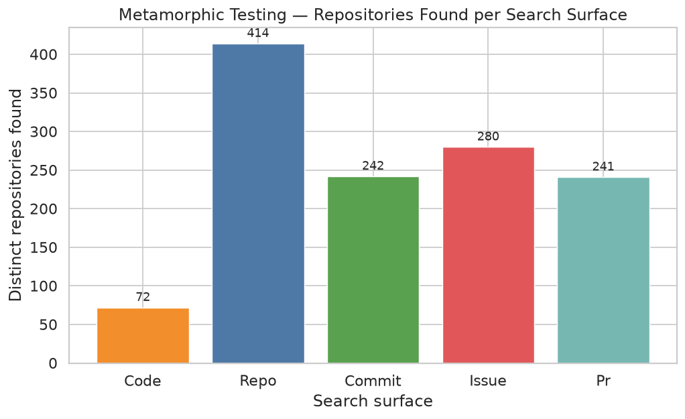
*MT — repositories found per search surface*

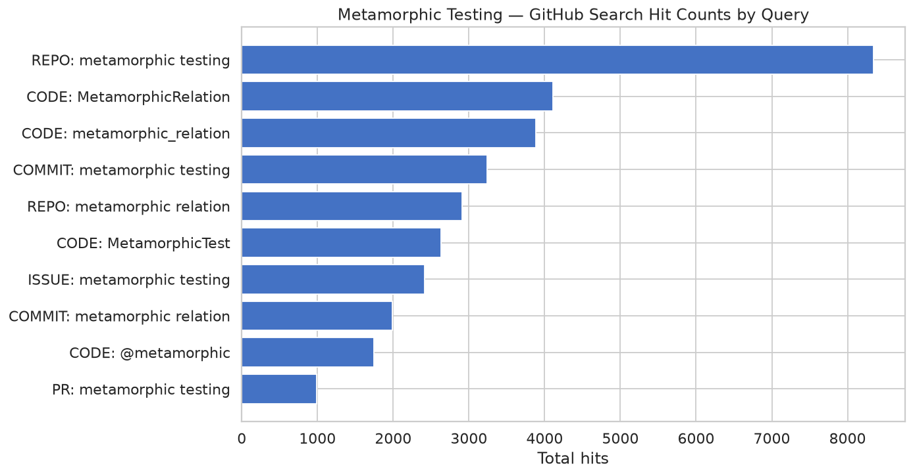
*MT — raw search hit counts per query*

---

## Adoption Overview

### Detection Count Distribution

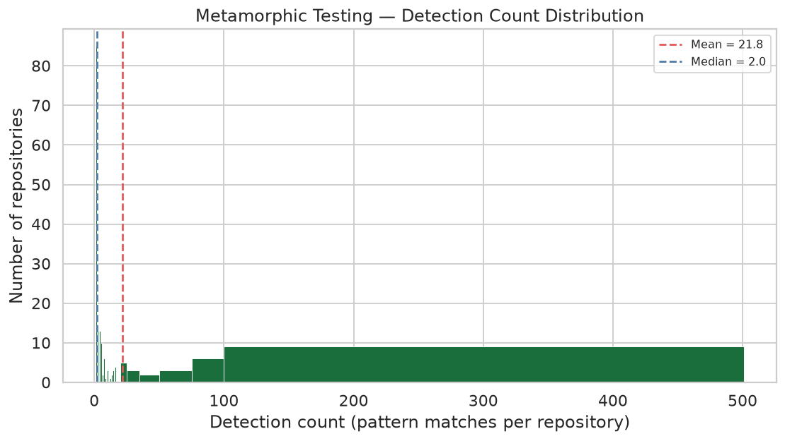
*MT — detection count distribution (detected repos)*

| Metric | Value |
|---|---|
| Total analysed | 1,103 |
| Total detected | 186 (16.9%) |
| Not detected | 917 (83.1%) |
| Median detection count | 2.0 |
| Mean detection count | 21.8 |
| Maximum detection count | 500 |
| Single-match detections | 85 (45.7%) |

### Code vs Non-Code Mentions

Signal matches classified by where they appear in the repository file tree.

| Category | Matches | % |
|---|---|---|
| Code (test code + source code) | 3,131 | 81.7% |
| Non-code (docs + config + other) | 700 | 18.3% |

### Technique Lines and Files (Detected Repos)

How much of each detected repo's content contains technique signals.

| Metric | Value |
|---|---|
| Median technique lines | 3.5 |
| Mean technique lines | 45.5 |
| Median technique line density | 0.0% |
| Median technique files | 1.0 |
| Mean technique files | 1.3 |
| Median technique file ratio | 0.9% |
| Repos with > 10% file coverage | 2 |

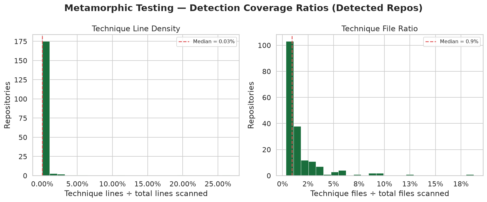
*MT — technique line density and file ratio distributions*

### Contributor Activity

Unique author email addresses from sampled git history (≤ 500 commits per repo).

| Metric | Value |
|---|---|
| Repos with contributor data | 186 |
| Median contributors | 2.0 |
| Mean contributors | 3.5 |
| Max contributors | 32 |
| Single-contributor repos | 85 (45.7%) |
| Repos with > 10 contributors | 12 (6.5%) |

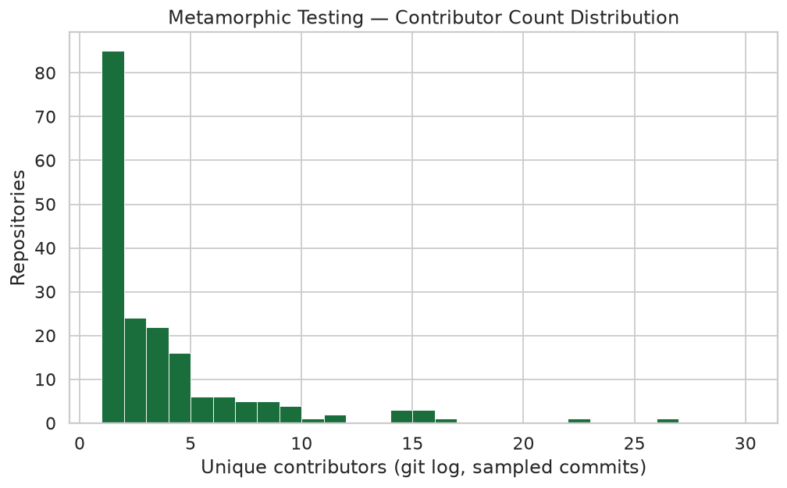
*MT — contributor count distribution*

---

## Usage Patterns

### Project Role Classification

Repos are classified by where technique signals appear in the directory tree. Not-detected repos are excluded from the use-case stats below.

| Classification | Repos | % of detected |
|---|---|---|
| Actual Usage | 78 | 41.9% |
| Framework / Library | 26 | 14.0% |
| Mixed | 28 | 15.1% |
| Research Artifact | 45 | 24.2% |
| Unknown | 9 | 4.8% |
| **Not Detected (excluded)** | 917 | — |

| Classification | Description |
|---|---|
| Actual Usage | Signals in test dirs (`tests/`, `spec/`, `*_test.*`). Technique is actively used in the project's testing. |
| Framework / Library | Signals in source dirs (`src/`, `lib/`, `core/`). The project implements or extends the technique. |
| Mixed | Signals in both source and test dirs. Technique used as both implementation target and test method. |
| Research Artifact | Signals alongside paper markers (`paper`, `evaluation`, `artifact`). Replication study or benchmarking repo. |
| Unknown | No clear dir-based classification. |

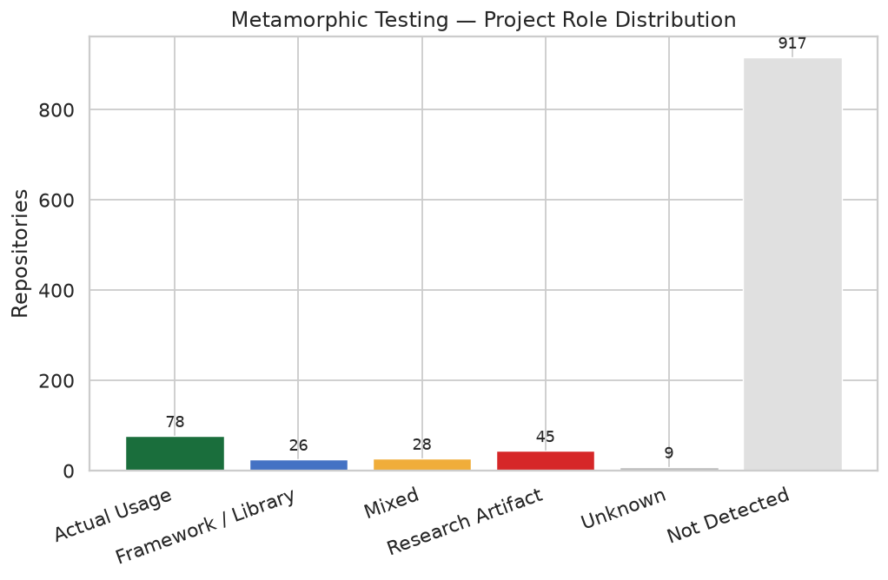
*MT — project role distribution (including not-detected)*

### Detection Distribution

How technique signals are distributed within repos: spread across files, density per file, and location in test infrastructure.

| Spread Metric | Value |
|---|---|
| Median signal-containing files per repo | 2.0 |
| Mean signal-containing files per repo | 2.6 |
| Single-file signal repos | 22 (22.2%) |
| Median avg matches per technique file | 1.0 |
| Mean avg matches per technique file | 18.7 |
| Median max matches in a single file | 2.0 |
| Mean signal concentration (max/total) | 154.0% |
| Median unique pattern types per repo | 1.0 |
| Mean unique pattern types per repo | 1.9 |

| Files with signals | Repos |
|---|---|
| 1 | 22 |
| 2 | 29 |
| 3–5 | 47 |
| 6–10 | 1 |
| 11–20 | 0 |
| >20 | 0 |

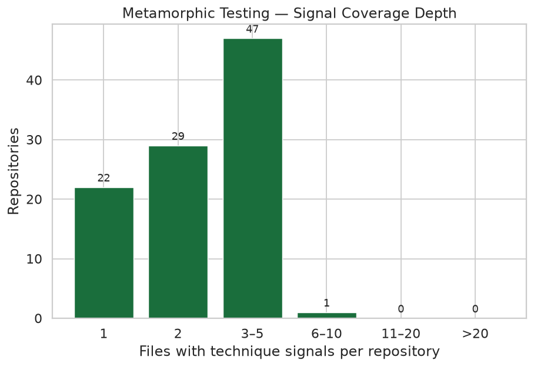
*MT — signal coverage depth (files per repo)*

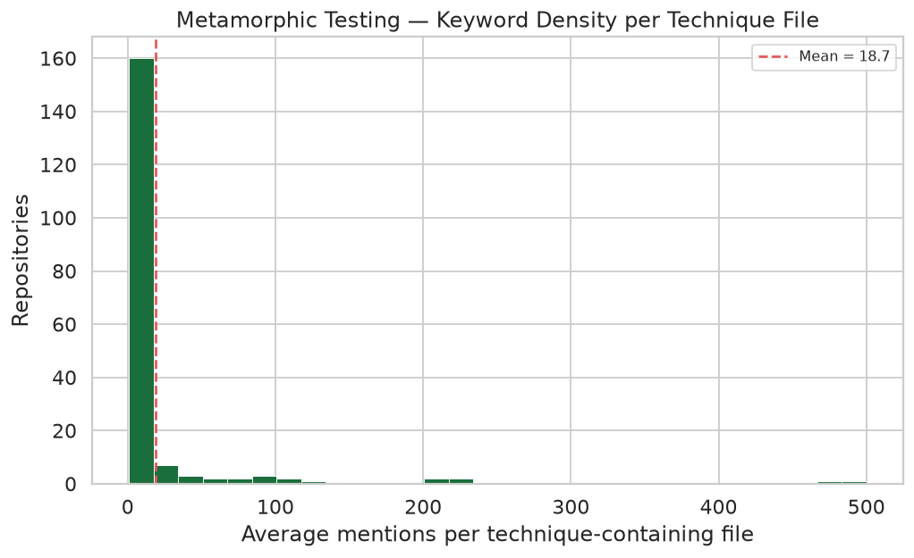
*MT — keyword density per technique file*

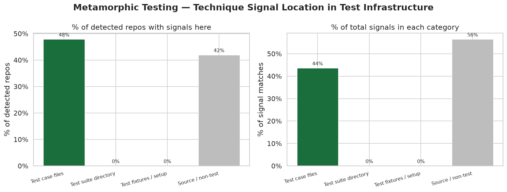
*MT — signal location in test infrastructure*

### Language Distribution

| Language | Detected repos | % |
|---|---|---|
| Python | 71 | 38.2% |
| Java | 36 | 19.4% |
| C++ | 20 | 10.8% |
| JavaScript | 15 | 8.1% |
| C | 12 | 6.5% |
| Go | 8 | 4.3% |
| Ruby | 7 | 3.8% |
| C# | 5 | 2.7% |
| Scala | 5 | 2.7% |
| Haskell | 4 | 2.2% |
| Other | 3 | 1.6% |

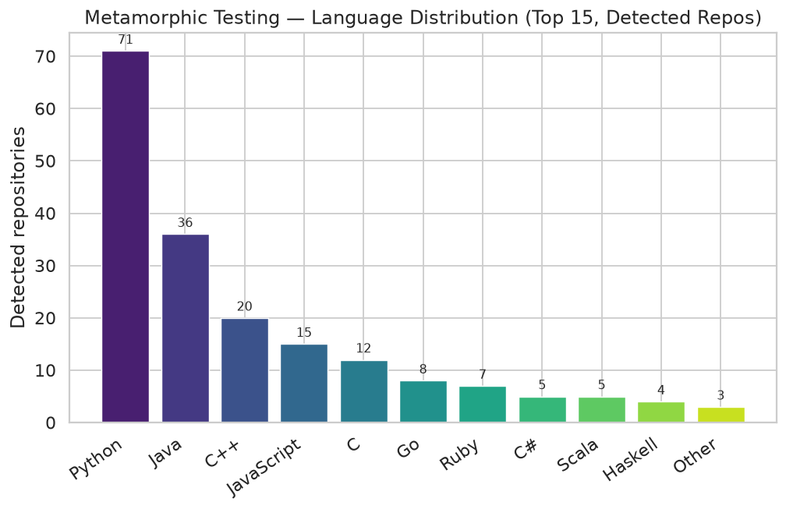
*MT — language distribution (top 15)*

### Artifact Type Distribution

Where in the file tree signals appear across all 3,825 total matches.

| Artifact Type | Matches | % |
|---|---|---|
| Test Code | 1,671 | 43.6% |
| Source Code | 1,460 | 38.1% |
| Documentation | 582 | 15.2% |
| Config | 118 | 3.1% |

| Artifact Type | Files included |
|---|---|
| Test Code | Files in test directories (`tests/`, `spec/`, `*test*`, `*_spec.*`) |
| Source Code | Non-test source files (`src/`, `lib/`, `*.py`, `*.java`, `*.cpp`, etc.) |
| Documentation | Markdown, RST, and plain-text docs (`*.md`, `*.rst`, `*.txt`, `docs/`) |
| Config | Config and build files (`*.yml`, `*.toml`, `*.ini`, `*.gradle`, `Makefile`) |

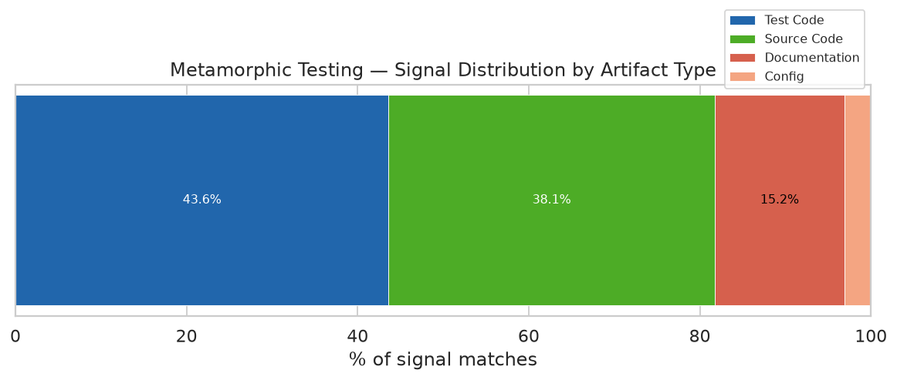
*MT — signal distribution by artifact type*

### File Extension Breakdown

Extension-level breakdown of files containing technique signals.

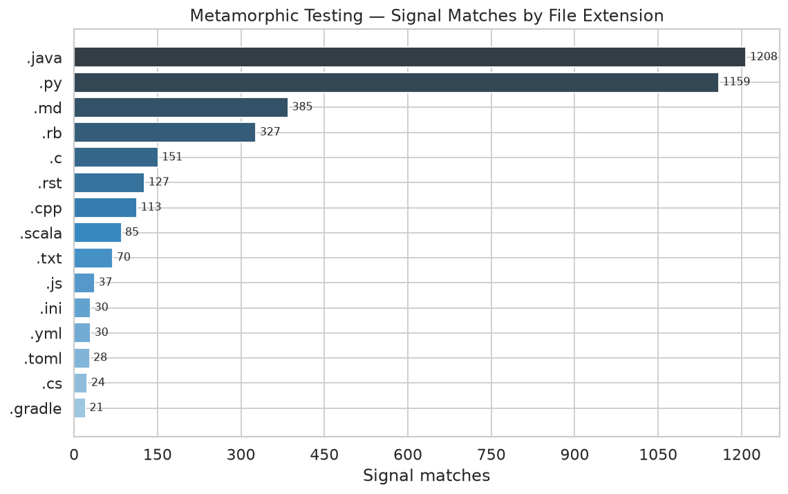
*MT — signal matches by file extension*

### Application Domain

Inferred from repo name, description, and GitHub topics (keyword matching). A repo can match multiple domains.

| Domain | Repos | % of detected |
|---|---|---|
| Machine Learning | 56 | 30.1% |
| Scientific | 33 | 17.7% |
| Compiler | 30 | 16.1% |
| Testing Infrastructure | 22 | 11.8% |
| Web | 20 | 10.8% |
| Database | 12 | 6.5% |
| Security | 11 | 5.9% |
| Bioinformatics | 6 | 3.2% |

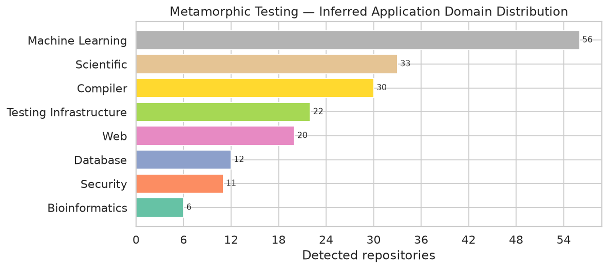
*MT — inferred domain distribution*

---

## Timeline

### Repository Creation Trend

| Year | Detected | Not detected | Total |
|---|---|---|---|
| 2010 | 0 | 59 | 59 |
| 2011 | 0 | 54 | 54 |
| 2012 | 12 | 59 | 71 |
| 2013 | 18 | 61 | 79 |
| 2014 | 12 | 68 | 80 |
| 2015 | 18 | 67 | 85 |
| 2016 | 14 | 56 | 70 |
| 2017 | 11 | 47 | 58 |
| 2018 | 16 | 57 | 73 |
| 2019 | 9 | 53 | 62 |
| 2020 | 12 | 54 | 66 |
| 2021 | 14 | 59 | 73 |
| 2022 | 11 | 69 | 80 |
| 2023 | 15 | 52 | 67 |
| 2024 | 13 | 57 | 70 |
| 2025 | 11 | 45 | 56 |

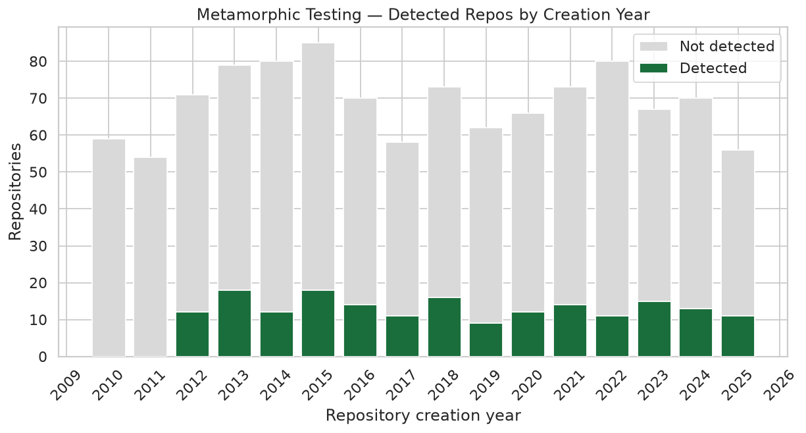
*MT — detected repos by creation year*

### Commit Activity

Computed from up to 500 most-recent commits per repo (git log, no merges).

| Metric | Value |
|---|---|
| Repos with commit data | 186 |
| Median commits sampled | 293.0 |
| Median first technique commit year | 2018.0 |
| Median last technique commit year  | 2019.0 |
| Median technique commit span       | 0.4 yrs |
| Mean technique commit span | 0.9 yrs |
| Median technique commit ratio | 8.4% |
| Mean technique commit ratio | 10.6% |
| Repos with > 10% technique commits | 76 (40.9%) |

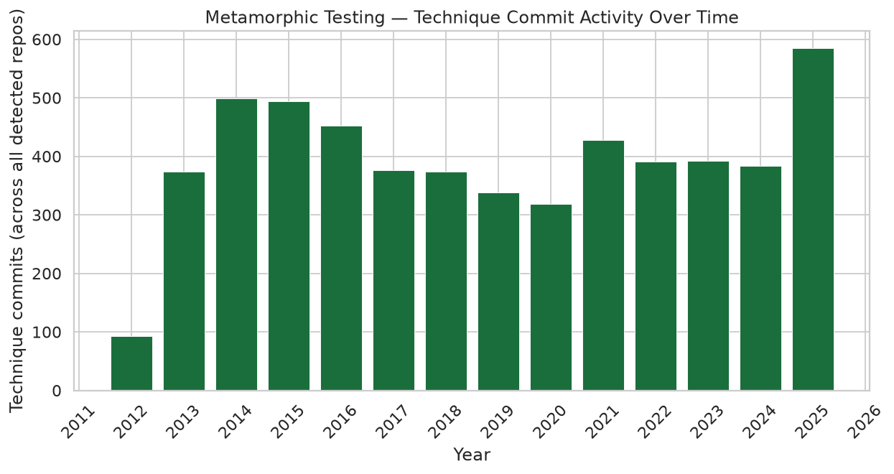
*MT — technique commit activity over time (commits per year)*

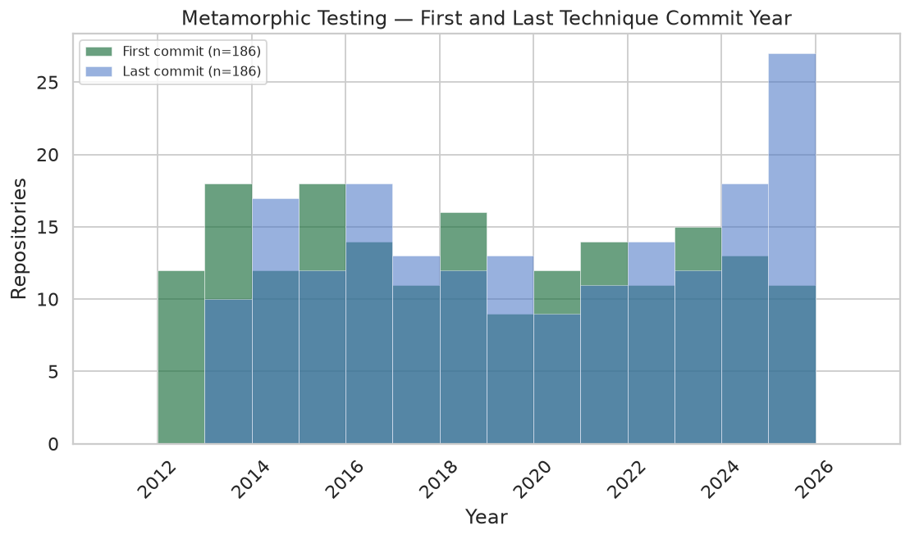
*MT — first and last technique commit year (overlaid)*

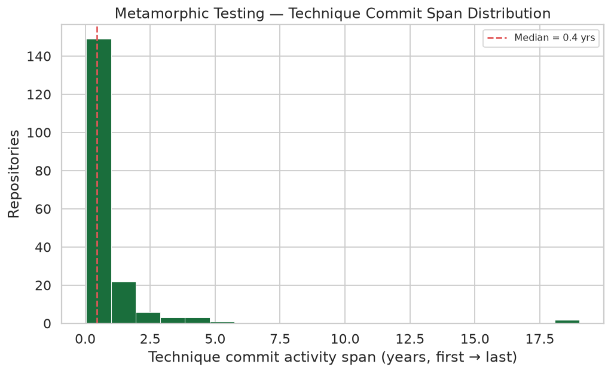
*MT — first-to-last commit duration distribution (years)*

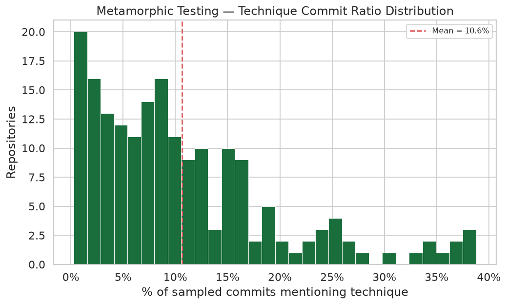
*MT — technique commit ratio distribution*

---

## Top Detected Repositories

Top 30 by detection count (then stars).

| Repository | Detections | Signal files | Project type | Language | Stars | Year |
|---|---|---|---|---|---|---|
| [metamorphic-testing/repo-mt-0113](https://github.com/metamorphic-testing/repo-mt-0113) | 500 | 1 | research artifact | Java | 12 | 2020 |
| [soarsmu/repo-mt-0179](https://github.com/soarsmu/repo-mt-0179) | 500 | 4 | framework | Java | 2 | 2015 |
| [compiler-testing/repo-mt-0125](https://github.com/compiler-testing/repo-mt-0125) | 481 | 1 | general usage | Python | 1,391 | 2022 |
| [metamorphic-testing/repo-mt-0167](https://github.com/metamorphic-testing/repo-mt-0167) | 231 | 1 | general usage | Ruby | 41 | 2021 |
| [db-testing/repo-mt-0106](https://github.com/db-testing/repo-mt-0106) | 225 | 1 | framework | Java | 19 | 2015 |
| [metamorphic-testing/repo-mt-0156](https://github.com/metamorphic-testing/repo-mt-0156) | 214 | 1 | general usage | Python | 54 | 2013 |
| [db-testing/repo-mt-0031](https://github.com/db-testing/repo-mt-0031) | 207 | 1 | research artifact | Java | 4 | 2025 |
| [nlp-lab-unipi/repo-mt-0006](https://github.com/nlp-lab-unipi/repo-mt-0006) | 104 | 1 | general usage | Python | 53 | 2013 |
| [icst-research/repo-mt-0073](https://github.com/icst-research/repo-mt-0073) | 101 | 1 | framework | Python | 0 | 2014 |
| [aerospace-mt/repo-mt-0135](https://github.com/aerospace-mt/repo-mt-0135) | 97 | 1 | research artifact | Python | 3 | 2024 |
| [soarsmu/repo-mt-0071](https://github.com/soarsmu/repo-mt-0071) | 94 | 1 | research artifact | C++ | 80 | 2025 |
| [ml-oracle/repo-mt-0003](https://github.com/ml-oracle/repo-mt-0003) | 91 | 1 | general usage | Ruby | 5 | 2014 |
| [icst-research/repo-mt-0082](https://github.com/icst-research/repo-mt-0082) | 81 | 2 | mixed | Java | 4 | 2025 |
| [gemtest/repo-mt-0020](https://github.com/gemtest/repo-mt-0020) | 79 | 1 | framework | Scala | 339 | 2021 |
| [jodavimeta/repo-mt-0177](https://github.com/jodavimeta/repo-mt-0177) | 76 | 1 | general usage | C | 5 | 2018 |
| [nlp-lab-unipi/repo-mt-0122](https://github.com/nlp-lab-unipi/repo-mt-0122) | 67 | 1 | research artifact | Ruby | 2 | 2014 |
| [se-research/repo-mt-0065](https://github.com/se-research/repo-mt-0065) | 60 | 1 | general usage | Python | 6 | 2015 |
| [ml-oracle/repo-mt-0141](https://github.com/ml-oracle/repo-mt-0141) | 53 | 2 | framework | C | 4 | 2025 |
| [aerospace-mt/repo-mt-0162](https://github.com/aerospace-mt/repo-mt-0162) | 36 | 1 | general usage | Python | 19 | 2019 |
| [aerospace-mt/repo-mt-0118](https://github.com/aerospace-mt/repo-mt-0118) | 35 | 1 | research artifact | Java | 4 | 2012 |
| [bioinf-lab/repo-mt-0047](https://github.com/bioinf-lab/repo-mt-0047) | 28 | 1 | research artifact | Python | 285 | 2013 |
| [bioinf-lab/repo-mt-0054](https://github.com/bioinf-lab/repo-mt-0054) | 27 | 1 | research artifact | C++ | 1 | 2022 |
| [test-oracle-group/repo-mt-0067](https://github.com/test-oracle-group/repo-mt-0067) | 25 | 1 | general usage | Python | 1 | 2015 |
| [aerospace-mt/repo-mt-0059](https://github.com/aerospace-mt/repo-mt-0059) | 23 | 1 | mixed | C++ | 27 | 2014 |
| [gemtest/repo-mt-0091](https://github.com/gemtest/repo-mt-0091) | 23 | 1 | general usage | Python | 0 | 2024 |
| [bioinf-lab/repo-mt-0164](https://github.com/bioinf-lab/repo-mt-0164) | 22 | 2 | mixed | C# | 1 | 2015 |
| [icst-research/repo-mt-0055](https://github.com/icst-research/repo-mt-0055) | 21 | 1 | mixed | Python | 43 | 2016 |
| [se-research/repo-mt-0086](https://github.com/se-research/repo-mt-0086) | 20 | 3 | general usage | Python | 14 | 2016 |
| [metamorphic-testing/repo-mt-0075](https://github.com/metamorphic-testing/repo-mt-0075) | 16 | 1 | general usage | Python | 36 | 2021 |
| [icst-research/repo-mt-0166](https://github.com/icst-research/repo-mt-0166) | 16 | 1 | research artifact | Python | 11 | 2015 |

---

## Pattern Activity

3,825 total pattern matches across 186 detected repositories.

| Pattern | Repos | Total matches |
|---|---|---|
| Class name: MetamorphicRelation | 38 | 73 |
| Comment: metamorphic relation | 36 | 567 |
| Decorator: @metamorphic | 36 | 729 |
| Abbreviation: MR | 35 | 339 |
| String: metamorphic test/testing | 34 | 884 |
| Comment: metamorphic test/testing | 32 | 493 |
| Class name: MetamorphicTest | 32 | 316 |
| Identifier: metamorphic_test | 29 | 14 |
| String: metamorphic relation | 29 | 76 |
| Abbreviation: MT | 28 | 111 |
| Identifier: metamorphic_relation | 25 | 223 |

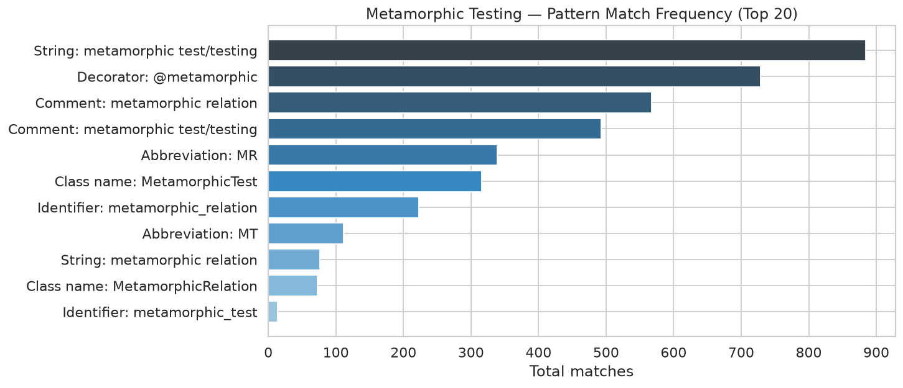
*MT — pattern match frequency*

---

## Appendix A — Not-Detected Repositories (917)

No MT pattern matches found in cloned default branch. Listed for manual review (sorted by stars).

| Repository | Language | Stars | Year | Found via |
|---|---|---|---|---|
| [ml-oracle/repo-nodet-0439](https://github.com/ml-oracle/repo-nodet-0439) | Java | 185 | 2012 | issue |
| [test-oracle-group/repo-nodet-0511](https://github.com/test-oracle-group/repo-nodet-0511) | JavaScript | 161 | 2022 | pr |
| [nlp-lab-unipi/repo-nodet-0696](https://github.com/nlp-lab-unipi/repo-nodet-0696) | Other | 158 | 2015 | repo |
| [gemtest/repo-nodet-0677](https://github.com/gemtest/repo-nodet-0677) | C++ | 139 | 2016 | issue |
| [gemtest/repo-nodet-0355](https://github.com/gemtest/repo-nodet-0355) | Other | 125 | 2022 | issue |
| [nlp-lab-unipi/repo-nodet-0840](https://github.com/nlp-lab-unipi/repo-nodet-0840) | Python | 120 | 2025 | commit |
| [bioinf-lab/repo-nodet-0748](https://github.com/bioinf-lab/repo-nodet-0748) | Python | 119 | 2014 | pr |
| [db-testing/repo-nodet-0288](https://github.com/db-testing/repo-nodet-0288) | C++ | 110 | 2023 | commit |
| [icst-research/repo-nodet-0656](https://github.com/icst-research/repo-nodet-0656) | Python | 104 | 2011 | pr |
| [bioinf-lab/repo-nodet-0872](https://github.com/bioinf-lab/repo-nodet-0872) | Python | 101 | 2022 | commit |
| [aerospace-mt/repo-nodet-0892](https://github.com/aerospace-mt/repo-nodet-0892) | Scala | 98 | 2016 | issue |
| [compiler-testing/repo-nodet-0210](https://github.com/compiler-testing/repo-nodet-0210) | JavaScript | 97 | 2015 | commit |
| [icst-research/repo-nodet-0528](https://github.com/icst-research/repo-nodet-0528) | Python | 97 | 2021 | issue |
| [ml-oracle/repo-nodet-0869](https://github.com/ml-oracle/repo-nodet-0869) | Python | 94 | 2014 | commit |
| [user-1585/repo-nodet-0318](https://github.com/user-1585/repo-nodet-0318) | C++ | 93 | 2013 | pr |
| [gemtest/repo-nodet-0263](https://github.com/gemtest/repo-nodet-0263) | Python | 91 | 2022 | issue |
| [db-testing/repo-nodet-0312](https://github.com/db-testing/repo-nodet-0312) | C++ | 88 | 2022 | issue |
| [user-4224/repo-nodet-0310](https://github.com/user-4224/repo-nodet-0310) | Java | 85 | 2012 | pr |
| [ml-oracle/repo-nodet-0242](https://github.com/ml-oracle/repo-nodet-0242) | JavaScript | 81 | 2015 | commit |
| [nlp-lab-unipi/repo-nodet-0147](https://github.com/nlp-lab-unipi/repo-nodet-0147) | Python | 80 | 2011 | repo |
| [db-testing/repo-nodet-0185](https://github.com/db-testing/repo-nodet-0185) | Ruby | 80 | 2025 | pr |
| [soarsmu/repo-nodet-0316](https://github.com/soarsmu/repo-nodet-0316) | Python | 80 | 2022 | issue |
| [ml-oracle/repo-nodet-0044](https://github.com/ml-oracle/repo-nodet-0044) | Java | 78 | 2013 | repo |
| [gemtest/repo-nodet-0575](https://github.com/gemtest/repo-nodet-0575) | Java | 75 | 2012 | repo |
| [soarsmu/repo-nodet-0084](https://github.com/soarsmu/repo-nodet-0084) | Java | 72 | 2010 | pr |
| [db-testing/repo-nodet-0819](https://github.com/db-testing/repo-nodet-0819) | Python | 72 | 2019 | repo |
| [jodavimeta/repo-nodet-0095](https://github.com/jodavimeta/repo-nodet-0095) | C++ | 71 | 2016 | commit |
| [icst-research/repo-nodet-0734](https://github.com/icst-research/repo-nodet-0734) | Java | 71 | 2014 | issue |
| [nlp-lab-unipi/repo-nodet-0041](https://github.com/nlp-lab-unipi/repo-nodet-0041) | Go | 70 | 2013 | issue |
| [jodavimeta/repo-nodet-0660](https://github.com/jodavimeta/repo-nodet-0660) | Python | 67 | 2016 | pr |
| [gemtest/repo-nodet-0100](https://github.com/gemtest/repo-nodet-0100) | Python | 66 | 2016 | commit |
| [test-oracle-group/repo-nodet-0587](https://github.com/test-oracle-group/repo-nodet-0587) | Python | 66 | 2020 | pr |
| [compiler-testing/repo-nodet-0676](https://github.com/compiler-testing/repo-nodet-0676) | Java | 66 | 2017 | issue |
| [aerospace-mt/repo-nodet-0795](https://github.com/aerospace-mt/repo-nodet-0795) | Python | 62 | 2015 | repo |
| [aerospace-mt/repo-nodet-0878](https://github.com/aerospace-mt/repo-nodet-0878) | C++ | 62 | 2010 | pr |
| [soarsmu/repo-nodet-0094](https://github.com/soarsmu/repo-nodet-0094) | Haskell | 61 | 2022 | repo |
| [db-testing/repo-nodet-0859](https://github.com/db-testing/repo-nodet-0859) | C++ | 61 | 2013 | pr |
| [user-1783/repo-nodet-0225](https://github.com/user-1783/repo-nodet-0225) | Python | 59 | 2019 | commit |
| [test-oracle-group/repo-nodet-0813](https://github.com/test-oracle-group/repo-nodet-0813) | Other | 59 | 2011 | repo |
| [jodavimeta/repo-nodet-0003](https://github.com/jodavimeta/repo-nodet-0003) | Python | 58 | 2013 | issue |
| [compiler-testing/repo-nodet-0376](https://github.com/compiler-testing/repo-nodet-0376) | JavaScript | 58 | 2011 | issue |
| [se-research/repo-nodet-0581](https://github.com/se-research/repo-nodet-0581) | Python | 58 | 2024 | commit |
| [se-research/repo-nodet-0058](https://github.com/se-research/repo-nodet-0058) | C++ | 55 | 2016 | repo |
| [compiler-testing/repo-nodet-0080](https://github.com/compiler-testing/repo-nodet-0080) | Python | 55 | 2023 | pr |
| [compiler-testing/repo-nodet-0308](https://github.com/compiler-testing/repo-nodet-0308) | Ruby | 55 | 2018 | commit |
| [ml-oracle/repo-nodet-0670](https://github.com/ml-oracle/repo-nodet-0670) | Python | 55 | 2013 | repo |
| [aerospace-mt/repo-nodet-0694](https://github.com/aerospace-mt/repo-nodet-0694) | Python | 55 | 2016 | pr |
| [jodavimeta/repo-nodet-0453](https://github.com/jodavimeta/repo-nodet-0453) | Python | 53 | 2016 | commit |
| [gemtest/repo-nodet-0142](https://github.com/gemtest/repo-nodet-0142) | C++ | 50 | 2020 | commit |
| [nlp-lab-unipi/repo-nodet-0262](https://github.com/nlp-lab-unipi/repo-nodet-0262) | Python | 50 | 2019 | issue |
| [test-oracle-group/repo-nodet-0278](https://github.com/test-oracle-group/repo-nodet-0278) | Scala | 50 | 2017 | pr |
| [compiler-testing/repo-nodet-0664](https://github.com/compiler-testing/repo-nodet-0664) | Python | 50 | 2021 | repo |
| [metamorphic-testing/repo-nodet-0309](https://github.com/metamorphic-testing/repo-nodet-0309) | Python | 49 | 2021 | issue |
| [se-research/repo-nodet-0481](https://github.com/se-research/repo-nodet-0481) | Python | 49 | 2012 | repo |
| [metamorphic-testing/repo-nodet-0505](https://github.com/metamorphic-testing/repo-nodet-0505) | Python | 49 | 2012 | repo |
| [icst-research/repo-nodet-0330](https://github.com/icst-research/repo-nodet-0330) | C++ | 48 | 2014 | issue |
| [icst-research/repo-nodet-0558](https://github.com/icst-research/repo-nodet-0558) | C++ | 48 | 2020 | issue |
| [bioinf-lab/repo-nodet-0655](https://github.com/bioinf-lab/repo-nodet-0655) | Python | 48 | 2013 | commit |
| [se-research/repo-nodet-0385](https://github.com/se-research/repo-nodet-0385) | Java | 47 | 2020 | commit |
| [aerospace-mt/repo-nodet-0296](https://github.com/aerospace-mt/repo-nodet-0296) | Python | 46 | 2015 | commit |
| [jodavimeta/repo-nodet-0502](https://github.com/jodavimeta/repo-nodet-0502) | JavaScript | 46 | 2022 | commit |
| [test-oracle-group/repo-nodet-0588](https://github.com/test-oracle-group/repo-nodet-0588) | Java | 46 | 2015 | issue |
| [bioinf-lab/repo-nodet-0096](https://github.com/bioinf-lab/repo-nodet-0096) | C++ | 45 | 2015 | pr |
| [jodavimeta/repo-nodet-0487](https://github.com/jodavimeta/repo-nodet-0487) | C | 45 | 2014 | commit |
| [metamorphic-testing/repo-nodet-0865](https://github.com/metamorphic-testing/repo-nodet-0865) | Java | 44 | 2017 | issue |
| [gemtest/repo-nodet-0283](https://github.com/gemtest/repo-nodet-0283) | Python | 43 | 2025 | issue |
| [metamorphic-testing/repo-nodet-0294](https://github.com/metamorphic-testing/repo-nodet-0294) | Scala | 43 | 2020 | repo |
| [aerospace-mt/repo-nodet-0522](https://github.com/aerospace-mt/repo-nodet-0522) | Python | 43 | 2024 | pr |
| [gemtest/repo-nodet-0491](https://github.com/gemtest/repo-nodet-0491) | C# | 42 | 2021 | issue |
| [se-research/repo-nodet-0306](https://github.com/se-research/repo-nodet-0306) | Other | 41 | 2021 | issue |
| [aerospace-mt/repo-nodet-0320](https://github.com/aerospace-mt/repo-nodet-0320) | C++ | 41 | 2018 | pr |
| [metamorphic-testing/repo-nodet-0452](https://github.com/metamorphic-testing/repo-nodet-0452) | JavaScript | 41 | 2017 | pr |
| [ml-oracle/repo-nodet-0569](https://github.com/ml-oracle/repo-nodet-0569) | Java | 41 | 2013 | commit |
| [soarsmu/repo-nodet-0907](https://github.com/soarsmu/repo-nodet-0907) | Other | 41 | 2014 | repo |
| [gemtest/repo-nodet-0896](https://github.com/gemtest/repo-nodet-0896) | Python | 40 | 2017 | pr |
| [db-testing/repo-nodet-0291](https://github.com/db-testing/repo-nodet-0291) | C++ | 39 | 2020 | pr |
| [se-research/repo-nodet-0797](https://github.com/se-research/repo-nodet-0797) | JavaScript | 39 | 2013 | commit |
| [soarsmu/repo-nodet-0879](https://github.com/soarsmu/repo-nodet-0879) | Go | 39 | 2025 | commit |
| [test-oracle-group/repo-nodet-0438](https://github.com/test-oracle-group/repo-nodet-0438) | Python | 37 | 2017 | issue |
| [icst-research/repo-nodet-0703](https://github.com/icst-research/repo-nodet-0703) | Java | 37 | 2022 | repo |
| [metamorphic-testing/repo-nodet-0780](https://github.com/metamorphic-testing/repo-nodet-0780) | Python | 37 | 2025 | pr |
| [test-oracle-group/repo-nodet-0049](https://github.com/test-oracle-group/repo-nodet-0049) | Python | 36 | 2021 | repo |
| [nlp-lab-unipi/repo-nodet-0799](https://github.com/nlp-lab-unipi/repo-nodet-0799) | Java | 36 | 2015 | pr |
| [compiler-testing/repo-nodet-0887](https://github.com/compiler-testing/repo-nodet-0887) | Scala | 36 | 2015 | repo |
| [user-6091/repo-nodet-0083](https://github.com/user-6091/repo-nodet-0083) | Python | 35 | 2018 | pr |
| [nlp-lab-unipi/repo-nodet-0252](https://github.com/nlp-lab-unipi/repo-nodet-0252) | JavaScript | 35 | 2020 | issue |
| [ml-oracle/repo-nodet-0389](https://github.com/ml-oracle/repo-nodet-0389) | C++ | 35 | 2021 | issue |
| [se-research/repo-nodet-0400](https://github.com/se-research/repo-nodet-0400) | Java | 35 | 2021 | commit |
| [metamorphic-testing/repo-nodet-0792](https://github.com/metamorphic-testing/repo-nodet-0792) | Java | 35 | 2017 | repo |
| [icst-research/repo-nodet-0207](https://github.com/icst-research/repo-nodet-0207) | Ruby | 34 | 2018 | commit |
| [db-testing/repo-nodet-0219](https://github.com/db-testing/repo-nodet-0219) | Python | 34 | 2013 | repo |
| [se-research/repo-nodet-0008](https://github.com/se-research/repo-nodet-0008) | C | 33 | 2014 | repo |
| [bioinf-lab/repo-nodet-0121](https://github.com/bioinf-lab/repo-nodet-0121) | Java | 33 | 2024 | pr |
| [aerospace-mt/repo-nodet-0718](https://github.com/aerospace-mt/repo-nodet-0718) | Python | 33 | 2012 | repo |
| [gemtest/repo-nodet-0737](https://github.com/gemtest/repo-nodet-0737) | Other | 33 | 2010 | commit |
| [user-9751/repo-nodet-0493](https://github.com/user-9751/repo-nodet-0493) | Python | 32 | 2018 | pr |
| [test-oracle-group/repo-nodet-0761](https://github.com/test-oracle-group/repo-nodet-0761) | Python | 32 | 2010 | commit |
| [aerospace-mt/repo-nodet-0354](https://github.com/aerospace-mt/repo-nodet-0354) | JavaScript | 31 | 2022 | issue |
| [jodavimeta/repo-nodet-0574](https://github.com/jodavimeta/repo-nodet-0574) | JavaScript | 31 | 2016 | repo |
| [se-research/repo-nodet-0119](https://github.com/se-research/repo-nodet-0119) | Java | 30 | 2019 | repo |
| [ml-oracle/repo-nodet-0529](https://github.com/ml-oracle/repo-nodet-0529) | C++ | 30 | 2016 | commit |
| [icst-research/repo-nodet-0564](https://github.com/icst-research/repo-nodet-0564) | Python | 30 | 2017 | repo |
| [test-oracle-group/repo-nodet-0683](https://github.com/test-oracle-group/repo-nodet-0683) | Python | 30 | 2013 | issue |
| [compiler-testing/repo-nodet-0208](https://github.com/compiler-testing/repo-nodet-0208) | Python | 29 | 2022 | repo |
| [se-research/repo-nodet-0220](https://github.com/se-research/repo-nodet-0220) | Python | 29 | 2017 | repo |
| [ml-oracle/repo-nodet-0838](https://github.com/ml-oracle/repo-nodet-0838) | Haskell | 29 | 2010 | pr |
| [icst-research/repo-nodet-0131](https://github.com/icst-research/repo-nodet-0131) | Go | 28 | 2021 | issue |
| [test-oracle-group/repo-nodet-0159](https://github.com/test-oracle-group/repo-nodet-0159) | C | 28 | 2025 | pr |
| [gemtest/repo-nodet-0796](https://github.com/gemtest/repo-nodet-0796) | Python | 28 | 2015 | commit |
| [jodavimeta/repo-nodet-0162](https://github.com/jodavimeta/repo-nodet-0162) | Java | 27 | 2012 | repo |
| [test-oracle-group/repo-nodet-0779](https://github.com/test-oracle-group/repo-nodet-0779) | C++ | 27 | 2012 | issue |
| [metamorphic-testing/repo-nodet-0335](https://github.com/metamorphic-testing/repo-nodet-0335) | Python | 26 | 2017 | repo |
| [soarsmu/repo-nodet-0404](https://github.com/soarsmu/repo-nodet-0404) | Python | 26 | 2017 | issue |
| [user-8168/repo-nodet-0561](https://github.com/user-8168/repo-nodet-0561) | Python | 26 | 2023 | commit |
| [bioinf-lab/repo-nodet-0235](https://github.com/bioinf-lab/repo-nodet-0235) | Python | 25 | 2018 | repo |
| [soarsmu/repo-nodet-0267](https://github.com/soarsmu/repo-nodet-0267) | C# | 25 | 2012 | repo |
| [soarsmu/repo-nodet-0469](https://github.com/soarsmu/repo-nodet-0469) | Python | 25 | 2013 | issue |
| [ml-oracle/repo-nodet-0601](https://github.com/ml-oracle/repo-nodet-0601) | C++ | 25 | 2025 | repo |
| [test-oracle-group/repo-nodet-0629](https://github.com/test-oracle-group/repo-nodet-0629) | Java | 25 | 2023 | commit |
| [test-oracle-group/repo-nodet-0769](https://github.com/test-oracle-group/repo-nodet-0769) | Ruby | 25 | 2013 | issue |
| [jodavimeta/repo-nodet-0826](https://github.com/jodavimeta/repo-nodet-0826) | Java | 25 | 2010 | commit |
| [aerospace-mt/repo-nodet-0905](https://github.com/aerospace-mt/repo-nodet-0905) | Python | 25 | 2011 | commit |
| [bioinf-lab/repo-nodet-0047](https://github.com/bioinf-lab/repo-nodet-0047) | Other | 24 | 2022 | commit |
| [user-3780/repo-nodet-0314](https://github.com/user-3780/repo-nodet-0314) | C++ | 24 | 2012 | repo |
| [ml-oracle/repo-nodet-0337](https://github.com/ml-oracle/repo-nodet-0337) | Java | 24 | 2020 | repo |
| [nlp-lab-unipi/repo-nodet-0790](https://github.com/nlp-lab-unipi/repo-nodet-0790) | JavaScript | 24 | 2014 | issue |
| [db-testing/repo-nodet-0876](https://github.com/db-testing/repo-nodet-0876) | Python | 24 | 2010 | pr |
| [db-testing/repo-nodet-0062](https://github.com/db-testing/repo-nodet-0062) | C++ | 23 | 2014 | commit |
| [db-testing/repo-nodet-0311](https://github.com/db-testing/repo-nodet-0311) | Java | 23 | 2025 | pr |
| [bioinf-lab/repo-nodet-0364](https://github.com/bioinf-lab/repo-nodet-0364) | C++ | 23 | 2018 | issue |
| [se-research/repo-nodet-0426](https://github.com/se-research/repo-nodet-0426) | Java | 23 | 2022 | pr |
| [se-research/repo-nodet-0663](https://github.com/se-research/repo-nodet-0663) | Python | 23 | 2017 | issue |
| [ml-oracle/repo-nodet-0827](https://github.com/ml-oracle/repo-nodet-0827) | C | 23 | 2010 | pr |
| [gemtest/repo-nodet-0276](https://github.com/gemtest/repo-nodet-0276) | C++ | 22 | 2024 | issue |
| [test-oracle-group/repo-nodet-0632](https://github.com/test-oracle-group/repo-nodet-0632) | Other | 22 | 2021 | commit |
| [compiler-testing/repo-nodet-0679](https://github.com/compiler-testing/repo-nodet-0679) | Go | 22 | 2015 | repo |
| [gemtest/repo-nodet-0825](https://github.com/gemtest/repo-nodet-0825) | C | 22 | 2015 | repo |
| [compiler-testing/repo-nodet-0863](https://github.com/compiler-testing/repo-nodet-0863) | C++ | 22 | 2012 | issue |
| [user-5937/repo-nodet-0902](https://github.com/user-5937/repo-nodet-0902) | Python | 22 | 2010 | pr |
| [bioinf-lab/repo-nodet-0057](https://github.com/bioinf-lab/repo-nodet-0057) | Python | 21 | 2014 | issue |
| [test-oracle-group/repo-nodet-0135](https://github.com/test-oracle-group/repo-nodet-0135) | Python | 21 | 2015 | commit |
| [test-oracle-group/repo-nodet-0324](https://github.com/test-oracle-group/repo-nodet-0324) | Java | 21 | 2014 | commit |
| [nlp-lab-unipi/repo-nodet-0353](https://github.com/nlp-lab-unipi/repo-nodet-0353) | C | 21 | 2025 | issue |
| [ml-oracle/repo-nodet-0359](https://github.com/ml-oracle/repo-nodet-0359) | Python | 21 | 2014 | issue |
| [soarsmu/repo-nodet-0370](https://github.com/soarsmu/repo-nodet-0370) | C++ | 21 | 2024 | commit |
| [icst-research/repo-nodet-0471](https://github.com/icst-research/repo-nodet-0471) | Python | 21 | 2016 | issue |
| [icst-research/repo-nodet-0705](https://github.com/icst-research/repo-nodet-0705) | Python | 21 | 2020 | repo |
| [jodavimeta/repo-nodet-0039](https://github.com/jodavimeta/repo-nodet-0039) | Python | 20 | 2018 | pr |
| [gemtest/repo-nodet-0209](https://github.com/gemtest/repo-nodet-0209) | Python | 20 | 2014 | pr |
| [nlp-lab-unipi/repo-nodet-0266](https://github.com/nlp-lab-unipi/repo-nodet-0266) | C | 20 | 2014 | repo |
| [icst-research/repo-nodet-0327](https://github.com/icst-research/repo-nodet-0327) | C# | 20 | 2018 | pr |
| [bioinf-lab/repo-nodet-0363](https://github.com/bioinf-lab/repo-nodet-0363) | C++ | 20 | 2018 | issue |
| [aerospace-mt/repo-nodet-0521](https://github.com/aerospace-mt/repo-nodet-0521) | Python | 20 | 2019 | pr |
| [db-testing/repo-nodet-0831](https://github.com/db-testing/repo-nodet-0831) | Go | 20 | 2023 | pr |
| [metamorphic-testing/repo-nodet-0186](https://github.com/metamorphic-testing/repo-nodet-0186) | Python | 19 | 2016 | commit |
| [metamorphic-testing/repo-nodet-0246](https://github.com/metamorphic-testing/repo-nodet-0246) | Java | 19 | 2018 | issue |
| [ml-oracle/repo-nodet-0305](https://github.com/ml-oracle/repo-nodet-0305) | Python | 19 | 2021 | repo |
| [soarsmu/repo-nodet-0366](https://github.com/soarsmu/repo-nodet-0366) | Python | 19 | 2021 | repo |
| [compiler-testing/repo-nodet-0384](https://github.com/compiler-testing/repo-nodet-0384) | Java | 19 | 2022 | repo |
| [user-4405/repo-nodet-0554](https://github.com/user-4405/repo-nodet-0554) | Python | 19 | 2020 | commit |
| [icst-research/repo-nodet-0019](https://github.com/icst-research/repo-nodet-0019) | Python | 18 | 2022 | pr |
| [icst-research/repo-nodet-0072](https://github.com/icst-research/repo-nodet-0072) | Java | 18 | 2016 | issue |
| [nlp-lab-unipi/repo-nodet-0140](https://github.com/nlp-lab-unipi/repo-nodet-0140) | Ruby | 18 | 2025 | commit |
| [aerospace-mt/repo-nodet-0202](https://github.com/aerospace-mt/repo-nodet-0202) | JavaScript | 18 | 2010 | issue |
| [ml-oracle/repo-nodet-0240](https://github.com/ml-oracle/repo-nodet-0240) | Python | 18 | 2022 | commit |
| [aerospace-mt/repo-nodet-0732](https://github.com/aerospace-mt/repo-nodet-0732) | C | 18 | 2025 | issue |
| [test-oracle-group/repo-nodet-0771](https://github.com/test-oracle-group/repo-nodet-0771) | Scala | 18 | 2014 | commit |
| [compiler-testing/repo-nodet-0786](https://github.com/compiler-testing/repo-nodet-0786) | Python | 18 | 2014 | repo |
| [nlp-lab-unipi/repo-nodet-0393](https://github.com/nlp-lab-unipi/repo-nodet-0393) | Haskell | 17 | 2020 | pr |
| [compiler-testing/repo-nodet-0421](https://github.com/compiler-testing/repo-nodet-0421) | Python | 17 | 2013 | commit |
| [icst-research/repo-nodet-0489](https://github.com/icst-research/repo-nodet-0489) | Java | 17 | 2022 | issue |
| [soarsmu/repo-nodet-0627](https://github.com/soarsmu/repo-nodet-0627) | Python | 17 | 2013 | repo |
| [user-5673/repo-nodet-0680](https://github.com/user-5673/repo-nodet-0680) | C | 17 | 2023 | commit |
| [compiler-testing/repo-nodet-0699](https://github.com/compiler-testing/repo-nodet-0699) | JavaScript | 17 | 2010 | issue |
| [icst-research/repo-nodet-0774](https://github.com/icst-research/repo-nodet-0774) | Scala | 17 | 2012 | issue |
| [gemtest/repo-nodet-0063](https://github.com/gemtest/repo-nodet-0063) | C++ | 16 | 2017 | pr |
| [icst-research/repo-nodet-0153](https://github.com/icst-research/repo-nodet-0153) | Python | 16 | 2014 | pr |
| [icst-research/repo-nodet-0180](https://github.com/icst-research/repo-nodet-0180) | Haskell | 16 | 2015 | commit |
| [nlp-lab-unipi/repo-nodet-0414](https://github.com/nlp-lab-unipi/repo-nodet-0414) | Java | 16 | 2017 | commit |
| [test-oracle-group/repo-nodet-0507](https://github.com/test-oracle-group/repo-nodet-0507) | C# | 16 | 2016 | pr |
| [jodavimeta/repo-nodet-0559](https://github.com/jodavimeta/repo-nodet-0559) | Python | 16 | 2010 | pr |
| [db-testing/repo-nodet-0594](https://github.com/db-testing/repo-nodet-0594) | Python | 16 | 2022 | issue |
| [soarsmu/repo-nodet-0743](https://github.com/soarsmu/repo-nodet-0743) | Python | 16 | 2018 | issue |
| [gemtest/repo-nodet-0785](https://github.com/gemtest/repo-nodet-0785) | Java | 16 | 2012 | commit |
| [aerospace-mt/repo-nodet-0889](https://github.com/aerospace-mt/repo-nodet-0889) | Java | 16 | 2015 | repo |
| [aerospace-mt/repo-nodet-0901](https://github.com/aerospace-mt/repo-nodet-0901) | Python | 16 | 2021 | pr |
| [db-testing/repo-nodet-0030](https://github.com/db-testing/repo-nodet-0030) | Go | 15 | 2014 | pr |
| [compiler-testing/repo-nodet-0067](https://github.com/compiler-testing/repo-nodet-0067) | Python | 15 | 2012 | repo |
| [gemtest/repo-nodet-0081](https://github.com/gemtest/repo-nodet-0081) | C++ | 15 | 2014 | commit |
| [test-oracle-group/repo-nodet-0179](https://github.com/test-oracle-group/repo-nodet-0179) | C | 15 | 2013 | pr |
| [db-testing/repo-nodet-0201](https://github.com/db-testing/repo-nodet-0201) | Haskell | 15 | 2013 | repo |
| [ml-oracle/repo-nodet-0215](https://github.com/ml-oracle/repo-nodet-0215) | Python | 15 | 2025 | commit |
| [ml-oracle/repo-nodet-0238](https://github.com/ml-oracle/repo-nodet-0238) | Python | 15 | 2025 | issue |
| [nlp-lab-unipi/repo-nodet-0468](https://github.com/nlp-lab-unipi/repo-nodet-0468) | Python | 15 | 2023 | repo |
| [aerospace-mt/repo-nodet-0598](https://github.com/aerospace-mt/repo-nodet-0598) | C++ | 15 | 2017 | repo |
| [nlp-lab-unipi/repo-nodet-0604](https://github.com/nlp-lab-unipi/repo-nodet-0604) | C++ | 15 | 2024 | commit |
| [jodavimeta/repo-nodet-0633](https://github.com/jodavimeta/repo-nodet-0633) | C++ | 15 | 2019 | issue |
| [gemtest/repo-nodet-0681](https://github.com/gemtest/repo-nodet-0681) | C# | 15 | 2024 | issue |
| [test-oracle-group/repo-nodet-0739](https://github.com/test-oracle-group/repo-nodet-0739) | Java | 15 | 2025 | issue |
| [jodavimeta/repo-nodet-0773](https://github.com/jodavimeta/repo-nodet-0773) | Go | 15 | 2023 | issue |
| [compiler-testing/repo-nodet-0809](https://github.com/compiler-testing/repo-nodet-0809) | Java | 15 | 2013 | issue |
| [icst-research/repo-nodet-0071](https://github.com/icst-research/repo-nodet-0071) | JavaScript | 14 | 2020 | commit |
| [se-research/repo-nodet-0087](https://github.com/se-research/repo-nodet-0087) | Java | 14 | 2011 | commit |
| [metamorphic-testing/repo-nodet-0193](https://github.com/metamorphic-testing/repo-nodet-0193) | C | 14 | 2025 | pr |
| [ml-oracle/repo-nodet-0204](https://github.com/ml-oracle/repo-nodet-0204) | Python | 14 | 2014 | commit |
| [test-oracle-group/repo-nodet-0325](https://github.com/test-oracle-group/repo-nodet-0325) | Python | 14 | 2014 | issue |
| [compiler-testing/repo-nodet-0340](https://github.com/compiler-testing/repo-nodet-0340) | Scala | 14 | 2010 | pr |
| [bioinf-lab/repo-nodet-0456](https://github.com/bioinf-lab/repo-nodet-0456) | Java | 14 | 2021 | repo |
| [se-research/repo-nodet-0835](https://github.com/se-research/repo-nodet-0835) | C++ | 14 | 2015 | issue |
| [gemtest/repo-nodet-0024](https://github.com/gemtest/repo-nodet-0024) | Python | 13 | 2011 | pr |
| [db-testing/repo-nodet-0046](https://github.com/db-testing/repo-nodet-0046) | C++ | 13 | 2023 | repo |
| [db-testing/repo-nodet-0060](https://github.com/db-testing/repo-nodet-0060) | Python | 13 | 2016 | pr |
| [bioinf-lab/repo-nodet-0170](https://github.com/bioinf-lab/repo-nodet-0170) | Ruby | 13 | 2013 | pr |
| [db-testing/repo-nodet-0299](https://github.com/db-testing/repo-nodet-0299) | JavaScript | 13 | 2022 | repo |
| [gemtest/repo-nodet-0377](https://github.com/gemtest/repo-nodet-0377) | Python | 13 | 2024 | pr |
| [ml-oracle/repo-nodet-0490](https://github.com/ml-oracle/repo-nodet-0490) | JavaScript | 13 | 2011 | issue |
| [ml-oracle/repo-nodet-0613](https://github.com/ml-oracle/repo-nodet-0613) | C | 13 | 2023 | repo |
| [jodavimeta/repo-nodet-0673](https://github.com/jodavimeta/repo-nodet-0673) | Python | 13 | 2021 | commit |
| [user-7321/repo-nodet-0713](https://github.com/user-7321/repo-nodet-0713) | Other | 13 | 2022 | issue |
| [nlp-lab-unipi/repo-nodet-0725](https://github.com/nlp-lab-unipi/repo-nodet-0725) | Python | 13 | 2022 | issue |
| [jodavimeta/repo-nodet-0873](https://github.com/jodavimeta/repo-nodet-0873) | Haskell | 13 | 2023 | pr |
| [metamorphic-testing/repo-nodet-0042](https://github.com/metamorphic-testing/repo-nodet-0042) | JavaScript | 12 | 2016 | commit |
| [soarsmu/repo-nodet-0166](https://github.com/soarsmu/repo-nodet-0166) | Java | 12 | 2015 | pr |
| [jodavimeta/repo-nodet-0448](https://github.com/jodavimeta/repo-nodet-0448) | Python | 12 | 2014 | repo |
| [soarsmu/repo-nodet-0538](https://github.com/soarsmu/repo-nodet-0538) | Python | 12 | 2015 | pr |
| [db-testing/repo-nodet-0643](https://github.com/db-testing/repo-nodet-0643) | Python | 12 | 2022 | repo |
| [test-oracle-group/repo-nodet-0733](https://github.com/test-oracle-group/repo-nodet-0733) | Go | 12 | 2010 | pr |
| [metamorphic-testing/repo-nodet-0754](https://github.com/metamorphic-testing/repo-nodet-0754) | Python | 12 | 2022 | repo |
| [gemtest/repo-nodet-0847](https://github.com/gemtest/repo-nodet-0847) | Python | 12 | 2023 | commit |
| [nlp-lab-unipi/repo-nodet-0915](https://github.com/nlp-lab-unipi/repo-nodet-0915) | Haskell | 12 | 2019 | repo |
| [bioinf-lab/repo-nodet-0126](https://github.com/bioinf-lab/repo-nodet-0126) | JavaScript | 11 | 2011 | repo |
| [soarsmu/repo-nodet-0146](https://github.com/soarsmu/repo-nodet-0146) | Other | 11 | 2021 | repo |
| [jodavimeta/repo-nodet-0163](https://github.com/jodavimeta/repo-nodet-0163) | Python | 11 | 2012 | repo |
| [icst-research/repo-nodet-0434](https://github.com/icst-research/repo-nodet-0434) | Scala | 11 | 2024 | issue |
| [ml-oracle/repo-nodet-0460](https://github.com/ml-oracle/repo-nodet-0460) | C++ | 11 | 2022 | issue |
| [soarsmu/repo-nodet-0517](https://github.com/soarsmu/repo-nodet-0517) | Java | 11 | 2020 | repo |
| [test-oracle-group/repo-nodet-0545](https://github.com/test-oracle-group/repo-nodet-0545) | Python | 11 | 2016 | commit |
| [se-research/repo-nodet-0547](https://github.com/se-research/repo-nodet-0547) | C++ | 11 | 2021 | issue |
| [icst-research/repo-nodet-0686](https://github.com/icst-research/repo-nodet-0686) | C | 11 | 2018 | commit |
| [se-research/repo-nodet-0778](https://github.com/se-research/repo-nodet-0778) | Java | 11 | 2012 | repo |
| [nlp-lab-unipi/repo-nodet-0812](https://github.com/nlp-lab-unipi/repo-nodet-0812) | Scala | 11 | 2018 | repo |
| [user-2001/repo-nodet-0864](https://github.com/user-2001/repo-nodet-0864) | Python | 11 | 2024 | pr |
| [aerospace-mt/repo-nodet-0867](https://github.com/aerospace-mt/repo-nodet-0867) | Python | 11 | 2012 | issue |
| [soarsmu/repo-nodet-0868](https://github.com/soarsmu/repo-nodet-0868) | Python | 11 | 2015 | pr |
| [aerospace-mt/repo-nodet-0001](https://github.com/aerospace-mt/repo-nodet-0001) | Java | 10 | 2016 | pr |
| [aerospace-mt/repo-nodet-0101](https://github.com/aerospace-mt/repo-nodet-0101) | C++ | 10 | 2011 | repo |
| [aerospace-mt/repo-nodet-0103](https://github.com/aerospace-mt/repo-nodet-0103) | Python | 10 | 2011 | repo |
| [user-2883/repo-nodet-0108](https://github.com/user-2883/repo-nodet-0108) | Java | 10 | 2015 | repo |
| [icst-research/repo-nodet-0183](https://github.com/icst-research/repo-nodet-0183) | Python | 10 | 2010 | commit |
| [metamorphic-testing/repo-nodet-0194](https://github.com/metamorphic-testing/repo-nodet-0194) | Python | 10 | 2014 | issue |
| [jodavimeta/repo-nodet-0224](https://github.com/jodavimeta/repo-nodet-0224) | JavaScript | 10 | 2011 | repo |
| [se-research/repo-nodet-0250](https://github.com/se-research/repo-nodet-0250) | Java | 10 | 2017 | pr |
| [icst-research/repo-nodet-0331](https://github.com/icst-research/repo-nodet-0331) | Python | 10 | 2010 | pr |
| [bioinf-lab/repo-nodet-0338](https://github.com/bioinf-lab/repo-nodet-0338) | Java | 10 | 2010 | issue |
| [user-7645/repo-nodet-0379](https://github.com/user-7645/repo-nodet-0379) | Other | 10 | 2018 | pr |
| [test-oracle-group/repo-nodet-0380](https://github.com/test-oracle-group/repo-nodet-0380) | Java | 10 | 2017 | issue |
| [icst-research/repo-nodet-0580](https://github.com/icst-research/repo-nodet-0580) | Python | 10 | 2014 | issue |
| [ml-oracle/repo-nodet-0589](https://github.com/ml-oracle/repo-nodet-0589) | Python | 10 | 2017 | pr |
| [se-research/repo-nodet-0600](https://github.com/se-research/repo-nodet-0600) | Other | 10 | 2013 | pr |
| [gemtest/repo-nodet-0671](https://github.com/gemtest/repo-nodet-0671) | Java | 10 | 2011 | commit |
| [test-oracle-group/repo-nodet-0749](https://github.com/test-oracle-group/repo-nodet-0749) | Python | 10 | 2010 | commit |
| [metamorphic-testing/repo-nodet-0834](https://github.com/metamorphic-testing/repo-nodet-0834) | Java | 10 | 2013 | issue |
| [bioinf-lab/repo-nodet-0858](https://github.com/bioinf-lab/repo-nodet-0858) | C++ | 10 | 2013 | pr |
| [test-oracle-group/repo-nodet-0877](https://github.com/test-oracle-group/repo-nodet-0877) | C | 10 | 2023 | pr |
| [db-testing/repo-nodet-0010](https://github.com/db-testing/repo-nodet-0010) | Python | 9 | 2010 | repo |
| [soarsmu/repo-nodet-0129](https://github.com/soarsmu/repo-nodet-0129) | C# | 9 | 2013 | commit |
| [user-6315/repo-nodet-0150](https://github.com/user-6315/repo-nodet-0150) | C++ | 9 | 2023 | commit |
| [aerospace-mt/repo-nodet-0178](https://github.com/aerospace-mt/repo-nodet-0178) | C++ | 9 | 2017 | commit |
| [jodavimeta/repo-nodet-0187](https://github.com/jodavimeta/repo-nodet-0187) | Python | 9 | 2022 | issue |
| [aerospace-mt/repo-nodet-0256](https://github.com/aerospace-mt/repo-nodet-0256) | Java | 9 | 2011 | commit |
| [compiler-testing/repo-nodet-0282](https://github.com/compiler-testing/repo-nodet-0282) | Python | 9 | 2017 | commit |
| [gemtest/repo-nodet-0285](https://github.com/gemtest/repo-nodet-0285) | Python | 9 | 2018 | pr |
| [metamorphic-testing/repo-nodet-0514](https://github.com/metamorphic-testing/repo-nodet-0514) | Python | 9 | 2010 | pr |
| [jodavimeta/repo-nodet-0534](https://github.com/jodavimeta/repo-nodet-0534) | C++ | 9 | 2018 | issue |
| [aerospace-mt/repo-nodet-0539](https://github.com/aerospace-mt/repo-nodet-0539) | Java | 9 | 2021 | commit |
| [user-1169/repo-nodet-0586](https://github.com/user-1169/repo-nodet-0586) | JavaScript | 9 | 2021 | commit |
| [bioinf-lab/repo-nodet-0635](https://github.com/bioinf-lab/repo-nodet-0635) | Scala | 9 | 2019 | pr |
| [gemtest/repo-nodet-0658](https://github.com/gemtest/repo-nodet-0658) | Python | 9 | 2020 | pr |
| [db-testing/repo-nodet-0729](https://github.com/db-testing/repo-nodet-0729) | Java | 9 | 2022 | issue |
| [se-research/repo-nodet-0823](https://github.com/se-research/repo-nodet-0823) | Java | 9 | 2018 | repo |
| [db-testing/repo-nodet-0012](https://github.com/db-testing/repo-nodet-0012) | C++ | 8 | 2021 | issue |
| [test-oracle-group/repo-nodet-0029](https://github.com/test-oracle-group/repo-nodet-0029) | Scala | 8 | 2019 | issue |
| [metamorphic-testing/repo-nodet-0076](https://github.com/metamorphic-testing/repo-nodet-0076) | Python | 8 | 2021 | repo |
| [compiler-testing/repo-nodet-0078](https://github.com/compiler-testing/repo-nodet-0078) | Python | 8 | 2010 | commit |
| [soarsmu/repo-nodet-0139](https://github.com/soarsmu/repo-nodet-0139) | Python | 8 | 2016 | repo |
| [test-oracle-group/repo-nodet-0196](https://github.com/test-oracle-group/repo-nodet-0196) | Java | 8 | 2012 | repo |
| [user-6523/repo-nodet-0203](https://github.com/user-6523/repo-nodet-0203) | Other | 8 | 2010 | issue |
| [user-9856/repo-nodet-0245](https://github.com/user-9856/repo-nodet-0245) | Ruby | 8 | 2015 | issue |
| [metamorphic-testing/repo-nodet-0247](https://github.com/metamorphic-testing/repo-nodet-0247) | Python | 8 | 2024 | repo |
| [metamorphic-testing/repo-nodet-0432](https://github.com/metamorphic-testing/repo-nodet-0432) | Java | 8 | 2014 | issue |
| [bioinf-lab/repo-nodet-0435](https://github.com/bioinf-lab/repo-nodet-0435) | Java | 8 | 2016 | repo |
| [gemtest/repo-nodet-0470](https://github.com/gemtest/repo-nodet-0470) | Python | 8 | 2021 | commit |
| [bioinf-lab/repo-nodet-0474](https://github.com/bioinf-lab/repo-nodet-0474) | Python | 8 | 2014 | issue |
| [se-research/repo-nodet-0530](https://github.com/se-research/repo-nodet-0530) | Scala | 8 | 2020 | pr |
| [user-1894/repo-nodet-0542](https://github.com/user-1894/repo-nodet-0542) | C | 8 | 2010 | issue |
| [bioinf-lab/repo-nodet-0562](https://github.com/bioinf-lab/repo-nodet-0562) | C++ | 8 | 2011 | issue |
| [user-7266/repo-nodet-0583](https://github.com/user-7266/repo-nodet-0583) | Other | 8 | 2016 | issue |
| [compiler-testing/repo-nodet-0605](https://github.com/compiler-testing/repo-nodet-0605) | Other | 8 | 2022 | commit |
| [user-9258/repo-nodet-0640](https://github.com/user-9258/repo-nodet-0640) | Python | 8 | 2019 | commit |
| [bioinf-lab/repo-nodet-0650](https://github.com/bioinf-lab/repo-nodet-0650) | C# | 8 | 2022 | commit |
| [test-oracle-group/repo-nodet-0691](https://github.com/test-oracle-group/repo-nodet-0691) | Python | 8 | 2021 | pr |
| [icst-research/repo-nodet-0818](https://github.com/icst-research/repo-nodet-0818) | Python | 8 | 2021 | pr |
| [soarsmu/repo-nodet-0853](https://github.com/soarsmu/repo-nodet-0853) | Python | 8 | 2014 | pr |
| [gemtest/repo-nodet-0860](https://github.com/gemtest/repo-nodet-0860) | Java | 8 | 2020 | repo |
| [soarsmu/repo-nodet-0007](https://github.com/soarsmu/repo-nodet-0007) | Python | 7 | 2023 | issue |
| [icst-research/repo-nodet-0011](https://github.com/icst-research/repo-nodet-0011) | C++ | 7 | 2012 | repo |
| [jodavimeta/repo-nodet-0052](https://github.com/jodavimeta/repo-nodet-0052) | Python | 7 | 2015 | issue |
| [jodavimeta/repo-nodet-0109](https://github.com/jodavimeta/repo-nodet-0109) | Python | 7 | 2024 | pr |
| [nlp-lab-unipi/repo-nodet-0125](https://github.com/nlp-lab-unipi/repo-nodet-0125) | Python | 7 | 2014 | issue |
| [aerospace-mt/repo-nodet-0130](https://github.com/aerospace-mt/repo-nodet-0130) | Python | 7 | 2018 | pr |
| [jodavimeta/repo-nodet-0165](https://github.com/jodavimeta/repo-nodet-0165) | Python | 7 | 2023 | pr |
| [icst-research/repo-nodet-0169](https://github.com/icst-research/repo-nodet-0169) | C++ | 7 | 2012 | pr |
| [user-7982/repo-nodet-0212](https://github.com/user-7982/repo-nodet-0212) | Java | 7 | 2010 | commit |
| [bioinf-lab/repo-nodet-0214](https://github.com/bioinf-lab/repo-nodet-0214) | C++ | 7 | 2019 | repo |
| [se-research/repo-nodet-0251](https://github.com/se-research/repo-nodet-0251) | Python | 7 | 2015 | repo |
| [aerospace-mt/repo-nodet-0260](https://github.com/aerospace-mt/repo-nodet-0260) | Go | 7 | 2011 | pr |
| [test-oracle-group/repo-nodet-0281](https://github.com/test-oracle-group/repo-nodet-0281) | Python | 7 | 2014 | repo |
| [se-research/repo-nodet-0345](https://github.com/se-research/repo-nodet-0345) | Python | 7 | 2016 | pr |
| [compiler-testing/repo-nodet-0437](https://github.com/compiler-testing/repo-nodet-0437) | JavaScript | 7 | 2017 | pr |
| [icst-research/repo-nodet-0548](https://github.com/icst-research/repo-nodet-0548) | Java | 7 | 2014 | commit |
| [ml-oracle/repo-nodet-0552](https://github.com/ml-oracle/repo-nodet-0552) | Go | 7 | 2011 | pr |
| [icst-research/repo-nodet-0582](https://github.com/icst-research/repo-nodet-0582) | Java | 7 | 2013 | commit |
| [compiler-testing/repo-nodet-0634](https://github.com/compiler-testing/repo-nodet-0634) | Java | 7 | 2017 | repo |
| [bioinf-lab/repo-nodet-0666](https://github.com/bioinf-lab/repo-nodet-0666) | Python | 7 | 2025 | pr |
| [metamorphic-testing/repo-nodet-0692](https://github.com/metamorphic-testing/repo-nodet-0692) | Python | 7 | 2021 | repo |
| [db-testing/repo-nodet-0709](https://github.com/db-testing/repo-nodet-0709) | Python | 7 | 2022 | commit |
| [soarsmu/repo-nodet-0716](https://github.com/soarsmu/repo-nodet-0716) | JavaScript | 7 | 2015 | pr |
| [ml-oracle/repo-nodet-0722](https://github.com/ml-oracle/repo-nodet-0722) | Python | 7 | 2016 | commit |
| [metamorphic-testing/repo-nodet-0723](https://github.com/metamorphic-testing/repo-nodet-0723) | Python | 7 | 2018 | issue |
| [gemtest/repo-nodet-0728](https://github.com/gemtest/repo-nodet-0728) | Python | 7 | 2024 | repo |
| [soarsmu/repo-nodet-0750](https://github.com/soarsmu/repo-nodet-0750) | Python | 7 | 2013 | repo |
| [metamorphic-testing/repo-nodet-0822](https://github.com/metamorphic-testing/repo-nodet-0822) | Python | 7 | 2019 | repo |
| [icst-research/repo-nodet-0903](https://github.com/icst-research/repo-nodet-0903) | Python | 7 | 2011 | issue |
| [ml-oracle/repo-nodet-0074](https://github.com/ml-oracle/repo-nodet-0074) | Python | 6 | 2013 | pr |
| [icst-research/repo-nodet-0091](https://github.com/icst-research/repo-nodet-0091) | Python | 6 | 2011 | pr |
| [db-testing/repo-nodet-0107](https://github.com/db-testing/repo-nodet-0107) | Python | 6 | 2024 | issue |
| [bioinf-lab/repo-nodet-0144](https://github.com/bioinf-lab/repo-nodet-0144) | Python | 6 | 2013 | commit |
| [metamorphic-testing/repo-nodet-0152](https://github.com/metamorphic-testing/repo-nodet-0152) | Java | 6 | 2020 | commit |
| [soarsmu/repo-nodet-0154](https://github.com/soarsmu/repo-nodet-0154) | Go | 6 | 2014 | commit |
| [metamorphic-testing/repo-nodet-0171](https://github.com/metamorphic-testing/repo-nodet-0171) | Python | 6 | 2025 | issue |
| [jodavimeta/repo-nodet-0176](https://github.com/jodavimeta/repo-nodet-0176) | Python | 6 | 2020 | repo |
| [gemtest/repo-nodet-0191](https://github.com/gemtest/repo-nodet-0191) | Other | 6 | 2019 | issue |
| [icst-research/repo-nodet-0221](https://github.com/icst-research/repo-nodet-0221) | Java | 6 | 2023 | repo |
| [db-testing/repo-nodet-0226](https://github.com/db-testing/repo-nodet-0226) | Go | 6 | 2022 | repo |
| [soarsmu/repo-nodet-0232](https://github.com/soarsmu/repo-nodet-0232) | JavaScript | 6 | 2011 | pr |
| [test-oracle-group/repo-nodet-0277](https://github.com/test-oracle-group/repo-nodet-0277) | Other | 6 | 2015 | pr |
| [icst-research/repo-nodet-0298](https://github.com/icst-research/repo-nodet-0298) | Python | 6 | 2018 | commit |
| [icst-research/repo-nodet-0307](https://github.com/icst-research/repo-nodet-0307) | JavaScript | 6 | 2013 | commit |
| [user-4725/repo-nodet-0369](https://github.com/user-4725/repo-nodet-0369) | Java | 6 | 2024 | issue |
| [bioinf-lab/repo-nodet-0431](https://github.com/bioinf-lab/repo-nodet-0431) | JavaScript | 6 | 2013 | issue |
| [bioinf-lab/repo-nodet-0451](https://github.com/bioinf-lab/repo-nodet-0451) | Java | 6 | 2025 | pr |
| [compiler-testing/repo-nodet-0459](https://github.com/compiler-testing/repo-nodet-0459) | Java | 6 | 2017 | commit |
| [ml-oracle/repo-nodet-0475](https://github.com/ml-oracle/repo-nodet-0475) | Python | 6 | 2020 | repo |
| [icst-research/repo-nodet-0572](https://github.com/icst-research/repo-nodet-0572) | Java | 6 | 2020 | pr |
| [user-3896/repo-nodet-0599](https://github.com/user-3896/repo-nodet-0599) | Go | 6 | 2014 | commit |
| [test-oracle-group/repo-nodet-0609](https://github.com/test-oracle-group/repo-nodet-0609) | C++ | 6 | 2018 | pr |
| [soarsmu/repo-nodet-0614](https://github.com/soarsmu/repo-nodet-0614) | Python | 6 | 2021 | commit |
| [user-7567/repo-nodet-0657](https://github.com/user-7567/repo-nodet-0657) | Java | 6 | 2021 | issue |
| [compiler-testing/repo-nodet-0662](https://github.com/compiler-testing/repo-nodet-0662) | Python | 6 | 2017 | repo |
| [icst-research/repo-nodet-0685](https://github.com/icst-research/repo-nodet-0685) | Python | 6 | 2022 | issue |
| [bioinf-lab/repo-nodet-0710](https://github.com/bioinf-lab/repo-nodet-0710) | C | 6 | 2022 | issue |
| [ml-oracle/repo-nodet-0789](https://github.com/ml-oracle/repo-nodet-0789) | Python | 6 | 2018 | pr |
| [nlp-lab-unipi/repo-nodet-0843](https://github.com/nlp-lab-unipi/repo-nodet-0843) | Python | 6 | 2011 | commit |
| [test-oracle-group/repo-nodet-0845](https://github.com/test-oracle-group/repo-nodet-0845) | Python | 6 | 2011 | commit |
| [gemtest/repo-nodet-0914](https://github.com/gemtest/repo-nodet-0914) | Python | 6 | 2014 | repo |
| [user-3578/repo-nodet-0000](https://github.com/user-3578/repo-nodet-0000) | Python | 5 | 2016 | commit |
| [se-research/repo-nodet-0004](https://github.com/se-research/repo-nodet-0004) | Java | 5 | 2015 | repo |
| [nlp-lab-unipi/repo-nodet-0015](https://github.com/nlp-lab-unipi/repo-nodet-0015) | Java | 5 | 2012 | repo |
| [soarsmu/repo-nodet-0022](https://github.com/soarsmu/repo-nodet-0022) | Java | 5 | 2023 | pr |
| [db-testing/repo-nodet-0116](https://github.com/db-testing/repo-nodet-0116) | Java | 5 | 2011 | issue |
| [gemtest/repo-nodet-0174](https://github.com/gemtest/repo-nodet-0174) | Python | 5 | 2023 | commit |
| [se-research/repo-nodet-0229](https://github.com/se-research/repo-nodet-0229) | JavaScript | 5 | 2010 | pr |
| [gemtest/repo-nodet-0231](https://github.com/gemtest/repo-nodet-0231) | Python | 5 | 2021 | issue |
| [test-oracle-group/repo-nodet-0239](https://github.com/test-oracle-group/repo-nodet-0239) | Python | 5 | 2024 | commit |
| [se-research/repo-nodet-0254](https://github.com/se-research/repo-nodet-0254) | Python | 5 | 2025 | issue |
| [compiler-testing/repo-nodet-0272](https://github.com/compiler-testing/repo-nodet-0272) | Python | 5 | 2011 | repo |
| [aerospace-mt/repo-nodet-0289](https://github.com/aerospace-mt/repo-nodet-0289) | C# | 5 | 2015 | pr |
| [jodavimeta/repo-nodet-0292](https://github.com/jodavimeta/repo-nodet-0292) | C# | 5 | 2021 | issue |
| [se-research/repo-nodet-0319](https://github.com/se-research/repo-nodet-0319) | C | 5 | 2019 | issue |
| [soarsmu/repo-nodet-0329](https://github.com/soarsmu/repo-nodet-0329) | C++ | 5 | 2022 | repo |
| [test-oracle-group/repo-nodet-0356](https://github.com/test-oracle-group/repo-nodet-0356) | JavaScript | 5 | 2025 | pr |
| [soarsmu/repo-nodet-0371](https://github.com/soarsmu/repo-nodet-0371) | Java | 5 | 2025 | commit |
| [ml-oracle/repo-nodet-0396](https://github.com/ml-oracle/repo-nodet-0396) | C++ | 5 | 2019 | repo |
| [icst-research/repo-nodet-0401](https://github.com/icst-research/repo-nodet-0401) | C++ | 5 | 2011 | repo |
| [soarsmu/repo-nodet-0403](https://github.com/soarsmu/repo-nodet-0403) | C | 5 | 2012 | pr |
| [soarsmu/repo-nodet-0407](https://github.com/soarsmu/repo-nodet-0407) | Go | 5 | 2016 | repo |
| [ml-oracle/repo-nodet-0417](https://github.com/ml-oracle/repo-nodet-0417) | Python | 5 | 2015 | commit |
| [ml-oracle/repo-nodet-0422](https://github.com/ml-oracle/repo-nodet-0422) | Python | 5 | 2013 | commit |
| [jodavimeta/repo-nodet-0425](https://github.com/jodavimeta/repo-nodet-0425) | Java | 5 | 2025 | issue |
| [icst-research/repo-nodet-0461](https://github.com/icst-research/repo-nodet-0461) | Java | 5 | 2020 | repo |
| [user-6440/repo-nodet-0462](https://github.com/user-6440/repo-nodet-0462) | JavaScript | 5 | 2019 | pr |
| [compiler-testing/repo-nodet-0484](https://github.com/compiler-testing/repo-nodet-0484) | Java | 5 | 2014 | issue |
| [icst-research/repo-nodet-0485](https://github.com/icst-research/repo-nodet-0485) | Python | 5 | 2015 | issue |
| [gemtest/repo-nodet-0596](https://github.com/gemtest/repo-nodet-0596) | Scala | 5 | 2020 | repo |
| [test-oracle-group/repo-nodet-0607](https://github.com/test-oracle-group/repo-nodet-0607) | JavaScript | 5 | 2014 | repo |
| [compiler-testing/repo-nodet-0616](https://github.com/compiler-testing/repo-nodet-0616) | Java | 5 | 2015 | repo |
| [compiler-testing/repo-nodet-0714](https://github.com/compiler-testing/repo-nodet-0714) | Python | 5 | 2013 | pr |
| [nlp-lab-unipi/repo-nodet-0746](https://github.com/nlp-lab-unipi/repo-nodet-0746) | Python | 5 | 2010 | issue |
| [jodavimeta/repo-nodet-0767](https://github.com/jodavimeta/repo-nodet-0767) | Python | 5 | 2024 | commit |
| [soarsmu/repo-nodet-0776](https://github.com/soarsmu/repo-nodet-0776) | Python | 5 | 2010 | commit |
| [nlp-lab-unipi/repo-nodet-0777](https://github.com/nlp-lab-unipi/repo-nodet-0777) | Java | 5 | 2017 | repo |
| [gemtest/repo-nodet-0806](https://github.com/gemtest/repo-nodet-0806) | Python | 5 | 2012 | pr |
| [soarsmu/repo-nodet-0841](https://github.com/soarsmu/repo-nodet-0841) | Python | 5 | 2024 | issue |
| [aerospace-mt/repo-nodet-0846](https://github.com/aerospace-mt/repo-nodet-0846) | Python | 5 | 2022 | pr |
| [icst-research/repo-nodet-0861](https://github.com/icst-research/repo-nodet-0861) | Java | 5 | 2017 | commit |
| [metamorphic-testing/repo-nodet-0871](https://github.com/metamorphic-testing/repo-nodet-0871) | Java | 5 | 2016 | commit |
| [db-testing/repo-nodet-0874](https://github.com/db-testing/repo-nodet-0874) | C# | 5 | 2018 | issue |
| [soarsmu/repo-nodet-0875](https://github.com/soarsmu/repo-nodet-0875) | Java | 5 | 2020 | repo |
| [aerospace-mt/repo-nodet-0880](https://github.com/aerospace-mt/repo-nodet-0880) | Scala | 5 | 2015 | repo |
| [icst-research/repo-nodet-0014](https://github.com/icst-research/repo-nodet-0014) | C | 4 | 2012 | pr |
| [aerospace-mt/repo-nodet-0021](https://github.com/aerospace-mt/repo-nodet-0021) | C++ | 4 | 2015 | repo |
| [db-testing/repo-nodet-0023](https://github.com/db-testing/repo-nodet-0023) | C++ | 4 | 2010 | issue |
| [aerospace-mt/repo-nodet-0038](https://github.com/aerospace-mt/repo-nodet-0038) | C | 4 | 2011 | issue |
| [aerospace-mt/repo-nodet-0068](https://github.com/aerospace-mt/repo-nodet-0068) | Python | 4 | 2015 | pr |
| [user-5664/repo-nodet-0077](https://github.com/user-5664/repo-nodet-0077) | Java | 4 | 2010 | issue |
| [aerospace-mt/repo-nodet-0082](https://github.com/aerospace-mt/repo-nodet-0082) | Python | 4 | 2016 | issue |
| [jodavimeta/repo-nodet-0111](https://github.com/jodavimeta/repo-nodet-0111) | JavaScript | 4 | 2022 | commit |
| [nlp-lab-unipi/repo-nodet-0189](https://github.com/nlp-lab-unipi/repo-nodet-0189) | JavaScript | 4 | 2012 | repo |
| [test-oracle-group/repo-nodet-0192](https://github.com/test-oracle-group/repo-nodet-0192) | Python | 4 | 2016 | repo |
| [bioinf-lab/repo-nodet-0205](https://github.com/bioinf-lab/repo-nodet-0205) | Python | 4 | 2022 | issue |
| [nlp-lab-unipi/repo-nodet-0223](https://github.com/nlp-lab-unipi/repo-nodet-0223) | JavaScript | 4 | 2012 | pr |
| [aerospace-mt/repo-nodet-0249](https://github.com/aerospace-mt/repo-nodet-0249) | Python | 4 | 2014 | commit |
| [aerospace-mt/repo-nodet-0264](https://github.com/aerospace-mt/repo-nodet-0264) | Scala | 4 | 2014 | commit |
| [ml-oracle/repo-nodet-0265](https://github.com/ml-oracle/repo-nodet-0265) | JavaScript | 4 | 2017 | commit |
| [nlp-lab-unipi/repo-nodet-0269](https://github.com/nlp-lab-unipi/repo-nodet-0269) | Java | 4 | 2023 | repo |
| [user-1876/repo-nodet-0321](https://github.com/user-1876/repo-nodet-0321) | C++ | 4 | 2016 | pr |
| [soarsmu/repo-nodet-0350](https://github.com/soarsmu/repo-nodet-0350) | C++ | 4 | 2012 | pr |
| [gemtest/repo-nodet-0365](https://github.com/gemtest/repo-nodet-0365) | Python | 4 | 2022 | pr |
| [ml-oracle/repo-nodet-0398](https://github.com/ml-oracle/repo-nodet-0398) | Python | 4 | 2011 | repo |
| [soarsmu/repo-nodet-0406](https://github.com/soarsmu/repo-nodet-0406) | Python | 4 | 2022 | commit |
| [compiler-testing/repo-nodet-0415](https://github.com/compiler-testing/repo-nodet-0415) | Python | 4 | 2024 | repo |
| [aerospace-mt/repo-nodet-0430](https://github.com/aerospace-mt/repo-nodet-0430) | Other | 4 | 2012 | issue |
| [gemtest/repo-nodet-0442](https://github.com/gemtest/repo-nodet-0442) | Java | 4 | 2023 | commit |
| [nlp-lab-unipi/repo-nodet-0446](https://github.com/nlp-lab-unipi/repo-nodet-0446) | Other | 4 | 2023 | issue |
| [bioinf-lab/repo-nodet-0483](https://github.com/bioinf-lab/repo-nodet-0483) | Python | 4 | 2010 | pr |
| [ml-oracle/repo-nodet-0497](https://github.com/ml-oracle/repo-nodet-0497) | C | 4 | 2011 | issue |
| [db-testing/repo-nodet-0508](https://github.com/db-testing/repo-nodet-0508) | Python | 4 | 2015 | repo |
| [ml-oracle/repo-nodet-0523](https://github.com/ml-oracle/repo-nodet-0523) | Scala | 4 | 2021 | commit |
| [jodavimeta/repo-nodet-0531](https://github.com/jodavimeta/repo-nodet-0531) | C# | 4 | 2019 | issue |
| [jodavimeta/repo-nodet-0535](https://github.com/jodavimeta/repo-nodet-0535) | Python | 4 | 2011 | issue |
| [nlp-lab-unipi/repo-nodet-0540](https://github.com/nlp-lab-unipi/repo-nodet-0540) | C++ | 4 | 2014 | repo |
| [jodavimeta/repo-nodet-0543](https://github.com/jodavimeta/repo-nodet-0543) | Python | 4 | 2024 | pr |
| [user-2664/repo-nodet-0568](https://github.com/user-2664/repo-nodet-0568) | C | 4 | 2025 | commit |
| [gemtest/repo-nodet-0591](https://github.com/gemtest/repo-nodet-0591) | Python | 4 | 2022 | issue |
| [gemtest/repo-nodet-0593](https://github.com/gemtest/repo-nodet-0593) | Python | 4 | 2020 | commit |
| [test-oracle-group/repo-nodet-0611](https://github.com/test-oracle-group/repo-nodet-0611) | Python | 4 | 2018 | issue |
| [nlp-lab-unipi/repo-nodet-0626](https://github.com/nlp-lab-unipi/repo-nodet-0626) | Python | 4 | 2022 | commit |
| [ml-oracle/repo-nodet-0631](https://github.com/ml-oracle/repo-nodet-0631) | Other | 4 | 2021 | pr |
| [metamorphic-testing/repo-nodet-0636](https://github.com/metamorphic-testing/repo-nodet-0636) | Java | 4 | 2025 | pr |
| [metamorphic-testing/repo-nodet-0647](https://github.com/metamorphic-testing/repo-nodet-0647) | Python | 4 | 2017 | commit |
| [soarsmu/repo-nodet-0651](https://github.com/soarsmu/repo-nodet-0651) | Python | 4 | 2021 | commit |
| [icst-research/repo-nodet-0742](https://github.com/icst-research/repo-nodet-0742) | C | 4 | 2021 | issue |
| [test-oracle-group/repo-nodet-0802](https://github.com/test-oracle-group/repo-nodet-0802) | Python | 4 | 2023 | repo |
| [se-research/repo-nodet-0808](https://github.com/se-research/repo-nodet-0808) | JavaScript | 4 | 2023 | issue |
| [gemtest/repo-nodet-0814](https://github.com/gemtest/repo-nodet-0814) | JavaScript | 4 | 2019 | issue |
| [se-research/repo-nodet-0829](https://github.com/se-research/repo-nodet-0829) | C++ | 4 | 2011 | repo |
| [icst-research/repo-nodet-0839](https://github.com/icst-research/repo-nodet-0839) | Java | 4 | 2016 | pr |
| [bioinf-lab/repo-nodet-0882](https://github.com/bioinf-lab/repo-nodet-0882) | C# | 4 | 2014 | repo |
| [icst-research/repo-nodet-0912](https://github.com/icst-research/repo-nodet-0912) | Java | 4 | 2018 | repo |
| [ml-oracle/repo-nodet-0016](https://github.com/ml-oracle/repo-nodet-0016) | C++ | 3 | 2025 | repo |
| [metamorphic-testing/repo-nodet-0018](https://github.com/metamorphic-testing/repo-nodet-0018) | JavaScript | 3 | 2020 | commit |
| [db-testing/repo-nodet-0020](https://github.com/db-testing/repo-nodet-0020) | Go | 3 | 2018 | repo |
| [ml-oracle/repo-nodet-0035](https://github.com/ml-oracle/repo-nodet-0035) | Python | 3 | 2019 | repo |
| [soarsmu/repo-nodet-0043](https://github.com/soarsmu/repo-nodet-0043) | Other | 3 | 2023 | pr |
| [se-research/repo-nodet-0051](https://github.com/se-research/repo-nodet-0051) | C | 3 | 2025 | issue |
| [gemtest/repo-nodet-0086](https://github.com/gemtest/repo-nodet-0086) | Python | 3 | 2016 | repo |
| [soarsmu/repo-nodet-0098](https://github.com/soarsmu/repo-nodet-0098) | Python | 3 | 2022 | issue |
| [metamorphic-testing/repo-nodet-0099](https://github.com/metamorphic-testing/repo-nodet-0099) | Java | 3 | 2020 | commit |
| [gemtest/repo-nodet-0105](https://github.com/gemtest/repo-nodet-0105) | Scala | 3 | 2010 | issue |
| [compiler-testing/repo-nodet-0113](https://github.com/compiler-testing/repo-nodet-0113) | Go | 3 | 2015 | repo |
| [nlp-lab-unipi/repo-nodet-0124](https://github.com/nlp-lab-unipi/repo-nodet-0124) | Scala | 3 | 2022 | pr |
| [icst-research/repo-nodet-0149](https://github.com/icst-research/repo-nodet-0149) | JavaScript | 3 | 2014 | repo |
| [metamorphic-testing/repo-nodet-0160](https://github.com/metamorphic-testing/repo-nodet-0160) | Other | 3 | 2024 | issue |
| [icst-research/repo-nodet-0197](https://github.com/icst-research/repo-nodet-0197) | C++ | 3 | 2011 | pr |
| [nlp-lab-unipi/repo-nodet-0222](https://github.com/nlp-lab-unipi/repo-nodet-0222) | C | 3 | 2013 | commit |
| [nlp-lab-unipi/repo-nodet-0234](https://github.com/nlp-lab-unipi/repo-nodet-0234) | Haskell | 3 | 2025 | repo |
| [nlp-lab-unipi/repo-nodet-0241](https://github.com/nlp-lab-unipi/repo-nodet-0241) | Python | 3 | 2025 | issue |
| [aerospace-mt/repo-nodet-0271](https://github.com/aerospace-mt/repo-nodet-0271) | C# | 3 | 2019 | repo |
| [db-testing/repo-nodet-0284](https://github.com/db-testing/repo-nodet-0284) | Java | 3 | 2022 | pr |
| [aerospace-mt/repo-nodet-0287](https://github.com/aerospace-mt/repo-nodet-0287) | Python | 3 | 2018 | pr |
| [user-4209/repo-nodet-0301](https://github.com/user-4209/repo-nodet-0301) | Python | 3 | 2012 | pr |
| [user-2724/repo-nodet-0358](https://github.com/user-2724/repo-nodet-0358) | Java | 3 | 2021 | repo |
| [nlp-lab-unipi/repo-nodet-0360](https://github.com/nlp-lab-unipi/repo-nodet-0360) | Python | 3 | 2010 | repo |
| [jodavimeta/repo-nodet-0361](https://github.com/jodavimeta/repo-nodet-0361) | Other | 3 | 2020 | issue |
| [db-testing/repo-nodet-0394](https://github.com/db-testing/repo-nodet-0394) | C++ | 3 | 2024 | repo |
| [gemtest/repo-nodet-0411](https://github.com/gemtest/repo-nodet-0411) | C++ | 3 | 2010 | repo |
| [user-7910/repo-nodet-0412](https://github.com/user-7910/repo-nodet-0412) | Python | 3 | 2011 | pr |
| [soarsmu/repo-nodet-0419](https://github.com/soarsmu/repo-nodet-0419) | Python | 3 | 2024 | issue |
| [icst-research/repo-nodet-0420](https://github.com/icst-research/repo-nodet-0420) | Scala | 3 | 2016 | issue |
| [db-testing/repo-nodet-0427](https://github.com/db-testing/repo-nodet-0427) | Python | 3 | 2018 | issue |
| [se-research/repo-nodet-0429](https://github.com/se-research/repo-nodet-0429) | Java | 3 | 2014 | issue |
| [jodavimeta/repo-nodet-0440](https://github.com/jodavimeta/repo-nodet-0440) | C# | 3 | 2013 | commit |
| [test-oracle-group/repo-nodet-0447](https://github.com/test-oracle-group/repo-nodet-0447) | Java | 3 | 2023 | issue |
| [aerospace-mt/repo-nodet-0449](https://github.com/aerospace-mt/repo-nodet-0449) | Python | 3 | 2014 | commit |
| [aerospace-mt/repo-nodet-0450](https://github.com/aerospace-mt/repo-nodet-0450) | Python | 3 | 2014 | repo |
| [nlp-lab-unipi/repo-nodet-0473](https://github.com/nlp-lab-unipi/repo-nodet-0473) | Java | 3 | 2016 | pr |
| [ml-oracle/repo-nodet-0482](https://github.com/ml-oracle/repo-nodet-0482) | Java | 3 | 2021 | pr |
| [nlp-lab-unipi/repo-nodet-0488](https://github.com/nlp-lab-unipi/repo-nodet-0488) | JavaScript | 3 | 2022 | repo |
| [compiler-testing/repo-nodet-0496](https://github.com/compiler-testing/repo-nodet-0496) | Python | 3 | 2014 | issue |
| [gemtest/repo-nodet-0500](https://github.com/gemtest/repo-nodet-0500) | Java | 3 | 2017 | issue |
| [jodavimeta/repo-nodet-0513](https://github.com/jodavimeta/repo-nodet-0513) | Python | 3 | 2012 | pr |
| [gemtest/repo-nodet-0516](https://github.com/gemtest/repo-nodet-0516) | Python | 3 | 2012 | commit |
| [soarsmu/repo-nodet-0524](https://github.com/soarsmu/repo-nodet-0524) | Python | 3 | 2023 | pr |
| [aerospace-mt/repo-nodet-0541](https://github.com/aerospace-mt/repo-nodet-0541) | Scala | 3 | 2023 | issue |
| [icst-research/repo-nodet-0557](https://github.com/icst-research/repo-nodet-0557) | C++ | 3 | 2014 | issue |
| [user-8445/repo-nodet-0577](https://github.com/user-8445/repo-nodet-0577) | Python | 3 | 2011 | issue |
| [compiler-testing/repo-nodet-0602](https://github.com/compiler-testing/repo-nodet-0602) | Python | 3 | 2018 | commit |
| [db-testing/repo-nodet-0623](https://github.com/db-testing/repo-nodet-0623) | Python | 3 | 2015 | repo |
| [gemtest/repo-nodet-0637](https://github.com/gemtest/repo-nodet-0637) | Python | 3 | 2024 | repo |
| [soarsmu/repo-nodet-0645](https://github.com/soarsmu/repo-nodet-0645) | JavaScript | 3 | 2015 | repo |
| [soarsmu/repo-nodet-0646](https://github.com/soarsmu/repo-nodet-0646) | Python | 3 | 2016 | pr |
| [db-testing/repo-nodet-0649](https://github.com/db-testing/repo-nodet-0649) | Other | 3 | 2021 | repo |
| [se-research/repo-nodet-0653](https://github.com/se-research/repo-nodet-0653) | Java | 3 | 2025 | pr |
| [icst-research/repo-nodet-0693](https://github.com/icst-research/repo-nodet-0693) | Python | 3 | 2012 | repo |
| [db-testing/repo-nodet-0704](https://github.com/db-testing/repo-nodet-0704) | Python | 3 | 2012 | pr |
| [compiler-testing/repo-nodet-0712](https://github.com/compiler-testing/repo-nodet-0712) | Go | 3 | 2019 | commit |
| [user-7710/repo-nodet-0720](https://github.com/user-7710/repo-nodet-0720) | Python | 3 | 2018 | issue |
| [compiler-testing/repo-nodet-0755](https://github.com/compiler-testing/repo-nodet-0755) | Python | 3 | 2018 | repo |
| [test-oracle-group/repo-nodet-0760](https://github.com/test-oracle-group/repo-nodet-0760) | Python | 3 | 2018 | issue |
| [nlp-lab-unipi/repo-nodet-0768](https://github.com/nlp-lab-unipi/repo-nodet-0768) | Java | 3 | 2018 | pr |
| [user-9901/repo-nodet-0782](https://github.com/user-9901/repo-nodet-0782) | Java | 3 | 2012 | pr |
| [metamorphic-testing/repo-nodet-0787](https://github.com/metamorphic-testing/repo-nodet-0787) | Python | 3 | 2018 | issue |
| [metamorphic-testing/repo-nodet-0791](https://github.com/metamorphic-testing/repo-nodet-0791) | Python | 3 | 2010 | issue |
| [gemtest/repo-nodet-0801](https://github.com/gemtest/repo-nodet-0801) | C | 3 | 2010 | issue |
| [bioinf-lab/repo-nodet-0807](https://github.com/bioinf-lab/repo-nodet-0807) | Java | 3 | 2019 | issue |
| [jodavimeta/repo-nodet-0815](https://github.com/jodavimeta/repo-nodet-0815) | Java | 3 | 2020 | repo |
| [db-testing/repo-nodet-0820](https://github.com/db-testing/repo-nodet-0820) | Java | 3 | 2016 | issue |
| [soarsmu/repo-nodet-0828](https://github.com/soarsmu/repo-nodet-0828) | Python | 3 | 2016 | repo |
| [ml-oracle/repo-nodet-0862](https://github.com/ml-oracle/repo-nodet-0862) | Java | 3 | 2021 | issue |
| [nlp-lab-unipi/repo-nodet-0866](https://github.com/nlp-lab-unipi/repo-nodet-0866) | Python | 3 | 2020 | issue |
| [icst-research/repo-nodet-0899](https://github.com/icst-research/repo-nodet-0899) | Python | 3 | 2023 | commit |
| [soarsmu/repo-nodet-0911](https://github.com/soarsmu/repo-nodet-0911) | C++ | 3 | 2010 | issue |
| [user-9329/repo-nodet-0005](https://github.com/user-9329/repo-nodet-0005) | Java | 2 | 2012 | commit |
| [nlp-lab-unipi/repo-nodet-0009](https://github.com/nlp-lab-unipi/repo-nodet-0009) | Java | 2 | 2015 | repo |
| [user-5237/repo-nodet-0026](https://github.com/user-5237/repo-nodet-0026) | JavaScript | 2 | 2015 | issue |
| [gemtest/repo-nodet-0031](https://github.com/gemtest/repo-nodet-0031) | Python | 2 | 2019 | pr |
| [metamorphic-testing/repo-nodet-0032](https://github.com/metamorphic-testing/repo-nodet-0032) | C++ | 2 | 2022 | commit |
| [icst-research/repo-nodet-0033](https://github.com/icst-research/repo-nodet-0033) | C++ | 2 | 2022 | commit |
| [db-testing/repo-nodet-0040](https://github.com/db-testing/repo-nodet-0040) | C# | 2 | 2014 | pr |
| [jodavimeta/repo-nodet-0053](https://github.com/jodavimeta/repo-nodet-0053) | JavaScript | 2 | 2024 | repo |
| [nlp-lab-unipi/repo-nodet-0056](https://github.com/nlp-lab-unipi/repo-nodet-0056) | Python | 2 | 2022 | repo |
| [soarsmu/repo-nodet-0065](https://github.com/soarsmu/repo-nodet-0065) | Other | 2 | 2016 | repo |
| [metamorphic-testing/repo-nodet-0066](https://github.com/metamorphic-testing/repo-nodet-0066) | Python | 2 | 2021 | repo |
| [se-research/repo-nodet-0070](https://github.com/se-research/repo-nodet-0070) | C | 2 | 2019 | pr |
| [gemtest/repo-nodet-0085](https://github.com/gemtest/repo-nodet-0085) | C# | 2 | 2011 | issue |
| [metamorphic-testing/repo-nodet-0106](https://github.com/metamorphic-testing/repo-nodet-0106) | Go | 2 | 2016 | commit |
| [soarsmu/repo-nodet-0138](https://github.com/soarsmu/repo-nodet-0138) | Ruby | 2 | 2020 | commit |
| [icst-research/repo-nodet-0151](https://github.com/icst-research/repo-nodet-0151) | Scala | 2 | 2025 | commit |
| [bioinf-lab/repo-nodet-0184](https://github.com/bioinf-lab/repo-nodet-0184) | C++ | 2 | 2011 | repo |
| [test-oracle-group/repo-nodet-0199](https://github.com/test-oracle-group/repo-nodet-0199) | Java | 2 | 2016 | pr |
| [compiler-testing/repo-nodet-0200](https://github.com/compiler-testing/repo-nodet-0200) | Python | 2 | 2016 | pr |
| [icst-research/repo-nodet-0211](https://github.com/icst-research/repo-nodet-0211) | Other | 2 | 2011 | pr |
| [user-3242/repo-nodet-0218](https://github.com/user-3242/repo-nodet-0218) | Java | 2 | 2018 | repo |
| [user-8058/repo-nodet-0244](https://github.com/user-8058/repo-nodet-0244) | C | 2 | 2014 | pr |
| [compiler-testing/repo-nodet-0268](https://github.com/compiler-testing/repo-nodet-0268) | Scala | 2 | 2015 | issue |
| [compiler-testing/repo-nodet-0270](https://github.com/compiler-testing/repo-nodet-0270) | JavaScript | 2 | 2013 | issue |
| [ml-oracle/repo-nodet-0273](https://github.com/ml-oracle/repo-nodet-0273) | JavaScript | 2 | 2012 | repo |
| [se-research/repo-nodet-0275](https://github.com/se-research/repo-nodet-0275) | Java | 2 | 2010 | repo |
| [nlp-lab-unipi/repo-nodet-0300](https://github.com/nlp-lab-unipi/repo-nodet-0300) | Python | 2 | 2022 | issue |
| [nlp-lab-unipi/repo-nodet-0322](https://github.com/nlp-lab-unipi/repo-nodet-0322) | C | 2 | 2013 | issue |
| [ml-oracle/repo-nodet-0346](https://github.com/ml-oracle/repo-nodet-0346) | Python | 2 | 2024 | pr |
| [test-oracle-group/repo-nodet-0351](https://github.com/test-oracle-group/repo-nodet-0351) | Java | 2 | 2015 | repo |
| [nlp-lab-unipi/repo-nodet-0374](https://github.com/nlp-lab-unipi/repo-nodet-0374) | Java | 2 | 2013 | issue |
| [jodavimeta/repo-nodet-0375](https://github.com/jodavimeta/repo-nodet-0375) | Python | 2 | 2019 | repo |
| [gemtest/repo-nodet-0409](https://github.com/gemtest/repo-nodet-0409) | Python | 2 | 2024 | repo |
| [aerospace-mt/repo-nodet-0413](https://github.com/aerospace-mt/repo-nodet-0413) | C++ | 2 | 2017 | pr |
| [se-research/repo-nodet-0423](https://github.com/se-research/repo-nodet-0423) | Haskell | 2 | 2012 | pr |
| [compiler-testing/repo-nodet-0436](https://github.com/compiler-testing/repo-nodet-0436) | JavaScript | 2 | 2011 | repo |
| [test-oracle-group/repo-nodet-0441](https://github.com/test-oracle-group/repo-nodet-0441) | JavaScript | 2 | 2022 | repo |
| [se-research/repo-nodet-0443](https://github.com/se-research/repo-nodet-0443) | Python | 2 | 2021 | repo |
| [jodavimeta/repo-nodet-0455](https://github.com/jodavimeta/repo-nodet-0455) | Python | 2 | 2018 | repo |
| [db-testing/repo-nodet-0465](https://github.com/db-testing/repo-nodet-0465) | Python | 2 | 2013 | commit |
| [soarsmu/repo-nodet-0478](https://github.com/soarsmu/repo-nodet-0478) | C++ | 2 | 2014 | issue |
| [se-research/repo-nodet-0486](https://github.com/se-research/repo-nodet-0486) | Go | 2 | 2015 | issue |
| [metamorphic-testing/repo-nodet-0498](https://github.com/metamorphic-testing/repo-nodet-0498) | Python | 2 | 2011 | issue |
| [jodavimeta/repo-nodet-0503](https://github.com/jodavimeta/repo-nodet-0503) | Python | 2 | 2025 | commit |
| [aerospace-mt/repo-nodet-0519](https://github.com/aerospace-mt/repo-nodet-0519) | Python | 2 | 2019 | pr |
| [jodavimeta/repo-nodet-0527](https://github.com/jodavimeta/repo-nodet-0527) | JavaScript | 2 | 2020 | pr |
| [bioinf-lab/repo-nodet-0536](https://github.com/bioinf-lab/repo-nodet-0536) | Python | 2 | 2016 | commit |
| [aerospace-mt/repo-nodet-0549](https://github.com/aerospace-mt/repo-nodet-0549) | Python | 2 | 2015 | repo |
| [icst-research/repo-nodet-0556](https://github.com/icst-research/repo-nodet-0556) | Other | 2 | 2024 | issue |
| [ml-oracle/repo-nodet-0570](https://github.com/ml-oracle/repo-nodet-0570) | Java | 2 | 2021 | pr |
| [db-testing/repo-nodet-0573](https://github.com/db-testing/repo-nodet-0573) | Java | 2 | 2019 | issue |
| [test-oracle-group/repo-nodet-0585](https://github.com/test-oracle-group/repo-nodet-0585) | Python | 2 | 2020 | issue |
| [test-oracle-group/repo-nodet-0606](https://github.com/test-oracle-group/repo-nodet-0606) | Python | 2 | 2023 | issue |
| [se-research/repo-nodet-0615](https://github.com/se-research/repo-nodet-0615) | Go | 2 | 2022 | commit |
| [jodavimeta/repo-nodet-0619](https://github.com/jodavimeta/repo-nodet-0619) | Other | 2 | 2017 | pr |
| [user-9856/repo-nodet-0624](https://github.com/user-9856/repo-nodet-0624) | C++ | 2 | 2017 | repo |
| [metamorphic-testing/repo-nodet-0639](https://github.com/metamorphic-testing/repo-nodet-0639) | Python | 2 | 2019 | issue |
| [se-research/repo-nodet-0641](https://github.com/se-research/repo-nodet-0641) | Go | 2 | 2020 | repo |
| [aerospace-mt/repo-nodet-0642](https://github.com/aerospace-mt/repo-nodet-0642) | Python | 2 | 2010 | issue |
| [user-4138/repo-nodet-0652](https://github.com/user-4138/repo-nodet-0652) | Java | 2 | 2024 | pr |
| [bioinf-lab/repo-nodet-0675](https://github.com/bioinf-lab/repo-nodet-0675) | Python | 2 | 2024 | issue |
| [jodavimeta/repo-nodet-0688](https://github.com/jodavimeta/repo-nodet-0688) | Python | 2 | 2010 | issue |
| [ml-oracle/repo-nodet-0701](https://github.com/ml-oracle/repo-nodet-0701) | C | 2 | 2016 | commit |
| [se-research/repo-nodet-0702](https://github.com/se-research/repo-nodet-0702) | Java | 2 | 2010 | commit |
| [test-oracle-group/repo-nodet-0719](https://github.com/test-oracle-group/repo-nodet-0719) | Java | 2 | 2024 | commit |
| [soarsmu/repo-nodet-0721](https://github.com/soarsmu/repo-nodet-0721) | Python | 2 | 2014 | issue |
| [db-testing/repo-nodet-0724](https://github.com/db-testing/repo-nodet-0724) | C | 2 | 2016 | repo |
| [test-oracle-group/repo-nodet-0738](https://github.com/test-oracle-group/repo-nodet-0738) | Python | 2 | 2016 | repo |
| [aerospace-mt/repo-nodet-0745](https://github.com/aerospace-mt/repo-nodet-0745) | Java | 2 | 2022 | issue |
| [metamorphic-testing/repo-nodet-0752](https://github.com/metamorphic-testing/repo-nodet-0752) | C# | 2 | 2024 | issue |
| [gemtest/repo-nodet-0762](https://github.com/gemtest/repo-nodet-0762) | Go | 2 | 2017 | pr |
| [ml-oracle/repo-nodet-0770](https://github.com/ml-oracle/repo-nodet-0770) | Other | 2 | 2019 | issue |
| [ml-oracle/repo-nodet-0781](https://github.com/ml-oracle/repo-nodet-0781) | Python | 2 | 2010 | commit |
| [jodavimeta/repo-nodet-0784](https://github.com/jodavimeta/repo-nodet-0784) | JavaScript | 2 | 2023 | pr |
| [aerospace-mt/repo-nodet-0794](https://github.com/aerospace-mt/repo-nodet-0794) | C++ | 2 | 2020 | issue |
| [se-research/repo-nodet-0803](https://github.com/se-research/repo-nodet-0803) | C | 2 | 2021 | pr |
| [nlp-lab-unipi/repo-nodet-0810](https://github.com/nlp-lab-unipi/repo-nodet-0810) | JavaScript | 2 | 2010 | commit |
| [bioinf-lab/repo-nodet-0816](https://github.com/bioinf-lab/repo-nodet-0816) | Java | 2 | 2023 | issue |
| [icst-research/repo-nodet-0817](https://github.com/icst-research/repo-nodet-0817) | C++ | 2 | 2012 | commit |
| [test-oracle-group/repo-nodet-0833](https://github.com/test-oracle-group/repo-nodet-0833) | Python | 2 | 2019 | commit |
| [metamorphic-testing/repo-nodet-0836](https://github.com/metamorphic-testing/repo-nodet-0836) | JavaScript | 2 | 2024 | issue |
| [gemtest/repo-nodet-0848](https://github.com/gemtest/repo-nodet-0848) | Python | 2 | 2020 | commit |
| [aerospace-mt/repo-nodet-0851](https://github.com/aerospace-mt/repo-nodet-0851) | Python | 2 | 2019 | repo |
| [nlp-lab-unipi/repo-nodet-0870](https://github.com/nlp-lab-unipi/repo-nodet-0870) | Python | 2 | 2023 | pr |
| [ml-oracle/repo-nodet-0891](https://github.com/ml-oracle/repo-nodet-0891) | Python | 2 | 2016 | repo |
| [aerospace-mt/repo-nodet-0893](https://github.com/aerospace-mt/repo-nodet-0893) | Python | 2 | 2022 | issue |
| [jodavimeta/repo-nodet-0898](https://github.com/jodavimeta/repo-nodet-0898) | JavaScript | 2 | 2021 | pr |
| [test-oracle-group/repo-nodet-0908](https://github.com/test-oracle-group/repo-nodet-0908) | Java | 2 | 2017 | issue |
| [ml-oracle/repo-nodet-0002](https://github.com/ml-oracle/repo-nodet-0002) | Other | 1 | 2024 | issue |
| [test-oracle-group/repo-nodet-0017](https://github.com/test-oracle-group/repo-nodet-0017) | Python | 1 | 2011 | pr |
| [user-5142/repo-nodet-0025](https://github.com/user-5142/repo-nodet-0025) | Java | 1 | 2013 | commit |
| [user-5647/repo-nodet-0048](https://github.com/user-5647/repo-nodet-0048) | Java | 1 | 2013 | pr |
| [user-3018/repo-nodet-0050](https://github.com/user-3018/repo-nodet-0050) | Python | 1 | 2019 | issue |
| [aerospace-mt/repo-nodet-0054](https://github.com/aerospace-mt/repo-nodet-0054) | Haskell | 1 | 2011 | issue |
| [se-research/repo-nodet-0055](https://github.com/se-research/repo-nodet-0055) | Python | 1 | 2023 | commit |
| [se-research/repo-nodet-0061](https://github.com/se-research/repo-nodet-0061) | Java | 1 | 2015 | pr |
| [compiler-testing/repo-nodet-0064](https://github.com/compiler-testing/repo-nodet-0064) | Java | 1 | 2019 | issue |
| [user-7158/repo-nodet-0069](https://github.com/user-7158/repo-nodet-0069) | Python | 1 | 2019 | pr |
| [metamorphic-testing/repo-nodet-0089](https://github.com/metamorphic-testing/repo-nodet-0089) | Go | 1 | 2023 | issue |
| [aerospace-mt/repo-nodet-0090](https://github.com/aerospace-mt/repo-nodet-0090) | Python | 1 | 2010 | commit |
| [ml-oracle/repo-nodet-0093](https://github.com/ml-oracle/repo-nodet-0093) | Java | 1 | 2011 | repo |
| [nlp-lab-unipi/repo-nodet-0104](https://github.com/nlp-lab-unipi/repo-nodet-0104) | Go | 1 | 2013 | issue |
| [metamorphic-testing/repo-nodet-0110](https://github.com/metamorphic-testing/repo-nodet-0110) | Java | 1 | 2013 | pr |
| [se-research/repo-nodet-0114](https://github.com/se-research/repo-nodet-0114) | Python | 1 | 2024 | issue |
| [test-oracle-group/repo-nodet-0117](https://github.com/test-oracle-group/repo-nodet-0117) | Python | 1 | 2019 | issue |
| [aerospace-mt/repo-nodet-0120](https://github.com/aerospace-mt/repo-nodet-0120) | Python | 1 | 2021 | pr |
| [ml-oracle/repo-nodet-0122](https://github.com/ml-oracle/repo-nodet-0122) | Python | 1 | 2025 | repo |
| [metamorphic-testing/repo-nodet-0127](https://github.com/metamorphic-testing/repo-nodet-0127) | C++ | 1 | 2015 | repo |
| [soarsmu/repo-nodet-0128](https://github.com/soarsmu/repo-nodet-0128) | Go | 1 | 2021 | pr |
| [db-testing/repo-nodet-0134](https://github.com/db-testing/repo-nodet-0134) | C++ | 1 | 2020 | pr |
| [test-oracle-group/repo-nodet-0136](https://github.com/test-oracle-group/repo-nodet-0136) | Python | 1 | 2021 | pr |
| [compiler-testing/repo-nodet-0137](https://github.com/compiler-testing/repo-nodet-0137) | JavaScript | 1 | 2010 | pr |
| [aerospace-mt/repo-nodet-0141](https://github.com/aerospace-mt/repo-nodet-0141) | Python | 1 | 2011 | pr |
| [gemtest/repo-nodet-0143](https://github.com/gemtest/repo-nodet-0143) | C | 1 | 2016 | pr |
| [soarsmu/repo-nodet-0145](https://github.com/soarsmu/repo-nodet-0145) | Python | 1 | 2018 | commit |
| [compiler-testing/repo-nodet-0148](https://github.com/compiler-testing/repo-nodet-0148) | Java | 1 | 2014 | commit |
| [metamorphic-testing/repo-nodet-0156](https://github.com/metamorphic-testing/repo-nodet-0156) | Java | 1 | 2013 | issue |
| [db-testing/repo-nodet-0167](https://github.com/db-testing/repo-nodet-0167) | Java | 1 | 2015 | commit |
| [se-research/repo-nodet-0168](https://github.com/se-research/repo-nodet-0168) | C++ | 1 | 2018 | repo |
| [bioinf-lab/repo-nodet-0177](https://github.com/bioinf-lab/repo-nodet-0177) | Java | 1 | 2024 | issue |
| [bioinf-lab/repo-nodet-0182](https://github.com/bioinf-lab/repo-nodet-0182) | Python | 1 | 2020 | issue |
| [icst-research/repo-nodet-0206](https://github.com/icst-research/repo-nodet-0206) | Python | 1 | 2025 | pr |
| [metamorphic-testing/repo-nodet-0213](https://github.com/metamorphic-testing/repo-nodet-0213) | C++ | 1 | 2013 | repo |
| [ml-oracle/repo-nodet-0228](https://github.com/ml-oracle/repo-nodet-0228) | Python | 1 | 2023 | issue |
| [user-3565/repo-nodet-0230](https://github.com/user-3565/repo-nodet-0230) | Java | 1 | 2024 | pr |
| [aerospace-mt/repo-nodet-0233](https://github.com/aerospace-mt/repo-nodet-0233) | Java | 1 | 2020 | repo |
| [test-oracle-group/repo-nodet-0243](https://github.com/test-oracle-group/repo-nodet-0243) | JavaScript | 1 | 2024 | issue |
| [se-research/repo-nodet-0248](https://github.com/se-research/repo-nodet-0248) | C | 1 | 2019 | pr |
| [test-oracle-group/repo-nodet-0253](https://github.com/test-oracle-group/repo-nodet-0253) | Go | 1 | 2012 | repo |
| [se-research/repo-nodet-0255](https://github.com/se-research/repo-nodet-0255) | Python | 1 | 2014 | pr |
| [icst-research/repo-nodet-0258](https://github.com/icst-research/repo-nodet-0258) | Python | 1 | 2025 | issue |
| [bioinf-lab/repo-nodet-0259](https://github.com/bioinf-lab/repo-nodet-0259) | Java | 1 | 2022 | pr |
| [icst-research/repo-nodet-0274](https://github.com/icst-research/repo-nodet-0274) | C++ | 1 | 2018 | repo |
| [test-oracle-group/repo-nodet-0280](https://github.com/test-oracle-group/repo-nodet-0280) | JavaScript | 1 | 2018 | repo |
| [nlp-lab-unipi/repo-nodet-0290](https://github.com/nlp-lab-unipi/repo-nodet-0290) | C++ | 1 | 2024 | pr |
| [db-testing/repo-nodet-0302](https://github.com/db-testing/repo-nodet-0302) | Java | 1 | 2018 | commit |
| [test-oracle-group/repo-nodet-0315](https://github.com/test-oracle-group/repo-nodet-0315) | Other | 1 | 2022 | commit |
| [icst-research/repo-nodet-0323](https://github.com/icst-research/repo-nodet-0323) | C# | 1 | 2024 | pr |
| [ml-oracle/repo-nodet-0326](https://github.com/ml-oracle/repo-nodet-0326) | Scala | 1 | 2017 | pr |
| [compiler-testing/repo-nodet-0339](https://github.com/compiler-testing/repo-nodet-0339) | Ruby | 1 | 2018 | pr |
| [user-5900/repo-nodet-0342](https://github.com/user-5900/repo-nodet-0342) | Scala | 1 | 2012 | commit |
| [soarsmu/repo-nodet-0344](https://github.com/soarsmu/repo-nodet-0344) | Go | 1 | 2010 | pr |
| [icst-research/repo-nodet-0352](https://github.com/icst-research/repo-nodet-0352) | Ruby | 1 | 2012 | commit |
| [db-testing/repo-nodet-0357](https://github.com/db-testing/repo-nodet-0357) | Python | 1 | 2018 | issue |
| [user-4461/repo-nodet-0362](https://github.com/user-4461/repo-nodet-0362) | C# | 1 | 2014 | issue |
| [test-oracle-group/repo-nodet-0367](https://github.com/test-oracle-group/repo-nodet-0367) | C | 1 | 2021 | repo |
| [bioinf-lab/repo-nodet-0372](https://github.com/bioinf-lab/repo-nodet-0372) | Java | 1 | 2019 | pr |
| [aerospace-mt/repo-nodet-0381](https://github.com/aerospace-mt/repo-nodet-0381) | JavaScript | 1 | 2015 | commit |
| [icst-research/repo-nodet-0382](https://github.com/icst-research/repo-nodet-0382) | Java | 1 | 2011 | pr |
| [bioinf-lab/repo-nodet-0383](https://github.com/bioinf-lab/repo-nodet-0383) | Other | 1 | 2011 | commit |
| [metamorphic-testing/repo-nodet-0386](https://github.com/metamorphic-testing/repo-nodet-0386) | Python | 1 | 2013 | pr |
| [ml-oracle/repo-nodet-0387](https://github.com/ml-oracle/repo-nodet-0387) | Python | 1 | 2013 | commit |
| [gemtest/repo-nodet-0392](https://github.com/gemtest/repo-nodet-0392) | Python | 1 | 2020 | commit |
| [bioinf-lab/repo-nodet-0395](https://github.com/bioinf-lab/repo-nodet-0395) | C++ | 1 | 2021 | repo |
| [se-research/repo-nodet-0399](https://github.com/se-research/repo-nodet-0399) | C++ | 1 | 2019 | commit |
| [jodavimeta/repo-nodet-0408](https://github.com/jodavimeta/repo-nodet-0408) | Java | 1 | 2022 | issue |
| [metamorphic-testing/repo-nodet-0410](https://github.com/metamorphic-testing/repo-nodet-0410) | Java | 1 | 2014 | commit |
| [icst-research/repo-nodet-0454](https://github.com/icst-research/repo-nodet-0454) | Python | 1 | 2021 | issue |
| [compiler-testing/repo-nodet-0458](https://github.com/compiler-testing/repo-nodet-0458) | Python | 1 | 2024 | commit |
| [gemtest/repo-nodet-0464](https://github.com/gemtest/repo-nodet-0464) | Java | 1 | 2017 | issue |
| [metamorphic-testing/repo-nodet-0466](https://github.com/metamorphic-testing/repo-nodet-0466) | Python | 1 | 2018 | issue |
| [ml-oracle/repo-nodet-0467](https://github.com/ml-oracle/repo-nodet-0467) | Python | 1 | 2013 | issue |
| [aerospace-mt/repo-nodet-0476](https://github.com/aerospace-mt/repo-nodet-0476) | Go | 1 | 2011 | issue |
| [se-research/repo-nodet-0477](https://github.com/se-research/repo-nodet-0477) | Python | 1 | 2012 | repo |
| [aerospace-mt/repo-nodet-0479](https://github.com/aerospace-mt/repo-nodet-0479) | Go | 1 | 2015 | repo |
| [bioinf-lab/repo-nodet-0495](https://github.com/bioinf-lab/repo-nodet-0495) | Java | 1 | 2010 | commit |
| [icst-research/repo-nodet-0509](https://github.com/icst-research/repo-nodet-0509) | Python | 1 | 2023 | pr |
| [test-oracle-group/repo-nodet-0512](https://github.com/test-oracle-group/repo-nodet-0512) | Ruby | 1 | 2025 | pr |
| [ml-oracle/repo-nodet-0515](https://github.com/ml-oracle/repo-nodet-0515) | JavaScript | 1 | 2021 | commit |
| [gemtest/repo-nodet-0518](https://github.com/gemtest/repo-nodet-0518) | C++ | 1 | 2012 | pr |
| [bioinf-lab/repo-nodet-0520](https://github.com/bioinf-lab/repo-nodet-0520) | Java | 1 | 2011 | pr |
| [gemtest/repo-nodet-0526](https://github.com/gemtest/repo-nodet-0526) | Scala | 1 | 2013 | issue |
| [db-testing/repo-nodet-0533](https://github.com/db-testing/repo-nodet-0533) | Python | 1 | 2017 | pr |
| [jodavimeta/repo-nodet-0537](https://github.com/jodavimeta/repo-nodet-0537) | Python | 1 | 2015 | pr |
| [compiler-testing/repo-nodet-0544](https://github.com/compiler-testing/repo-nodet-0544) | Other | 1 | 2020 | pr |
| [aerospace-mt/repo-nodet-0546](https://github.com/aerospace-mt/repo-nodet-0546) | JavaScript | 1 | 2020 | repo |
| [gemtest/repo-nodet-0563](https://github.com/gemtest/repo-nodet-0563) | C++ | 1 | 2015 | commit |
| [se-research/repo-nodet-0565](https://github.com/se-research/repo-nodet-0565) | Python | 1 | 2019 | repo |
| [soarsmu/repo-nodet-0567](https://github.com/soarsmu/repo-nodet-0567) | Python | 1 | 2024 | pr |
| [compiler-testing/repo-nodet-0578](https://github.com/compiler-testing/repo-nodet-0578) | C | 1 | 2013 | commit |
| [metamorphic-testing/repo-nodet-0592](https://github.com/metamorphic-testing/repo-nodet-0592) | C++ | 1 | 2021 | commit |
| [icst-research/repo-nodet-0595](https://github.com/icst-research/repo-nodet-0595) | Python | 1 | 2019 | pr |
| [gemtest/repo-nodet-0597](https://github.com/gemtest/repo-nodet-0597) | Python | 1 | 2016 | repo |
| [icst-research/repo-nodet-0608](https://github.com/icst-research/repo-nodet-0608) | Python | 1 | 2010 | commit |
| [test-oracle-group/repo-nodet-0610](https://github.com/test-oracle-group/repo-nodet-0610) | C++ | 1 | 2013 | issue |
| [bioinf-lab/repo-nodet-0612](https://github.com/bioinf-lab/repo-nodet-0612) | C# | 1 | 2016 | repo |
| [jodavimeta/repo-nodet-0620](https://github.com/jodavimeta/repo-nodet-0620) | Java | 1 | 2025 | commit |
| [metamorphic-testing/repo-nodet-0621](https://github.com/metamorphic-testing/repo-nodet-0621) | JavaScript | 1 | 2022 | issue |
| [nlp-lab-unipi/repo-nodet-0625](https://github.com/nlp-lab-unipi/repo-nodet-0625) | Java | 1 | 2020 | pr |
| [se-research/repo-nodet-0638](https://github.com/se-research/repo-nodet-0638) | C | 1 | 2024 | commit |
| [ml-oracle/repo-nodet-0644](https://github.com/ml-oracle/repo-nodet-0644) | C# | 1 | 2014 | commit |
| [ml-oracle/repo-nodet-0654](https://github.com/ml-oracle/repo-nodet-0654) | JavaScript | 1 | 2011 | pr |
| [compiler-testing/repo-nodet-0659](https://github.com/compiler-testing/repo-nodet-0659) | C | 1 | 2023 | repo |
| [bioinf-lab/repo-nodet-0665](https://github.com/bioinf-lab/repo-nodet-0665) | C# | 1 | 2017 | repo |
| [icst-research/repo-nodet-0667](https://github.com/icst-research/repo-nodet-0667) | Java | 1 | 2023 | issue |
| [se-research/repo-nodet-0668](https://github.com/se-research/repo-nodet-0668) | Java | 1 | 2020 | commit |
| [icst-research/repo-nodet-0669](https://github.com/icst-research/repo-nodet-0669) | C | 1 | 2019 | commit |
| [test-oracle-group/repo-nodet-0672](https://github.com/test-oracle-group/repo-nodet-0672) | JavaScript | 1 | 2012 | commit |
| [user-8182/repo-nodet-0674](https://github.com/user-8182/repo-nodet-0674) | Python | 1 | 2019 | commit |
| [test-oracle-group/repo-nodet-0678](https://github.com/test-oracle-group/repo-nodet-0678) | Python | 1 | 2015 | issue |
| [bioinf-lab/repo-nodet-0682](https://github.com/bioinf-lab/repo-nodet-0682) | Go | 1 | 2017 | repo |
| [aerospace-mt/repo-nodet-0684](https://github.com/aerospace-mt/repo-nodet-0684) | Java | 1 | 2022 | pr |
| [test-oracle-group/repo-nodet-0687](https://github.com/test-oracle-group/repo-nodet-0687) | Other | 1 | 2010 | commit |
| [icst-research/repo-nodet-0690](https://github.com/icst-research/repo-nodet-0690) | JavaScript | 1 | 2019 | commit |
| [compiler-testing/repo-nodet-0695](https://github.com/compiler-testing/repo-nodet-0695) | Python | 1 | 2019 | issue |
| [bioinf-lab/repo-nodet-0697](https://github.com/bioinf-lab/repo-nodet-0697) | Haskell | 1 | 2016 | commit |
| [user-8117/repo-nodet-0698](https://github.com/user-8117/repo-nodet-0698) | Python | 1 | 2013 | repo |
| [aerospace-mt/repo-nodet-0707](https://github.com/aerospace-mt/repo-nodet-0707) | C | 1 | 2020 | pr |
| [bioinf-lab/repo-nodet-0711](https://github.com/bioinf-lab/repo-nodet-0711) | Python | 1 | 2010 | pr |
| [compiler-testing/repo-nodet-0717](https://github.com/compiler-testing/repo-nodet-0717) | Python | 1 | 2017 | pr |
| [se-research/repo-nodet-0726](https://github.com/se-research/repo-nodet-0726) | Java | 1 | 2018 | commit |
| [db-testing/repo-nodet-0740](https://github.com/db-testing/repo-nodet-0740) | Python | 1 | 2018 | pr |
| [bioinf-lab/repo-nodet-0741](https://github.com/bioinf-lab/repo-nodet-0741) | JavaScript | 1 | 2022 | issue |
| [gemtest/repo-nodet-0744](https://github.com/gemtest/repo-nodet-0744) | Go | 1 | 2013 | repo |
| [icst-research/repo-nodet-0747](https://github.com/icst-research/repo-nodet-0747) | Python | 1 | 2011 | pr |
| [db-testing/repo-nodet-0751](https://github.com/db-testing/repo-nodet-0751) | Other | 1 | 2024 | issue |
| [user-9856/repo-nodet-0753](https://github.com/user-9856/repo-nodet-0753) | Haskell | 1 | 2022 | pr |
| [bioinf-lab/repo-nodet-0763](https://github.com/bioinf-lab/repo-nodet-0763) | C++ | 1 | 2010 | commit |
| [bioinf-lab/repo-nodet-0766](https://github.com/bioinf-lab/repo-nodet-0766) | Python | 1 | 2023 | pr |
| [aerospace-mt/repo-nodet-0772](https://github.com/aerospace-mt/repo-nodet-0772) | Java | 1 | 2023 | issue |
| [compiler-testing/repo-nodet-0775](https://github.com/compiler-testing/repo-nodet-0775) | Java | 1 | 2020 | repo |
| [test-oracle-group/repo-nodet-0798](https://github.com/test-oracle-group/repo-nodet-0798) | Java | 1 | 2010 | repo |
| [jodavimeta/repo-nodet-0821](https://github.com/jodavimeta/repo-nodet-0821) | Python | 1 | 2010 | issue |
| [aerospace-mt/repo-nodet-0830](https://github.com/aerospace-mt/repo-nodet-0830) | Java | 1 | 2025 | repo |
| [db-testing/repo-nodet-0832](https://github.com/db-testing/repo-nodet-0832) | C++ | 1 | 2021 | commit |
| [soarsmu/repo-nodet-0850](https://github.com/soarsmu/repo-nodet-0850) | Java | 1 | 2018 | issue |
| [db-testing/repo-nodet-0854](https://github.com/db-testing/repo-nodet-0854) | Python | 1 | 2022 | issue |
| [user-1279/repo-nodet-0856](https://github.com/user-1279/repo-nodet-0856) | Python | 1 | 2013 | issue |
| [se-research/repo-nodet-0857](https://github.com/se-research/repo-nodet-0857) | Python | 1 | 2023 | commit |
| [icst-research/repo-nodet-0885](https://github.com/icst-research/repo-nodet-0885) | Python | 1 | 2011 | commit |
| [aerospace-mt/repo-nodet-0886](https://github.com/aerospace-mt/repo-nodet-0886) | Python | 1 | 2018 | issue |
| [nlp-lab-unipi/repo-nodet-0900](https://github.com/nlp-lab-unipi/repo-nodet-0900) | JavaScript | 1 | 2015 | issue |
| [icst-research/repo-nodet-0904](https://github.com/icst-research/repo-nodet-0904) | Python | 1 | 2015 | repo |
| [test-oracle-group/repo-nodet-0909](https://github.com/test-oracle-group/repo-nodet-0909) | Python | 1 | 2019 | issue |
| [icst-research/repo-nodet-0910](https://github.com/icst-research/repo-nodet-0910) | C# | 1 | 2019 | pr |
| [se-research/repo-nodet-0006](https://github.com/se-research/repo-nodet-0006) | Scala | 0 | 2012 | issue |
| [compiler-testing/repo-nodet-0013](https://github.com/compiler-testing/repo-nodet-0013) | C++ | 0 | 2022 | commit |
| [bioinf-lab/repo-nodet-0027](https://github.com/bioinf-lab/repo-nodet-0027) | Python | 0 | 2016 | commit |
| [icst-research/repo-nodet-0028](https://github.com/icst-research/repo-nodet-0028) | Python | 0 | 2012 | issue |
| [metamorphic-testing/repo-nodet-0034](https://github.com/metamorphic-testing/repo-nodet-0034) | JavaScript | 0 | 2015 | repo |
| [bioinf-lab/repo-nodet-0036](https://github.com/bioinf-lab/repo-nodet-0036) | Java | 0 | 2013 | issue |
| [compiler-testing/repo-nodet-0037](https://github.com/compiler-testing/repo-nodet-0037) | Python | 0 | 2014 | commit |
| [icst-research/repo-nodet-0045](https://github.com/icst-research/repo-nodet-0045) | Python | 0 | 2016 | repo |
| [icst-research/repo-nodet-0059](https://github.com/icst-research/repo-nodet-0059) | Ruby | 0 | 2024 | repo |
| [ml-oracle/repo-nodet-0073](https://github.com/ml-oracle/repo-nodet-0073) | C | 0 | 2011 | pr |
| [bioinf-lab/repo-nodet-0075](https://github.com/bioinf-lab/repo-nodet-0075) | Other | 0 | 2016 | issue |
| [metamorphic-testing/repo-nodet-0079](https://github.com/metamorphic-testing/repo-nodet-0079) | Python | 0 | 2014 | pr |
| [user-2198/repo-nodet-0088](https://github.com/user-2198/repo-nodet-0088) | C++ | 0 | 2020 | issue |
| [test-oracle-group/repo-nodet-0092](https://github.com/test-oracle-group/repo-nodet-0092) | Python | 0 | 2014 | pr |
| [gemtest/repo-nodet-0097](https://github.com/gemtest/repo-nodet-0097) | JavaScript | 0 | 2024 | repo |
| [user-3307/repo-nodet-0102](https://github.com/user-3307/repo-nodet-0102) | Haskell | 0 | 2022 | pr |
| [ml-oracle/repo-nodet-0112](https://github.com/ml-oracle/repo-nodet-0112) | Python | 0 | 2014 | issue |
| [se-research/repo-nodet-0115](https://github.com/se-research/repo-nodet-0115) | Python | 0 | 2015 | pr |
| [user-1619/repo-nodet-0118](https://github.com/user-1619/repo-nodet-0118) | Python | 0 | 2020 | pr |
| [aerospace-mt/repo-nodet-0123](https://github.com/aerospace-mt/repo-nodet-0123) | JavaScript | 0 | 2022 | pr |
| [bioinf-lab/repo-nodet-0132](https://github.com/bioinf-lab/repo-nodet-0132) | Python | 0 | 2018 | repo |
| [ml-oracle/repo-nodet-0133](https://github.com/ml-oracle/repo-nodet-0133) | Python | 0 | 2015 | issue |
| [metamorphic-testing/repo-nodet-0155](https://github.com/metamorphic-testing/repo-nodet-0155) | Java | 0 | 2017 | issue |
| [compiler-testing/repo-nodet-0157](https://github.com/compiler-testing/repo-nodet-0157) | C# | 0 | 2020 | pr |
| [metamorphic-testing/repo-nodet-0158](https://github.com/metamorphic-testing/repo-nodet-0158) | Python | 0 | 2013 | pr |
| [icst-research/repo-nodet-0161](https://github.com/icst-research/repo-nodet-0161) | Java | 0 | 2021 | commit |
| [test-oracle-group/repo-nodet-0164](https://github.com/test-oracle-group/repo-nodet-0164) | Python | 0 | 2012 | repo |
| [db-testing/repo-nodet-0172](https://github.com/db-testing/repo-nodet-0172) | Python | 0 | 2016 | repo |
| [icst-research/repo-nodet-0173](https://github.com/icst-research/repo-nodet-0173) | Go | 0 | 2015 | pr |
| [se-research/repo-nodet-0175](https://github.com/se-research/repo-nodet-0175) | Python | 0 | 2014 | issue |
| [metamorphic-testing/repo-nodet-0181](https://github.com/metamorphic-testing/repo-nodet-0181) | Python | 0 | 2024 | issue |
| [aerospace-mt/repo-nodet-0188](https://github.com/aerospace-mt/repo-nodet-0188) | C# | 0 | 2019 | commit |
| [db-testing/repo-nodet-0190](https://github.com/db-testing/repo-nodet-0190) | JavaScript | 0 | 2014 | commit |
| [user-2934/repo-nodet-0195](https://github.com/user-2934/repo-nodet-0195) | Python | 0 | 2024 | repo |
| [bioinf-lab/repo-nodet-0198](https://github.com/bioinf-lab/repo-nodet-0198) | Python | 0 | 2020 | issue |
| [db-testing/repo-nodet-0216](https://github.com/db-testing/repo-nodet-0216) | Python | 0 | 2019 | commit |
| [aerospace-mt/repo-nodet-0217](https://github.com/aerospace-mt/repo-nodet-0217) | Python | 0 | 2023 | repo |
| [test-oracle-group/repo-nodet-0227](https://github.com/test-oracle-group/repo-nodet-0227) | Python | 0 | 2023 | commit |
| [test-oracle-group/repo-nodet-0236](https://github.com/test-oracle-group/repo-nodet-0236) | C# | 0 | 2010 | commit |
| [soarsmu/repo-nodet-0237](https://github.com/soarsmu/repo-nodet-0237) | Go | 0 | 2018 | commit |
| [db-testing/repo-nodet-0257](https://github.com/db-testing/repo-nodet-0257) | Python | 0 | 2023 | pr |
| [se-research/repo-nodet-0261](https://github.com/se-research/repo-nodet-0261) | JavaScript | 0 | 2017 | repo |
| [se-research/repo-nodet-0279](https://github.com/se-research/repo-nodet-0279) | Other | 0 | 2022 | commit |
| [soarsmu/repo-nodet-0286](https://github.com/soarsmu/repo-nodet-0286) | Python | 0 | 2011 | commit |
| [db-testing/repo-nodet-0293](https://github.com/db-testing/repo-nodet-0293) | Python | 0 | 2023 | repo |
| [bioinf-lab/repo-nodet-0295](https://github.com/bioinf-lab/repo-nodet-0295) | JavaScript | 0 | 2023 | issue |
| [icst-research/repo-nodet-0297](https://github.com/icst-research/repo-nodet-0297) | JavaScript | 0 | 2020 | repo |
| [metamorphic-testing/repo-nodet-0303](https://github.com/metamorphic-testing/repo-nodet-0303) | C++ | 0 | 2023 | issue |
| [jodavimeta/repo-nodet-0304](https://github.com/jodavimeta/repo-nodet-0304) | C# | 0 | 2018 | commit |
| [icst-research/repo-nodet-0313](https://github.com/icst-research/repo-nodet-0313) | Java | 0 | 2010 | pr |
| [test-oracle-group/repo-nodet-0317](https://github.com/test-oracle-group/repo-nodet-0317) | Python | 0 | 2017 | repo |
| [se-research/repo-nodet-0328](https://github.com/se-research/repo-nodet-0328) | C# | 0 | 2017 | repo |
| [ml-oracle/repo-nodet-0332](https://github.com/ml-oracle/repo-nodet-0332) | Python | 0 | 2022 | pr |
| [gemtest/repo-nodet-0333](https://github.com/gemtest/repo-nodet-0333) | Python | 0 | 2010 | commit |
| [db-testing/repo-nodet-0334](https://github.com/db-testing/repo-nodet-0334) | Python | 0 | 2012 | commit |
| [aerospace-mt/repo-nodet-0336](https://github.com/aerospace-mt/repo-nodet-0336) | Java | 0 | 2023 | commit |
| [aerospace-mt/repo-nodet-0341](https://github.com/aerospace-mt/repo-nodet-0341) | Python | 0 | 2012 | commit |
| [db-testing/repo-nodet-0343](https://github.com/db-testing/repo-nodet-0343) | Python | 0 | 2024 | commit |
| [metamorphic-testing/repo-nodet-0347](https://github.com/metamorphic-testing/repo-nodet-0347) | Python | 0 | 2013 | repo |
| [soarsmu/repo-nodet-0348](https://github.com/soarsmu/repo-nodet-0348) | Python | 0 | 2021 | pr |
| [test-oracle-group/repo-nodet-0349](https://github.com/test-oracle-group/repo-nodet-0349) | Python | 0 | 2024 | issue |
| [compiler-testing/repo-nodet-0368](https://github.com/compiler-testing/repo-nodet-0368) | Java | 0 | 2015 | commit |
| [test-oracle-group/repo-nodet-0373](https://github.com/test-oracle-group/repo-nodet-0373) | JavaScript | 0 | 2016 | commit |
| [se-research/repo-nodet-0378](https://github.com/se-research/repo-nodet-0378) | JavaScript | 0 | 2017 | repo |
| [bioinf-lab/repo-nodet-0388](https://github.com/bioinf-lab/repo-nodet-0388) | Python | 0 | 2024 | issue |
| [gemtest/repo-nodet-0390](https://github.com/gemtest/repo-nodet-0390) | Python | 0 | 2014 | commit |
| [soarsmu/repo-nodet-0391](https://github.com/soarsmu/repo-nodet-0391) | Java | 0 | 2015 | repo |
| [bioinf-lab/repo-nodet-0397](https://github.com/bioinf-lab/repo-nodet-0397) | C++ | 0 | 2013 | repo |
| [nlp-lab-unipi/repo-nodet-0402](https://github.com/nlp-lab-unipi/repo-nodet-0402) | Java | 0 | 2010 | pr |
| [test-oracle-group/repo-nodet-0405](https://github.com/test-oracle-group/repo-nodet-0405) | Go | 0 | 2019 | issue |
| [test-oracle-group/repo-nodet-0416](https://github.com/test-oracle-group/repo-nodet-0416) | Python | 0 | 2023 | issue |
| [se-research/repo-nodet-0418](https://github.com/se-research/repo-nodet-0418) | C++ | 0 | 2015 | repo |
| [icst-research/repo-nodet-0424](https://github.com/icst-research/repo-nodet-0424) | Python | 0 | 2013 | repo |
| [bioinf-lab/repo-nodet-0428](https://github.com/bioinf-lab/repo-nodet-0428) | Python | 0 | 2025 | issue |
| [metamorphic-testing/repo-nodet-0433](https://github.com/metamorphic-testing/repo-nodet-0433) | C | 0 | 2016 | issue |
| [jodavimeta/repo-nodet-0444](https://github.com/jodavimeta/repo-nodet-0444) | Python | 0 | 2022 | pr |
| [compiler-testing/repo-nodet-0445](https://github.com/compiler-testing/repo-nodet-0445) | Other | 0 | 2011 | commit |
| [bioinf-lab/repo-nodet-0457](https://github.com/bioinf-lab/repo-nodet-0457) | Python | 0 | 2018 | commit |
| [compiler-testing/repo-nodet-0463](https://github.com/compiler-testing/repo-nodet-0463) | Java | 0 | 2021 | pr |
| [se-research/repo-nodet-0472](https://github.com/se-research/repo-nodet-0472) | Go | 0 | 2024 | repo |
| [soarsmu/repo-nodet-0480](https://github.com/soarsmu/repo-nodet-0480) | Ruby | 0 | 2019 | issue |
| [user-2468/repo-nodet-0492](https://github.com/user-2468/repo-nodet-0492) | Python | 0 | 2025 | commit |
| [icst-research/repo-nodet-0494](https://github.com/icst-research/repo-nodet-0494) | Python | 0 | 2014 | issue |
| [user-2092/repo-nodet-0499](https://github.com/user-2092/repo-nodet-0499) | Python | 0 | 2013 | pr |
| [db-testing/repo-nodet-0501](https://github.com/db-testing/repo-nodet-0501) | JavaScript | 0 | 2013 | repo |
| [db-testing/repo-nodet-0504](https://github.com/db-testing/repo-nodet-0504) | Python | 0 | 2025 | repo |
| [test-oracle-group/repo-nodet-0506](https://github.com/test-oracle-group/repo-nodet-0506) | Python | 0 | 2020 | repo |
| [icst-research/repo-nodet-0510](https://github.com/icst-research/repo-nodet-0510) | C | 0 | 2012 | issue |
| [soarsmu/repo-nodet-0525](https://github.com/soarsmu/repo-nodet-0525) | Python | 0 | 2022 | pr |
| [bioinf-lab/repo-nodet-0532](https://github.com/bioinf-lab/repo-nodet-0532) | Python | 0 | 2018 | pr |
| [jodavimeta/repo-nodet-0550](https://github.com/jodavimeta/repo-nodet-0550) | Python | 0 | 2024 | pr |
| [user-9851/repo-nodet-0551](https://github.com/user-9851/repo-nodet-0551) | Python | 0 | 2010 | issue |
| [aerospace-mt/repo-nodet-0553](https://github.com/aerospace-mt/repo-nodet-0553) | Go | 0 | 2012 | commit |
| [icst-research/repo-nodet-0555](https://github.com/icst-research/repo-nodet-0555) | Scala | 0 | 2015 | pr |
| [gemtest/repo-nodet-0560](https://github.com/gemtest/repo-nodet-0560) | C++ | 0 | 2013 | repo |
| [bioinf-lab/repo-nodet-0566](https://github.com/bioinf-lab/repo-nodet-0566) | Python | 0 | 2015 | repo |
| [db-testing/repo-nodet-0571](https://github.com/db-testing/repo-nodet-0571) | Python | 0 | 2025 | repo |
| [bioinf-lab/repo-nodet-0576](https://github.com/bioinf-lab/repo-nodet-0576) | Go | 0 | 2021 | repo |
| [test-oracle-group/repo-nodet-0579](https://github.com/test-oracle-group/repo-nodet-0579) | Python | 0 | 2020 | repo |
| [aerospace-mt/repo-nodet-0584](https://github.com/aerospace-mt/repo-nodet-0584) | C++ | 0 | 2019 | pr |
| [db-testing/repo-nodet-0590](https://github.com/db-testing/repo-nodet-0590) | Java | 0 | 2015 | repo |
| [db-testing/repo-nodet-0603](https://github.com/db-testing/repo-nodet-0603) | Other | 0 | 2014 | issue |
| [se-research/repo-nodet-0617](https://github.com/se-research/repo-nodet-0617) | JavaScript | 0 | 2015 | repo |
| [nlp-lab-unipi/repo-nodet-0618](https://github.com/nlp-lab-unipi/repo-nodet-0618) | Python | 0 | 2022 | pr |
| [se-research/repo-nodet-0622](https://github.com/se-research/repo-nodet-0622) | Go | 0 | 2019 | issue |
| [nlp-lab-unipi/repo-nodet-0628](https://github.com/nlp-lab-unipi/repo-nodet-0628) | Python | 0 | 2024 | repo |
| [metamorphic-testing/repo-nodet-0630](https://github.com/metamorphic-testing/repo-nodet-0630) | Python | 0 | 2025 | issue |
| [se-research/repo-nodet-0648](https://github.com/se-research/repo-nodet-0648) | Python | 0 | 2021 | issue |
| [aerospace-mt/repo-nodet-0661](https://github.com/aerospace-mt/repo-nodet-0661) | Java | 0 | 2025 | commit |
| [bioinf-lab/repo-nodet-0689](https://github.com/bioinf-lab/repo-nodet-0689) | C++ | 0 | 2012 | commit |
| [nlp-lab-unipi/repo-nodet-0700](https://github.com/nlp-lab-unipi/repo-nodet-0700) | Java | 0 | 2024 | issue |
| [bioinf-lab/repo-nodet-0706](https://github.com/bioinf-lab/repo-nodet-0706) | JavaScript | 0 | 2020 | repo |
| [ml-oracle/repo-nodet-0708](https://github.com/ml-oracle/repo-nodet-0708) | Python | 0 | 2012 | issue |
| [metamorphic-testing/repo-nodet-0715](https://github.com/metamorphic-testing/repo-nodet-0715) | Python | 0 | 2014 | issue |
| [gemtest/repo-nodet-0727](https://github.com/gemtest/repo-nodet-0727) | Java | 0 | 2017 | issue |
| [jodavimeta/repo-nodet-0730](https://github.com/jodavimeta/repo-nodet-0730) | Java | 0 | 2012 | pr |
| [metamorphic-testing/repo-nodet-0731](https://github.com/metamorphic-testing/repo-nodet-0731) | C++ | 0 | 2021 | issue |
| [aerospace-mt/repo-nodet-0735](https://github.com/aerospace-mt/repo-nodet-0735) | Java | 0 | 2012 | repo |
| [bioinf-lab/repo-nodet-0736](https://github.com/bioinf-lab/repo-nodet-0736) | C++ | 0 | 2021 | commit |
| [se-research/repo-nodet-0756](https://github.com/se-research/repo-nodet-0756) | Python | 0 | 2012 | commit |
| [jodavimeta/repo-nodet-0757](https://github.com/jodavimeta/repo-nodet-0757) | Java | 0 | 2023 | commit |
| [icst-research/repo-nodet-0758](https://github.com/icst-research/repo-nodet-0758) | Python | 0 | 2021 | repo |
| [compiler-testing/repo-nodet-0759](https://github.com/compiler-testing/repo-nodet-0759) | Python | 0 | 2015 | issue |
| [compiler-testing/repo-nodet-0764](https://github.com/compiler-testing/repo-nodet-0764) | Go | 0 | 2013 | repo |
| [compiler-testing/repo-nodet-0765](https://github.com/compiler-testing/repo-nodet-0765) | Python | 0 | 2012 | pr |
| [soarsmu/repo-nodet-0783](https://github.com/soarsmu/repo-nodet-0783) | Python | 0 | 2011 | commit |
| [db-testing/repo-nodet-0788](https://github.com/db-testing/repo-nodet-0788) | JavaScript | 0 | 2017 | pr |
| [ml-oracle/repo-nodet-0793](https://github.com/ml-oracle/repo-nodet-0793) | Python | 0 | 2014 | repo |
| [soarsmu/repo-nodet-0800](https://github.com/soarsmu/repo-nodet-0800) | Python | 0 | 2012 | issue |
| [jodavimeta/repo-nodet-0804](https://github.com/jodavimeta/repo-nodet-0804) | Python | 0 | 2018 | commit |
| [icst-research/repo-nodet-0805](https://github.com/icst-research/repo-nodet-0805) | Python | 0 | 2024 | pr |
| [icst-research/repo-nodet-0811](https://github.com/icst-research/repo-nodet-0811) | Java | 0 | 2014 | pr |
| [ml-oracle/repo-nodet-0824](https://github.com/ml-oracle/repo-nodet-0824) | Java | 0 | 2018 | repo |
| [test-oracle-group/repo-nodet-0837](https://github.com/test-oracle-group/repo-nodet-0837) | C++ | 0 | 2011 | pr |
| [se-research/repo-nodet-0842](https://github.com/se-research/repo-nodet-0842) | Python | 0 | 2010 | commit |
| [db-testing/repo-nodet-0844](https://github.com/db-testing/repo-nodet-0844) | Python | 0 | 2014 | repo |
| [ml-oracle/repo-nodet-0849](https://github.com/ml-oracle/repo-nodet-0849) | Python | 0 | 2012 | issue |
| [gemtest/repo-nodet-0852](https://github.com/gemtest/repo-nodet-0852) | Other | 0 | 2023 | commit |
| [jodavimeta/repo-nodet-0855](https://github.com/jodavimeta/repo-nodet-0855) | JavaScript | 0 | 2019 | commit |
| [user-4952/repo-nodet-0881](https://github.com/user-4952/repo-nodet-0881) | Java | 0 | 2018 | issue |
| [icst-research/repo-nodet-0883](https://github.com/icst-research/repo-nodet-0883) | C++ | 0 | 2014 | pr |
| [metamorphic-testing/repo-nodet-0884](https://github.com/metamorphic-testing/repo-nodet-0884) | Python | 0 | 2025 | repo |
| [test-oracle-group/repo-nodet-0888](https://github.com/test-oracle-group/repo-nodet-0888) | Other | 0 | 2015 | repo |
| [ml-oracle/repo-nodet-0890](https://github.com/ml-oracle/repo-nodet-0890) | Python | 0 | 2010 | issue |
| [db-testing/repo-nodet-0894](https://github.com/db-testing/repo-nodet-0894) | C# | 0 | 2024 | issue |
| [bioinf-lab/repo-nodet-0895](https://github.com/bioinf-lab/repo-nodet-0895) | Python | 0 | 2022 | commit |
| [db-testing/repo-nodet-0897](https://github.com/db-testing/repo-nodet-0897) | C++ | 0 | 2025 | repo |
| [jodavimeta/repo-nodet-0906](https://github.com/jodavimeta/repo-nodet-0906) | C++ | 0 | 2016 | commit |
| [db-testing/repo-nodet-0913](https://github.com/db-testing/repo-nodet-0913) | Python | 0 | 2020 | issue |
| [ml-oracle/repo-nodet-0916](https://github.com/ml-oracle/repo-nodet-0916) | C++ | 0 | 2015 | issue |

---

## Appendix B — Search Query Statistics

10 queries · 32,261 total API hits

| Surface | Query | API hits | Repos in analysis |
|---|---|---|---|
| REPO | metamorphic testing | 8,341 | 21 |
| CODE | MetamorphicRelation | 4,112 | 22 |
| CODE | metamorphic_relation | 3,887 | 20 |
| COMMIT | metamorphic testing | 3,241 | 16 |
| REPO | metamorphic relation | 2,914 | 19 |
| CODE | MetamorphicTest | 2,631 | 21 |
| ISSUE | metamorphic testing | 2,418 | 27 |
| COMMIT | metamorphic relation | 1,987 | 14 |
| CODE | @metamorphic | 1,743 | 9 |
| PR | metamorphic testing | 987 | 17 |

---

## Appendix C — Pattern Reference

| Pattern ID | Description |
|---|---|
| `class_MetamorphicTest` | Class name: MetamorphicTest |
| `class_MetamorphicRelation` | Class name: MetamorphicRelation |
| `decorator_metamorphic` | Decorator: @metamorphic |
| `identifier_mr` | Identifier: metamorphic_relation |
| `identifier_mt` | Identifier: metamorphic_test |
| `string_mt_phrase` | String: metamorphic test/testing |
| `string_mr_phrase` | String: metamorphic relation |
| `comment_mt` | Comment: metamorphic test/testing |
| `comment_mr` | Comment: metamorphic relation |
| `abbrev_MT` | Abbreviation: MT |
| `abbrev_MR` | Abbreviation: MR |
