# Property-Based Testing — GitHub Mining Report

*PBT · Generated: 2026-09-06 15:17 UTC*

---

## Pipeline Summary

| Stage | Count |
|---|---|
| Candidates found via search | 2,287 |
| Cloned | 2,287 |
| Clone errors | 0 |
| Analysed | 2,287 |
| **Detected** | **712 (31.1%)** |
| Not detected | 1,575 (68.9%) |

| Search | Value |
|---|---|
| Total queries run | 10 |
| Total API hits | 57,671 |

> *Detected* = ≥ 1 pattern match found in the cloned default branch. Not detected means no matching signal was found in our patterns — not that the technique is absent (non-standard terminology, non-default branches, or vendored code all cause misses). All figures are lower-bound estimates.

### Search Surfaces Used

Each surface corresponds to a distinct GitHub Search API endpoint.

| Surface | What is searched |
|---|---|
| **Code** | Contents of source files on the default branch |
| **Repo** | Repository name, description, topic tags, and README |
| **Commit** | Commit message text (not the diff/code itself) |
| **Issue** | Issue titles and body text |

### Results per Search Surface

Total distinct results found across all search queries for each surface.
Only repositories proceed to cloning and local analysis.

| Surface | Results found |
|---|---|
| **Code files** | 37,853 |
| **Repositories** | 12,804 |
| **Commits** | 3,912 |
| **Issues** | 3,102 |

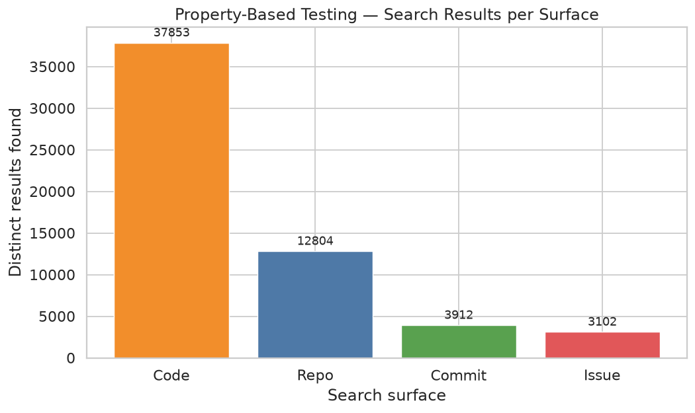
*PBT — search results per surface*

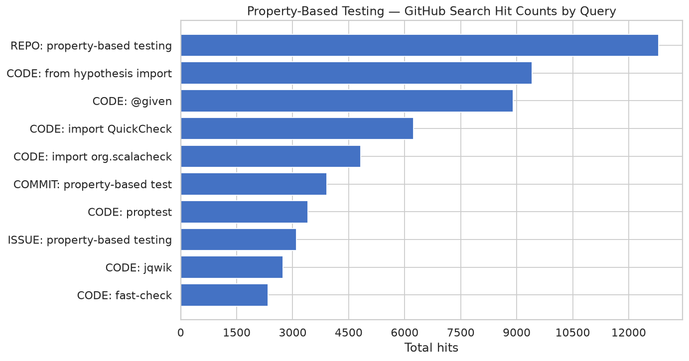
*PBT — raw search hit counts per query*

---

## Adoption Overview

### Detection Count Distribution

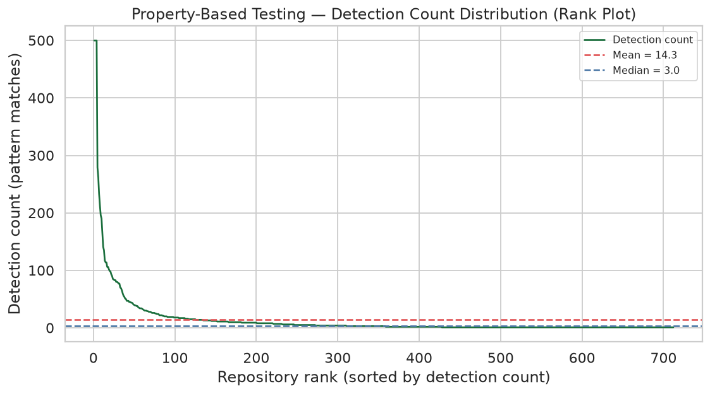
*PBT — detection count distribution (detected repos)*

| Metric | Value |
|---|---|
| Total analysed | 2,287 |
| Total detected | 712 (31.1%) |
| Not detected | 1,575 (68.9%) |
| Median detection count | 3.0 |
| Mean detection count | 14.3 |
| Maximum detection count | 500 |
| Single-match detections | 285 (40.0%) |

### Project Metadata (Detected vs Not Detected)

| Metric | Detected (n=712) | Not Detected (n=1,575) |
|---|---|---|
| Median stars | 14.0 | 4.0 |
| Mean stars | 57.3 | 14.9 |
| Max stars | 4,105 | 2,243 |
| Median repo age (yrs) | 7.0 | 8.0 |
| Max repo age (yrs) | 14 | 16 |
| Median files scanned | 158.0 | 103.0 |
| Max files scanned | 300 | 200 |

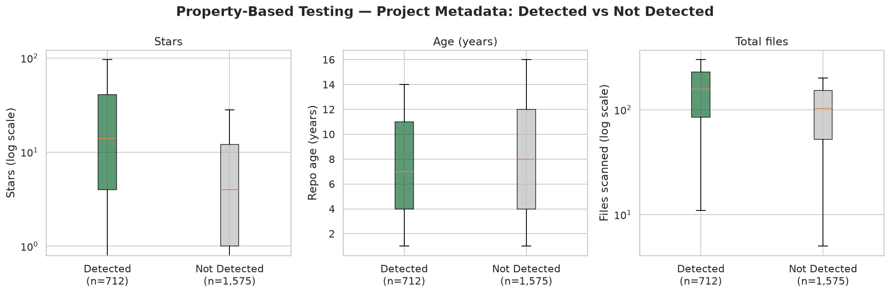
*PBT — project metadata: detected vs not-detected (stars, age, files)*

### Contributor Activity

Unique author email addresses from sampled git history (≤ 500 commits per repo).

| Metric | Value |
|---|---|
| Repos with contributor data | 712 |
| Median contributors | 2.0 |
| Mean contributors | 3.2 |
| Max contributors | 85 |
| Single-contributor repos | 353 (49.6%) |
| Repos with > 10 contributors | 37 (5.2%) |

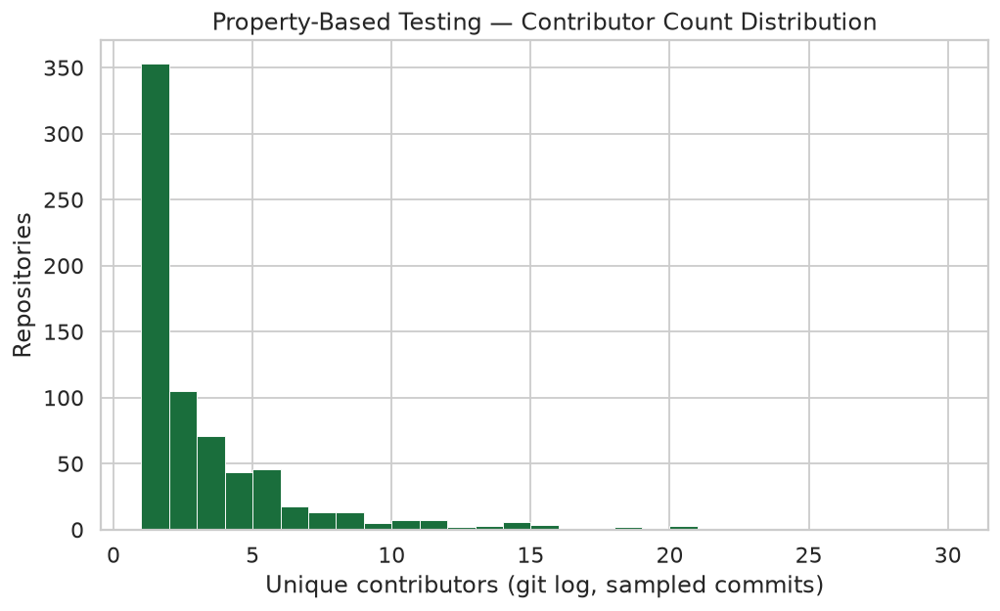
*PBT — contributor count distribution*

---

## Usage Patterns

### Project Role Classification

Repos are classified by where technique signals appear in the directory tree. Not-detected repos are excluded from the use-case stats below.

| Classification | Repos | % of detected |
|---|---|---|
| Actual Usage | 335 | 47.1% |
| Framework / Library | 134 | 18.8% |
| Mixed | 102 | 14.3% |
| Research Artifact | 106 | 14.9% |
| Unknown | 35 | 4.9% |
| **Not Detected (excluded)** | 1,575 | — |

| Classification | Description |
|---|---|
| Actual Usage | Signals in test dirs (`tests/`, `spec/`, `*_test.*`). Technique is actively used in the project's testing. |
| Framework / Library | Signals in source dirs (`src/`, `lib/`, `core/`). The project implements or extends the technique. |
| Mixed | Signals in both source and test dirs. Technique used as both implementation target and test method. |
| Research Artifact | Signals alongside paper markers (`paper`, `evaluation`, `artifact`). Replication study or benchmarking repo. |
| Unknown | No clear dir-based classification. |

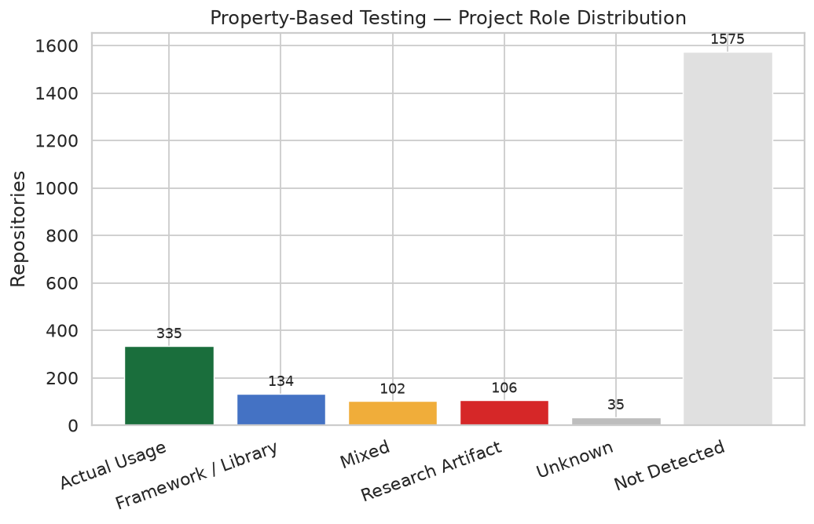
*PBT — project role distribution (including not-detected)*

### Detection Distribution

How technique signals are distributed within repos: signal type, code coverage, spread across files, and density per file.

#### Code vs Non-Code Mentions

Signal matches classified by where they appear in the repository file tree.

| Category | Matches | % |
|---|---|---|
| Code (test code + source code) | 8,090 | 87.3% |
| Non-code (docs + config + other) | 1,172 | 12.7% |

#### Technique Coverage Ratios

Proportion of each detected repo's content containing technique signals.

| Metric | Value |
|---|---|
| Median technique line density | 0.0% |
| Median technique file ratio | 0.9% |
| Repos with > 10% file coverage | 13 |

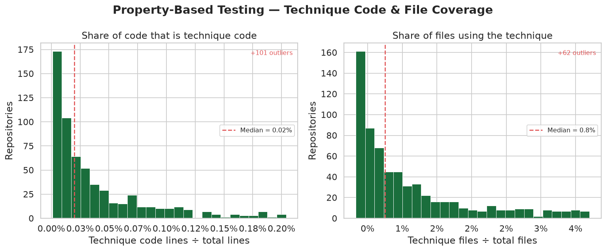
*PBT — technique code share and file coverage (detected repos)*

| Spread Metric | Value |
|---|---|
| Single-file signal repos | 112 (27.1%) |
| Median avg matches per technique file | 1.7 |
| Mean avg matches per technique file | 11.7 |
| Median max matches in a single file | 2.0 |
| Mean signal concentration (max/total) | 151.6% |
| Median unique pattern types per repo | 1.0 |
| Mean unique pattern types per repo | 2.0 |

| Files with signals | Repos |
|---|---|
| 1 | 112 |
| 2 | 113 |
| 3–5 | 178 |
| 6–10 | 10 |
| 11–20 | 1 |
| >20 | 0 |

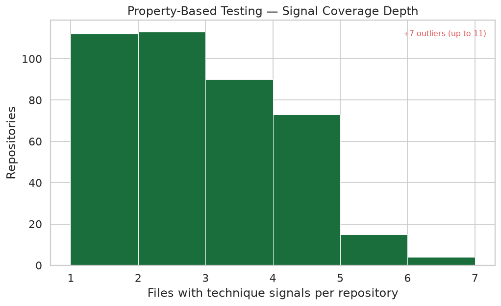
*PBT — signal coverage depth (files per repo)*

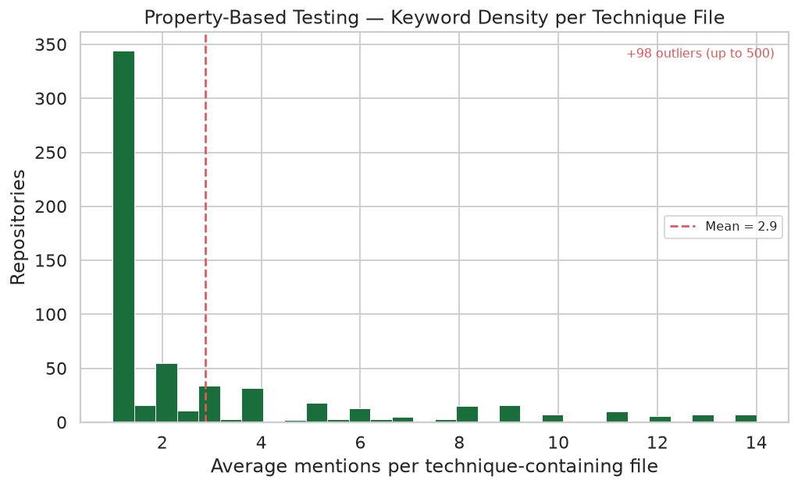
*PBT — keyword density per technique file*

### Language Distribution

| Language | Detected repos | % |
|---|---|---|
| Python | 233 | 32.7% |
| Java | 83 | 11.7% |
| Haskell | 81 | 11.4% |
| Rust | 67 | 9.4% |
| Scala | 65 | 9.1% |
| JavaScript | 54 | 7.6% |
| C# | 49 | 6.9% |
| Kotlin | 31 | 4.4% |
| Other | 29 | 4.1% |
| Ruby | 20 | 2.8% |

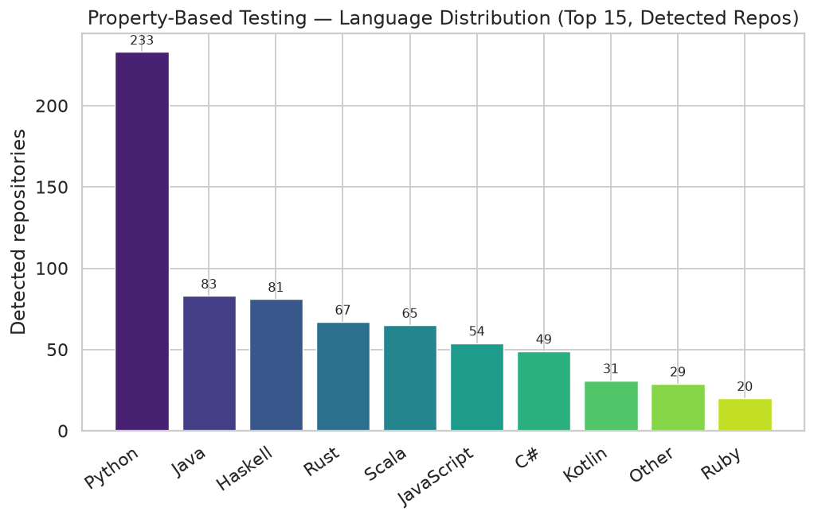
*PBT — language distribution (top 15)*

### Artifact Type Distribution

Where in the file tree signals appear across all 9,218 total matches.

| Artifact Type | Matches | % |
|---|---|---|
| Test Code | 5,072 | 54.8% |
| Source Code | 3,018 | 32.6% |
| Documentation | 926 | 10.0% |
| Config | 246 | 2.7% |

| Artifact Type | Files included |
|---|---|
| Test Code | Files in test directories (`tests/`, `spec/`, `*test*`, `*_spec.*`) |
| Source Code | Non-test source files (`src/`, `lib/`, `*.py`, `*.java`, `*.cpp`, etc.) |
| Documentation | Markdown, RST, and plain-text docs (`*.md`, `*.rst`, `*.txt`, `docs/`) |
| Config | Config and build files (`*.yml`, `*.toml`, `*.ini`, `*.gradle`, `Makefile`) |

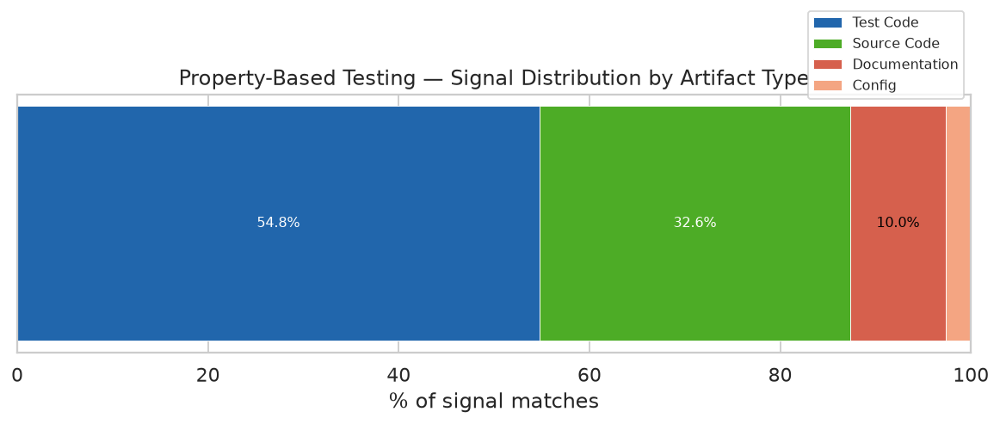
*PBT — signal distribution by artifact type*

### File Extension Breakdown

Extension-level breakdown of files containing technique signals (top 15 by match count).

| Extension | Signal matches |
|---|---|
| `.py` | 2,645 |
| `.scala` | 1,175 |
| `.rs` | 1,104 |
| `.java` | 883 |
| `.cs` | 765 |
| `.hs` | 514 |
| `.md` | 485 |
| `.js` | 463 |
| `.kt` | 379 |
| `.txt` | 229 |
| `.rst` | 212 |
| `.rb` | 118 |
| `./makefile` | 75 |
| `.toml` | 60 |
| `.yml` | 41 |

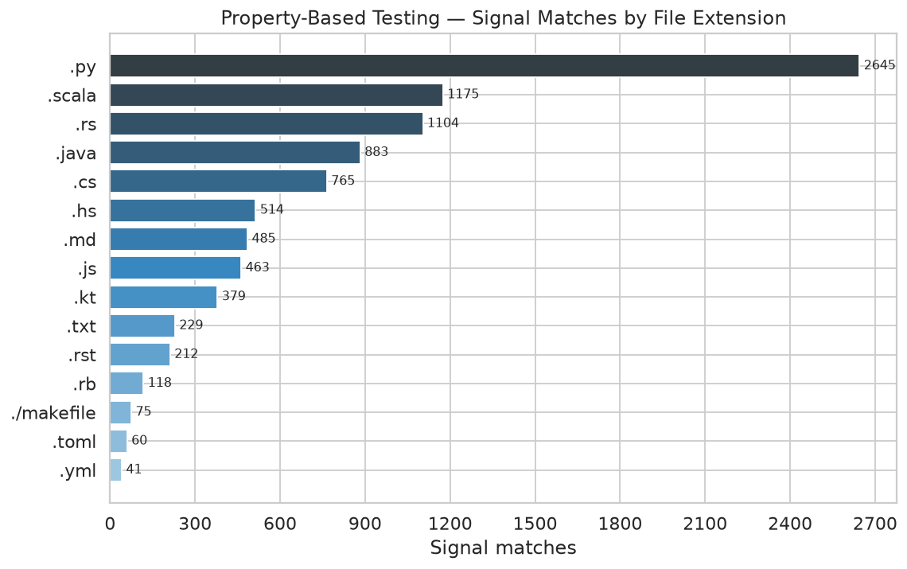
*PBT — signal matches by file extension*

### Application Domain

Inferred from repo name, description, GitHub topics, and README text (keyword matching). A repo can match multiple domains.

| Domain | Repos | % of detected |
|---|---|---|
| Testing Infrastructure | 183 | 25.7% |
| Compiler | 138 | 19.4% |
| Database | 100 | 14.0% |
| Scientific | 82 | 11.5% |
| Web | 82 | 11.5% |
| Security | 66 | 9.3% |
| Bioinformatics | 44 | 6.2% |

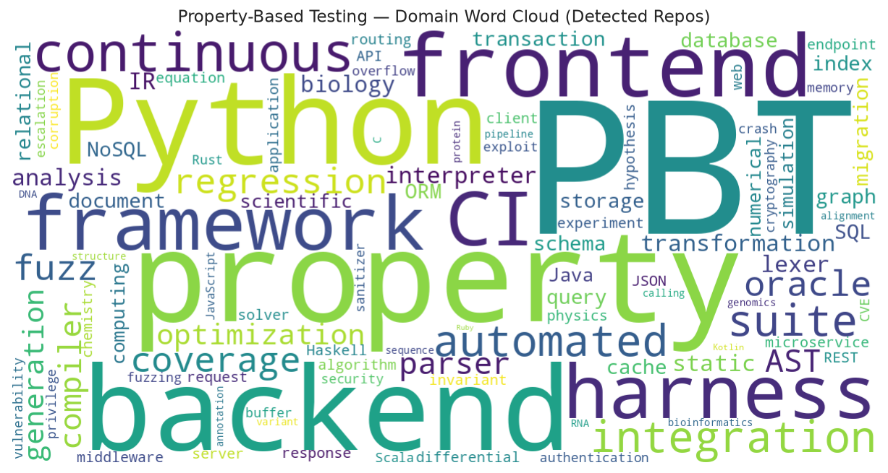
*PBT — domain word cloud (detected repos)*

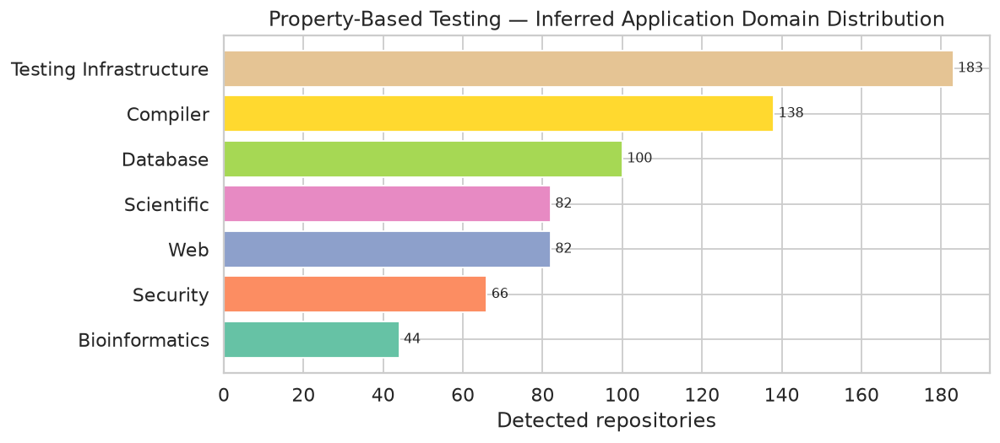
*PBT — inferred domain distribution*

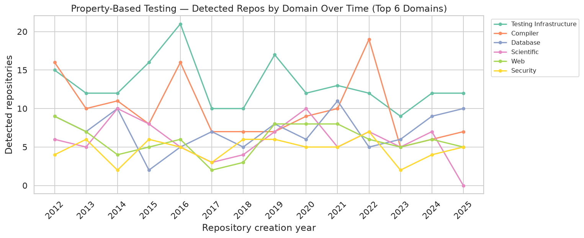
*PBT — detected repos by domain and creation year*

---

## Timeline

### Repository Creation Trend

| Year | Detected | Not detected | Total |
|---|---|---|---|
| 2010 | 0 | 90 | 90 |
| 2011 | 0 | 94 | 94 |
| 2012 | 58 | 101 | 159 |
| 2013 | 47 | 69 | 116 |
| 2014 | 56 | 92 | 148 |
| 2015 | 54 | 96 | 150 |
| 2016 | 54 | 109 | 163 |
| 2017 | 40 | 98 | 138 |
| 2018 | 44 | 98 | 142 |
| 2019 | 57 | 102 | 159 |
| 2020 | 48 | 109 | 157 |
| 2021 | 66 | 89 | 155 |
| 2022 | 64 | 91 | 155 |
| 2023 | 32 | 111 | 143 |
| 2024 | 48 | 106 | 154 |
| 2025 | 44 | 120 | 164 |

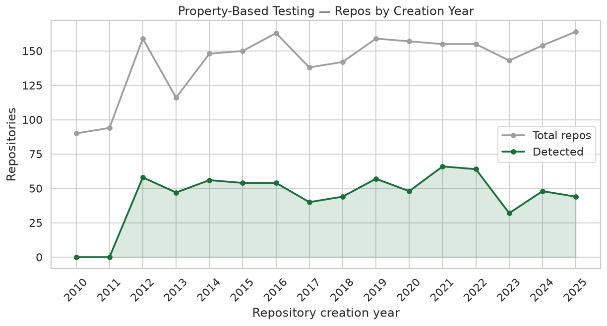
*PBT — detected repos by creation year*

### Commit Activity

Computed from up to 500 most-recent commits per repo (git log, no merges).

| Metric | Value |
|---|---|
| Repos with commit data | 712 |
| Median commits sampled | 271.5 |
| Median first technique commit year | 2019.0 |
| Median last technique commit year  | 2020.0 |
| Median technique commit span       | 0.4 yrs |
| Mean technique commit span | 0.7 yrs |
| Median technique commit ratio | 9.0% |
| Mean technique commit ratio | 11.0% |
| Repos with > 10% technique commits | 324 (45.5%) |

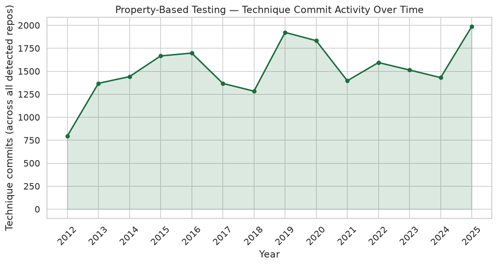
*PBT — technique commit activity over time (commits per year)*

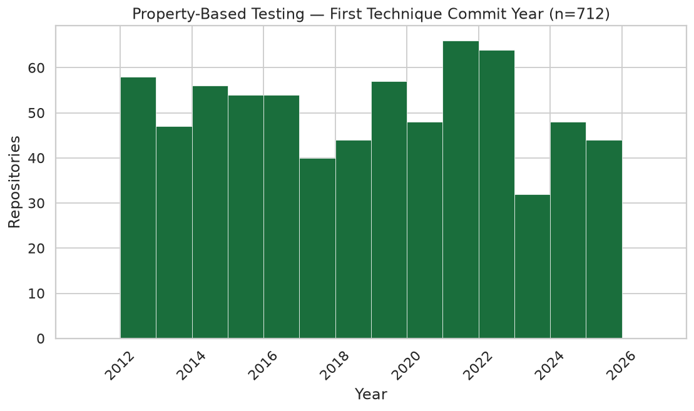
*PBT — first technique commit year distribution*

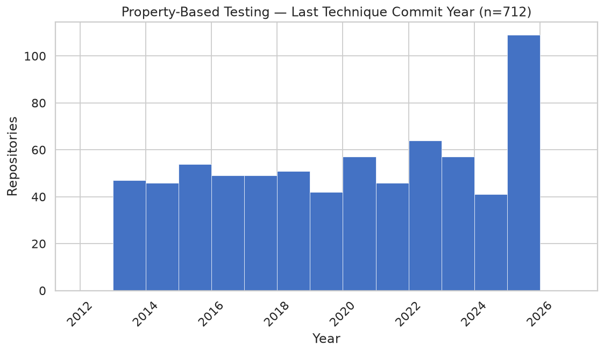
*PBT — last technique commit year distribution*

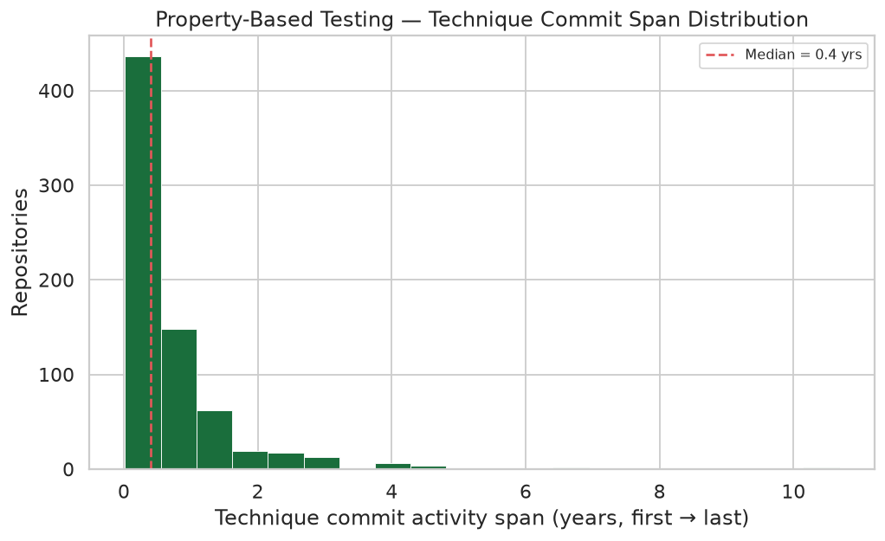
*PBT — first-to-last commit duration distribution (years)*

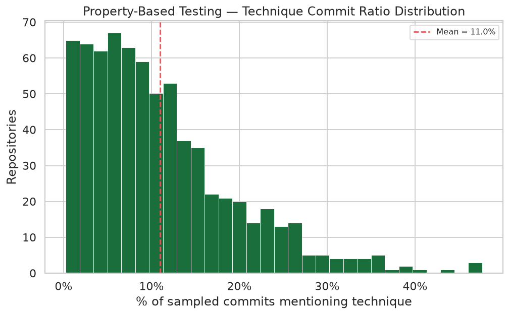
*PBT — technique commit ratio distribution*

### Technique Commits by Year of Repository Life

Total technique commits in each year of a repo's existence, aggregated across all detected repos.
Shows whether technique adoption is concentrated early or sustained over time.

| Project life year | Technique commits |
|---|---|
| Yr 1 | 10,978 |
| Yr 2 | 9,887 |
| Yr 3 | 289 |
| Yr 4 | 97 |
| Yr 5 | 25 |
| Yr 6 | 7 |
| Yr 7 | 7 |
| Yr 8 | 4 |
| Yr 9 | 4 |
| Yr 10 | 1 |
| Yr 11 | 4 |

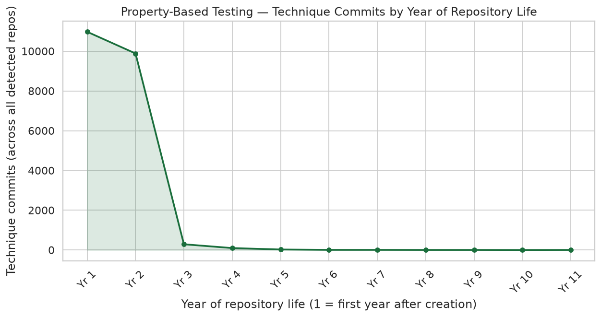
*PBT — technique commits by year of repository life*

---

## Top Detected Repositories

Top 30 by detection count (then stars).

| Repository | Detections | Signal files | Project type | Language | Stars | Year |
|---|---|---|---|---|---|---|
| [HypothesisWorks/repo-pbt-0295](https://github.com/HypothesisWorks/repo-pbt-0295) | 500 | 1 | general usage | Scala | 1,146 | 2018 |
| [haskell/repo-pbt-0680](https://github.com/haskell/repo-pbt-0680) | 500 | 1 | research artifact | Java | 15 | 2025 |
| [hypothesis-users/repo-pbt-0254](https://github.com/hypothesis-users/repo-pbt-0254) | 500 | 1 | general usage | C# | 2 | 2014 |
| [dubzzz/repo-pbt-0292](https://github.com/dubzzz/repo-pbt-0292) | 500 | 1 | mixed | Python | 0 | 2024 |
| [jqwik-team/repo-pbt-0621](https://github.com/jqwik-team/repo-pbt-0621) | 279 | 1 | unknown | Java | 29 | 2016 |
| [scalatest/repo-pbt-0199](https://github.com/scalatest/repo-pbt-0199) | 262 | 4 | mixed | Kotlin | 156 | 2024 |
| [qcheckml/repo-pbt-0185](https://github.com/qcheckml/repo-pbt-0185) | 233 | 1 | general usage | Python | 11 | 2012 |
| [pbt-community/repo-pbt-0553](https://github.com/pbt-community/repo-pbt-0553) | 213 | 1 | framework | Python | 39 | 2018 |
| [dubzzz/repo-pbt-0019](https://github.com/dubzzz/repo-pbt-0019) | 196 | 1 | general usage | Python | 3 | 2015 |
| [scala-testing/repo-pbt-0397](https://github.com/scala-testing/repo-pbt-0397) | 190 | 5 | mixed | Rust | 58 | 2016 |
| [quickcheck-java/repo-pbt-0420](https://github.com/quickcheck-java/repo-pbt-0420) | 166 | 5 | mixed | Python | 7 | 2021 |
| [scala-testing/repo-pbt-0586](https://github.com/scala-testing/repo-pbt-0586) | 141 | 2 | general usage | Rust | 70 | 2024 |
| [dubzzz/repo-pbt-0495](https://github.com/dubzzz/repo-pbt-0495) | 135 | 3 | framework | Rust | 37 | 2020 |
| [scalatest/repo-pbt-0549](https://github.com/scalatest/repo-pbt-0549) | 117 | 1 | general usage | JavaScript | 9 | 2015 |
| [property-testing/repo-pbt-0262](https://github.com/property-testing/repo-pbt-0262) | 114 | 1 | framework | Haskell | 66 | 2014 |
| [jqwik-team/repo-pbt-0507](https://github.com/jqwik-team/repo-pbt-0507) | 114 | 1 | mixed | Scala | 40 | 2020 |
| [haskell/repo-pbt-0514](https://github.com/haskell/repo-pbt-0514) | 106 | 1 | mixed | Python | 8 | 2024 |
| [property-testing/repo-pbt-0645](https://github.com/property-testing/repo-pbt-0645) | 106 | 1 | mixed | Python | 1 | 2025 |
| [quickcheck-java/repo-pbt-0389](https://github.com/quickcheck-java/repo-pbt-0389) | 102 | 8 | general usage | Python | 6 | 2024 |
| [HypothesisWorks/repo-pbt-0247](https://github.com/HypothesisWorks/repo-pbt-0247) | 99 | 1 | general usage | Rust | 3 | 2020 |
| [proptest-rs/repo-pbt-0590](https://github.com/proptest-rs/repo-pbt-0590) | 98 | 8 | framework | Scala | 0 | 2025 |
| [scala-testing/repo-pbt-0217](https://github.com/scala-testing/repo-pbt-0217) | 93 | 1 | general usage | Rust | 14 | 2012 |
| [HypothesisWorks/repo-pbt-0187](https://github.com/HypothesisWorks/repo-pbt-0187) | 90 | 1 | general usage | Scala | 5 | 2020 |
| [scala-testing/repo-pbt-0349](https://github.com/scala-testing/repo-pbt-0349) | 85 | 1 | framework | Rust | 4 | 2020 |
| [property-testing/repo-pbt-0348](https://github.com/property-testing/repo-pbt-0348) | 84 | 1 | framework | Other | 6 | 2015 |
| [scalatest/repo-pbt-0313](https://github.com/scalatest/repo-pbt-0313) | 83 | 1 | unknown | C# | 22 | 2012 |
| [haskell/repo-pbt-0646](https://github.com/haskell/repo-pbt-0646) | 83 | 1 | general usage | Rust | 16 | 2025 |
| [dubzzz/repo-pbt-0189](https://github.com/dubzzz/repo-pbt-0189) | 80 | 2 | general usage | Haskell | 3 | 2016 |
| [hypothesis-users/repo-pbt-0694](https://github.com/hypothesis-users/repo-pbt-0694) | 80 | 1 | general usage | Other | 1 | 2024 |
| [HypothesisWorks/repo-pbt-0253](https://github.com/HypothesisWorks/repo-pbt-0253) | 79 | 1 | mixed | Ruby | 0 | 2015 |

---

## Pattern Activity

9,218 total pattern matches across 712 detected repositories.

| Pattern | Repos | Total matches |
|---|---|---|
| Import: proptest (Rust) | 151 | 965 |
| Import: jqwik (Java) | 149 | 1,153 |
| Comment: property-based testing | 147 | 1,147 |
| Import: hypothesis | 141 | 602 |
| Import: fast-check | 140 | 688 |
| Import: QuickCheck | 137 | 541 |
| Import: ScalaCheck | 136 | 996 |
| Decorator: @given | 136 | 1,065 |
| String: property-based test | 134 | 937 |
| Identifier: prop_/Property | 122 | 1,124 |

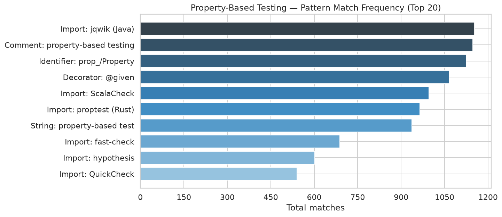
*PBT — pattern match frequency*

---

## Appendix A — Not-Detected Repositories (1,575)

No PBT pattern matches found in cloned default branch. Listed for manual review (sorted by stars).

| Repository | Language | Stars | Year | Found via |
|---|---|---|---|---|
| [dubzzz/repo-nodet-1065](https://github.com/dubzzz/repo-nodet-1065) | Java | 2,243 | 2020 | issue |
| [proptest-rs/repo-nodet-0082](https://github.com/proptest-rs/repo-nodet-0082) | Java | 1,488 | 2010 | commit |
| [pbt-community/repo-nodet-0133](https://github.com/pbt-community/repo-nodet-0133) | Other | 453 | 2025 | issue |
| [scala-testing/repo-nodet-0497](https://github.com/scala-testing/repo-nodet-0497) | Python | 249 | 2024 | pr |
| [property-testing/repo-nodet-0151](https://github.com/property-testing/repo-nodet-0151) | JavaScript | 248 | 2019 | commit |
| [pbt-community/repo-nodet-1339](https://github.com/pbt-community/repo-nodet-1339) | Java | 247 | 2023 | commit |
| [HypothesisWorks/repo-nodet-0622](https://github.com/HypothesisWorks/repo-nodet-0622) | Ruby | 231 | 2012 | pr |
| [property-testing/repo-nodet-1114](https://github.com/property-testing/repo-nodet-1114) | Python | 195 | 2018 | repo |
| [quickcheck-java/repo-nodet-0456](https://github.com/quickcheck-java/repo-nodet-0456) | Haskell | 190 | 2016 | repo |
| [quickcheck-java/repo-nodet-0245](https://github.com/quickcheck-java/repo-nodet-0245) | Rust | 188 | 2024 | repo |
| [pbt-community/repo-nodet-1380](https://github.com/pbt-community/repo-nodet-1380) | Python | 175 | 2016 | repo |
| [property-testing/repo-nodet-0313](https://github.com/property-testing/repo-nodet-0313) | Java | 174 | 2012 | repo |
| [pbt-community/repo-nodet-1558](https://github.com/pbt-community/repo-nodet-1558) | Rust | 167 | 2022 | commit |
| [qcheckml/repo-nodet-0805](https://github.com/qcheckml/repo-nodet-0805) | Python | 166 | 2025 | issue |
| [quickcheck-java/repo-nodet-1191](https://github.com/quickcheck-java/repo-nodet-1191) | Haskell | 165 | 2011 | commit |
| [scalatest/repo-nodet-1394](https://github.com/scalatest/repo-nodet-1394) | Python | 146 | 2020 | commit |
| [jqwik-team/repo-nodet-0929](https://github.com/jqwik-team/repo-nodet-0929) | Kotlin | 143 | 2017 | commit |
| [proptest-rs/repo-nodet-1277](https://github.com/proptest-rs/repo-nodet-1277) | Python | 143 | 2021 | commit |
| [jqwik-team/repo-nodet-1157](https://github.com/jqwik-team/repo-nodet-1157) | Scala | 141 | 2025 | issue |
| [property-testing/repo-nodet-1533](https://github.com/property-testing/repo-nodet-1533) | JavaScript | 136 | 2010 | commit |
| [user-3802/repo-nodet-0714](https://github.com/user-3802/repo-nodet-0714) | Rust | 133 | 2015 | pr |
| [jqwik-team/repo-nodet-0663](https://github.com/jqwik-team/repo-nodet-0663) | Java | 132 | 2011 | commit |
| [hypothesis-users/repo-nodet-1062](https://github.com/hypothesis-users/repo-nodet-1062) | Python | 126 | 2012 | repo |
| [scalatest/repo-nodet-1351](https://github.com/scalatest/repo-nodet-1351) | Haskell | 122 | 2010 | pr |
| [property-testing/repo-nodet-1133](https://github.com/property-testing/repo-nodet-1133) | Java | 118 | 2011 | repo |
| [user-4042/repo-nodet-1368](https://github.com/user-4042/repo-nodet-1368) | Haskell | 108 | 2016 | issue |
| [scalatest/repo-nodet-0218](https://github.com/scalatest/repo-nodet-0218) | Python | 103 | 2021 | issue |
| [haskell/repo-nodet-0014](https://github.com/haskell/repo-nodet-0014) | Rust | 102 | 2018 | repo |
| [dubzzz/repo-nodet-0605](https://github.com/dubzzz/repo-nodet-0605) | Python | 101 | 2019 | repo |
| [haskell/repo-nodet-1135](https://github.com/haskell/repo-nodet-1135) | Python | 101 | 2021 | pr |
| [haskell/repo-nodet-0693](https://github.com/haskell/repo-nodet-0693) | Python | 97 | 2010 | issue |
| [dubzzz/repo-nodet-1420](https://github.com/dubzzz/repo-nodet-1420) | Scala | 97 | 2020 | pr |
| [pbt-community/repo-nodet-0404](https://github.com/pbt-community/repo-nodet-0404) | Ruby | 96 | 2016 | repo |
| [pbt-community/repo-nodet-1201](https://github.com/pbt-community/repo-nodet-1201) | Kotlin | 96 | 2016 | repo |
| [HypothesisWorks/repo-nodet-0843](https://github.com/HypothesisWorks/repo-nodet-0843) | Other | 94 | 2011 | issue |
| [quickcheck-java/repo-nodet-1388](https://github.com/quickcheck-java/repo-nodet-1388) | JavaScript | 94 | 2025 | pr |
| [pbt-community/repo-nodet-1237](https://github.com/pbt-community/repo-nodet-1237) | Python | 92 | 2023 | repo |
| [scalatest/repo-nodet-0691](https://github.com/scalatest/repo-nodet-0691) | Java | 89 | 2011 | repo |
| [jqwik-team/repo-nodet-1048](https://github.com/jqwik-team/repo-nodet-1048) | Python | 89 | 2011 | pr |
| [pbt-community/repo-nodet-0840](https://github.com/pbt-community/repo-nodet-0840) | Haskell | 87 | 2017 | commit |
| [dubzzz/repo-nodet-0113](https://github.com/dubzzz/repo-nodet-0113) | Python | 86 | 2017 | commit |
| [haskell/repo-nodet-0749](https://github.com/haskell/repo-nodet-0749) | Python | 86 | 2024 | issue |
| [HypothesisWorks/repo-nodet-1431](https://github.com/HypothesisWorks/repo-nodet-1431) | Python | 85 | 2012 | issue |
| [qcheckml/repo-nodet-1214](https://github.com/qcheckml/repo-nodet-1214) | Java | 83 | 2021 | repo |
| [HypothesisWorks/repo-nodet-1293](https://github.com/HypothesisWorks/repo-nodet-1293) | Haskell | 81 | 2013 | commit |
| [scala-testing/repo-nodet-0543](https://github.com/scala-testing/repo-nodet-0543) | Scala | 78 | 2021 | commit |
| [hypothesis-users/repo-nodet-0672](https://github.com/hypothesis-users/repo-nodet-0672) | Python | 77 | 2025 | repo |
| [quickcheck-java/repo-nodet-0764](https://github.com/quickcheck-java/repo-nodet-0764) | JavaScript | 74 | 2018 | issue |
| [property-testing/repo-nodet-0326](https://github.com/property-testing/repo-nodet-0326) | Haskell | 73 | 2011 | issue |
| [dubzzz/repo-nodet-1027](https://github.com/dubzzz/repo-nodet-1027) | Scala | 72 | 2020 | commit |
| [proptest-rs/repo-nodet-1292](https://github.com/proptest-rs/repo-nodet-1292) | JavaScript | 72 | 2011 | issue |
| [quickcheck-java/repo-nodet-0932](https://github.com/quickcheck-java/repo-nodet-0932) | JavaScript | 71 | 2024 | repo |
| [hypothesis-users/repo-nodet-0992](https://github.com/hypothesis-users/repo-nodet-0992) | Kotlin | 70 | 2020 | commit |
| [dubzzz/repo-nodet-1457](https://github.com/dubzzz/repo-nodet-1457) | C# | 68 | 2017 | commit |
| [qcheckml/repo-nodet-0303](https://github.com/qcheckml/repo-nodet-0303) | Java | 67 | 2016 | repo |
| [jqwik-team/repo-nodet-1141](https://github.com/jqwik-team/repo-nodet-1141) | Scala | 67 | 2023 | commit |
| [HypothesisWorks/repo-nodet-1335](https://github.com/HypothesisWorks/repo-nodet-1335) | Java | 67 | 2023 | issue |
| [HypothesisWorks/repo-nodet-1479](https://github.com/HypothesisWorks/repo-nodet-1479) | Java | 67 | 2020 | repo |
| [property-testing/repo-nodet-1162](https://github.com/property-testing/repo-nodet-1162) | Other | 66 | 2023 | repo |
| [pbt-community/repo-nodet-0441](https://github.com/pbt-community/repo-nodet-0441) | Ruby | 64 | 2019 | pr |
| [quickcheck-java/repo-nodet-1051](https://github.com/quickcheck-java/repo-nodet-1051) | Rust | 64 | 2022 | issue |
| [user-2552/repo-nodet-0856](https://github.com/user-2552/repo-nodet-0856) | Python | 63 | 2010 | commit |
| [hypothesis-users/repo-nodet-0286](https://github.com/hypothesis-users/repo-nodet-0286) | Python | 61 | 2017 | pr |
| [user-6482/repo-nodet-0029](https://github.com/user-6482/repo-nodet-0029) | Java | 60 | 2018 | commit |
| [user-7626/repo-nodet-0851](https://github.com/user-7626/repo-nodet-0851) | Scala | 60 | 2016 | repo |
| [qcheckml/repo-nodet-0072](https://github.com/qcheckml/repo-nodet-0072) | Java | 59 | 2013 | issue |
| [qcheckml/repo-nodet-0915](https://github.com/qcheckml/repo-nodet-0915) | Python | 59 | 2017 | commit |
| [scalatest/repo-nodet-1291](https://github.com/scalatest/repo-nodet-1291) | Java | 59 | 2025 | commit |
| [dubzzz/repo-nodet-0090](https://github.com/dubzzz/repo-nodet-0090) | Python | 58 | 2020 | issue |
| [dubzzz/repo-nodet-0588](https://github.com/dubzzz/repo-nodet-0588) | Other | 57 | 2025 | pr |
| [property-testing/repo-nodet-1459](https://github.com/property-testing/repo-nodet-1459) | Haskell | 57 | 2016 | commit |
| [proptest-rs/repo-nodet-1004](https://github.com/proptest-rs/repo-nodet-1004) | Python | 56 | 2023 | repo |
| [user-8964/repo-nodet-0620](https://github.com/user-8964/repo-nodet-0620) | JavaScript | 55 | 2021 | pr |
| [qcheckml/repo-nodet-0959](https://github.com/qcheckml/repo-nodet-0959) | Haskell | 55 | 2011 | commit |
| [property-testing/repo-nodet-0729](https://github.com/property-testing/repo-nodet-0729) | Scala | 54 | 2012 | commit |
| [HypothesisWorks/repo-nodet-0753](https://github.com/HypothesisWorks/repo-nodet-0753) | Python | 54 | 2022 | repo |
| [HypothesisWorks/repo-nodet-1434](https://github.com/HypothesisWorks/repo-nodet-1434) | Python | 54 | 2018 | issue |
| [pbt-community/repo-nodet-0085](https://github.com/pbt-community/repo-nodet-0085) | Haskell | 53 | 2020 | issue |
| [jqwik-team/repo-nodet-0165](https://github.com/jqwik-team/repo-nodet-0165) | Python | 52 | 2016 | repo |
| [jqwik-team/repo-nodet-0241](https://github.com/jqwik-team/repo-nodet-0241) | Scala | 52 | 2013 | repo |
| [dubzzz/repo-nodet-0446](https://github.com/dubzzz/repo-nodet-0446) | Other | 52 | 2015 | pr |
| [scalatest/repo-nodet-0280](https://github.com/scalatest/repo-nodet-0280) | Kotlin | 51 | 2020 | pr |
| [proptest-rs/repo-nodet-0794](https://github.com/proptest-rs/repo-nodet-0794) | Java | 50 | 2024 | commit |
| [property-testing/repo-nodet-1285](https://github.com/property-testing/repo-nodet-1285) | Python | 50 | 2010 | issue |
| [dubzzz/repo-nodet-0426](https://github.com/dubzzz/repo-nodet-0426) | Python | 49 | 2020 | pr |
| [jqwik-team/repo-nodet-0781](https://github.com/jqwik-team/repo-nodet-0781) | Rust | 47 | 2013 | repo |
| [qcheckml/repo-nodet-1099](https://github.com/qcheckml/repo-nodet-1099) | Python | 46 | 2020 | pr |
| [property-testing/repo-nodet-0351](https://github.com/property-testing/repo-nodet-0351) | Haskell | 45 | 2011 | issue |
| [scalatest/repo-nodet-0701](https://github.com/scalatest/repo-nodet-0701) | JavaScript | 45 | 2019 | repo |
| [qcheckml/repo-nodet-0854](https://github.com/qcheckml/repo-nodet-0854) | Rust | 45 | 2016 | commit |
| [qcheckml/repo-nodet-1091](https://github.com/qcheckml/repo-nodet-1091) | JavaScript | 45 | 2021 | repo |
| [pbt-community/repo-nodet-0185](https://github.com/pbt-community/repo-nodet-0185) | Python | 44 | 2023 | repo |
| [hypothesis-users/repo-nodet-1186](https://github.com/hypothesis-users/repo-nodet-1186) | Python | 44 | 2025 | repo |
| [pbt-community/repo-nodet-0619](https://github.com/pbt-community/repo-nodet-0619) | Java | 43 | 2025 | pr |
| [jqwik-team/repo-nodet-0869](https://github.com/jqwik-team/repo-nodet-0869) | Python | 43 | 2023 | commit |
| [dubzzz/repo-nodet-0189](https://github.com/dubzzz/repo-nodet-0189) | Scala | 42 | 2022 | issue |
| [scalatest/repo-nodet-0907](https://github.com/scalatest/repo-nodet-0907) | Other | 42 | 2017 | pr |
| [proptest-rs/repo-nodet-0972](https://github.com/proptest-rs/repo-nodet-0972) | Python | 42 | 2013 | issue |
| [user-4884/repo-nodet-0017](https://github.com/user-4884/repo-nodet-0017) | Python | 41 | 2022 | issue |
| [user-2957/repo-nodet-0467](https://github.com/user-2957/repo-nodet-0467) | Rust | 41 | 2025 | repo |
| [dubzzz/repo-nodet-0582](https://github.com/dubzzz/repo-nodet-0582) | Java | 41 | 2011 | pr |
| [pbt-community/repo-nodet-0607](https://github.com/pbt-community/repo-nodet-0607) | Scala | 41 | 2025 | commit |
| [proptest-rs/repo-nodet-0770](https://github.com/proptest-rs/repo-nodet-0770) | Python | 41 | 2015 | commit |
| [scalatest/repo-nodet-0015](https://github.com/scalatest/repo-nodet-0015) | C# | 40 | 2020 | repo |
| [user-2679/repo-nodet-0427](https://github.com/user-2679/repo-nodet-0427) | Kotlin | 40 | 2012 | issue |
| [proptest-rs/repo-nodet-0486](https://github.com/proptest-rs/repo-nodet-0486) | Java | 40 | 2021 | issue |
| [HypothesisWorks/repo-nodet-0682](https://github.com/HypothesisWorks/repo-nodet-0682) | Python | 40 | 2021 | repo |
| [scala-testing/repo-nodet-0780](https://github.com/scala-testing/repo-nodet-0780) | Python | 40 | 2022 | repo |
| [scala-testing/repo-nodet-1094](https://github.com/scala-testing/repo-nodet-1094) | Python | 40 | 2018 | issue |
| [pbt-community/repo-nodet-1130](https://github.com/pbt-community/repo-nodet-1130) | Java | 40 | 2011 | pr |
| [HypothesisWorks/repo-nodet-1389](https://github.com/HypothesisWorks/repo-nodet-1389) | Java | 40 | 2025 | commit |
| [scala-testing/repo-nodet-0433](https://github.com/scala-testing/repo-nodet-0433) | Haskell | 39 | 2019 | repo |
| [property-testing/repo-nodet-1534](https://github.com/property-testing/repo-nodet-1534) | Python | 38 | 2012 | pr |
| [haskell/repo-nodet-1566](https://github.com/haskell/repo-nodet-1566) | Rust | 38 | 2017 | repo |
| [scalatest/repo-nodet-0398](https://github.com/scalatest/repo-nodet-0398) | Haskell | 37 | 2023 | pr |
| [jqwik-team/repo-nodet-0610](https://github.com/jqwik-team/repo-nodet-0610) | Haskell | 37 | 2017 | repo |
| [dubzzz/repo-nodet-0852](https://github.com/dubzzz/repo-nodet-0852) | JavaScript | 37 | 2012 | pr |
| [jqwik-team/repo-nodet-0104](https://github.com/jqwik-team/repo-nodet-0104) | C# | 36 | 2019 | repo |
| [pbt-community/repo-nodet-0297](https://github.com/pbt-community/repo-nodet-0297) | Scala | 36 | 2024 | issue |
| [property-testing/repo-nodet-0501](https://github.com/property-testing/repo-nodet-0501) | Other | 36 | 2012 | issue |
| [user-3160/repo-nodet-0564](https://github.com/user-3160/repo-nodet-0564) | Java | 36 | 2010 | issue |
| [pbt-community/repo-nodet-0639](https://github.com/pbt-community/repo-nodet-0639) | Python | 36 | 2022 | pr |
| [jqwik-team/repo-nodet-0716](https://github.com/jqwik-team/repo-nodet-0716) | Java | 36 | 2025 | repo |
| [proptest-rs/repo-nodet-0985](https://github.com/proptest-rs/repo-nodet-0985) | Haskell | 36 | 2015 | repo |
| [dubzzz/repo-nodet-1042](https://github.com/dubzzz/repo-nodet-1042) | Scala | 36 | 2013 | repo |
| [pbt-community/repo-nodet-1321](https://github.com/pbt-community/repo-nodet-1321) | Other | 36 | 2023 | pr |
| [qcheckml/repo-nodet-1373](https://github.com/qcheckml/repo-nodet-1373) | Scala | 36 | 2012 | repo |
| [haskell/repo-nodet-0264](https://github.com/haskell/repo-nodet-0264) | Scala | 35 | 2016 | repo |
| [scalatest/repo-nodet-0394](https://github.com/scalatest/repo-nodet-0394) | Python | 35 | 2015 | issue |
| [scala-testing/repo-nodet-0538](https://github.com/scala-testing/repo-nodet-0538) | Haskell | 35 | 2014 | issue |
| [dubzzz/repo-nodet-0654](https://github.com/dubzzz/repo-nodet-0654) | Python | 35 | 2022 | commit |
| [quickcheck-java/repo-nodet-0834](https://github.com/quickcheck-java/repo-nodet-0834) | Python | 35 | 2011 | pr |
| [hypothesis-users/repo-nodet-1022](https://github.com/hypothesis-users/repo-nodet-1022) | Ruby | 35 | 2017 | repo |
| [dubzzz/repo-nodet-0007](https://github.com/dubzzz/repo-nodet-0007) | Java | 34 | 2020 | repo |
| [dubzzz/repo-nodet-0073](https://github.com/dubzzz/repo-nodet-0073) | Haskell | 34 | 2023 | commit |
| [scala-testing/repo-nodet-0173](https://github.com/scala-testing/repo-nodet-0173) | Kotlin | 34 | 2014 | pr |
| [haskell/repo-nodet-1030](https://github.com/haskell/repo-nodet-1030) | Python | 34 | 2011 | commit |
| [scala-testing/repo-nodet-0019](https://github.com/scala-testing/repo-nodet-0019) | Rust | 33 | 2019 | commit |
| [hypothesis-users/repo-nodet-0429](https://github.com/hypothesis-users/repo-nodet-0429) | Python | 33 | 2012 | issue |
| [quickcheck-java/repo-nodet-0787](https://github.com/quickcheck-java/repo-nodet-0787) | Haskell | 33 | 2012 | commit |
| [proptest-rs/repo-nodet-0986](https://github.com/proptest-rs/repo-nodet-0986) | C# | 33 | 2020 | pr |
| [pbt-community/repo-nodet-1151](https://github.com/pbt-community/repo-nodet-1151) | Haskell | 33 | 2019 | pr |
| [user-9474/repo-nodet-1159](https://github.com/user-9474/repo-nodet-1159) | Python | 33 | 2024 | commit |
| [proptest-rs/repo-nodet-1199](https://github.com/proptest-rs/repo-nodet-1199) | Java | 33 | 2012 | issue |
| [scala-testing/repo-nodet-1315](https://github.com/scala-testing/repo-nodet-1315) | Python | 33 | 2010 | commit |
| [qcheckml/repo-nodet-1365](https://github.com/qcheckml/repo-nodet-1365) | Python | 33 | 2018 | issue |
| [proptest-rs/repo-nodet-1378](https://github.com/proptest-rs/repo-nodet-1378) | Java | 33 | 2011 | pr |
| [haskell/repo-nodet-1449](https://github.com/haskell/repo-nodet-1449) | Python | 33 | 2012 | commit |
| [pbt-community/repo-nodet-0235](https://github.com/pbt-community/repo-nodet-0235) | Scala | 32 | 2019 | repo |
| [haskell/repo-nodet-0493](https://github.com/haskell/repo-nodet-0493) | Python | 32 | 2011 | pr |
| [property-testing/repo-nodet-0526](https://github.com/property-testing/repo-nodet-0526) | JavaScript | 32 | 2014 | pr |
| [quickcheck-java/repo-nodet-0874](https://github.com/quickcheck-java/repo-nodet-0874) | JavaScript | 32 | 2025 | issue |
| [property-testing/repo-nodet-1248](https://github.com/property-testing/repo-nodet-1248) | Python | 32 | 2015 | commit |
| [pbt-community/repo-nodet-1290](https://github.com/pbt-community/repo-nodet-1290) | JavaScript | 32 | 2019 | issue |
| [property-testing/repo-nodet-1528](https://github.com/property-testing/repo-nodet-1528) | Haskell | 32 | 2022 | issue |
| [pbt-community/repo-nodet-0077](https://github.com/pbt-community/repo-nodet-0077) | JavaScript | 31 | 2022 | commit |
| [proptest-rs/repo-nodet-0203](https://github.com/proptest-rs/repo-nodet-0203) | JavaScript | 31 | 2014 | repo |
| [qcheckml/repo-nodet-0340](https://github.com/qcheckml/repo-nodet-0340) | Haskell | 31 | 2022 | pr |
| [proptest-rs/repo-nodet-0523](https://github.com/proptest-rs/repo-nodet-0523) | Rust | 31 | 2012 | issue |
| [jqwik-team/repo-nodet-1113](https://github.com/jqwik-team/repo-nodet-1113) | Python | 31 | 2013 | repo |
| [pbt-community/repo-nodet-1272](https://github.com/pbt-community/repo-nodet-1272) | Haskell | 31 | 2025 | repo |
| [qcheckml/repo-nodet-1338](https://github.com/qcheckml/repo-nodet-1338) | Python | 31 | 2012 | pr |
| [dubzzz/repo-nodet-1390](https://github.com/dubzzz/repo-nodet-1390) | Ruby | 31 | 2023 | pr |
| [property-testing/repo-nodet-1442](https://github.com/property-testing/repo-nodet-1442) | Python | 31 | 2023 | repo |
| [scala-testing/repo-nodet-0201](https://github.com/scala-testing/repo-nodet-0201) | Java | 30 | 2020 | repo |
| [jqwik-team/repo-nodet-0344](https://github.com/jqwik-team/repo-nodet-0344) | Python | 30 | 2024 | issue |
| [pbt-community/repo-nodet-0860](https://github.com/pbt-community/repo-nodet-0860) | JavaScript | 30 | 2025 | repo |
| [scalatest/repo-nodet-0927](https://github.com/scalatest/repo-nodet-0927) | Python | 30 | 2025 | commit |
| [qcheckml/repo-nodet-0954](https://github.com/qcheckml/repo-nodet-0954) | Rust | 30 | 2024 | repo |
| [haskell/repo-nodet-1446](https://github.com/haskell/repo-nodet-1446) | Kotlin | 30 | 2022 | pr |
| [dubzzz/repo-nodet-0004](https://github.com/dubzzz/repo-nodet-0004) | JavaScript | 29 | 2021 | pr |
| [scalatest/repo-nodet-0145](https://github.com/scalatest/repo-nodet-0145) | Rust | 29 | 2019 | issue |
| [haskell/repo-nodet-0331](https://github.com/haskell/repo-nodet-0331) | Rust | 29 | 2012 | commit |
| [property-testing/repo-nodet-0684](https://github.com/property-testing/repo-nodet-0684) | Ruby | 29 | 2015 | pr |
| [qcheckml/repo-nodet-1049](https://github.com/qcheckml/repo-nodet-1049) | Python | 29 | 2019 | repo |
| [scala-testing/repo-nodet-1450](https://github.com/scala-testing/repo-nodet-1450) | Haskell | 29 | 2013 | pr |
| [qcheckml/repo-nodet-0180](https://github.com/qcheckml/repo-nodet-0180) | Rust | 28 | 2023 | issue |
| [qcheckml/repo-nodet-0612](https://github.com/qcheckml/repo-nodet-0612) | Java | 28 | 2019 | repo |
| [proptest-rs/repo-nodet-0647](https://github.com/proptest-rs/repo-nodet-0647) | Python | 28 | 2012 | commit |
| [qcheckml/repo-nodet-0755](https://github.com/qcheckml/repo-nodet-0755) | Python | 28 | 2012 | commit |
| [qcheckml/repo-nodet-1465](https://github.com/qcheckml/repo-nodet-1465) | Java | 28 | 2025 | pr |
| [scalatest/repo-nodet-1553](https://github.com/scalatest/repo-nodet-1553) | Haskell | 28 | 2019 | repo |
| [HypothesisWorks/repo-nodet-0021](https://github.com/HypothesisWorks/repo-nodet-0021) | Ruby | 27 | 2016 | issue |
| [user-9510/repo-nodet-0108](https://github.com/user-9510/repo-nodet-0108) | Python | 27 | 2020 | pr |
| [qcheckml/repo-nodet-0424](https://github.com/qcheckml/repo-nodet-0424) | Rust | 27 | 2019 | issue |
| [proptest-rs/repo-nodet-0448](https://github.com/proptest-rs/repo-nodet-0448) | Rust | 27 | 2022 | commit |
| [hypothesis-users/repo-nodet-0484](https://github.com/hypothesis-users/repo-nodet-0484) | JavaScript | 27 | 2010 | pr |
| [qcheckml/repo-nodet-0793](https://github.com/qcheckml/repo-nodet-0793) | Python | 27 | 2011 | pr |
| [proptest-rs/repo-nodet-0870](https://github.com/proptest-rs/repo-nodet-0870) | Python | 27 | 2022 | repo |
| [user-9782/repo-nodet-0882](https://github.com/user-9782/repo-nodet-0882) | Ruby | 27 | 2021 | issue |
| [scalatest/repo-nodet-0984](https://github.com/scalatest/repo-nodet-0984) | Python | 27 | 2014 | pr |
| [quickcheck-java/repo-nodet-1294](https://github.com/quickcheck-java/repo-nodet-1294) | Other | 27 | 2020 | issue |
| [haskell/repo-nodet-0066](https://github.com/haskell/repo-nodet-0066) | JavaScript | 26 | 2021 | repo |
| [proptest-rs/repo-nodet-0335](https://github.com/proptest-rs/repo-nodet-0335) | Scala | 26 | 2013 | pr |
| [user-2811/repo-nodet-0560](https://github.com/user-2811/repo-nodet-0560) | Python | 26 | 2019 | repo |
| [quickcheck-java/repo-nodet-0745](https://github.com/quickcheck-java/repo-nodet-0745) | Scala | 26 | 2024 | repo |
| [hypothesis-users/repo-nodet-0872](https://github.com/hypothesis-users/repo-nodet-0872) | Rust | 26 | 2022 | pr |
| [hypothesis-users/repo-nodet-0960](https://github.com/hypothesis-users/repo-nodet-0960) | Python | 26 | 2020 | issue |
| [property-testing/repo-nodet-1269](https://github.com/property-testing/repo-nodet-1269) | Haskell | 26 | 2023 | issue |
| [HypothesisWorks/repo-nodet-0198](https://github.com/HypothesisWorks/repo-nodet-0198) | Python | 25 | 2020 | repo |
| [jqwik-team/repo-nodet-0266](https://github.com/jqwik-team/repo-nodet-0266) | Python | 25 | 2014 | repo |
| [jqwik-team/repo-nodet-0294](https://github.com/jqwik-team/repo-nodet-0294) | Rust | 25 | 2023 | repo |
| [property-testing/repo-nodet-0420](https://github.com/property-testing/repo-nodet-0420) | Python | 25 | 2020 | pr |
| [jqwik-team/repo-nodet-0735](https://github.com/jqwik-team/repo-nodet-0735) | Other | 25 | 2014 | repo |
| [scalatest/repo-nodet-0951](https://github.com/scalatest/repo-nodet-0951) | Java | 25 | 2021 | commit |
| [property-testing/repo-nodet-1147](https://github.com/property-testing/repo-nodet-1147) | Haskell | 25 | 2023 | commit |
| [scala-testing/repo-nodet-1152](https://github.com/scala-testing/repo-nodet-1152) | Java | 25 | 2015 | repo |
| [pbt-community/repo-nodet-1312](https://github.com/pbt-community/repo-nodet-1312) | Python | 25 | 2022 | commit |
| [pbt-community/repo-nodet-1347](https://github.com/pbt-community/repo-nodet-1347) | Ruby | 25 | 2016 | pr |
| [proptest-rs/repo-nodet-1406](https://github.com/proptest-rs/repo-nodet-1406) | Java | 25 | 2018 | repo |
| [haskell/repo-nodet-0164](https://github.com/haskell/repo-nodet-0164) | Java | 24 | 2016 | pr |
| [hypothesis-users/repo-nodet-0262](https://github.com/hypothesis-users/repo-nodet-0262) | Python | 24 | 2019 | repo |
| [pbt-community/repo-nodet-0559](https://github.com/pbt-community/repo-nodet-0559) | Python | 24 | 2020 | commit |
| [hypothesis-users/repo-nodet-0905](https://github.com/hypothesis-users/repo-nodet-0905) | Python | 24 | 2018 | commit |
| [scalatest/repo-nodet-1194](https://github.com/scalatest/repo-nodet-1194) | Python | 24 | 2016 | issue |
| [haskell/repo-nodet-1381](https://github.com/haskell/repo-nodet-1381) | Rust | 24 | 2016 | repo |
| [pbt-community/repo-nodet-1421](https://github.com/pbt-community/repo-nodet-1421) | Python | 24 | 2021 | issue |
| [property-testing/repo-nodet-0327](https://github.com/property-testing/repo-nodet-0327) | Java | 23 | 2020 | repo |
| [qcheckml/repo-nodet-0458](https://github.com/qcheckml/repo-nodet-0458) | Python | 23 | 2022 | issue |
| [property-testing/repo-nodet-0508](https://github.com/property-testing/repo-nodet-0508) | Java | 23 | 2012 | issue |
| [user-1442/repo-nodet-0520](https://github.com/user-1442/repo-nodet-0520) | JavaScript | 23 | 2013 | repo |
| [jqwik-team/repo-nodet-0536](https://github.com/jqwik-team/repo-nodet-0536) | Scala | 23 | 2021 | commit |
| [proptest-rs/repo-nodet-0732](https://github.com/proptest-rs/repo-nodet-0732) | Rust | 23 | 2020 | pr |
| [qcheckml/repo-nodet-0827](https://github.com/qcheckml/repo-nodet-0827) | C# | 23 | 2017 | repo |
| [pbt-community/repo-nodet-0850](https://github.com/pbt-community/repo-nodet-0850) | Python | 23 | 2012 | repo |
| [proptest-rs/repo-nodet-0877](https://github.com/proptest-rs/repo-nodet-0877) | Python | 23 | 2016 | repo |
| [scala-testing/repo-nodet-1234](https://github.com/scala-testing/repo-nodet-1234) | Java | 23 | 2017 | commit |
| [user-6754/repo-nodet-1546](https://github.com/user-6754/repo-nodet-1546) | Python | 23 | 2023 | commit |
| [haskell/repo-nodet-0045](https://github.com/haskell/repo-nodet-0045) | JavaScript | 22 | 2019 | issue |
| [scalatest/repo-nodet-0741](https://github.com/scalatest/repo-nodet-0741) | Other | 22 | 2017 | commit |
| [user-4317/repo-nodet-0769](https://github.com/user-4317/repo-nodet-0769) | Java | 22 | 2010 | repo |
| [haskell/repo-nodet-0821](https://github.com/haskell/repo-nodet-0821) | Ruby | 22 | 2021 | commit |
| [dubzzz/repo-nodet-0981](https://github.com/dubzzz/repo-nodet-0981) | Python | 22 | 2020 | pr |
| [quickcheck-java/repo-nodet-1524](https://github.com/quickcheck-java/repo-nodet-1524) | Haskell | 22 | 2022 | issue |
| [dubzzz/repo-nodet-0477](https://github.com/dubzzz/repo-nodet-0477) | Python | 21 | 2012 | pr |
| [qcheckml/repo-nodet-0489](https://github.com/qcheckml/repo-nodet-0489) | Other | 21 | 2010 | issue |
| [qcheckml/repo-nodet-0547](https://github.com/qcheckml/repo-nodet-0547) | Java | 21 | 2019 | repo |
| [qcheckml/repo-nodet-0603](https://github.com/qcheckml/repo-nodet-0603) | Other | 21 | 2018 | commit |
| [pbt-community/repo-nodet-0643](https://github.com/pbt-community/repo-nodet-0643) | Scala | 21 | 2022 | repo |
| [user-1706/repo-nodet-0974](https://github.com/user-1706/repo-nodet-0974) | Haskell | 21 | 2019 | pr |
| [hypothesis-users/repo-nodet-1359](https://github.com/hypothesis-users/repo-nodet-1359) | Scala | 21 | 2021 | commit |
| [pbt-community/repo-nodet-1512](https://github.com/pbt-community/repo-nodet-1512) | Java | 21 | 2017 | commit |
| [haskell/repo-nodet-0098](https://github.com/haskell/repo-nodet-0098) | Python | 20 | 2021 | issue |
| [HypothesisWorks/repo-nodet-0388](https://github.com/HypothesisWorks/repo-nodet-0388) | Python | 20 | 2025 | repo |
| [proptest-rs/repo-nodet-0399](https://github.com/proptest-rs/repo-nodet-0399) | Java | 20 | 2023 | pr |
| [proptest-rs/repo-nodet-0576](https://github.com/proptest-rs/repo-nodet-0576) | Scala | 20 | 2017 | issue |
| [property-testing/repo-nodet-0674](https://github.com/property-testing/repo-nodet-0674) | Java | 20 | 2019 | issue |
| [scala-testing/repo-nodet-0881](https://github.com/scala-testing/repo-nodet-0881) | Java | 20 | 2013 | repo |
| [haskell/repo-nodet-1067](https://github.com/haskell/repo-nodet-1067) | Python | 20 | 2016 | issue |
| [scala-testing/repo-nodet-1086](https://github.com/scala-testing/repo-nodet-1086) | JavaScript | 20 | 2016 | repo |
| [dubzzz/repo-nodet-1253](https://github.com/dubzzz/repo-nodet-1253) | Java | 20 | 2016 | pr |
| [quickcheck-java/repo-nodet-1404](https://github.com/quickcheck-java/repo-nodet-1404) | Rust | 20 | 2022 | pr |
| [qcheckml/repo-nodet-1504](https://github.com/qcheckml/repo-nodet-1504) | Ruby | 20 | 2023 | commit |
| [hypothesis-users/repo-nodet-1513](https://github.com/hypothesis-users/repo-nodet-1513) | Ruby | 20 | 2019 | commit |
| [quickcheck-java/repo-nodet-1532](https://github.com/quickcheck-java/repo-nodet-1532) | JavaScript | 20 | 2021 | repo |
| [HypothesisWorks/repo-nodet-0122](https://github.com/HypothesisWorks/repo-nodet-0122) | JavaScript | 19 | 2015 | issue |
| [hypothesis-users/repo-nodet-0194](https://github.com/hypothesis-users/repo-nodet-0194) | Java | 19 | 2015 | repo |
| [proptest-rs/repo-nodet-0214](https://github.com/proptest-rs/repo-nodet-0214) | Scala | 19 | 2012 | pr |
| [scalatest/repo-nodet-0242](https://github.com/scalatest/repo-nodet-0242) | Java | 19 | 2019 | commit |
| [pbt-community/repo-nodet-0317](https://github.com/pbt-community/repo-nodet-0317) | Python | 19 | 2012 | issue |
| [proptest-rs/repo-nodet-0392](https://github.com/proptest-rs/repo-nodet-0392) | Python | 19 | 2010 | repo |
| [user-2915/repo-nodet-0734](https://github.com/user-2915/repo-nodet-0734) | JavaScript | 19 | 2025 | pr |
| [pbt-community/repo-nodet-0914](https://github.com/pbt-community/repo-nodet-0914) | Python | 19 | 2010 | issue |
| [user-6916/repo-nodet-1092](https://github.com/user-6916/repo-nodet-1092) | Kotlin | 19 | 2019 | pr |
| [qcheckml/repo-nodet-1104](https://github.com/qcheckml/repo-nodet-1104) | Java | 19 | 2015 | issue |
| [property-testing/repo-nodet-1401](https://github.com/property-testing/repo-nodet-1401) | Python | 19 | 2011 | repo |
| [pbt-community/repo-nodet-1428](https://github.com/pbt-community/repo-nodet-1428) | Haskell | 19 | 2010 | commit |
| [quickcheck-java/repo-nodet-0000](https://github.com/quickcheck-java/repo-nodet-0000) | Java | 18 | 2020 | issue |
| [dubzzz/repo-nodet-0101](https://github.com/dubzzz/repo-nodet-0101) | JavaScript | 18 | 2018 | repo |
| [user-9204/repo-nodet-0391](https://github.com/user-9204/repo-nodet-0391) | Rust | 18 | 2019 | issue |
| [user-6696/repo-nodet-0408](https://github.com/user-6696/repo-nodet-0408) | Python | 18 | 2023 | pr |
| [dubzzz/repo-nodet-0473](https://github.com/dubzzz/repo-nodet-0473) | Python | 18 | 2021 | issue |
| [pbt-community/repo-nodet-0527](https://github.com/pbt-community/repo-nodet-0527) | Scala | 18 | 2014 | pr |
| [haskell/repo-nodet-0779](https://github.com/haskell/repo-nodet-0779) | Python | 18 | 2016 | pr |
| [scala-testing/repo-nodet-0786](https://github.com/scala-testing/repo-nodet-0786) | Java | 18 | 2015 | repo |
| [user-4704/repo-nodet-0788](https://github.com/user-4704/repo-nodet-0788) | Python | 18 | 2025 | issue |
| [pbt-community/repo-nodet-0817](https://github.com/pbt-community/repo-nodet-0817) | Ruby | 18 | 2022 | repo |
| [HypothesisWorks/repo-nodet-0939](https://github.com/HypothesisWorks/repo-nodet-0939) | Haskell | 18 | 2021 | commit |
| [quickcheck-java/repo-nodet-0940](https://github.com/quickcheck-java/repo-nodet-0940) | Python | 18 | 2024 | commit |
| [quickcheck-java/repo-nodet-1015](https://github.com/quickcheck-java/repo-nodet-1015) | Python | 18 | 2024 | commit |
| [HypothesisWorks/repo-nodet-1137](https://github.com/HypothesisWorks/repo-nodet-1137) | Kotlin | 18 | 2018 | issue |
| [hypothesis-users/repo-nodet-1254](https://github.com/hypothesis-users/repo-nodet-1254) | Rust | 18 | 2023 | issue |
| [proptest-rs/repo-nodet-1364](https://github.com/proptest-rs/repo-nodet-1364) | Python | 18 | 2023 | issue |
| [dubzzz/repo-nodet-1489](https://github.com/dubzzz/repo-nodet-1489) | Java | 18 | 2019 | pr |
| [scalatest/repo-nodet-0020](https://github.com/scalatest/repo-nodet-0020) | Java | 17 | 2016 | commit |
| [haskell/repo-nodet-0055](https://github.com/haskell/repo-nodet-0055) | Ruby | 17 | 2019 | repo |
| [dubzzz/repo-nodet-0209](https://github.com/dubzzz/repo-nodet-0209) | Haskell | 17 | 2013 | issue |
| [scala-testing/repo-nodet-0296](https://github.com/scala-testing/repo-nodet-0296) | Python | 17 | 2024 | commit |
| [jqwik-team/repo-nodet-0355](https://github.com/jqwik-team/repo-nodet-0355) | Kotlin | 17 | 2018 | repo |
| [pbt-community/repo-nodet-0365](https://github.com/pbt-community/repo-nodet-0365) | Other | 17 | 2024 | repo |
| [user-9772/repo-nodet-0430](https://github.com/user-9772/repo-nodet-0430) | Java | 17 | 2012 | commit |
| [qcheckml/repo-nodet-0518](https://github.com/qcheckml/repo-nodet-0518) | C# | 17 | 2014 | issue |
| [hypothesis-users/repo-nodet-0546](https://github.com/hypothesis-users/repo-nodet-0546) | Java | 17 | 2012 | repo |
| [user-3560/repo-nodet-0623](https://github.com/user-3560/repo-nodet-0623) | JavaScript | 17 | 2014 | pr |
| [jqwik-team/repo-nodet-0822](https://github.com/jqwik-team/repo-nodet-0822) | Python | 17 | 2012 | commit |
| [HypothesisWorks/repo-nodet-0865](https://github.com/HypothesisWorks/repo-nodet-0865) | Java | 17 | 2023 | issue |
| [HypothesisWorks/repo-nodet-0868](https://github.com/HypothesisWorks/repo-nodet-0868) | JavaScript | 17 | 2013 | issue |
| [property-testing/repo-nodet-0936](https://github.com/property-testing/repo-nodet-0936) | Python | 17 | 2020 | commit |
| [qcheckml/repo-nodet-0961](https://github.com/qcheckml/repo-nodet-0961) | Kotlin | 17 | 2023 | pr |
| [pbt-community/repo-nodet-1563](https://github.com/pbt-community/repo-nodet-1563) | C# | 17 | 2024 | issue |
| [pbt-community/repo-nodet-0273](https://github.com/pbt-community/repo-nodet-0273) | Python | 16 | 2024 | pr |
| [HypothesisWorks/repo-nodet-0316](https://github.com/HypothesisWorks/repo-nodet-0316) | JavaScript | 16 | 2024 | commit |
| [scala-testing/repo-nodet-0472](https://github.com/scala-testing/repo-nodet-0472) | Rust | 16 | 2018 | commit |
| [haskell/repo-nodet-0475](https://github.com/haskell/repo-nodet-0475) | C# | 16 | 2010 | commit |
| [pbt-community/repo-nodet-0598](https://github.com/pbt-community/repo-nodet-0598) | JavaScript | 16 | 2012 | pr |
| [property-testing/repo-nodet-0733](https://github.com/property-testing/repo-nodet-0733) | JavaScript | 16 | 2023 | issue |
| [jqwik-team/repo-nodet-0846](https://github.com/jqwik-team/repo-nodet-0846) | Rust | 16 | 2020 | issue |
| [pbt-community/repo-nodet-0953](https://github.com/pbt-community/repo-nodet-0953) | Java | 16 | 2012 | commit |
| [user-3306/repo-nodet-1129](https://github.com/user-3306/repo-nodet-1129) | Haskell | 16 | 2010 | repo |
| [HypothesisWorks/repo-nodet-1318](https://github.com/HypothesisWorks/repo-nodet-1318) | Python | 16 | 2021 | issue |
| [hypothesis-users/repo-nodet-1336](https://github.com/hypothesis-users/repo-nodet-1336) | Scala | 16 | 2014 | pr |
| [scala-testing/repo-nodet-1353](https://github.com/scala-testing/repo-nodet-1353) | Java | 16 | 2018 | issue |
| [dubzzz/repo-nodet-1499](https://github.com/dubzzz/repo-nodet-1499) | Python | 16 | 2012 | pr |
| [dubzzz/repo-nodet-0001](https://github.com/dubzzz/repo-nodet-0001) | Kotlin | 15 | 2025 | repo |
| [jqwik-team/repo-nodet-0079](https://github.com/jqwik-team/repo-nodet-0079) | Ruby | 15 | 2015 | repo |
| [proptest-rs/repo-nodet-0271](https://github.com/proptest-rs/repo-nodet-0271) | Scala | 15 | 2024 | repo |
| [HypothesisWorks/repo-nodet-0282](https://github.com/HypothesisWorks/repo-nodet-0282) | C# | 15 | 2023 | commit |
| [HypothesisWorks/repo-nodet-0312](https://github.com/HypothesisWorks/repo-nodet-0312) | Rust | 15 | 2015 | issue |
| [haskell/repo-nodet-0356](https://github.com/haskell/repo-nodet-0356) | Java | 15 | 2022 | repo |
| [jqwik-team/repo-nodet-0573](https://github.com/jqwik-team/repo-nodet-0573) | JavaScript | 15 | 2015 | issue |
| [scalatest/repo-nodet-0688](https://github.com/scalatest/repo-nodet-0688) | C# | 15 | 2011 | repo |
| [proptest-rs/repo-nodet-0704](https://github.com/proptest-rs/repo-nodet-0704) | Scala | 15 | 2015 | repo |
| [property-testing/repo-nodet-0748](https://github.com/property-testing/repo-nodet-0748) | Haskell | 15 | 2010 | repo |
| [haskell/repo-nodet-0946](https://github.com/haskell/repo-nodet-0946) | C# | 15 | 2019 | repo |
| [user-2183/repo-nodet-0970](https://github.com/user-2183/repo-nodet-0970) | Python | 15 | 2022 | commit |
| [HypothesisWorks/repo-nodet-1002](https://github.com/HypothesisWorks/repo-nodet-1002) | Python | 15 | 2020 | commit |
| [qcheckml/repo-nodet-1017](https://github.com/qcheckml/repo-nodet-1017) | Python | 15 | 2011 | pr |
| [haskell/repo-nodet-1029](https://github.com/haskell/repo-nodet-1029) | Python | 15 | 2010 | pr |
| [haskell/repo-nodet-1059](https://github.com/haskell/repo-nodet-1059) | Python | 15 | 2010 | pr |
| [dubzzz/repo-nodet-1107](https://github.com/dubzzz/repo-nodet-1107) | JavaScript | 15 | 2017 | commit |
| [qcheckml/repo-nodet-1443](https://github.com/qcheckml/repo-nodet-1443) | Python | 15 | 2018 | issue |
| [scalatest/repo-nodet-1471](https://github.com/scalatest/repo-nodet-1471) | Scala | 15 | 2016 | commit |
| [scalatest/repo-nodet-0117](https://github.com/scalatest/repo-nodet-0117) | C# | 14 | 2025 | pr |
| [HypothesisWorks/repo-nodet-0289](https://github.com/HypothesisWorks/repo-nodet-0289) | Python | 14 | 2020 | commit |
| [qcheckml/repo-nodet-0293](https://github.com/qcheckml/repo-nodet-0293) | Other | 14 | 2015 | repo |
| [user-9859/repo-nodet-0345](https://github.com/user-9859/repo-nodet-0345) | Scala | 14 | 2012 | pr |
| [dubzzz/repo-nodet-0368](https://github.com/dubzzz/repo-nodet-0368) | Haskell | 14 | 2012 | repo |
| [jqwik-team/repo-nodet-0418](https://github.com/jqwik-team/repo-nodet-0418) | Haskell | 14 | 2012 | issue |
| [quickcheck-java/repo-nodet-0551](https://github.com/quickcheck-java/repo-nodet-0551) | Rust | 14 | 2020 | issue |
| [haskell/repo-nodet-0634](https://github.com/haskell/repo-nodet-0634) | Rust | 14 | 2015 | commit |
| [quickcheck-java/repo-nodet-0635](https://github.com/quickcheck-java/repo-nodet-0635) | Haskell | 14 | 2016 | repo |
| [scala-testing/repo-nodet-0645](https://github.com/scala-testing/repo-nodet-0645) | Haskell | 14 | 2020 | commit |
| [haskell/repo-nodet-0694](https://github.com/haskell/repo-nodet-0694) | Python | 14 | 2023 | repo |
| [qcheckml/repo-nodet-0712](https://github.com/qcheckml/repo-nodet-0712) | Python | 14 | 2024 | commit |
| [proptest-rs/repo-nodet-0796](https://github.com/proptest-rs/repo-nodet-0796) | Java | 14 | 2022 | commit |
| [property-testing/repo-nodet-0803](https://github.com/property-testing/repo-nodet-0803) | Haskell | 14 | 2012 | repo |
| [scala-testing/repo-nodet-0812](https://github.com/scala-testing/repo-nodet-0812) | C# | 14 | 2017 | pr |
| [scala-testing/repo-nodet-0831](https://github.com/scala-testing/repo-nodet-0831) | Haskell | 14 | 2015 | repo |
| [user-5984/repo-nodet-0896](https://github.com/user-5984/repo-nodet-0896) | Java | 14 | 2011 | commit |
| [user-4961/repo-nodet-0925](https://github.com/user-4961/repo-nodet-0925) | Scala | 14 | 2019 | commit |
| [hypothesis-users/repo-nodet-1164](https://github.com/hypothesis-users/repo-nodet-1164) | C# | 14 | 2023 | issue |
| [quickcheck-java/repo-nodet-1190](https://github.com/quickcheck-java/repo-nodet-1190) | Other | 14 | 2018 | commit |
| [pbt-community/repo-nodet-1213](https://github.com/pbt-community/repo-nodet-1213) | Python | 14 | 2019 | pr |
| [property-testing/repo-nodet-1306](https://github.com/property-testing/repo-nodet-1306) | Scala | 14 | 2021 | issue |
| [pbt-community/repo-nodet-1309](https://github.com/pbt-community/repo-nodet-1309) | Haskell | 14 | 2013 | repo |
| [scala-testing/repo-nodet-1510](https://github.com/scala-testing/repo-nodet-1510) | Other | 14 | 2019 | issue |
| [jqwik-team/repo-nodet-1565](https://github.com/jqwik-team/repo-nodet-1565) | JavaScript | 14 | 2017 | commit |
| [quickcheck-java/repo-nodet-0128](https://github.com/quickcheck-java/repo-nodet-0128) | Python | 13 | 2012 | commit |
| [HypothesisWorks/repo-nodet-0143](https://github.com/HypothesisWorks/repo-nodet-0143) | Java | 13 | 2019 | issue |
| [hypothesis-users/repo-nodet-0182](https://github.com/hypothesis-users/repo-nodet-0182) | Haskell | 13 | 2017 | issue |
| [qcheckml/repo-nodet-0260](https://github.com/qcheckml/repo-nodet-0260) | Rust | 13 | 2017 | issue |
| [haskell/repo-nodet-0425](https://github.com/haskell/repo-nodet-0425) | Python | 13 | 2023 | issue |
| [user-3669/repo-nodet-0488](https://github.com/user-3669/repo-nodet-0488) | Rust | 13 | 2013 | pr |
| [jqwik-team/repo-nodet-0513](https://github.com/jqwik-team/repo-nodet-0513) | Haskell | 13 | 2024 | issue |
| [jqwik-team/repo-nodet-0533](https://github.com/jqwik-team/repo-nodet-0533) | Haskell | 13 | 2011 | issue |
| [HypothesisWorks/repo-nodet-0556](https://github.com/HypothesisWorks/repo-nodet-0556) | Python | 13 | 2016 | repo |
| [haskell/repo-nodet-0581](https://github.com/haskell/repo-nodet-0581) | Haskell | 13 | 2025 | issue |
| [hypothesis-users/repo-nodet-0705](https://github.com/hypothesis-users/repo-nodet-0705) | C# | 13 | 2025 | commit |
| [property-testing/repo-nodet-0884](https://github.com/property-testing/repo-nodet-0884) | Python | 13 | 2012 | issue |
| [hypothesis-users/repo-nodet-0895](https://github.com/hypothesis-users/repo-nodet-0895) | JavaScript | 13 | 2023 | pr |
| [qcheckml/repo-nodet-0934](https://github.com/qcheckml/repo-nodet-0934) | Other | 13 | 2020 | pr |
| [quickcheck-java/repo-nodet-1053](https://github.com/quickcheck-java/repo-nodet-1053) | Kotlin | 13 | 2021 | commit |
| [proptest-rs/repo-nodet-1074](https://github.com/proptest-rs/repo-nodet-1074) | Ruby | 13 | 2011 | issue |
| [user-8059/repo-nodet-1110](https://github.com/user-8059/repo-nodet-1110) | JavaScript | 13 | 2016 | repo |
| [user-5568/repo-nodet-1119](https://github.com/user-5568/repo-nodet-1119) | Other | 13 | 2020 | commit |
| [jqwik-team/repo-nodet-1146](https://github.com/jqwik-team/repo-nodet-1146) | Scala | 13 | 2013 | repo |
| [property-testing/repo-nodet-1150](https://github.com/property-testing/repo-nodet-1150) | Python | 13 | 2020 | commit |
| [quickcheck-java/repo-nodet-1158](https://github.com/quickcheck-java/repo-nodet-1158) | Python | 13 | 2012 | pr |
| [pbt-community/repo-nodet-1215](https://github.com/pbt-community/repo-nodet-1215) | Python | 13 | 2024 | issue |
| [proptest-rs/repo-nodet-1288](https://github.com/proptest-rs/repo-nodet-1288) | Kotlin | 13 | 2023 | commit |
| [quickcheck-java/repo-nodet-1393](https://github.com/quickcheck-java/repo-nodet-1393) | Python | 13 | 2019 | repo |
| [haskell/repo-nodet-1422](https://github.com/haskell/repo-nodet-1422) | Rust | 13 | 2019 | commit |
| [user-9802/repo-nodet-1463](https://github.com/user-9802/repo-nodet-1463) | Python | 13 | 2020 | issue |
| [scala-testing/repo-nodet-1496](https://github.com/scala-testing/repo-nodet-1496) | Python | 13 | 2023 | issue |
| [jqwik-team/repo-nodet-1521](https://github.com/jqwik-team/repo-nodet-1521) | Python | 13 | 2010 | commit |
| [property-testing/repo-nodet-1562](https://github.com/property-testing/repo-nodet-1562) | Python | 13 | 2022 | issue |
| [qcheckml/repo-nodet-0023](https://github.com/qcheckml/repo-nodet-0023) | JavaScript | 12 | 2017 | pr |
| [hypothesis-users/repo-nodet-0111](https://github.com/hypothesis-users/repo-nodet-0111) | Python | 12 | 2017 | repo |
| [user-7074/repo-nodet-0125](https://github.com/user-7074/repo-nodet-0125) | Python | 12 | 2025 | repo |
| [property-testing/repo-nodet-0132](https://github.com/property-testing/repo-nodet-0132) | Python | 12 | 2015 | commit |
| [pbt-community/repo-nodet-0223](https://github.com/pbt-community/repo-nodet-0223) | Kotlin | 12 | 2023 | repo |
| [HypothesisWorks/repo-nodet-0231](https://github.com/HypothesisWorks/repo-nodet-0231) | Rust | 12 | 2024 | commit |
| [hypothesis-users/repo-nodet-0276](https://github.com/hypothesis-users/repo-nodet-0276) | Haskell | 12 | 2018 | issue |
| [proptest-rs/repo-nodet-0333](https://github.com/proptest-rs/repo-nodet-0333) | Python | 12 | 2016 | repo |
| [qcheckml/repo-nodet-0362](https://github.com/qcheckml/repo-nodet-0362) | Rust | 12 | 2024 | pr |
| [dubzzz/repo-nodet-0428](https://github.com/dubzzz/repo-nodet-0428) | Other | 12 | 2010 | pr |
| [haskell/repo-nodet-0495](https://github.com/haskell/repo-nodet-0495) | Haskell | 12 | 2013 | repo |
| [haskell/repo-nodet-0503](https://github.com/haskell/repo-nodet-0503) | JavaScript | 12 | 2024 | issue |
| [quickcheck-java/repo-nodet-0528](https://github.com/quickcheck-java/repo-nodet-0528) | Python | 12 | 2024 | issue |
| [pbt-community/repo-nodet-0554](https://github.com/pbt-community/repo-nodet-0554) | Rust | 12 | 2019 | pr |
| [qcheckml/repo-nodet-0666](https://github.com/qcheckml/repo-nodet-0666) | Kotlin | 12 | 2021 | pr |
| [HypothesisWorks/repo-nodet-0678](https://github.com/HypothesisWorks/repo-nodet-0678) | JavaScript | 12 | 2016 | issue |
| [qcheckml/repo-nodet-0679](https://github.com/qcheckml/repo-nodet-0679) | Haskell | 12 | 2017 | repo |
| [hypothesis-users/repo-nodet-0744](https://github.com/hypothesis-users/repo-nodet-0744) | Ruby | 12 | 2014 | repo |
| [HypothesisWorks/repo-nodet-0778](https://github.com/HypothesisWorks/repo-nodet-0778) | Java | 12 | 2018 | issue |
| [property-testing/repo-nodet-0871](https://github.com/property-testing/repo-nodet-0871) | Python | 12 | 2011 | commit |
| [user-3152/repo-nodet-0976](https://github.com/user-3152/repo-nodet-0976) | JavaScript | 12 | 2015 | commit |
| [proptest-rs/repo-nodet-0993](https://github.com/proptest-rs/repo-nodet-0993) | Python | 12 | 2021 | repo |
| [scalatest/repo-nodet-1088](https://github.com/scalatest/repo-nodet-1088) | Haskell | 12 | 2022 | pr |
| [proptest-rs/repo-nodet-1097](https://github.com/proptest-rs/repo-nodet-1097) | Python | 12 | 2017 | commit |
| [hypothesis-users/repo-nodet-1103](https://github.com/hypothesis-users/repo-nodet-1103) | Python | 12 | 2015 | repo |
| [HypothesisWorks/repo-nodet-1125](https://github.com/HypothesisWorks/repo-nodet-1125) | Java | 12 | 2013 | commit |
| [property-testing/repo-nodet-1327](https://github.com/property-testing/repo-nodet-1327) | C# | 12 | 2024 | issue |
| [HypothesisWorks/repo-nodet-1543](https://github.com/HypothesisWorks/repo-nodet-1543) | Python | 12 | 2025 | commit |
| [proptest-rs/repo-nodet-1554](https://github.com/proptest-rs/repo-nodet-1554) | Python | 12 | 2017 | pr |
| [haskell/repo-nodet-0049](https://github.com/haskell/repo-nodet-0049) | Python | 11 | 2019 | issue |
| [proptest-rs/repo-nodet-0081](https://github.com/proptest-rs/repo-nodet-0081) | Python | 11 | 2018 | repo |
| [scalatest/repo-nodet-0084](https://github.com/scalatest/repo-nodet-0084) | Python | 11 | 2018 | repo |
| [qcheckml/repo-nodet-0095](https://github.com/qcheckml/repo-nodet-0095) | Python | 11 | 2011 | repo |
| [property-testing/repo-nodet-0137](https://github.com/property-testing/repo-nodet-0137) | Haskell | 11 | 2014 | repo |
| [qcheckml/repo-nodet-0210](https://github.com/qcheckml/repo-nodet-0210) | Other | 11 | 2020 | issue |
| [property-testing/repo-nodet-0267](https://github.com/property-testing/repo-nodet-0267) | JavaScript | 11 | 2018 | pr |
| [hypothesis-users/repo-nodet-0274](https://github.com/hypothesis-users/repo-nodet-0274) | Other | 11 | 2019 | issue |
| [haskell/repo-nodet-0319](https://github.com/haskell/repo-nodet-0319) | Haskell | 11 | 2016 | repo |
| [dubzzz/repo-nodet-0366](https://github.com/dubzzz/repo-nodet-0366) | Haskell | 11 | 2021 | issue |
| [qcheckml/repo-nodet-0401](https://github.com/qcheckml/repo-nodet-0401) | Java | 11 | 2021 | pr |
| [scala-testing/repo-nodet-0476](https://github.com/scala-testing/repo-nodet-0476) | C# | 11 | 2020 | issue |
| [proptest-rs/repo-nodet-0642](https://github.com/proptest-rs/repo-nodet-0642) | Java | 11 | 2024 | repo |
| [dubzzz/repo-nodet-0900](https://github.com/dubzzz/repo-nodet-0900) | Python | 11 | 2012 | issue |
| [dubzzz/repo-nodet-0935](https://github.com/dubzzz/repo-nodet-0935) | Python | 11 | 2010 | repo |
| [scala-testing/repo-nodet-0944](https://github.com/scala-testing/repo-nodet-0944) | Java | 11 | 2021 | commit |
| [user-8185/repo-nodet-0963](https://github.com/user-8185/repo-nodet-0963) | Python | 11 | 2014 | repo |
| [pbt-community/repo-nodet-1037](https://github.com/pbt-community/repo-nodet-1037) | JavaScript | 11 | 2017 | pr |
| [pbt-community/repo-nodet-1040](https://github.com/pbt-community/repo-nodet-1040) | Rust | 11 | 2016 | repo |
| [quickcheck-java/repo-nodet-1246](https://github.com/quickcheck-java/repo-nodet-1246) | Python | 11 | 2011 | commit |
| [haskell/repo-nodet-1379](https://github.com/haskell/repo-nodet-1379) | Other | 11 | 2014 | commit |
| [pbt-community/repo-nodet-1382](https://github.com/pbt-community/repo-nodet-1382) | Rust | 11 | 2024 | commit |
| [scalatest/repo-nodet-1423](https://github.com/scalatest/repo-nodet-1423) | Java | 11 | 2012 | issue |
| [user-5892/repo-nodet-1438](https://github.com/user-5892/repo-nodet-1438) | Java | 11 | 2010 | pr |
| [pbt-community/repo-nodet-1523](https://github.com/pbt-community/repo-nodet-1523) | Java | 11 | 2020 | pr |
| [property-testing/repo-nodet-0031](https://github.com/property-testing/repo-nodet-0031) | Java | 10 | 2023 | commit |
| [jqwik-team/repo-nodet-0216](https://github.com/jqwik-team/repo-nodet-0216) | Python | 10 | 2013 | commit |
| [quickcheck-java/repo-nodet-0240](https://github.com/quickcheck-java/repo-nodet-0240) | Python | 10 | 2022 | pr |
| [property-testing/repo-nodet-0248](https://github.com/property-testing/repo-nodet-0248) | Scala | 10 | 2016 | repo |
| [jqwik-team/repo-nodet-0261](https://github.com/jqwik-team/repo-nodet-0261) | Java | 10 | 2010 | issue |
| [pbt-community/repo-nodet-0308](https://github.com/pbt-community/repo-nodet-0308) | Java | 10 | 2015 | pr |
| [scala-testing/repo-nodet-0354](https://github.com/scala-testing/repo-nodet-0354) | Python | 10 | 2024 | repo |
| [proptest-rs/repo-nodet-0364](https://github.com/proptest-rs/repo-nodet-0364) | Haskell | 10 | 2016 | repo |
| [haskell/repo-nodet-0369](https://github.com/haskell/repo-nodet-0369) | Haskell | 10 | 2024 | repo |
| [jqwik-team/repo-nodet-0494](https://github.com/jqwik-team/repo-nodet-0494) | Python | 10 | 2017 | commit |
| [pbt-community/repo-nodet-0507](https://github.com/pbt-community/repo-nodet-0507) | Java | 10 | 2014 | pr |
| [quickcheck-java/repo-nodet-0583](https://github.com/quickcheck-java/repo-nodet-0583) | Java | 10 | 2011 | issue |
| [HypothesisWorks/repo-nodet-0660](https://github.com/HypothesisWorks/repo-nodet-0660) | Java | 10 | 2013 | commit |
| [scala-testing/repo-nodet-0709](https://github.com/scala-testing/repo-nodet-0709) | Python | 10 | 2017 | commit |
| [HypothesisWorks/repo-nodet-0775](https://github.com/HypothesisWorks/repo-nodet-0775) | Ruby | 10 | 2021 | commit |
| [jqwik-team/repo-nodet-0782](https://github.com/jqwik-team/repo-nodet-0782) | C# | 10 | 2017 | commit |
| [scala-testing/repo-nodet-0818](https://github.com/scala-testing/repo-nodet-0818) | Java | 10 | 2025 | issue |
| [property-testing/repo-nodet-0875](https://github.com/property-testing/repo-nodet-0875) | Java | 10 | 2019 | pr |
| [scala-testing/repo-nodet-0883](https://github.com/scala-testing/repo-nodet-0883) | Python | 10 | 2022 | commit |
| [pbt-community/repo-nodet-0885](https://github.com/pbt-community/repo-nodet-0885) | Haskell | 10 | 2020 | issue |
| [haskell/repo-nodet-1026](https://github.com/haskell/repo-nodet-1026) | Java | 10 | 2016 | pr |
| [HypothesisWorks/repo-nodet-1039](https://github.com/HypothesisWorks/repo-nodet-1039) | Java | 10 | 2012 | repo |
| [haskell/repo-nodet-1173](https://github.com/haskell/repo-nodet-1173) | Java | 10 | 2022 | pr |
| [haskell/repo-nodet-1182](https://github.com/haskell/repo-nodet-1182) | JavaScript | 10 | 2025 | issue |
| [HypothesisWorks/repo-nodet-1202](https://github.com/HypothesisWorks/repo-nodet-1202) | Java | 10 | 2020 | repo |
| [qcheckml/repo-nodet-1204](https://github.com/qcheckml/repo-nodet-1204) | Java | 10 | 2022 | issue |
| [scalatest/repo-nodet-1207](https://github.com/scalatest/repo-nodet-1207) | Python | 10 | 2010 | pr |
| [scala-testing/repo-nodet-1220](https://github.com/scala-testing/repo-nodet-1220) | Java | 10 | 2023 | repo |
| [scalatest/repo-nodet-1297](https://github.com/scalatest/repo-nodet-1297) | Python | 10 | 2024 | commit |
| [property-testing/repo-nodet-1358](https://github.com/property-testing/repo-nodet-1358) | JavaScript | 10 | 2023 | commit |
| [quickcheck-java/repo-nodet-1360](https://github.com/quickcheck-java/repo-nodet-1360) | Rust | 10 | 2023 | issue |
| [user-2787/repo-nodet-1363](https://github.com/user-2787/repo-nodet-1363) | Python | 10 | 2021 | commit |
| [dubzzz/repo-nodet-1400](https://github.com/dubzzz/repo-nodet-1400) | Kotlin | 10 | 2020 | pr |
| [jqwik-team/repo-nodet-1522](https://github.com/jqwik-team/repo-nodet-1522) | Python | 10 | 2019 | commit |
| [pbt-community/repo-nodet-1525](https://github.com/pbt-community/repo-nodet-1525) | Python | 10 | 2023 | pr |
| [pbt-community/repo-nodet-1541](https://github.com/pbt-community/repo-nodet-1541) | Python | 10 | 2016 | issue |
| [property-testing/repo-nodet-0030](https://github.com/property-testing/repo-nodet-0030) | Python | 9 | 2011 | repo |
| [property-testing/repo-nodet-0050](https://github.com/property-testing/repo-nodet-0050) | Python | 9 | 2016 | commit |
| [hypothesis-users/repo-nodet-0112](https://github.com/hypothesis-users/repo-nodet-0112) | Python | 9 | 2011 | pr |
| [haskell/repo-nodet-0141](https://github.com/haskell/repo-nodet-0141) | Haskell | 9 | 2011 | pr |
| [dubzzz/repo-nodet-0160](https://github.com/dubzzz/repo-nodet-0160) | Haskell | 9 | 2020 | commit |
| [scalatest/repo-nodet-0166](https://github.com/scalatest/repo-nodet-0166) | Scala | 9 | 2013 | commit |
| [pbt-community/repo-nodet-0191](https://github.com/pbt-community/repo-nodet-0191) | Ruby | 9 | 2018 | pr |
| [scalatest/repo-nodet-0193](https://github.com/scalatest/repo-nodet-0193) | Java | 9 | 2010 | commit |
| [quickcheck-java/repo-nodet-0212](https://github.com/quickcheck-java/repo-nodet-0212) | C# | 9 | 2019 | issue |
| [quickcheck-java/repo-nodet-0254](https://github.com/quickcheck-java/repo-nodet-0254) | Java | 9 | 2010 | pr |
| [scalatest/repo-nodet-0307](https://github.com/scalatest/repo-nodet-0307) | Python | 9 | 2016 | pr |
| [user-9248/repo-nodet-0357](https://github.com/user-9248/repo-nodet-0357) | JavaScript | 9 | 2024 | repo |
| [property-testing/repo-nodet-0374](https://github.com/property-testing/repo-nodet-0374) | Other | 9 | 2017 | repo |
| [user-6857/repo-nodet-0431](https://github.com/user-6857/repo-nodet-0431) | C# | 9 | 2025 | repo |
| [qcheckml/repo-nodet-0511](https://github.com/qcheckml/repo-nodet-0511) | Java | 9 | 2015 | repo |
| [quickcheck-java/repo-nodet-0553](https://github.com/quickcheck-java/repo-nodet-0553) | Python | 9 | 2018 | issue |
| [pbt-community/repo-nodet-0562](https://github.com/pbt-community/repo-nodet-0562) | Haskell | 9 | 2014 | commit |
| [HypothesisWorks/repo-nodet-0618](https://github.com/HypothesisWorks/repo-nodet-0618) | Haskell | 9 | 2017 | pr |
| [pbt-community/repo-nodet-0628](https://github.com/pbt-community/repo-nodet-0628) | Ruby | 9 | 2016 | repo |
| [jqwik-team/repo-nodet-0724](https://github.com/jqwik-team/repo-nodet-0724) | Haskell | 9 | 2021 | issue |
| [proptest-rs/repo-nodet-0891](https://github.com/proptest-rs/repo-nodet-0891) | Scala | 9 | 2012 | pr |
| [user-6640/repo-nodet-0928](https://github.com/user-6640/repo-nodet-0928) | Haskell | 9 | 2025 | issue |
| [jqwik-team/repo-nodet-1011](https://github.com/jqwik-team/repo-nodet-1011) | Python | 9 | 2013 | pr |
| [property-testing/repo-nodet-1096](https://github.com/property-testing/repo-nodet-1096) | Java | 9 | 2016 | issue |
| [property-testing/repo-nodet-1111](https://github.com/property-testing/repo-nodet-1111) | Scala | 9 | 2010 | pr |
| [HypothesisWorks/repo-nodet-1145](https://github.com/HypothesisWorks/repo-nodet-1145) | Haskell | 9 | 2015 | pr |
| [pbt-community/repo-nodet-1206](https://github.com/pbt-community/repo-nodet-1206) | JavaScript | 9 | 2023 | repo |
| [hypothesis-users/repo-nodet-1219](https://github.com/hypothesis-users/repo-nodet-1219) | Python | 9 | 2010 | issue |
| [dubzzz/repo-nodet-1249](https://github.com/dubzzz/repo-nodet-1249) | Python | 9 | 2025 | pr |
| [property-testing/repo-nodet-1311](https://github.com/property-testing/repo-nodet-1311) | JavaScript | 9 | 2020 | repo |
| [hypothesis-users/repo-nodet-1341](https://github.com/hypothesis-users/repo-nodet-1341) | Rust | 9 | 2019 | repo |
| [property-testing/repo-nodet-1348](https://github.com/property-testing/repo-nodet-1348) | Java | 9 | 2016 | repo |
| [scalatest/repo-nodet-1437](https://github.com/scalatest/repo-nodet-1437) | Java | 9 | 2019 | repo |
| [hypothesis-users/repo-nodet-1448](https://github.com/hypothesis-users/repo-nodet-1448) | Python | 9 | 2023 | repo |
| [proptest-rs/repo-nodet-1466](https://github.com/proptest-rs/repo-nodet-1466) | Java | 9 | 2024 | commit |
| [jqwik-team/repo-nodet-0024](https://github.com/jqwik-team/repo-nodet-0024) | Java | 8 | 2023 | issue |
| [pbt-community/repo-nodet-0026](https://github.com/pbt-community/repo-nodet-0026) | Haskell | 8 | 2018 | pr |
| [pbt-community/repo-nodet-0057](https://github.com/pbt-community/repo-nodet-0057) | JavaScript | 8 | 2010 | commit |
| [pbt-community/repo-nodet-0142](https://github.com/pbt-community/repo-nodet-0142) | C# | 8 | 2025 | commit |
| [quickcheck-java/repo-nodet-0147](https://github.com/quickcheck-java/repo-nodet-0147) | Python | 8 | 2014 | pr |
| [quickcheck-java/repo-nodet-0192](https://github.com/quickcheck-java/repo-nodet-0192) | Scala | 8 | 2013 | pr |
| [qcheckml/repo-nodet-0197](https://github.com/qcheckml/repo-nodet-0197) | Python | 8 | 2014 | repo |
| [proptest-rs/repo-nodet-0352](https://github.com/proptest-rs/repo-nodet-0352) | C# | 8 | 2025 | pr |
| [scalatest/repo-nodet-0438](https://github.com/scalatest/repo-nodet-0438) | Haskell | 8 | 2019 | repo |
| [haskell/repo-nodet-0454](https://github.com/haskell/repo-nodet-0454) | Haskell | 8 | 2014 | issue |
| [pbt-community/repo-nodet-0479](https://github.com/pbt-community/repo-nodet-0479) | Python | 8 | 2019 | repo |
| [user-7718/repo-nodet-0512](https://github.com/user-7718/repo-nodet-0512) | Java | 8 | 2017 | pr |
| [quickcheck-java/repo-nodet-0516](https://github.com/quickcheck-java/repo-nodet-0516) | Python | 8 | 2010 | pr |
| [pbt-community/repo-nodet-0592](https://github.com/pbt-community/repo-nodet-0592) | Other | 8 | 2024 | repo |
| [scalatest/repo-nodet-0627](https://github.com/scalatest/repo-nodet-0627) | Python | 8 | 2010 | issue |
| [hypothesis-users/repo-nodet-0637](https://github.com/hypothesis-users/repo-nodet-0637) | Python | 8 | 2024 | pr |
| [dubzzz/repo-nodet-0640](https://github.com/dubzzz/repo-nodet-0640) | Python | 8 | 2019 | issue |
| [dubzzz/repo-nodet-0644](https://github.com/dubzzz/repo-nodet-0644) | Scala | 8 | 2024 | pr |
| [property-testing/repo-nodet-0651](https://github.com/property-testing/repo-nodet-0651) | Haskell | 8 | 2023 | repo |
| [scalatest/repo-nodet-0680](https://github.com/scalatest/repo-nodet-0680) | Python | 8 | 2015 | issue |
| [jqwik-team/repo-nodet-0737](https://github.com/jqwik-team/repo-nodet-0737) | Other | 8 | 2010 | pr |
| [qcheckml/repo-nodet-0785](https://github.com/qcheckml/repo-nodet-0785) | Python | 8 | 2024 | issue |
| [property-testing/repo-nodet-0804](https://github.com/property-testing/repo-nodet-0804) | Scala | 8 | 2016 | commit |
| [HypothesisWorks/repo-nodet-0814](https://github.com/HypothesisWorks/repo-nodet-0814) | Haskell | 8 | 2013 | pr |
| [scala-testing/repo-nodet-0849](https://github.com/scala-testing/repo-nodet-0849) | Python | 8 | 2015 | repo |
| [quickcheck-java/repo-nodet-0894](https://github.com/quickcheck-java/repo-nodet-0894) | Haskell | 8 | 2013 | repo |
| [property-testing/repo-nodet-0903](https://github.com/property-testing/repo-nodet-0903) | C# | 8 | 2022 | commit |
| [HypothesisWorks/repo-nodet-0906](https://github.com/HypothesisWorks/repo-nodet-0906) | C# | 8 | 2022 | repo |
| [HypothesisWorks/repo-nodet-0917](https://github.com/HypothesisWorks/repo-nodet-0917) | Java | 8 | 2012 | pr |
| [pbt-community/repo-nodet-0952](https://github.com/pbt-community/repo-nodet-0952) | Haskell | 8 | 2025 | issue |
| [hypothesis-users/repo-nodet-0956](https://github.com/hypothesis-users/repo-nodet-0956) | Python | 8 | 2012 | repo |
| [proptest-rs/repo-nodet-0958](https://github.com/proptest-rs/repo-nodet-0958) | Python | 8 | 2023 | commit |
| [property-testing/repo-nodet-1000](https://github.com/property-testing/repo-nodet-1000) | Scala | 8 | 2019 | commit |
| [scala-testing/repo-nodet-1008](https://github.com/scala-testing/repo-nodet-1008) | Kotlin | 8 | 2016 | repo |
| [scala-testing/repo-nodet-1166](https://github.com/scala-testing/repo-nodet-1166) | Python | 8 | 2017 | commit |
| [user-2786/repo-nodet-1168](https://github.com/user-2786/repo-nodet-1168) | Python | 8 | 2015 | issue |
| [property-testing/repo-nodet-1177](https://github.com/property-testing/repo-nodet-1177) | Haskell | 8 | 2025 | repo |
| [property-testing/repo-nodet-1211](https://github.com/property-testing/repo-nodet-1211) | Python | 8 | 2022 | repo |
| [scalatest/repo-nodet-1289](https://github.com/scalatest/repo-nodet-1289) | Haskell | 8 | 2018 | pr |
| [pbt-community/repo-nodet-1300](https://github.com/pbt-community/repo-nodet-1300) | C# | 8 | 2021 | issue |
| [proptest-rs/repo-nodet-1301](https://github.com/proptest-rs/repo-nodet-1301) | JavaScript | 8 | 2011 | issue |
| [HypothesisWorks/repo-nodet-1329](https://github.com/HypothesisWorks/repo-nodet-1329) | Python | 8 | 2024 | issue |
| [pbt-community/repo-nodet-1330](https://github.com/pbt-community/repo-nodet-1330) | Python | 8 | 2025 | commit |
| [pbt-community/repo-nodet-1367](https://github.com/pbt-community/repo-nodet-1367) | Python | 8 | 2014 | pr |
| [qcheckml/repo-nodet-1384](https://github.com/qcheckml/repo-nodet-1384) | Python | 8 | 2025 | repo |
| [pbt-community/repo-nodet-1462](https://github.com/pbt-community/repo-nodet-1462) | Scala | 8 | 2019 | repo |
| [scala-testing/repo-nodet-1475](https://github.com/scala-testing/repo-nodet-1475) | Python | 8 | 2024 | issue |
| [property-testing/repo-nodet-1511](https://github.com/property-testing/repo-nodet-1511) | Haskell | 8 | 2017 | repo |
| [haskell/repo-nodet-1518](https://github.com/haskell/repo-nodet-1518) | Haskell | 8 | 2022 | issue |
| [property-testing/repo-nodet-1536](https://github.com/property-testing/repo-nodet-1536) | JavaScript | 8 | 2019 | pr |
| [scala-testing/repo-nodet-1552](https://github.com/scala-testing/repo-nodet-1552) | Haskell | 8 | 2025 | pr |
| [hypothesis-users/repo-nodet-1560](https://github.com/hypothesis-users/repo-nodet-1560) | Rust | 8 | 2023 | commit |
| [pbt-community/repo-nodet-0012](https://github.com/pbt-community/repo-nodet-0012) | C# | 7 | 2024 | repo |
| [haskell/repo-nodet-0013](https://github.com/haskell/repo-nodet-0013) | Java | 7 | 2014 | repo |
| [quickcheck-java/repo-nodet-0053](https://github.com/quickcheck-java/repo-nodet-0053) | Rust | 7 | 2020 | commit |
| [proptest-rs/repo-nodet-0054](https://github.com/proptest-rs/repo-nodet-0054) | Python | 7 | 2025 | repo |
| [quickcheck-java/repo-nodet-0067](https://github.com/quickcheck-java/repo-nodet-0067) | Rust | 7 | 2016 | pr |
| [pbt-community/repo-nodet-0121](https://github.com/pbt-community/repo-nodet-0121) | Python | 7 | 2011 | pr |
| [user-7809/repo-nodet-0161](https://github.com/user-7809/repo-nodet-0161) | Java | 7 | 2011 | repo |
| [property-testing/repo-nodet-0167](https://github.com/property-testing/repo-nodet-0167) | Java | 7 | 2017 | pr |
| [property-testing/repo-nodet-0178](https://github.com/property-testing/repo-nodet-0178) | Scala | 7 | 2012 | issue |
| [dubzzz/repo-nodet-0230](https://github.com/dubzzz/repo-nodet-0230) | C# | 7 | 2016 | commit |
| [jqwik-team/repo-nodet-0238](https://github.com/jqwik-team/repo-nodet-0238) | Haskell | 7 | 2019 | commit |
| [scala-testing/repo-nodet-0268](https://github.com/scala-testing/repo-nodet-0268) | Ruby | 7 | 2011 | issue |
| [scala-testing/repo-nodet-0380](https://github.com/scala-testing/repo-nodet-0380) | Java | 7 | 2023 | issue |
| [property-testing/repo-nodet-0393](https://github.com/property-testing/repo-nodet-0393) | Ruby | 7 | 2020 | repo |
| [scala-testing/repo-nodet-0403](https://github.com/scala-testing/repo-nodet-0403) | Python | 7 | 2023 | repo |
| [proptest-rs/repo-nodet-0434](https://github.com/proptest-rs/repo-nodet-0434) | Java | 7 | 2014 | issue |
| [scala-testing/repo-nodet-0461](https://github.com/scala-testing/repo-nodet-0461) | Python | 7 | 2022 | commit |
| [scala-testing/repo-nodet-0558](https://github.com/scala-testing/repo-nodet-0558) | Scala | 7 | 2015 | repo |
| [haskell/repo-nodet-0570](https://github.com/haskell/repo-nodet-0570) | Python | 7 | 2010 | issue |
| [pbt-community/repo-nodet-0577](https://github.com/pbt-community/repo-nodet-0577) | Python | 7 | 2022 | commit |
| [property-testing/repo-nodet-0601](https://github.com/property-testing/repo-nodet-0601) | Python | 7 | 2012 | issue |
| [qcheckml/repo-nodet-0614](https://github.com/qcheckml/repo-nodet-0614) | Scala | 7 | 2011 | pr |
| [property-testing/repo-nodet-0695](https://github.com/property-testing/repo-nodet-0695) | Python | 7 | 2016 | commit |
| [pbt-community/repo-nodet-0789](https://github.com/pbt-community/repo-nodet-0789) | JavaScript | 7 | 2018 | pr |
| [pbt-community/repo-nodet-0816](https://github.com/pbt-community/repo-nodet-0816) | Java | 7 | 2020 | pr |
| [pbt-community/repo-nodet-0901](https://github.com/pbt-community/repo-nodet-0901) | Python | 7 | 2016 | commit |
| [scalatest/repo-nodet-0933](https://github.com/scalatest/repo-nodet-0933) | Other | 7 | 2011 | issue |
| [jqwik-team/repo-nodet-0957](https://github.com/jqwik-team/repo-nodet-0957) | Scala | 7 | 2015 | issue |
| [dubzzz/repo-nodet-0969](https://github.com/dubzzz/repo-nodet-0969) | Java | 7 | 2016 | issue |
| [pbt-community/repo-nodet-0973](https://github.com/pbt-community/repo-nodet-0973) | Other | 7 | 2014 | commit |
| [dubzzz/repo-nodet-1073](https://github.com/dubzzz/repo-nodet-1073) | Rust | 7 | 2020 | issue |
| [hypothesis-users/repo-nodet-1179](https://github.com/hypothesis-users/repo-nodet-1179) | Python | 7 | 2012 | pr |
| [scala-testing/repo-nodet-1203](https://github.com/scala-testing/repo-nodet-1203) | Python | 7 | 2021 | repo |
| [qcheckml/repo-nodet-1247](https://github.com/qcheckml/repo-nodet-1247) | Python | 7 | 2015 | pr |
| [scalatest/repo-nodet-1251](https://github.com/scalatest/repo-nodet-1251) | Haskell | 7 | 2017 | issue |
| [qcheckml/repo-nodet-1271](https://github.com/qcheckml/repo-nodet-1271) | Python | 7 | 2025 | commit |
| [proptest-rs/repo-nodet-1274](https://github.com/proptest-rs/repo-nodet-1274) | Haskell | 7 | 2017 | commit |
| [proptest-rs/repo-nodet-1283](https://github.com/proptest-rs/repo-nodet-1283) | Java | 7 | 2014 | commit |
| [HypothesisWorks/repo-nodet-1314](https://github.com/HypothesisWorks/repo-nodet-1314) | Haskell | 7 | 2011 | issue |
| [quickcheck-java/repo-nodet-1322](https://github.com/quickcheck-java/repo-nodet-1322) | Haskell | 7 | 2017 | pr |
| [user-6929/repo-nodet-1372](https://github.com/user-6929/repo-nodet-1372) | Python | 7 | 2015 | repo |
| [HypothesisWorks/repo-nodet-1374](https://github.com/HypothesisWorks/repo-nodet-1374) | Java | 7 | 2015 | issue |
| [HypothesisWorks/repo-nodet-1395](https://github.com/HypothesisWorks/repo-nodet-1395) | Haskell | 7 | 2011 | commit |
| [scala-testing/repo-nodet-1408](https://github.com/scala-testing/repo-nodet-1408) | Python | 7 | 2023 | repo |
| [proptest-rs/repo-nodet-1444](https://github.com/proptest-rs/repo-nodet-1444) | Python | 7 | 2019 | issue |
| [hypothesis-users/repo-nodet-1485](https://github.com/hypothesis-users/repo-nodet-1485) | Python | 7 | 2024 | pr |
| [haskell/repo-nodet-1535](https://github.com/haskell/repo-nodet-1535) | Scala | 7 | 2020 | repo |
| [user-1035/repo-nodet-1574](https://github.com/user-1035/repo-nodet-1574) | Other | 7 | 2019 | repo |
| [user-2883/repo-nodet-0037](https://github.com/user-2883/repo-nodet-0037) | Python | 6 | 2015 | repo |
| [qcheckml/repo-nodet-0089](https://github.com/qcheckml/repo-nodet-0089) | Kotlin | 6 | 2018 | pr |
| [proptest-rs/repo-nodet-0099](https://github.com/proptest-rs/repo-nodet-0099) | Kotlin | 6 | 2025 | pr |
| [quickcheck-java/repo-nodet-0136](https://github.com/quickcheck-java/repo-nodet-0136) | Ruby | 6 | 2018 | commit |
| [user-6927/repo-nodet-0139](https://github.com/user-6927/repo-nodet-0139) | Python | 6 | 2017 | repo |
| [proptest-rs/repo-nodet-0159](https://github.com/proptest-rs/repo-nodet-0159) | Other | 6 | 2025 | issue |
| [user-7470/repo-nodet-0244](https://github.com/user-7470/repo-nodet-0244) | Haskell | 6 | 2017 | pr |
| [HypothesisWorks/repo-nodet-0269](https://github.com/HypothesisWorks/repo-nodet-0269) | C# | 6 | 2025 | pr |
| [haskell/repo-nodet-0281](https://github.com/haskell/repo-nodet-0281) | Java | 6 | 2016 | pr |
| [scala-testing/repo-nodet-0288](https://github.com/scala-testing/repo-nodet-0288) | Kotlin | 6 | 2016 | issue |
| [scala-testing/repo-nodet-0325](https://github.com/scala-testing/repo-nodet-0325) | Python | 6 | 2018 | commit |
| [quickcheck-java/repo-nodet-0329](https://github.com/quickcheck-java/repo-nodet-0329) | JavaScript | 6 | 2025 | pr |
| [jqwik-team/repo-nodet-0342](https://github.com/jqwik-team/repo-nodet-0342) | Other | 6 | 2021 | repo |
| [qcheckml/repo-nodet-0360](https://github.com/qcheckml/repo-nodet-0360) | Java | 6 | 2025 | issue |
| [HypothesisWorks/repo-nodet-0375](https://github.com/HypothesisWorks/repo-nodet-0375) | Python | 6 | 2021 | commit |
| [dubzzz/repo-nodet-0419](https://github.com/dubzzz/repo-nodet-0419) | Python | 6 | 2011 | repo |
| [user-2687/repo-nodet-0442](https://github.com/user-2687/repo-nodet-0442) | Scala | 6 | 2010 | commit |
| [hypothesis-users/repo-nodet-0505](https://github.com/hypothesis-users/repo-nodet-0505) | Haskell | 6 | 2013 | commit |
| [user-8556/repo-nodet-0574](https://github.com/user-8556/repo-nodet-0574) | Java | 6 | 2018 | commit |
| [scalatest/repo-nodet-0587](https://github.com/scalatest/repo-nodet-0587) | Python | 6 | 2020 | issue |
| [user-7465/repo-nodet-0591](https://github.com/user-7465/repo-nodet-0591) | Java | 6 | 2025 | commit |
| [scalatest/repo-nodet-0602](https://github.com/scalatest/repo-nodet-0602) | Haskell | 6 | 2017 | repo |
| [property-testing/repo-nodet-0615](https://github.com/property-testing/repo-nodet-0615) | Python | 6 | 2015 | repo |
| [proptest-rs/repo-nodet-0668](https://github.com/proptest-rs/repo-nodet-0668) | Scala | 6 | 2020 | pr |
| [user-7642/repo-nodet-0692](https://github.com/user-7642/repo-nodet-0692) | Python | 6 | 2014 | commit |
| [scalatest/repo-nodet-0723](https://github.com/scalatest/repo-nodet-0723) | JavaScript | 6 | 2014 | repo |
| [haskell/repo-nodet-0736](https://github.com/haskell/repo-nodet-0736) | Python | 6 | 2015 | issue |
| [HypothesisWorks/repo-nodet-0754](https://github.com/HypothesisWorks/repo-nodet-0754) | Rust | 6 | 2019 | repo |
| [hypothesis-users/repo-nodet-0784](https://github.com/hypothesis-users/repo-nodet-0784) | JavaScript | 6 | 2012 | issue |
| [dubzzz/repo-nodet-0797](https://github.com/dubzzz/repo-nodet-0797) | Rust | 6 | 2025 | repo |
| [property-testing/repo-nodet-0800](https://github.com/property-testing/repo-nodet-0800) | Python | 6 | 2022 | commit |
| [scala-testing/repo-nodet-0819](https://github.com/scala-testing/repo-nodet-0819) | Haskell | 6 | 2017 | issue |
| [qcheckml/repo-nodet-0838](https://github.com/qcheckml/repo-nodet-0838) | Haskell | 6 | 2021 | repo |
| [jqwik-team/repo-nodet-0924](https://github.com/jqwik-team/repo-nodet-0924) | Python | 6 | 2015 | repo |
| [jqwik-team/repo-nodet-0943](https://github.com/jqwik-team/repo-nodet-0943) | Python | 6 | 2023 | pr |
| [dubzzz/repo-nodet-0999](https://github.com/dubzzz/repo-nodet-0999) | Python | 6 | 2023 | pr |
| [scala-testing/repo-nodet-1012](https://github.com/scala-testing/repo-nodet-1012) | Python | 6 | 2024 | commit |
| [proptest-rs/repo-nodet-1020](https://github.com/proptest-rs/repo-nodet-1020) | Haskell | 6 | 2011 | issue |
| [qcheckml/repo-nodet-1028](https://github.com/qcheckml/repo-nodet-1028) | Rust | 6 | 2012 | pr |
| [jqwik-team/repo-nodet-1045](https://github.com/jqwik-team/repo-nodet-1045) | Python | 6 | 2024 | pr |
| [dubzzz/repo-nodet-1084](https://github.com/dubzzz/repo-nodet-1084) | Haskell | 6 | 2014 | pr |
| [property-testing/repo-nodet-1118](https://github.com/property-testing/repo-nodet-1118) | Python | 6 | 2014 | pr |
| [pbt-community/repo-nodet-1163](https://github.com/pbt-community/repo-nodet-1163) | C# | 6 | 2023 | issue |
| [hypothesis-users/repo-nodet-1165](https://github.com/hypothesis-users/repo-nodet-1165) | Python | 6 | 2016 | repo |
| [HypothesisWorks/repo-nodet-1175](https://github.com/HypothesisWorks/repo-nodet-1175) | Java | 6 | 2010 | commit |
| [hypothesis-users/repo-nodet-1187](https://github.com/hypothesis-users/repo-nodet-1187) | Haskell | 6 | 2022 | repo |
| [user-4297/repo-nodet-1236](https://github.com/user-4297/repo-nodet-1236) | Scala | 6 | 2010 | issue |
| [quickcheck-java/repo-nodet-1242](https://github.com/quickcheck-java/repo-nodet-1242) | Java | 6 | 2010 | commit |
| [qcheckml/repo-nodet-1263](https://github.com/qcheckml/repo-nodet-1263) | Haskell | 6 | 2011 | pr |
| [user-4566/repo-nodet-1273](https://github.com/user-4566/repo-nodet-1273) | Java | 6 | 2020 | issue |
| [haskell/repo-nodet-1343](https://github.com/haskell/repo-nodet-1343) | Rust | 6 | 2017 | commit |
| [scala-testing/repo-nodet-1344](https://github.com/scala-testing/repo-nodet-1344) | Python | 6 | 2012 | repo |
| [proptest-rs/repo-nodet-1349](https://github.com/proptest-rs/repo-nodet-1349) | Scala | 6 | 2015 | pr |
| [scala-testing/repo-nodet-1352](https://github.com/scala-testing/repo-nodet-1352) | Python | 6 | 2023 | pr |
| [quickcheck-java/repo-nodet-1409](https://github.com/quickcheck-java/repo-nodet-1409) | JavaScript | 6 | 2020 | pr |
| [HypothesisWorks/repo-nodet-1445](https://github.com/HypothesisWorks/repo-nodet-1445) | Ruby | 6 | 2018 | repo |
| [quickcheck-java/repo-nodet-1455](https://github.com/quickcheck-java/repo-nodet-1455) | Java | 6 | 2010 | commit |
| [scalatest/repo-nodet-1474](https://github.com/scalatest/repo-nodet-1474) | Python | 6 | 2020 | commit |
| [proptest-rs/repo-nodet-1538](https://github.com/proptest-rs/repo-nodet-1538) | Haskell | 6 | 2022 | repo |
| [dubzzz/repo-nodet-1550](https://github.com/dubzzz/repo-nodet-1550) | Scala | 6 | 2023 | issue |
| [hypothesis-users/repo-nodet-1561](https://github.com/hypothesis-users/repo-nodet-1561) | Haskell | 6 | 2020 | commit |
| [haskell/repo-nodet-1569](https://github.com/haskell/repo-nodet-1569) | JavaScript | 6 | 2010 | commit |
| [dubzzz/repo-nodet-1572](https://github.com/dubzzz/repo-nodet-1572) | Scala | 6 | 2021 | issue |
| [jqwik-team/repo-nodet-0011](https://github.com/jqwik-team/repo-nodet-0011) | Other | 5 | 2025 | pr |
| [scala-testing/repo-nodet-0016](https://github.com/scala-testing/repo-nodet-0016) | Haskell | 5 | 2017 | issue |
| [dubzzz/repo-nodet-0042](https://github.com/dubzzz/repo-nodet-0042) | Haskell | 5 | 2017 | issue |
| [jqwik-team/repo-nodet-0048](https://github.com/jqwik-team/repo-nodet-0048) | Python | 5 | 2017 | commit |
| [haskell/repo-nodet-0052](https://github.com/haskell/repo-nodet-0052) | JavaScript | 5 | 2013 | pr |
| [property-testing/repo-nodet-0109](https://github.com/property-testing/repo-nodet-0109) | Java | 5 | 2018 | issue |
| [proptest-rs/repo-nodet-0126](https://github.com/proptest-rs/repo-nodet-0126) | JavaScript | 5 | 2019 | pr |
| [qcheckml/repo-nodet-0149](https://github.com/qcheckml/repo-nodet-0149) | Scala | 5 | 2019 | commit |
| [scalatest/repo-nodet-0154](https://github.com/scalatest/repo-nodet-0154) | Java | 5 | 2014 | pr |
| [user-2314/repo-nodet-0157](https://github.com/user-2314/repo-nodet-0157) | Rust | 5 | 2025 | repo |
| [dubzzz/repo-nodet-0163](https://github.com/dubzzz/repo-nodet-0163) | Kotlin | 5 | 2022 | issue |
| [pbt-community/repo-nodet-0208](https://github.com/pbt-community/repo-nodet-0208) | Scala | 5 | 2025 | issue |
| [qcheckml/repo-nodet-0225](https://github.com/qcheckml/repo-nodet-0225) | Rust | 5 | 2014 | issue |
| [jqwik-team/repo-nodet-0226](https://github.com/jqwik-team/repo-nodet-0226) | Haskell | 5 | 2018 | issue |
| [qcheckml/repo-nodet-0236](https://github.com/qcheckml/repo-nodet-0236) | JavaScript | 5 | 2023 | issue |
| [jqwik-team/repo-nodet-0246](https://github.com/jqwik-team/repo-nodet-0246) | Python | 5 | 2011 | pr |
| [scalatest/repo-nodet-0320](https://github.com/scalatest/repo-nodet-0320) | Haskell | 5 | 2024 | issue |
| [user-1999/repo-nodet-0353](https://github.com/user-1999/repo-nodet-0353) | Python | 5 | 2021 | pr |
| [hypothesis-users/repo-nodet-0363](https://github.com/hypothesis-users/repo-nodet-0363) | Python | 5 | 2024 | pr |
| [jqwik-team/repo-nodet-0383](https://github.com/jqwik-team/repo-nodet-0383) | Kotlin | 5 | 2019 | repo |
| [haskell/repo-nodet-0390](https://github.com/haskell/repo-nodet-0390) | Haskell | 5 | 2021 | pr |
| [pbt-community/repo-nodet-0413](https://github.com/pbt-community/repo-nodet-0413) | Rust | 5 | 2020 | issue |
| [quickcheck-java/repo-nodet-0435](https://github.com/quickcheck-java/repo-nodet-0435) | Python | 5 | 2014 | repo |
| [jqwik-team/repo-nodet-0499](https://github.com/jqwik-team/repo-nodet-0499) | Java | 5 | 2016 | commit |
| [HypothesisWorks/repo-nodet-0541](https://github.com/HypothesisWorks/repo-nodet-0541) | Haskell | 5 | 2019 | repo |
| [pbt-community/repo-nodet-0565](https://github.com/pbt-community/repo-nodet-0565) | Java | 5 | 2013 | pr |
| [dubzzz/repo-nodet-0597](https://github.com/dubzzz/repo-nodet-0597) | Scala | 5 | 2014 | pr |
| [quickcheck-java/repo-nodet-0633](https://github.com/quickcheck-java/repo-nodet-0633) | Python | 5 | 2014 | repo |
| [haskell/repo-nodet-0641](https://github.com/haskell/repo-nodet-0641) | Python | 5 | 2012 | issue |
| [proptest-rs/repo-nodet-0646](https://github.com/proptest-rs/repo-nodet-0646) | Rust | 5 | 2016 | pr |
| [hypothesis-users/repo-nodet-0667](https://github.com/hypothesis-users/repo-nodet-0667) | JavaScript | 5 | 2012 | pr |
| [HypothesisWorks/repo-nodet-0722](https://github.com/HypothesisWorks/repo-nodet-0722) | Haskell | 5 | 2020 | repo |
| [proptest-rs/repo-nodet-0731](https://github.com/proptest-rs/repo-nodet-0731) | C# | 5 | 2015 | commit |
| [scalatest/repo-nodet-0747](https://github.com/scalatest/repo-nodet-0747) | Haskell | 5 | 2010 | issue |
| [dubzzz/repo-nodet-0837](https://github.com/dubzzz/repo-nodet-0837) | C# | 5 | 2023 | commit |
| [pbt-community/repo-nodet-0842](https://github.com/pbt-community/repo-nodet-0842) | C# | 5 | 2010 | pr |
| [haskell/repo-nodet-0889](https://github.com/haskell/repo-nodet-0889) | JavaScript | 5 | 2012 | repo |
| [user-9374/repo-nodet-0898](https://github.com/user-9374/repo-nodet-0898) | Haskell | 5 | 2024 | repo |
| [scala-testing/repo-nodet-0909](https://github.com/scala-testing/repo-nodet-0909) | Scala | 5 | 2015 | repo |
| [dubzzz/repo-nodet-0938](https://github.com/dubzzz/repo-nodet-0938) | Python | 5 | 2011 | commit |
| [haskell/repo-nodet-0965](https://github.com/haskell/repo-nodet-0965) | Python | 5 | 2021 | issue |
| [jqwik-team/repo-nodet-0975](https://github.com/jqwik-team/repo-nodet-0975) | Other | 5 | 2024 | commit |
| [jqwik-team/repo-nodet-0989](https://github.com/jqwik-team/repo-nodet-0989) | Python | 5 | 2015 | issue |
| [quickcheck-java/repo-nodet-1005](https://github.com/quickcheck-java/repo-nodet-1005) | JavaScript | 5 | 2018 | repo |
| [jqwik-team/repo-nodet-1032](https://github.com/jqwik-team/repo-nodet-1032) | Ruby | 5 | 2013 | issue |
| [user-1281/repo-nodet-1044](https://github.com/user-1281/repo-nodet-1044) | Other | 5 | 2010 | repo |
| [dubzzz/repo-nodet-1056](https://github.com/dubzzz/repo-nodet-1056) | C# | 5 | 2012 | issue |
| [pbt-community/repo-nodet-1080](https://github.com/pbt-community/repo-nodet-1080) | Python | 5 | 2015 | pr |
| [HypothesisWorks/repo-nodet-1081](https://github.com/HypothesisWorks/repo-nodet-1081) | Python | 5 | 2019 | pr |
| [scala-testing/repo-nodet-1085](https://github.com/scala-testing/repo-nodet-1085) | Java | 5 | 2019 | pr |
| [proptest-rs/repo-nodet-1093](https://github.com/proptest-rs/repo-nodet-1093) | Scala | 5 | 2015 | commit |
| [qcheckml/repo-nodet-1136](https://github.com/qcheckml/repo-nodet-1136) | Python | 5 | 2025 | pr |
| [qcheckml/repo-nodet-1148](https://github.com/qcheckml/repo-nodet-1148) | Python | 5 | 2023 | pr |
| [qcheckml/repo-nodet-1161](https://github.com/qcheckml/repo-nodet-1161) | Scala | 5 | 2012 | pr |
| [jqwik-team/repo-nodet-1183](https://github.com/jqwik-team/repo-nodet-1183) | C# | 5 | 2014 | commit |
| [property-testing/repo-nodet-1195](https://github.com/property-testing/repo-nodet-1195) | Haskell | 5 | 2016 | commit |
| [jqwik-team/repo-nodet-1196](https://github.com/jqwik-team/repo-nodet-1196) | Haskell | 5 | 2011 | repo |
| [jqwik-team/repo-nodet-1198](https://github.com/jqwik-team/repo-nodet-1198) | Python | 5 | 2012 | issue |
| [user-6736/repo-nodet-1218](https://github.com/user-6736/repo-nodet-1218) | Java | 5 | 2013 | issue |
| [property-testing/repo-nodet-1223](https://github.com/property-testing/repo-nodet-1223) | Java | 5 | 2011 | pr |
| [property-testing/repo-nodet-1227](https://github.com/property-testing/repo-nodet-1227) | JavaScript | 5 | 2023 | pr |
| [scala-testing/repo-nodet-1230](https://github.com/scala-testing/repo-nodet-1230) | C# | 5 | 2011 | commit |
| [HypothesisWorks/repo-nodet-1235](https://github.com/HypothesisWorks/repo-nodet-1235) | Haskell | 5 | 2010 | repo |
| [dubzzz/repo-nodet-1243](https://github.com/dubzzz/repo-nodet-1243) | Other | 5 | 2023 | issue |
| [jqwik-team/repo-nodet-1256](https://github.com/jqwik-team/repo-nodet-1256) | Scala | 5 | 2020 | pr |
| [user-2555/repo-nodet-1265](https://github.com/user-2555/repo-nodet-1265) | Python | 5 | 2019 | issue |
| [hypothesis-users/repo-nodet-1350](https://github.com/hypothesis-users/repo-nodet-1350) | Python | 5 | 2022 | repo |
| [scala-testing/repo-nodet-1371](https://github.com/scala-testing/repo-nodet-1371) | Python | 5 | 2015 | commit |
| [qcheckml/repo-nodet-1392](https://github.com/qcheckml/repo-nodet-1392) | Rust | 5 | 2010 | repo |
| [pbt-community/repo-nodet-1418](https://github.com/pbt-community/repo-nodet-1418) | Haskell | 5 | 2017 | commit |
| [scalatest/repo-nodet-1430](https://github.com/scalatest/repo-nodet-1430) | Java | 5 | 2022 | repo |
| [jqwik-team/repo-nodet-1440](https://github.com/jqwik-team/repo-nodet-1440) | Java | 5 | 2025 | pr |
| [quickcheck-java/repo-nodet-1447](https://github.com/quickcheck-java/repo-nodet-1447) | Java | 5 | 2023 | repo |
| [haskell/repo-nodet-1456](https://github.com/haskell/repo-nodet-1456) | Python | 5 | 2022 | issue |
| [scala-testing/repo-nodet-1482](https://github.com/scala-testing/repo-nodet-1482) | Python | 5 | 2025 | issue |
| [proptest-rs/repo-nodet-1515](https://github.com/proptest-rs/repo-nodet-1515) | Python | 5 | 2010 | issue |
| [proptest-rs/repo-nodet-1517](https://github.com/proptest-rs/repo-nodet-1517) | Kotlin | 5 | 2019 | commit |
| [pbt-community/repo-nodet-1540](https://github.com/pbt-community/repo-nodet-1540) | Python | 5 | 2010 | repo |
| [hypothesis-users/repo-nodet-0028](https://github.com/hypothesis-users/repo-nodet-0028) | Ruby | 4 | 2013 | repo |
| [quickcheck-java/repo-nodet-0038](https://github.com/quickcheck-java/repo-nodet-0038) | Python | 4 | 2016 | commit |
| [pbt-community/repo-nodet-0046](https://github.com/pbt-community/repo-nodet-0046) | Java | 4 | 2020 | commit |
| [proptest-rs/repo-nodet-0058](https://github.com/proptest-rs/repo-nodet-0058) | Python | 4 | 2012 | issue |
| [scalatest/repo-nodet-0063](https://github.com/scalatest/repo-nodet-0063) | Java | 4 | 2022 | repo |
| [pbt-community/repo-nodet-0076](https://github.com/pbt-community/repo-nodet-0076) | Python | 4 | 2024 | commit |
| [HypothesisWorks/repo-nodet-0115](https://github.com/HypothesisWorks/repo-nodet-0115) | Other | 4 | 2018 | issue |
| [hypothesis-users/repo-nodet-0116](https://github.com/hypothesis-users/repo-nodet-0116) | Kotlin | 4 | 2013 | repo |
| [quickcheck-java/repo-nodet-0131](https://github.com/quickcheck-java/repo-nodet-0131) | Rust | 4 | 2015 | repo |
| [user-4878/repo-nodet-0138](https://github.com/user-4878/repo-nodet-0138) | Python | 4 | 2022 | pr |
| [scala-testing/repo-nodet-0169](https://github.com/scala-testing/repo-nodet-0169) | Other | 4 | 2017 | pr |
| [property-testing/repo-nodet-0215](https://github.com/property-testing/repo-nodet-0215) | Java | 4 | 2015 | repo |
| [dubzzz/repo-nodet-0239](https://github.com/dubzzz/repo-nodet-0239) | Haskell | 4 | 2023 | pr |
| [jqwik-team/repo-nodet-0243](https://github.com/jqwik-team/repo-nodet-0243) | Java | 4 | 2011 | commit |
| [scala-testing/repo-nodet-0249](https://github.com/scala-testing/repo-nodet-0249) | Scala | 4 | 2014 | issue |
| [dubzzz/repo-nodet-0256](https://github.com/dubzzz/repo-nodet-0256) | Python | 4 | 2017 | issue |
| [scala-testing/repo-nodet-0305](https://github.com/scala-testing/repo-nodet-0305) | Scala | 4 | 2019 | issue |
| [jqwik-team/repo-nodet-0315](https://github.com/jqwik-team/repo-nodet-0315) | Rust | 4 | 2023 | issue |
| [qcheckml/repo-nodet-0323](https://github.com/qcheckml/repo-nodet-0323) | Python | 4 | 2017 | repo |
| [qcheckml/repo-nodet-0349](https://github.com/qcheckml/repo-nodet-0349) | Scala | 4 | 2023 | commit |
| [dubzzz/repo-nodet-0370](https://github.com/dubzzz/repo-nodet-0370) | Python | 4 | 2013 | repo |
| [pbt-community/repo-nodet-0379](https://github.com/pbt-community/repo-nodet-0379) | C# | 4 | 2010 | pr |
| [user-3104/repo-nodet-0385](https://github.com/user-3104/repo-nodet-0385) | Scala | 4 | 2017 | commit |
| [jqwik-team/repo-nodet-0386](https://github.com/jqwik-team/repo-nodet-0386) | Python | 4 | 2021 | pr |
| [pbt-community/repo-nodet-0397](https://github.com/pbt-community/repo-nodet-0397) | Python | 4 | 2025 | issue |
| [scalatest/repo-nodet-0402](https://github.com/scalatest/repo-nodet-0402) | Python | 4 | 2017 | commit |
| [dubzzz/repo-nodet-0436](https://github.com/dubzzz/repo-nodet-0436) | C# | 4 | 2010 | issue |
| [scalatest/repo-nodet-0445](https://github.com/scalatest/repo-nodet-0445) | Python | 4 | 2021 | issue |
| [scalatest/repo-nodet-0447](https://github.com/scalatest/repo-nodet-0447) | Java | 4 | 2019 | repo |
| [property-testing/repo-nodet-0449](https://github.com/property-testing/repo-nodet-0449) | Kotlin | 4 | 2021 | pr |
| [hypothesis-users/repo-nodet-0452](https://github.com/hypothesis-users/repo-nodet-0452) | Kotlin | 4 | 2010 | repo |
| [jqwik-team/repo-nodet-0462](https://github.com/jqwik-team/repo-nodet-0462) | JavaScript | 4 | 2019 | repo |
| [dubzzz/repo-nodet-0482](https://github.com/dubzzz/repo-nodet-0482) | Other | 4 | 2020 | pr |
| [dubzzz/repo-nodet-0522](https://github.com/dubzzz/repo-nodet-0522) | Java | 4 | 2017 | pr |
| [property-testing/repo-nodet-0534](https://github.com/property-testing/repo-nodet-0534) | Rust | 4 | 2018 | repo |
| [dubzzz/repo-nodet-0569](https://github.com/dubzzz/repo-nodet-0569) | Scala | 4 | 2024 | repo |
| [HypothesisWorks/repo-nodet-0580](https://github.com/HypothesisWorks/repo-nodet-0580) | Other | 4 | 2018 | commit |
| [jqwik-team/repo-nodet-0589](https://github.com/jqwik-team/repo-nodet-0589) | Kotlin | 4 | 2013 | issue |
| [dubzzz/repo-nodet-0648](https://github.com/dubzzz/repo-nodet-0648) | Scala | 4 | 2017 | commit |
| [jqwik-team/repo-nodet-0656](https://github.com/jqwik-team/repo-nodet-0656) | Python | 4 | 2014 | repo |
| [jqwik-team/repo-nodet-0670](https://github.com/jqwik-team/repo-nodet-0670) | Scala | 4 | 2010 | commit |
| [property-testing/repo-nodet-0671](https://github.com/property-testing/repo-nodet-0671) | Java | 4 | 2025 | issue |
| [jqwik-team/repo-nodet-0687](https://github.com/jqwik-team/repo-nodet-0687) | Python | 4 | 2011 | commit |
| [jqwik-team/repo-nodet-0710](https://github.com/jqwik-team/repo-nodet-0710) | Python | 4 | 2023 | issue |
| [property-testing/repo-nodet-0751](https://github.com/property-testing/repo-nodet-0751) | Python | 4 | 2018 | issue |
| [jqwik-team/repo-nodet-0762](https://github.com/jqwik-team/repo-nodet-0762) | Java | 4 | 2025 | pr |
| [scalatest/repo-nodet-0766](https://github.com/scalatest/repo-nodet-0766) | Java | 4 | 2015 | pr |
| [scala-testing/repo-nodet-0773](https://github.com/scala-testing/repo-nodet-0773) | JavaScript | 4 | 2013 | repo |
| [proptest-rs/repo-nodet-0783](https://github.com/proptest-rs/repo-nodet-0783) | Python | 4 | 2018 | repo |
| [proptest-rs/repo-nodet-0792](https://github.com/proptest-rs/repo-nodet-0792) | C# | 4 | 2017 | pr |
| [jqwik-team/repo-nodet-0830](https://github.com/jqwik-team/repo-nodet-0830) | Java | 4 | 2022 | repo |
| [user-6979/repo-nodet-0848](https://github.com/user-6979/repo-nodet-0848) | Python | 4 | 2015 | issue |
| [jqwik-team/repo-nodet-0853](https://github.com/jqwik-team/repo-nodet-0853) | Ruby | 4 | 2016 | commit |
| [scala-testing/repo-nodet-0861](https://github.com/scala-testing/repo-nodet-0861) | C# | 4 | 2016 | repo |
| [hypothesis-users/repo-nodet-0880](https://github.com/hypothesis-users/repo-nodet-0880) | Python | 4 | 2019 | commit |
| [user-6906/repo-nodet-0886](https://github.com/user-6906/repo-nodet-0886) | Python | 4 | 2024 | pr |
| [pbt-community/repo-nodet-0899](https://github.com/pbt-community/repo-nodet-0899) | Scala | 4 | 2018 | repo |
| [HypothesisWorks/repo-nodet-0941](https://github.com/HypothesisWorks/repo-nodet-0941) | Python | 4 | 2014 | pr |
| [HypothesisWorks/repo-nodet-0947](https://github.com/HypothesisWorks/repo-nodet-0947) | Python | 4 | 2019 | pr |
| [qcheckml/repo-nodet-0962](https://github.com/qcheckml/repo-nodet-0962) | Other | 4 | 2014 | pr |
| [dubzzz/repo-nodet-0966](https://github.com/dubzzz/repo-nodet-0966) | Python | 4 | 2016 | commit |
| [dubzzz/repo-nodet-0983](https://github.com/dubzzz/repo-nodet-0983) | Python | 4 | 2016 | commit |
| [quickcheck-java/repo-nodet-0987](https://github.com/quickcheck-java/repo-nodet-0987) | Python | 4 | 2010 | repo |
| [pbt-community/repo-nodet-1006](https://github.com/pbt-community/repo-nodet-1006) | Java | 4 | 2014 | pr |
| [dubzzz/repo-nodet-1009](https://github.com/dubzzz/repo-nodet-1009) | Rust | 4 | 2019 | issue |
| [pbt-community/repo-nodet-1013](https://github.com/pbt-community/repo-nodet-1013) | Java | 4 | 2024 | issue |
| [pbt-community/repo-nodet-1016](https://github.com/pbt-community/repo-nodet-1016) | Rust | 4 | 2021 | commit |
| [proptest-rs/repo-nodet-1018](https://github.com/proptest-rs/repo-nodet-1018) | Python | 4 | 2014 | pr |
| [property-testing/repo-nodet-1021](https://github.com/property-testing/repo-nodet-1021) | C# | 4 | 2013 | commit |
| [quickcheck-java/repo-nodet-1025](https://github.com/quickcheck-java/repo-nodet-1025) | Ruby | 4 | 2020 | issue |
| [pbt-community/repo-nodet-1035](https://github.com/pbt-community/repo-nodet-1035) | Python | 4 | 2022 | commit |
| [quickcheck-java/repo-nodet-1050](https://github.com/quickcheck-java/repo-nodet-1050) | Java | 4 | 2021 | repo |
| [jqwik-team/repo-nodet-1071](https://github.com/jqwik-team/repo-nodet-1071) | JavaScript | 4 | 2025 | pr |
| [user-1794/repo-nodet-1077](https://github.com/user-1794/repo-nodet-1077) | Other | 4 | 2023 | repo |
| [pbt-community/repo-nodet-1078](https://github.com/pbt-community/repo-nodet-1078) | Python | 4 | 2020 | pr |
| [property-testing/repo-nodet-1105](https://github.com/property-testing/repo-nodet-1105) | Java | 4 | 2018 | repo |
| [qcheckml/repo-nodet-1167](https://github.com/qcheckml/repo-nodet-1167) | C# | 4 | 2010 | pr |
| [user-5673/repo-nodet-1172](https://github.com/user-5673/repo-nodet-1172) | Other | 4 | 2016 | issue |
| [property-testing/repo-nodet-1221](https://github.com/property-testing/repo-nodet-1221) | Ruby | 4 | 2018 | repo |
| [quickcheck-java/repo-nodet-1225](https://github.com/quickcheck-java/repo-nodet-1225) | Python | 4 | 2015 | issue |
| [qcheckml/repo-nodet-1239](https://github.com/qcheckml/repo-nodet-1239) | Python | 4 | 2020 | commit |
| [user-8091/repo-nodet-1245](https://github.com/user-8091/repo-nodet-1245) | Other | 4 | 2019 | repo |
| [property-testing/repo-nodet-1260](https://github.com/property-testing/repo-nodet-1260) | Haskell | 4 | 2018 | repo |
| [quickcheck-java/repo-nodet-1286](https://github.com/quickcheck-java/repo-nodet-1286) | Python | 4 | 2017 | pr |
| [HypothesisWorks/repo-nodet-1302](https://github.com/HypothesisWorks/repo-nodet-1302) | Python | 4 | 2018 | commit |
| [quickcheck-java/repo-nodet-1308](https://github.com/quickcheck-java/repo-nodet-1308) | Python | 4 | 2021 | repo |
| [pbt-community/repo-nodet-1310](https://github.com/pbt-community/repo-nodet-1310) | Scala | 4 | 2024 | issue |
| [HypothesisWorks/repo-nodet-1316](https://github.com/HypothesisWorks/repo-nodet-1316) | JavaScript | 4 | 2014 | commit |
| [quickcheck-java/repo-nodet-1326](https://github.com/quickcheck-java/repo-nodet-1326) | Python | 4 | 2021 | repo |
| [dubzzz/repo-nodet-1332](https://github.com/dubzzz/repo-nodet-1332) | Haskell | 4 | 2016 | repo |
| [dubzzz/repo-nodet-1337](https://github.com/dubzzz/repo-nodet-1337) | Kotlin | 4 | 2017 | commit |
| [dubzzz/repo-nodet-1385](https://github.com/dubzzz/repo-nodet-1385) | Scala | 4 | 2015 | pr |
| [hypothesis-users/repo-nodet-1397](https://github.com/hypothesis-users/repo-nodet-1397) | Java | 4 | 2017 | issue |
| [pbt-community/repo-nodet-1411](https://github.com/pbt-community/repo-nodet-1411) | Rust | 4 | 2017 | repo |
| [jqwik-team/repo-nodet-1417](https://github.com/jqwik-team/repo-nodet-1417) | Java | 4 | 2024 | repo |
| [hypothesis-users/repo-nodet-1435](https://github.com/hypothesis-users/repo-nodet-1435) | Java | 4 | 2024 | issue |
| [quickcheck-java/repo-nodet-1458](https://github.com/quickcheck-java/repo-nodet-1458) | Scala | 4 | 2018 | issue |
| [jqwik-team/repo-nodet-1476](https://github.com/jqwik-team/repo-nodet-1476) | Python | 4 | 2010 | issue |
| [scalatest/repo-nodet-1514](https://github.com/scalatest/repo-nodet-1514) | Java | 4 | 2016 | repo |
| [property-testing/repo-nodet-0003](https://github.com/property-testing/repo-nodet-0003) | Java | 3 | 2017 | commit |
| [scala-testing/repo-nodet-0032](https://github.com/scala-testing/repo-nodet-0032) | Rust | 3 | 2015 | commit |
| [jqwik-team/repo-nodet-0034](https://github.com/jqwik-team/repo-nodet-0034) | Scala | 3 | 2012 | repo |
| [scalatest/repo-nodet-0035](https://github.com/scalatest/repo-nodet-0035) | Java | 3 | 2017 | issue |
| [property-testing/repo-nodet-0041](https://github.com/property-testing/repo-nodet-0041) | Haskell | 3 | 2012 | issue |
| [dubzzz/repo-nodet-0047](https://github.com/dubzzz/repo-nodet-0047) | Java | 3 | 2024 | pr |
| [property-testing/repo-nodet-0051](https://github.com/property-testing/repo-nodet-0051) | Scala | 3 | 2025 | pr |
| [HypothesisWorks/repo-nodet-0064](https://github.com/HypothesisWorks/repo-nodet-0064) | Scala | 3 | 2025 | repo |
| [scala-testing/repo-nodet-0092](https://github.com/scala-testing/repo-nodet-0092) | Python | 3 | 2025 | repo |
| [jqwik-team/repo-nodet-0120](https://github.com/jqwik-team/repo-nodet-0120) | Python | 3 | 2012 | pr |
| [scala-testing/repo-nodet-0168](https://github.com/scala-testing/repo-nodet-0168) | Python | 3 | 2017 | issue |
| [dubzzz/repo-nodet-0200](https://github.com/dubzzz/repo-nodet-0200) | Rust | 3 | 2013 | repo |
| [pbt-community/repo-nodet-0205](https://github.com/pbt-community/repo-nodet-0205) | Python | 3 | 2011 | pr |
| [pbt-community/repo-nodet-0232](https://github.com/pbt-community/repo-nodet-0232) | C# | 3 | 2025 | repo |
| [qcheckml/repo-nodet-0250](https://github.com/qcheckml/repo-nodet-0250) | Python | 3 | 2017 | repo |
| [HypothesisWorks/repo-nodet-0277](https://github.com/HypothesisWorks/repo-nodet-0277) | Python | 3 | 2016 | commit |
| [hypothesis-users/repo-nodet-0278](https://github.com/hypothesis-users/repo-nodet-0278) | Kotlin | 3 | 2021 | repo |
| [HypothesisWorks/repo-nodet-0298](https://github.com/HypothesisWorks/repo-nodet-0298) | Ruby | 3 | 2013 | commit |
| [qcheckml/repo-nodet-0306](https://github.com/qcheckml/repo-nodet-0306) | Kotlin | 3 | 2016 | commit |
| [dubzzz/repo-nodet-0310](https://github.com/dubzzz/repo-nodet-0310) | Rust | 3 | 2014 | issue |
| [jqwik-team/repo-nodet-0338](https://github.com/jqwik-team/repo-nodet-0338) | C# | 3 | 2015 | commit |
| [pbt-community/repo-nodet-0339](https://github.com/pbt-community/repo-nodet-0339) | Scala | 3 | 2011 | pr |
| [quickcheck-java/repo-nodet-0347](https://github.com/quickcheck-java/repo-nodet-0347) | Haskell | 3 | 2014 | issue |
| [property-testing/repo-nodet-0367](https://github.com/property-testing/repo-nodet-0367) | Scala | 3 | 2015 | pr |
| [property-testing/repo-nodet-0377](https://github.com/property-testing/repo-nodet-0377) | Python | 3 | 2018 | commit |
| [property-testing/repo-nodet-0387](https://github.com/property-testing/repo-nodet-0387) | Haskell | 3 | 2023 | pr |
| [scalatest/repo-nodet-0411](https://github.com/scalatest/repo-nodet-0411) | Java | 3 | 2021 | issue |
| [HypothesisWorks/repo-nodet-0415](https://github.com/HypothesisWorks/repo-nodet-0415) | Scala | 3 | 2022 | repo |
| [haskell/repo-nodet-0439](https://github.com/haskell/repo-nodet-0439) | Other | 3 | 2012 | pr |
| [scala-testing/repo-nodet-0443](https://github.com/scala-testing/repo-nodet-0443) | Python | 3 | 2022 | issue |
| [dubzzz/repo-nodet-0444](https://github.com/dubzzz/repo-nodet-0444) | Python | 3 | 2012 | pr |
| [quickcheck-java/repo-nodet-0457](https://github.com/quickcheck-java/repo-nodet-0457) | JavaScript | 3 | 2017 | pr |
| [jqwik-team/repo-nodet-0465](https://github.com/jqwik-team/repo-nodet-0465) | Haskell | 3 | 2021 | issue |
| [scala-testing/repo-nodet-0468](https://github.com/scala-testing/repo-nodet-0468) | Rust | 3 | 2010 | pr |
| [property-testing/repo-nodet-0481](https://github.com/property-testing/repo-nodet-0481) | Kotlin | 3 | 2021 | pr |
| [scala-testing/repo-nodet-0492](https://github.com/scala-testing/repo-nodet-0492) | Java | 3 | 2011 | pr |
| [property-testing/repo-nodet-0500](https://github.com/property-testing/repo-nodet-0500) | Haskell | 3 | 2024 | issue |
| [HypothesisWorks/repo-nodet-0504](https://github.com/HypothesisWorks/repo-nodet-0504) | Python | 3 | 2025 | repo |
| [property-testing/repo-nodet-0509](https://github.com/property-testing/repo-nodet-0509) | Python | 3 | 2023 | pr |
| [pbt-community/repo-nodet-0529](https://github.com/pbt-community/repo-nodet-0529) | Scala | 3 | 2011 | pr |
| [property-testing/repo-nodet-0540](https://github.com/property-testing/repo-nodet-0540) | Other | 3 | 2015 | repo |
| [pbt-community/repo-nodet-0552](https://github.com/pbt-community/repo-nodet-0552) | Python | 3 | 2016 | issue |
| [haskell/repo-nodet-0561](https://github.com/haskell/repo-nodet-0561) | C# | 3 | 2025 | repo |
| [hypothesis-users/repo-nodet-0578](https://github.com/hypothesis-users/repo-nodet-0578) | Java | 3 | 2016 | pr |
| [quickcheck-java/repo-nodet-0595](https://github.com/quickcheck-java/repo-nodet-0595) | Rust | 3 | 2010 | pr |
| [jqwik-team/repo-nodet-0617](https://github.com/jqwik-team/repo-nodet-0617) | Python | 3 | 2017 | commit |
| [property-testing/repo-nodet-0652](https://github.com/property-testing/repo-nodet-0652) | Python | 3 | 2024 | pr |
| [qcheckml/repo-nodet-0696](https://github.com/qcheckml/repo-nodet-0696) | Java | 3 | 2016 | commit |
| [jqwik-team/repo-nodet-0697](https://github.com/jqwik-team/repo-nodet-0697) | Java | 3 | 2015 | repo |
| [haskell/repo-nodet-0707](https://github.com/haskell/repo-nodet-0707) | Python | 3 | 2019 | issue |
| [scalatest/repo-nodet-0719](https://github.com/scalatest/repo-nodet-0719) | Haskell | 3 | 2020 | issue |
| [haskell/repo-nodet-0721](https://github.com/haskell/repo-nodet-0721) | Python | 3 | 2012 | issue |
| [user-7613/repo-nodet-0738](https://github.com/user-7613/repo-nodet-0738) | JavaScript | 3 | 2023 | commit |
| [property-testing/repo-nodet-0752](https://github.com/property-testing/repo-nodet-0752) | Python | 3 | 2025 | pr |
| [proptest-rs/repo-nodet-0767](https://github.com/proptest-rs/repo-nodet-0767) | Other | 3 | 2015 | issue |
| [proptest-rs/repo-nodet-0771](https://github.com/proptest-rs/repo-nodet-0771) | Haskell | 3 | 2012 | issue |
| [jqwik-team/repo-nodet-0813](https://github.com/jqwik-team/repo-nodet-0813) | Python | 3 | 2018 | issue |
| [jqwik-team/repo-nodet-0855](https://github.com/jqwik-team/repo-nodet-0855) | Python | 3 | 2018 | pr |
| [hypothesis-users/repo-nodet-0879](https://github.com/hypothesis-users/repo-nodet-0879) | Scala | 3 | 2021 | pr |
| [qcheckml/repo-nodet-0904](https://github.com/qcheckml/repo-nodet-0904) | Python | 3 | 2011 | commit |
| [user-2055/repo-nodet-0912](https://github.com/user-2055/repo-nodet-0912) | Rust | 3 | 2016 | repo |
| [scala-testing/repo-nodet-0945](https://github.com/scala-testing/repo-nodet-0945) | Ruby | 3 | 2010 | issue |
| [scalatest/repo-nodet-0971](https://github.com/scalatest/repo-nodet-0971) | Python | 3 | 2010 | commit |
| [HypothesisWorks/repo-nodet-0979](https://github.com/HypothesisWorks/repo-nodet-0979) | C# | 3 | 2023 | issue |
| [scala-testing/repo-nodet-0980](https://github.com/scala-testing/repo-nodet-0980) | Rust | 3 | 2017 | repo |
| [quickcheck-java/repo-nodet-0998](https://github.com/quickcheck-java/repo-nodet-0998) | Ruby | 3 | 2020 | issue |
| [haskell/repo-nodet-1024](https://github.com/haskell/repo-nodet-1024) | Haskell | 3 | 2015 | issue |
| [proptest-rs/repo-nodet-1033](https://github.com/proptest-rs/repo-nodet-1033) | JavaScript | 3 | 2024 | repo |
| [hypothesis-users/repo-nodet-1036](https://github.com/hypothesis-users/repo-nodet-1036) | Python | 3 | 2010 | commit |
| [qcheckml/repo-nodet-1060](https://github.com/qcheckml/repo-nodet-1060) | Haskell | 3 | 2014 | issue |
| [proptest-rs/repo-nodet-1076](https://github.com/proptest-rs/repo-nodet-1076) | Java | 3 | 2015 | commit |
| [qcheckml/repo-nodet-1082](https://github.com/qcheckml/repo-nodet-1082) | Other | 3 | 2022 | repo |
| [scala-testing/repo-nodet-1083](https://github.com/scala-testing/repo-nodet-1083) | JavaScript | 3 | 2023 | commit |
| [qcheckml/repo-nodet-1087](https://github.com/qcheckml/repo-nodet-1087) | JavaScript | 3 | 2025 | commit |
| [hypothesis-users/repo-nodet-1126](https://github.com/hypothesis-users/repo-nodet-1126) | Python | 3 | 2013 | repo |
| [jqwik-team/repo-nodet-1132](https://github.com/jqwik-team/repo-nodet-1132) | JavaScript | 3 | 2014 | commit |
| [jqwik-team/repo-nodet-1138](https://github.com/jqwik-team/repo-nodet-1138) | Java | 3 | 2011 | pr |
| [user-4540/repo-nodet-1154](https://github.com/user-4540/repo-nodet-1154) | Java | 3 | 2016 | commit |
| [scala-testing/repo-nodet-1181](https://github.com/scala-testing/repo-nodet-1181) | Python | 3 | 2017 | commit |
| [haskell/repo-nodet-1209](https://github.com/haskell/repo-nodet-1209) | Java | 3 | 2016 | pr |
| [property-testing/repo-nodet-1210](https://github.com/property-testing/repo-nodet-1210) | JavaScript | 3 | 2024 | pr |
| [dubzzz/repo-nodet-1224](https://github.com/dubzzz/repo-nodet-1224) | Java | 3 | 2014 | issue |
| [haskell/repo-nodet-1232](https://github.com/haskell/repo-nodet-1232) | Java | 3 | 2022 | commit |
| [HypothesisWorks/repo-nodet-1264](https://github.com/HypothesisWorks/repo-nodet-1264) | Haskell | 3 | 2025 | repo |
| [HypothesisWorks/repo-nodet-1267](https://github.com/HypothesisWorks/repo-nodet-1267) | Python | 3 | 2015 | repo |
| [dubzzz/repo-nodet-1270](https://github.com/dubzzz/repo-nodet-1270) | Python | 3 | 2011 | repo |
| [hypothesis-users/repo-nodet-1279](https://github.com/hypothesis-users/repo-nodet-1279) | Ruby | 3 | 2016 | issue |
| [HypothesisWorks/repo-nodet-1296](https://github.com/HypothesisWorks/repo-nodet-1296) | Python | 3 | 2010 | repo |
| [pbt-community/repo-nodet-1303](https://github.com/pbt-community/repo-nodet-1303) | Java | 3 | 2012 | repo |
| [haskell/repo-nodet-1345](https://github.com/haskell/repo-nodet-1345) | Haskell | 3 | 2022 | commit |
| [pbt-community/repo-nodet-1361](https://github.com/pbt-community/repo-nodet-1361) | Rust | 3 | 2019 | issue |
| [scalatest/repo-nodet-1366](https://github.com/scalatest/repo-nodet-1366) | Rust | 3 | 2014 | repo |
| [haskell/repo-nodet-1370](https://github.com/haskell/repo-nodet-1370) | JavaScript | 3 | 2017 | pr |
| [scala-testing/repo-nodet-1399](https://github.com/scala-testing/repo-nodet-1399) | Java | 3 | 2024 | commit |
| [proptest-rs/repo-nodet-1414](https://github.com/proptest-rs/repo-nodet-1414) | Python | 3 | 2021 | commit |
| [quickcheck-java/repo-nodet-1419](https://github.com/quickcheck-java/repo-nodet-1419) | Scala | 3 | 2023 | commit |
| [pbt-community/repo-nodet-1429](https://github.com/pbt-community/repo-nodet-1429) | Java | 3 | 2025 | pr |
| [quickcheck-java/repo-nodet-1441](https://github.com/quickcheck-java/repo-nodet-1441) | Scala | 3 | 2010 | pr |
| [dubzzz/repo-nodet-1460](https://github.com/dubzzz/repo-nodet-1460) | Scala | 3 | 2023 | repo |
| [pbt-community/repo-nodet-1484](https://github.com/pbt-community/repo-nodet-1484) | Rust | 3 | 2022 | repo |
| [qcheckml/repo-nodet-1490](https://github.com/qcheckml/repo-nodet-1490) | Rust | 3 | 2018 | pr |
| [qcheckml/repo-nodet-1497](https://github.com/qcheckml/repo-nodet-1497) | Scala | 3 | 2010 | repo |
| [jqwik-team/repo-nodet-1500](https://github.com/jqwik-team/repo-nodet-1500) | Python | 3 | 2011 | commit |
| [proptest-rs/repo-nodet-1520](https://github.com/proptest-rs/repo-nodet-1520) | C# | 3 | 2021 | commit |
| [scalatest/repo-nodet-1526](https://github.com/scalatest/repo-nodet-1526) | Python | 3 | 2015 | issue |
| [pbt-community/repo-nodet-1555](https://github.com/pbt-community/repo-nodet-1555) | Scala | 3 | 2014 | issue |
| [hypothesis-users/repo-nodet-1570](https://github.com/hypothesis-users/repo-nodet-1570) | Haskell | 3 | 2020 | issue |
| [hypothesis-users/repo-nodet-0002](https://github.com/hypothesis-users/repo-nodet-0002) | Haskell | 2 | 2020 | commit |
| [pbt-community/repo-nodet-0018](https://github.com/pbt-community/repo-nodet-0018) | Kotlin | 2 | 2016 | commit |
| [pbt-community/repo-nodet-0022](https://github.com/pbt-community/repo-nodet-0022) | Python | 2 | 2018 | issue |
| [user-4542/repo-nodet-0043](https://github.com/user-4542/repo-nodet-0043) | Java | 2 | 2010 | commit |
| [proptest-rs/repo-nodet-0061](https://github.com/proptest-rs/repo-nodet-0061) | Python | 2 | 2015 | repo |
| [quickcheck-java/repo-nodet-0068](https://github.com/quickcheck-java/repo-nodet-0068) | Python | 2 | 2012 | issue |
| [qcheckml/repo-nodet-0071](https://github.com/qcheckml/repo-nodet-0071) | Python | 2 | 2016 | pr |
| [proptest-rs/repo-nodet-0074](https://github.com/proptest-rs/repo-nodet-0074) | Python | 2 | 2015 | repo |
| [property-testing/repo-nodet-0093](https://github.com/property-testing/repo-nodet-0093) | Haskell | 2 | 2018 | repo |
| [user-5424/repo-nodet-0094](https://github.com/user-5424/repo-nodet-0094) | Scala | 2 | 2011 | pr |
| [proptest-rs/repo-nodet-0102](https://github.com/proptest-rs/repo-nodet-0102) | Python | 2 | 2025 | repo |
| [haskell/repo-nodet-0118](https://github.com/haskell/repo-nodet-0118) | Python | 2 | 2023 | repo |
| [quickcheck-java/repo-nodet-0119](https://github.com/quickcheck-java/repo-nodet-0119) | Python | 2 | 2014 | pr |
| [haskell/repo-nodet-0123](https://github.com/haskell/repo-nodet-0123) | Java | 2 | 2013 | commit |
| [dubzzz/repo-nodet-0129](https://github.com/dubzzz/repo-nodet-0129) | Java | 2 | 2022 | issue |
| [user-8947/repo-nodet-0130](https://github.com/user-8947/repo-nodet-0130) | Java | 2 | 2011 | commit |
| [quickcheck-java/repo-nodet-0144](https://github.com/quickcheck-java/repo-nodet-0144) | Python | 2 | 2025 | pr |
| [scala-testing/repo-nodet-0150](https://github.com/scala-testing/repo-nodet-0150) | Haskell | 2 | 2013 | commit |
| [property-testing/repo-nodet-0152](https://github.com/property-testing/repo-nodet-0152) | Scala | 2 | 2024 | commit |
| [scalatest/repo-nodet-0153](https://github.com/scalatest/repo-nodet-0153) | Python | 2 | 2024 | commit |
| [user-5417/repo-nodet-0156](https://github.com/user-5417/repo-nodet-0156) | Java | 2 | 2020 | pr |
| [user-8113/repo-nodet-0177](https://github.com/user-8113/repo-nodet-0177) | Scala | 2 | 2010 | pr |
| [pbt-community/repo-nodet-0184](https://github.com/pbt-community/repo-nodet-0184) | Scala | 2 | 2017 | pr |
| [qcheckml/repo-nodet-0207](https://github.com/qcheckml/repo-nodet-0207) | Python | 2 | 2012 | issue |
| [proptest-rs/repo-nodet-0217](https://github.com/proptest-rs/repo-nodet-0217) | Rust | 2 | 2024 | commit |
| [dubzzz/repo-nodet-0220](https://github.com/dubzzz/repo-nodet-0220) | Python | 2 | 2025 | commit |
| [scalatest/repo-nodet-0221](https://github.com/scalatest/repo-nodet-0221) | Python | 2 | 2010 | repo |
| [HypothesisWorks/repo-nodet-0227](https://github.com/HypothesisWorks/repo-nodet-0227) | Python | 2 | 2019 | pr |
| [scala-testing/repo-nodet-0233](https://github.com/scala-testing/repo-nodet-0233) | Rust | 2 | 2013 | issue |
| [proptest-rs/repo-nodet-0253](https://github.com/proptest-rs/repo-nodet-0253) | Python | 2 | 2019 | issue |
| [user-3817/repo-nodet-0257](https://github.com/user-3817/repo-nodet-0257) | Other | 2 | 2020 | commit |
| [user-8290/repo-nodet-0259](https://github.com/user-8290/repo-nodet-0259) | Haskell | 2 | 2019 | pr |
| [qcheckml/repo-nodet-0272](https://github.com/qcheckml/repo-nodet-0272) | Python | 2 | 2023 | issue |
| [user-1884/repo-nodet-0283](https://github.com/user-1884/repo-nodet-0283) | Python | 2 | 2011 | issue |
| [HypothesisWorks/repo-nodet-0284](https://github.com/HypothesisWorks/repo-nodet-0284) | Java | 2 | 2020 | repo |
| [user-5025/repo-nodet-0291](https://github.com/user-5025/repo-nodet-0291) | Ruby | 2 | 2023 | repo |
| [quickcheck-java/repo-nodet-0295](https://github.com/quickcheck-java/repo-nodet-0295) | Rust | 2 | 2020 | issue |
| [proptest-rs/repo-nodet-0300](https://github.com/proptest-rs/repo-nodet-0300) | Haskell | 2 | 2015 | issue |
| [jqwik-team/repo-nodet-0314](https://github.com/jqwik-team/repo-nodet-0314) | Python | 2 | 2010 | repo |
| [user-1057/repo-nodet-0330](https://github.com/user-1057/repo-nodet-0330) | Python | 2 | 2010 | commit |
| [scalatest/repo-nodet-0334](https://github.com/scalatest/repo-nodet-0334) | Haskell | 2 | 2022 | commit |
| [quickcheck-java/repo-nodet-0341](https://github.com/quickcheck-java/repo-nodet-0341) | Scala | 2 | 2016 | repo |
| [proptest-rs/repo-nodet-0405](https://github.com/proptest-rs/repo-nodet-0405) | Haskell | 2 | 2021 | commit |
| [hypothesis-users/repo-nodet-0406](https://github.com/hypothesis-users/repo-nodet-0406) | Python | 2 | 2024 | pr |
| [user-4085/repo-nodet-0412](https://github.com/user-4085/repo-nodet-0412) | Python | 2 | 2019 | pr |
| [scalatest/repo-nodet-0414](https://github.com/scalatest/repo-nodet-0414) | Java | 2 | 2022 | pr |
| [scala-testing/repo-nodet-0416](https://github.com/scala-testing/repo-nodet-0416) | C# | 2 | 2011 | commit |
| [dubzzz/repo-nodet-0417](https://github.com/dubzzz/repo-nodet-0417) | Java | 2 | 2010 | issue |
| [haskell/repo-nodet-0437](https://github.com/haskell/repo-nodet-0437) | Python | 2 | 2016 | issue |
| [haskell/repo-nodet-0450](https://github.com/haskell/repo-nodet-0450) | Rust | 2 | 2012 | repo |
| [scala-testing/repo-nodet-0455](https://github.com/scala-testing/repo-nodet-0455) | Python | 2 | 2024 | commit |
| [hypothesis-users/repo-nodet-0470](https://github.com/hypothesis-users/repo-nodet-0470) | Java | 2 | 2020 | issue |
| [hypothesis-users/repo-nodet-0471](https://github.com/hypothesis-users/repo-nodet-0471) | Python | 2 | 2021 | issue |
| [proptest-rs/repo-nodet-0506](https://github.com/proptest-rs/repo-nodet-0506) | JavaScript | 2 | 2024 | issue |
| [jqwik-team/repo-nodet-0514](https://github.com/jqwik-team/repo-nodet-0514) | Java | 2 | 2011 | issue |
| [jqwik-team/repo-nodet-0515](https://github.com/jqwik-team/repo-nodet-0515) | Python | 2 | 2015 | commit |
| [haskell/repo-nodet-0525](https://github.com/haskell/repo-nodet-0525) | JavaScript | 2 | 2010 | issue |
| [user-8655/repo-nodet-0530](https://github.com/user-8655/repo-nodet-0530) | Ruby | 2 | 2015 | issue |
| [hypothesis-users/repo-nodet-0532](https://github.com/hypothesis-users/repo-nodet-0532) | Haskell | 2 | 2012 | pr |
| [qcheckml/repo-nodet-0542](https://github.com/qcheckml/repo-nodet-0542) | Java | 2 | 2020 | issue |
| [qcheckml/repo-nodet-0555](https://github.com/qcheckml/repo-nodet-0555) | C# | 2 | 2016 | commit |
| [scala-testing/repo-nodet-0566](https://github.com/scala-testing/repo-nodet-0566) | Python | 2 | 2015 | issue |
| [jqwik-team/repo-nodet-0571](https://github.com/jqwik-team/repo-nodet-0571) | Scala | 2 | 2018 | repo |
| [hypothesis-users/repo-nodet-0584](https://github.com/hypothesis-users/repo-nodet-0584) | Python | 2 | 2023 | issue |
| [pbt-community/repo-nodet-0593](https://github.com/pbt-community/repo-nodet-0593) | Kotlin | 2 | 2013 | issue |
| [scalatest/repo-nodet-0600](https://github.com/scalatest/repo-nodet-0600) | Python | 2 | 2010 | repo |
| [user-5680/repo-nodet-0625](https://github.com/user-5680/repo-nodet-0625) | Other | 2 | 2011 | pr |
| [haskell/repo-nodet-0629](https://github.com/haskell/repo-nodet-0629) | Python | 2 | 2024 | commit |
| [dubzzz/repo-nodet-0630](https://github.com/dubzzz/repo-nodet-0630) | Python | 2 | 2024 | commit |
| [quickcheck-java/repo-nodet-0632](https://github.com/quickcheck-java/repo-nodet-0632) | Scala | 2 | 2020 | pr |
| [scalatest/repo-nodet-0649](https://github.com/scalatest/repo-nodet-0649) | JavaScript | 2 | 2012 | pr |
| [dubzzz/repo-nodet-0653](https://github.com/dubzzz/repo-nodet-0653) | Python | 2 | 2017 | repo |
| [haskell/repo-nodet-0659](https://github.com/haskell/repo-nodet-0659) | Haskell | 2 | 2018 | pr |
| [property-testing/repo-nodet-0664](https://github.com/property-testing/repo-nodet-0664) | Haskell | 2 | 2022 | pr |
| [hypothesis-users/repo-nodet-0673](https://github.com/hypothesis-users/repo-nodet-0673) | JavaScript | 2 | 2025 | commit |
| [dubzzz/repo-nodet-0677](https://github.com/dubzzz/repo-nodet-0677) | Haskell | 2 | 2012 | commit |
| [hypothesis-users/repo-nodet-0725](https://github.com/hypothesis-users/repo-nodet-0725) | Scala | 2 | 2014 | commit |
| [proptest-rs/repo-nodet-0739](https://github.com/proptest-rs/repo-nodet-0739) | Python | 2 | 2010 | commit |
| [haskell/repo-nodet-0742](https://github.com/haskell/repo-nodet-0742) | Java | 2 | 2015 | commit |
| [haskell/repo-nodet-0746](https://github.com/haskell/repo-nodet-0746) | Python | 2 | 2016 | issue |
| [property-testing/repo-nodet-0757](https://github.com/property-testing/repo-nodet-0757) | Ruby | 2 | 2018 | pr |
| [qcheckml/repo-nodet-0760](https://github.com/qcheckml/repo-nodet-0760) | Ruby | 2 | 2018 | issue |
| [qcheckml/repo-nodet-0772](https://github.com/qcheckml/repo-nodet-0772) | Other | 2 | 2018 | repo |
| [jqwik-team/repo-nodet-0790](https://github.com/jqwik-team/repo-nodet-0790) | JavaScript | 2 | 2010 | pr |
| [scalatest/repo-nodet-0795](https://github.com/scalatest/repo-nodet-0795) | Java | 2 | 2012 | pr |
| [dubzzz/repo-nodet-0807](https://github.com/dubzzz/repo-nodet-0807) | Java | 2 | 2015 | issue |
| [HypothesisWorks/repo-nodet-0820](https://github.com/HypothesisWorks/repo-nodet-0820) | Python | 2 | 2019 | repo |
| [dubzzz/repo-nodet-0839](https://github.com/dubzzz/repo-nodet-0839) | Java | 2 | 2023 | pr |
| [HypothesisWorks/repo-nodet-0862](https://github.com/HypothesisWorks/repo-nodet-0862) | Java | 2 | 2010 | repo |
| [qcheckml/repo-nodet-0890](https://github.com/qcheckml/repo-nodet-0890) | Python | 2 | 2021 | pr |
| [HypothesisWorks/repo-nodet-0897](https://github.com/HypothesisWorks/repo-nodet-0897) | Ruby | 2 | 2014 | pr |
| [user-4626/repo-nodet-0902](https://github.com/user-4626/repo-nodet-0902) | Haskell | 2 | 2021 | pr |
| [qcheckml/repo-nodet-0923](https://github.com/qcheckml/repo-nodet-0923) | Python | 2 | 2021 | pr |
| [scala-testing/repo-nodet-0926](https://github.com/scala-testing/repo-nodet-0926) | Java | 2 | 2024 | issue |
| [scalatest/repo-nodet-0948](https://github.com/scalatest/repo-nodet-0948) | Rust | 2 | 2017 | repo |
| [dubzzz/repo-nodet-0949](https://github.com/dubzzz/repo-nodet-0949) | C# | 2 | 2016 | repo |
| [qcheckml/repo-nodet-0950](https://github.com/qcheckml/repo-nodet-0950) | Python | 2 | 2012 | commit |
| [dubzzz/repo-nodet-0955](https://github.com/dubzzz/repo-nodet-0955) | Python | 2 | 2013 | issue |
| [pbt-community/repo-nodet-0964](https://github.com/pbt-community/repo-nodet-0964) | Python | 2 | 2014 | repo |
| [scala-testing/repo-nodet-0982](https://github.com/scala-testing/repo-nodet-0982) | Rust | 2 | 2023 | commit |
| [jqwik-team/repo-nodet-0991](https://github.com/jqwik-team/repo-nodet-0991) | JavaScript | 2 | 2018 | repo |
| [scalatest/repo-nodet-1031](https://github.com/scalatest/repo-nodet-1031) | Haskell | 2 | 2016 | issue |
| [scalatest/repo-nodet-1034](https://github.com/scalatest/repo-nodet-1034) | Python | 2 | 2024 | repo |
| [property-testing/repo-nodet-1047](https://github.com/property-testing/repo-nodet-1047) | Python | 2 | 2010 | repo |
| [dubzzz/repo-nodet-1061](https://github.com/dubzzz/repo-nodet-1061) | Haskell | 2 | 2024 | pr |
| [haskell/repo-nodet-1069](https://github.com/haskell/repo-nodet-1069) | Other | 2 | 2020 | issue |
| [scalatest/repo-nodet-1072](https://github.com/scalatest/repo-nodet-1072) | Ruby | 2 | 2010 | repo |
| [property-testing/repo-nodet-1089](https://github.com/property-testing/repo-nodet-1089) | Python | 2 | 2014 | issue |
| [hypothesis-users/repo-nodet-1090](https://github.com/hypothesis-users/repo-nodet-1090) | Kotlin | 2 | 2014 | issue |
| [scala-testing/repo-nodet-1106](https://github.com/scala-testing/repo-nodet-1106) | Kotlin | 2 | 2018 | issue |
| [HypothesisWorks/repo-nodet-1108](https://github.com/HypothesisWorks/repo-nodet-1108) | C# | 2 | 2015 | issue |
| [hypothesis-users/repo-nodet-1112](https://github.com/hypothesis-users/repo-nodet-1112) | Python | 2 | 2020 | repo |
| [proptest-rs/repo-nodet-1123](https://github.com/proptest-rs/repo-nodet-1123) | Scala | 2 | 2025 | issue |
| [property-testing/repo-nodet-1134](https://github.com/property-testing/repo-nodet-1134) | Python | 2 | 2021 | commit |
| [quickcheck-java/repo-nodet-1142](https://github.com/quickcheck-java/repo-nodet-1142) | Python | 2 | 2024 | issue |
| [scalatest/repo-nodet-1144](https://github.com/scalatest/repo-nodet-1144) | Rust | 2 | 2013 | repo |
| [HypothesisWorks/repo-nodet-1149](https://github.com/HypothesisWorks/repo-nodet-1149) | Haskell | 2 | 2018 | issue |
| [scala-testing/repo-nodet-1170](https://github.com/scala-testing/repo-nodet-1170) | Ruby | 2 | 2015 | pr |
| [HypothesisWorks/repo-nodet-1178](https://github.com/HypothesisWorks/repo-nodet-1178) | JavaScript | 2 | 2025 | repo |
| [jqwik-team/repo-nodet-1180](https://github.com/jqwik-team/repo-nodet-1180) | Haskell | 2 | 2023 | repo |
| [hypothesis-users/repo-nodet-1185](https://github.com/hypothesis-users/repo-nodet-1185) | Python | 2 | 2025 | issue |
| [hypothesis-users/repo-nodet-1193](https://github.com/hypothesis-users/repo-nodet-1193) | Ruby | 2 | 2011 | repo |
| [scalatest/repo-nodet-1197](https://github.com/scalatest/repo-nodet-1197) | C# | 2 | 2025 | repo |
| [hypothesis-users/repo-nodet-1205](https://github.com/hypothesis-users/repo-nodet-1205) | Java | 2 | 2012 | pr |
| [hypothesis-users/repo-nodet-1226](https://github.com/hypothesis-users/repo-nodet-1226) | JavaScript | 2 | 2024 | repo |
| [proptest-rs/repo-nodet-1229](https://github.com/proptest-rs/repo-nodet-1229) | Haskell | 2 | 2014 | issue |
| [proptest-rs/repo-nodet-1244](https://github.com/proptest-rs/repo-nodet-1244) | Python | 2 | 2020 | commit |
| [scala-testing/repo-nodet-1259](https://github.com/scala-testing/repo-nodet-1259) | C# | 2 | 2019 | issue |
| [dubzzz/repo-nodet-1261](https://github.com/dubzzz/repo-nodet-1261) | JavaScript | 2 | 2020 | issue |
| [hypothesis-users/repo-nodet-1262](https://github.com/hypothesis-users/repo-nodet-1262) | C# | 2 | 2013 | repo |
| [jqwik-team/repo-nodet-1287](https://github.com/jqwik-team/repo-nodet-1287) | C# | 2 | 2018 | commit |
| [HypothesisWorks/repo-nodet-1305](https://github.com/HypothesisWorks/repo-nodet-1305) | Python | 2 | 2024 | pr |
| [dubzzz/repo-nodet-1307](https://github.com/dubzzz/repo-nodet-1307) | Python | 2 | 2024 | commit |
| [scala-testing/repo-nodet-1313](https://github.com/scala-testing/repo-nodet-1313) | Python | 2 | 2018 | pr |
| [haskell/repo-nodet-1342](https://github.com/haskell/repo-nodet-1342) | Kotlin | 2 | 2017 | commit |
| [quickcheck-java/repo-nodet-1354](https://github.com/quickcheck-java/repo-nodet-1354) | Python | 2 | 2010 | repo |
| [quickcheck-java/repo-nodet-1375](https://github.com/quickcheck-java/repo-nodet-1375) | Scala | 2 | 2024 | commit |
| [hypothesis-users/repo-nodet-1396](https://github.com/hypothesis-users/repo-nodet-1396) | Python | 2 | 2016 | commit |
| [scalatest/repo-nodet-1415](https://github.com/scalatest/repo-nodet-1415) | Python | 2 | 2014 | commit |
| [property-testing/repo-nodet-1424](https://github.com/property-testing/repo-nodet-1424) | C# | 2 | 2014 | issue |
| [dubzzz/repo-nodet-1432](https://github.com/dubzzz/repo-nodet-1432) | Python | 2 | 2018 | repo |
| [user-8823/repo-nodet-1439](https://github.com/user-8823/repo-nodet-1439) | Haskell | 2 | 2013 | pr |
| [dubzzz/repo-nodet-1453](https://github.com/dubzzz/repo-nodet-1453) | Scala | 2 | 2019 | pr |
| [HypothesisWorks/repo-nodet-1454](https://github.com/HypothesisWorks/repo-nodet-1454) | Python | 2 | 2012 | repo |
| [dubzzz/repo-nodet-1464](https://github.com/dubzzz/repo-nodet-1464) | Kotlin | 2 | 2017 | commit |
| [scalatest/repo-nodet-1491](https://github.com/scalatest/repo-nodet-1491) | C# | 2 | 2022 | commit |
| [qcheckml/repo-nodet-1495](https://github.com/qcheckml/repo-nodet-1495) | Scala | 2 | 2019 | pr |
| [haskell/repo-nodet-1498](https://github.com/haskell/repo-nodet-1498) | Scala | 2 | 2021 | pr |
| [jqwik-team/repo-nodet-1501](https://github.com/jqwik-team/repo-nodet-1501) | Python | 2 | 2019 | commit |
| [user-1291/repo-nodet-1503](https://github.com/user-1291/repo-nodet-1503) | Ruby | 2 | 2013 | commit |
| [hypothesis-users/repo-nodet-1507](https://github.com/hypothesis-users/repo-nodet-1507) | Scala | 2 | 2022 | commit |
| [dubzzz/repo-nodet-1509](https://github.com/dubzzz/repo-nodet-1509) | Java | 2 | 2024 | issue |
| [hypothesis-users/repo-nodet-1527](https://github.com/hypothesis-users/repo-nodet-1527) | Python | 2 | 2025 | pr |
| [property-testing/repo-nodet-1545](https://github.com/property-testing/repo-nodet-1545) | Python | 2 | 2025 | pr |
| [user-1869/repo-nodet-1571](https://github.com/user-1869/repo-nodet-1571) | Scala | 2 | 2022 | commit |
| [haskell/repo-nodet-0006](https://github.com/haskell/repo-nodet-0006) | Java | 1 | 2016 | repo |
| [pbt-community/repo-nodet-0008](https://github.com/pbt-community/repo-nodet-0008) | Python | 1 | 2022 | commit |
| [haskell/repo-nodet-0009](https://github.com/haskell/repo-nodet-0009) | Python | 1 | 2021 | commit |
| [scalatest/repo-nodet-0010](https://github.com/scalatest/repo-nodet-0010) | Python | 1 | 2019 | commit |
| [proptest-rs/repo-nodet-0027](https://github.com/proptest-rs/repo-nodet-0027) | Scala | 1 | 2024 | pr |
| [hypothesis-users/repo-nodet-0040](https://github.com/hypothesis-users/repo-nodet-0040) | Python | 1 | 2022 | commit |
| [HypothesisWorks/repo-nodet-0056](https://github.com/HypothesisWorks/repo-nodet-0056) | Python | 1 | 2011 | repo |
| [quickcheck-java/repo-nodet-0059](https://github.com/quickcheck-java/repo-nodet-0059) | Scala | 1 | 2013 | commit |
| [hypothesis-users/repo-nodet-0075](https://github.com/hypothesis-users/repo-nodet-0075) | Python | 1 | 2015 | commit |
| [qcheckml/repo-nodet-0083](https://github.com/qcheckml/repo-nodet-0083) | Python | 1 | 2015 | repo |
| [jqwik-team/repo-nodet-0086](https://github.com/jqwik-team/repo-nodet-0086) | JavaScript | 1 | 2011 | pr |
| [jqwik-team/repo-nodet-0088](https://github.com/jqwik-team/repo-nodet-0088) | Rust | 1 | 2011 | commit |
| [qcheckml/repo-nodet-0096](https://github.com/qcheckml/repo-nodet-0096) | Scala | 1 | 2017 | repo |
| [scalatest/repo-nodet-0100](https://github.com/scalatest/repo-nodet-0100) | Other | 1 | 2019 | pr |
| [quickcheck-java/repo-nodet-0103](https://github.com/quickcheck-java/repo-nodet-0103) | JavaScript | 1 | 2024 | commit |
| [pbt-community/repo-nodet-0106](https://github.com/pbt-community/repo-nodet-0106) | Python | 1 | 2011 | commit |
| [scalatest/repo-nodet-0107](https://github.com/scalatest/repo-nodet-0107) | Python | 1 | 2016 | repo |
| [scala-testing/repo-nodet-0110](https://github.com/scala-testing/repo-nodet-0110) | Python | 1 | 2018 | issue |
| [scala-testing/repo-nodet-0114](https://github.com/scala-testing/repo-nodet-0114) | Python | 1 | 2016 | issue |
| [haskell/repo-nodet-0124](https://github.com/haskell/repo-nodet-0124) | Scala | 1 | 2021 | commit |
| [scala-testing/repo-nodet-0127](https://github.com/scala-testing/repo-nodet-0127) | Java | 1 | 2018 | issue |
| [dubzzz/repo-nodet-0134](https://github.com/dubzzz/repo-nodet-0134) | Haskell | 1 | 2025 | commit |
| [proptest-rs/repo-nodet-0135](https://github.com/proptest-rs/repo-nodet-0135) | Haskell | 1 | 2024 | repo |
| [proptest-rs/repo-nodet-0155](https://github.com/proptest-rs/repo-nodet-0155) | Java | 1 | 2025 | issue |
| [HypothesisWorks/repo-nodet-0158](https://github.com/HypothesisWorks/repo-nodet-0158) | Other | 1 | 2014 | pr |
| [jqwik-team/repo-nodet-0162](https://github.com/jqwik-team/repo-nodet-0162) | C# | 1 | 2023 | repo |
| [scalatest/repo-nodet-0172](https://github.com/scalatest/repo-nodet-0172) | Java | 1 | 2016 | commit |
| [qcheckml/repo-nodet-0204](https://github.com/qcheckml/repo-nodet-0204) | Python | 1 | 2011 | issue |
| [jqwik-team/repo-nodet-0219](https://github.com/jqwik-team/repo-nodet-0219) | JavaScript | 1 | 2014 | issue |
| [user-1270/repo-nodet-0224](https://github.com/user-1270/repo-nodet-0224) | Python | 1 | 2014 | commit |
| [user-3603/repo-nodet-0234](https://github.com/user-3603/repo-nodet-0234) | Python | 1 | 2023 | commit |
| [haskell/repo-nodet-0237](https://github.com/haskell/repo-nodet-0237) | Python | 1 | 2019 | issue |
| [haskell/repo-nodet-0247](https://github.com/haskell/repo-nodet-0247) | Scala | 1 | 2018 | commit |
| [qcheckml/repo-nodet-0251](https://github.com/qcheckml/repo-nodet-0251) | Python | 1 | 2024 | repo |
| [user-8767/repo-nodet-0258](https://github.com/user-8767/repo-nodet-0258) | Python | 1 | 2022 | issue |
| [hypothesis-users/repo-nodet-0263](https://github.com/hypothesis-users/repo-nodet-0263) | Ruby | 1 | 2015 | pr |
| [user-6189/repo-nodet-0270](https://github.com/user-6189/repo-nodet-0270) | Ruby | 1 | 2016 | pr |
| [pbt-community/repo-nodet-0287](https://github.com/pbt-community/repo-nodet-0287) | Haskell | 1 | 2024 | issue |
| [qcheckml/repo-nodet-0290](https://github.com/qcheckml/repo-nodet-0290) | Java | 1 | 2025 | repo |
| [dubzzz/repo-nodet-0299](https://github.com/dubzzz/repo-nodet-0299) | Haskell | 1 | 2019 | repo |
| [HypothesisWorks/repo-nodet-0301](https://github.com/HypothesisWorks/repo-nodet-0301) | Scala | 1 | 2019 | commit |
| [qcheckml/repo-nodet-0302](https://github.com/qcheckml/repo-nodet-0302) | Haskell | 1 | 2022 | issue |
| [user-1994/repo-nodet-0304](https://github.com/user-1994/repo-nodet-0304) | Java | 1 | 2015 | repo |
| [haskell/repo-nodet-0311](https://github.com/haskell/repo-nodet-0311) | Java | 1 | 2010 | commit |
| [haskell/repo-nodet-0318](https://github.com/haskell/repo-nodet-0318) | Python | 1 | 2020 | issue |
| [proptest-rs/repo-nodet-0324](https://github.com/proptest-rs/repo-nodet-0324) | Rust | 1 | 2016 | repo |
| [property-testing/repo-nodet-0328](https://github.com/property-testing/repo-nodet-0328) | Rust | 1 | 2017 | pr |
| [qcheckml/repo-nodet-0332](https://github.com/qcheckml/repo-nodet-0332) | Rust | 1 | 2018 | commit |
| [user-5756/repo-nodet-0337](https://github.com/user-5756/repo-nodet-0337) | Scala | 1 | 2018 | repo |
| [hypothesis-users/repo-nodet-0343](https://github.com/hypothesis-users/repo-nodet-0343) | Python | 1 | 2025 | issue |
| [quickcheck-java/repo-nodet-0358](https://github.com/quickcheck-java/repo-nodet-0358) | Scala | 1 | 2012 | commit |
| [user-2778/repo-nodet-0373](https://github.com/user-2778/repo-nodet-0373) | Python | 1 | 2020 | issue |
| [property-testing/repo-nodet-0378](https://github.com/property-testing/repo-nodet-0378) | Python | 1 | 2022 | pr |
| [user-5658/repo-nodet-0384](https://github.com/user-5658/repo-nodet-0384) | Haskell | 1 | 2014 | commit |
| [hypothesis-users/repo-nodet-0400](https://github.com/hypothesis-users/repo-nodet-0400) | Python | 1 | 2023 | commit |
| [property-testing/repo-nodet-0421](https://github.com/property-testing/repo-nodet-0421) | Rust | 1 | 2012 | issue |
| [scalatest/repo-nodet-0432](https://github.com/scalatest/repo-nodet-0432) | Kotlin | 1 | 2017 | issue |
| [jqwik-team/repo-nodet-0440](https://github.com/jqwik-team/repo-nodet-0440) | Python | 1 | 2021 | repo |
| [dubzzz/repo-nodet-0451](https://github.com/dubzzz/repo-nodet-0451) | JavaScript | 1 | 2021 | issue |
| [qcheckml/repo-nodet-0459](https://github.com/qcheckml/repo-nodet-0459) | Rust | 1 | 2011 | commit |
| [hypothesis-users/repo-nodet-0460](https://github.com/hypothesis-users/repo-nodet-0460) | JavaScript | 1 | 2025 | commit |
| [quickcheck-java/repo-nodet-0463](https://github.com/quickcheck-java/repo-nodet-0463) | Python | 1 | 2012 | commit |
| [haskell/repo-nodet-0466](https://github.com/haskell/repo-nodet-0466) | Python | 1 | 2011 | repo |
| [hypothesis-users/repo-nodet-0478](https://github.com/hypothesis-users/repo-nodet-0478) | Ruby | 1 | 2024 | repo |
| [scala-testing/repo-nodet-0485](https://github.com/scala-testing/repo-nodet-0485) | Kotlin | 1 | 2015 | repo |
| [proptest-rs/repo-nodet-0487](https://github.com/proptest-rs/repo-nodet-0487) | Python | 1 | 2021 | pr |
| [property-testing/repo-nodet-0498](https://github.com/property-testing/repo-nodet-0498) | Python | 1 | 2012 | pr |
| [pbt-community/repo-nodet-0510](https://github.com/pbt-community/repo-nodet-0510) | Scala | 1 | 2024 | issue |
| [pbt-community/repo-nodet-0517](https://github.com/pbt-community/repo-nodet-0517) | Java | 1 | 2015 | pr |
| [user-1122/repo-nodet-0521](https://github.com/user-1122/repo-nodet-0521) | Java | 1 | 2017 | issue |
| [scalatest/repo-nodet-0524](https://github.com/scalatest/repo-nodet-0524) | Python | 1 | 2025 | pr |
| [dubzzz/repo-nodet-0537](https://github.com/dubzzz/repo-nodet-0537) | Python | 1 | 2018 | repo |
| [user-3284/repo-nodet-0544](https://github.com/user-3284/repo-nodet-0544) | Scala | 1 | 2019 | commit |
| [scalatest/repo-nodet-0545](https://github.com/scalatest/repo-nodet-0545) | Python | 1 | 2025 | repo |
| [pbt-community/repo-nodet-0549](https://github.com/pbt-community/repo-nodet-0549) | JavaScript | 1 | 2015 | issue |
| [HypothesisWorks/repo-nodet-0563](https://github.com/HypothesisWorks/repo-nodet-0563) | Ruby | 1 | 2018 | pr |
| [property-testing/repo-nodet-0568](https://github.com/property-testing/repo-nodet-0568) | Haskell | 1 | 2010 | pr |
| [jqwik-team/repo-nodet-0572](https://github.com/jqwik-team/repo-nodet-0572) | Kotlin | 1 | 2015 | pr |
| [scalatest/repo-nodet-0579](https://github.com/scalatest/repo-nodet-0579) | Haskell | 1 | 2023 | pr |
| [property-testing/repo-nodet-0585](https://github.com/property-testing/repo-nodet-0585) | Haskell | 1 | 2016 | issue |
| [HypothesisWorks/repo-nodet-0590](https://github.com/HypothesisWorks/repo-nodet-0590) | Python | 1 | 2021 | commit |
| [quickcheck-java/repo-nodet-0594](https://github.com/quickcheck-java/repo-nodet-0594) | Ruby | 1 | 2020 | repo |
| [haskell/repo-nodet-0596](https://github.com/haskell/repo-nodet-0596) | Python | 1 | 2017 | commit |
| [pbt-community/repo-nodet-0604](https://github.com/pbt-community/repo-nodet-0604) | Haskell | 1 | 2023 | repo |
| [quickcheck-java/repo-nodet-0608](https://github.com/quickcheck-java/repo-nodet-0608) | Rust | 1 | 2023 | repo |
| [qcheckml/repo-nodet-0611](https://github.com/qcheckml/repo-nodet-0611) | JavaScript | 1 | 2018 | issue |
| [jqwik-team/repo-nodet-0616](https://github.com/jqwik-team/repo-nodet-0616) | Haskell | 1 | 2018 | repo |
| [property-testing/repo-nodet-0621](https://github.com/property-testing/repo-nodet-0621) | JavaScript | 1 | 2012 | commit |
| [haskell/repo-nodet-0624](https://github.com/haskell/repo-nodet-0624) | Haskell | 1 | 2014 | issue |
| [qcheckml/repo-nodet-0626](https://github.com/qcheckml/repo-nodet-0626) | Rust | 1 | 2015 | issue |
| [jqwik-team/repo-nodet-0631](https://github.com/jqwik-team/repo-nodet-0631) | Haskell | 1 | 2019 | pr |
| [scala-testing/repo-nodet-0655](https://github.com/scala-testing/repo-nodet-0655) | Scala | 1 | 2014 | pr |
| [proptest-rs/repo-nodet-0657](https://github.com/proptest-rs/repo-nodet-0657) | Kotlin | 1 | 2011 | commit |
| [proptest-rs/repo-nodet-0658](https://github.com/proptest-rs/repo-nodet-0658) | Python | 1 | 2016 | repo |
| [qcheckml/repo-nodet-0661](https://github.com/qcheckml/repo-nodet-0661) | Python | 1 | 2017 | pr |
| [HypothesisWorks/repo-nodet-0683](https://github.com/HypothesisWorks/repo-nodet-0683) | Python | 1 | 2024 | repo |
| [HypothesisWorks/repo-nodet-0686](https://github.com/HypothesisWorks/repo-nodet-0686) | Java | 1 | 2025 | repo |
| [user-4945/repo-nodet-0689](https://github.com/user-4945/repo-nodet-0689) | Haskell | 1 | 2024 | pr |
| [user-3411/repo-nodet-0700](https://github.com/user-3411/repo-nodet-0700) | Haskell | 1 | 2013 | commit |
| [qcheckml/repo-nodet-0708](https://github.com/qcheckml/repo-nodet-0708) | Python | 1 | 2023 | commit |
| [scala-testing/repo-nodet-0711](https://github.com/scala-testing/repo-nodet-0711) | Python | 1 | 2018 | issue |
| [scalatest/repo-nodet-0717](https://github.com/scalatest/repo-nodet-0717) | Kotlin | 1 | 2012 | issue |
| [hypothesis-users/repo-nodet-0718](https://github.com/hypothesis-users/repo-nodet-0718) | Scala | 1 | 2025 | commit |
| [jqwik-team/repo-nodet-0720](https://github.com/jqwik-team/repo-nodet-0720) | Python | 1 | 2023 | issue |
| [user-5060/repo-nodet-0750](https://github.com/user-5060/repo-nodet-0750) | Haskell | 1 | 2010 | pr |
| [HypothesisWorks/repo-nodet-0758](https://github.com/HypothesisWorks/repo-nodet-0758) | Ruby | 1 | 2016 | issue |
| [proptest-rs/repo-nodet-0759](https://github.com/proptest-rs/repo-nodet-0759) | JavaScript | 1 | 2019 | commit |
| [property-testing/repo-nodet-0761](https://github.com/property-testing/repo-nodet-0761) | Kotlin | 1 | 2011 | issue |
| [quickcheck-java/repo-nodet-0768](https://github.com/quickcheck-java/repo-nodet-0768) | Haskell | 1 | 2011 | repo |
| [user-9341/repo-nodet-0798](https://github.com/user-9341/repo-nodet-0798) | Python | 1 | 2013 | pr |
| [quickcheck-java/repo-nodet-0799](https://github.com/quickcheck-java/repo-nodet-0799) | Python | 1 | 2017 | repo |
| [pbt-community/repo-nodet-0802](https://github.com/pbt-community/repo-nodet-0802) | Python | 1 | 2011 | repo |
| [user-6720/repo-nodet-0810](https://github.com/user-6720/repo-nodet-0810) | Java | 1 | 2020 | issue |
| [scala-testing/repo-nodet-0811](https://github.com/scala-testing/repo-nodet-0811) | C# | 1 | 2016 | pr |
| [quickcheck-java/repo-nodet-0815](https://github.com/quickcheck-java/repo-nodet-0815) | Java | 1 | 2019 | issue |
| [user-8021/repo-nodet-0824](https://github.com/user-8021/repo-nodet-0824) | Python | 1 | 2011 | pr |
| [jqwik-team/repo-nodet-0825](https://github.com/jqwik-team/repo-nodet-0825) | Rust | 1 | 2022 | issue |
| [pbt-community/repo-nodet-0826](https://github.com/pbt-community/repo-nodet-0826) | JavaScript | 1 | 2017 | repo |
| [haskell/repo-nodet-0841](https://github.com/haskell/repo-nodet-0841) | C# | 1 | 2021 | pr |
| [quickcheck-java/repo-nodet-0844](https://github.com/quickcheck-java/repo-nodet-0844) | Python | 1 | 2015 | repo |
| [user-3174/repo-nodet-0847](https://github.com/user-3174/repo-nodet-0847) | Java | 1 | 2021 | pr |
| [scalatest/repo-nodet-0858](https://github.com/scalatest/repo-nodet-0858) | Python | 1 | 2024 | repo |
| [HypothesisWorks/repo-nodet-0859](https://github.com/HypothesisWorks/repo-nodet-0859) | Scala | 1 | 2019 | pr |
| [dubzzz/repo-nodet-0864](https://github.com/dubzzz/repo-nodet-0864) | Java | 1 | 2023 | commit |
| [hypothesis-users/repo-nodet-0867](https://github.com/hypothesis-users/repo-nodet-0867) | Java | 1 | 2014 | pr |
| [proptest-rs/repo-nodet-0873](https://github.com/proptest-rs/repo-nodet-0873) | Python | 1 | 2017 | repo |
| [pbt-community/repo-nodet-0892](https://github.com/pbt-community/repo-nodet-0892) | Python | 1 | 2020 | repo |
| [haskell/repo-nodet-0908](https://github.com/haskell/repo-nodet-0908) | Rust | 1 | 2010 | issue |
| [scala-testing/repo-nodet-0910](https://github.com/scala-testing/repo-nodet-0910) | Rust | 1 | 2010 | commit |
| [pbt-community/repo-nodet-0911](https://github.com/pbt-community/repo-nodet-0911) | Rust | 1 | 2017 | repo |
| [property-testing/repo-nodet-0916](https://github.com/property-testing/repo-nodet-0916) | Java | 1 | 2022 | commit |
| [pbt-community/repo-nodet-0921](https://github.com/pbt-community/repo-nodet-0921) | Python | 1 | 2024 | commit |
| [scala-testing/repo-nodet-0930](https://github.com/scala-testing/repo-nodet-0930) | Haskell | 1 | 2022 | repo |
| [qcheckml/repo-nodet-0931](https://github.com/qcheckml/repo-nodet-0931) | Python | 1 | 2018 | commit |
| [proptest-rs/repo-nodet-0977](https://github.com/proptest-rs/repo-nodet-0977) | Python | 1 | 2023 | repo |
| [dubzzz/repo-nodet-0978](https://github.com/dubzzz/repo-nodet-0978) | Kotlin | 1 | 2019 | repo |
| [jqwik-team/repo-nodet-0994](https://github.com/jqwik-team/repo-nodet-0994) | Java | 1 | 2019 | commit |
| [proptest-rs/repo-nodet-0995](https://github.com/proptest-rs/repo-nodet-0995) | Python | 1 | 2010 | repo |
| [hypothesis-users/repo-nodet-1007](https://github.com/hypothesis-users/repo-nodet-1007) | Python | 1 | 2014 | repo |
| [HypothesisWorks/repo-nodet-1010](https://github.com/HypothesisWorks/repo-nodet-1010) | Python | 1 | 2025 | pr |
| [proptest-rs/repo-nodet-1019](https://github.com/proptest-rs/repo-nodet-1019) | Java | 1 | 2025 | issue |
| [user-9117/repo-nodet-1041](https://github.com/user-9117/repo-nodet-1041) | Python | 1 | 2022 | issue |
| [quickcheck-java/repo-nodet-1043](https://github.com/quickcheck-java/repo-nodet-1043) | Python | 1 | 2023 | pr |
| [dubzzz/repo-nodet-1046](https://github.com/dubzzz/repo-nodet-1046) | Ruby | 1 | 2011 | pr |
| [hypothesis-users/repo-nodet-1052](https://github.com/hypothesis-users/repo-nodet-1052) | Java | 1 | 2014 | pr |
| [property-testing/repo-nodet-1054](https://github.com/property-testing/repo-nodet-1054) | Haskell | 1 | 2022 | repo |
| [proptest-rs/repo-nodet-1057](https://github.com/proptest-rs/repo-nodet-1057) | Java | 1 | 2025 | repo |
| [jqwik-team/repo-nodet-1058](https://github.com/jqwik-team/repo-nodet-1058) | Python | 1 | 2022 | commit |
| [proptest-rs/repo-nodet-1063](https://github.com/proptest-rs/repo-nodet-1063) | Rust | 1 | 2020 | pr |
| [quickcheck-java/repo-nodet-1079](https://github.com/quickcheck-java/repo-nodet-1079) | Rust | 1 | 2014 | commit |
| [pbt-community/repo-nodet-1098](https://github.com/pbt-community/repo-nodet-1098) | JavaScript | 1 | 2012 | repo |
| [pbt-community/repo-nodet-1139](https://github.com/pbt-community/repo-nodet-1139) | Scala | 1 | 2019 | issue |
| [qcheckml/repo-nodet-1171](https://github.com/qcheckml/repo-nodet-1171) | Rust | 1 | 2010 | issue |
| [qcheckml/repo-nodet-1174](https://github.com/qcheckml/repo-nodet-1174) | Java | 1 | 2013 | issue |
| [pbt-community/repo-nodet-1176](https://github.com/pbt-community/repo-nodet-1176) | Scala | 1 | 2024 | pr |
| [user-6427/repo-nodet-1188](https://github.com/user-6427/repo-nodet-1188) | Python | 1 | 2018 | issue |
| [dubzzz/repo-nodet-1208](https://github.com/dubzzz/repo-nodet-1208) | Python | 1 | 2015 | pr |
| [user-6174/repo-nodet-1212](https://github.com/user-6174/repo-nodet-1212) | Python | 1 | 2011 | issue |
| [hypothesis-users/repo-nodet-1231](https://github.com/hypothesis-users/repo-nodet-1231) | Other | 1 | 2025 | issue |
| [jqwik-team/repo-nodet-1233](https://github.com/jqwik-team/repo-nodet-1233) | JavaScript | 1 | 2025 | commit |
| [dubzzz/repo-nodet-1238](https://github.com/dubzzz/repo-nodet-1238) | C# | 1 | 2024 | repo |
| [scala-testing/repo-nodet-1275](https://github.com/scala-testing/repo-nodet-1275) | Python | 1 | 2018 | repo |
| [property-testing/repo-nodet-1284](https://github.com/property-testing/repo-nodet-1284) | Haskell | 1 | 2012 | pr |
| [scalatest/repo-nodet-1298](https://github.com/scalatest/repo-nodet-1298) | Haskell | 1 | 2018 | pr |
| [quickcheck-java/repo-nodet-1304](https://github.com/quickcheck-java/repo-nodet-1304) | Python | 1 | 2017 | repo |
| [dubzzz/repo-nodet-1320](https://github.com/dubzzz/repo-nodet-1320) | Java | 1 | 2020 | commit |
| [scalatest/repo-nodet-1331](https://github.com/scalatest/repo-nodet-1331) | Python | 1 | 2022 | repo |
| [proptest-rs/repo-nodet-1346](https://github.com/proptest-rs/repo-nodet-1346) | Python | 1 | 2011 | repo |
| [scala-testing/repo-nodet-1356](https://github.com/scala-testing/repo-nodet-1356) | Java | 1 | 2012 | commit |
| [HypothesisWorks/repo-nodet-1377](https://github.com/HypothesisWorks/repo-nodet-1377) | Rust | 1 | 2012 | repo |
| [HypothesisWorks/repo-nodet-1383](https://github.com/HypothesisWorks/repo-nodet-1383) | Rust | 1 | 2024 | issue |
| [hypothesis-users/repo-nodet-1387](https://github.com/hypothesis-users/repo-nodet-1387) | Python | 1 | 2021 | pr |
| [HypothesisWorks/repo-nodet-1391](https://github.com/HypothesisWorks/repo-nodet-1391) | Rust | 1 | 2022 | pr |
| [scalatest/repo-nodet-1398](https://github.com/scalatest/repo-nodet-1398) | JavaScript | 1 | 2025 | pr |
| [dubzzz/repo-nodet-1402](https://github.com/dubzzz/repo-nodet-1402) | Other | 1 | 2015 | issue |
| [qcheckml/repo-nodet-1403](https://github.com/qcheckml/repo-nodet-1403) | C# | 1 | 2025 | issue |
| [HypothesisWorks/repo-nodet-1410](https://github.com/HypothesisWorks/repo-nodet-1410) | C# | 1 | 2025 | repo |
| [dubzzz/repo-nodet-1412](https://github.com/dubzzz/repo-nodet-1412) | Python | 1 | 2018 | commit |
| [scala-testing/repo-nodet-1425](https://github.com/scala-testing/repo-nodet-1425) | Python | 1 | 2025 | repo |
| [scala-testing/repo-nodet-1427](https://github.com/scala-testing/repo-nodet-1427) | Other | 1 | 2020 | repo |
| [dubzzz/repo-nodet-1433](https://github.com/dubzzz/repo-nodet-1433) | Python | 1 | 2025 | commit |
| [hypothesis-users/repo-nodet-1461](https://github.com/hypothesis-users/repo-nodet-1461) | Ruby | 1 | 2023 | issue |
| [dubzzz/repo-nodet-1467](https://github.com/dubzzz/repo-nodet-1467) | Haskell | 1 | 2014 | repo |
| [property-testing/repo-nodet-1468](https://github.com/property-testing/repo-nodet-1468) | Java | 1 | 2025 | pr |
| [user-6588/repo-nodet-1470](https://github.com/user-6588/repo-nodet-1470) | C# | 1 | 2025 | issue |
| [HypothesisWorks/repo-nodet-1472](https://github.com/HypothesisWorks/repo-nodet-1472) | Python | 1 | 2018 | issue |
| [haskell/repo-nodet-1478](https://github.com/haskell/repo-nodet-1478) | Java | 1 | 2018 | issue |
| [hypothesis-users/repo-nodet-1480](https://github.com/hypothesis-users/repo-nodet-1480) | Haskell | 1 | 2018 | repo |
| [property-testing/repo-nodet-1487](https://github.com/property-testing/repo-nodet-1487) | JavaScript | 1 | 2010 | commit |
| [scalatest/repo-nodet-1488](https://github.com/scalatest/repo-nodet-1488) | Python | 1 | 2023 | commit |
| [property-testing/repo-nodet-1492](https://github.com/property-testing/repo-nodet-1492) | Java | 1 | 2025 | repo |
| [proptest-rs/repo-nodet-1493](https://github.com/proptest-rs/repo-nodet-1493) | Python | 1 | 2021 | pr |
| [user-4281/repo-nodet-1494](https://github.com/user-4281/repo-nodet-1494) | Haskell | 1 | 2017 | pr |
| [jqwik-team/repo-nodet-1502](https://github.com/jqwik-team/repo-nodet-1502) | Python | 1 | 2012 | repo |
| [user-4086/repo-nodet-1508](https://github.com/user-4086/repo-nodet-1508) | Haskell | 1 | 2021 | repo |
| [jqwik-team/repo-nodet-1516](https://github.com/jqwik-team/repo-nodet-1516) | Python | 1 | 2010 | repo |
| [HypothesisWorks/repo-nodet-1531](https://github.com/HypothesisWorks/repo-nodet-1531) | Python | 1 | 2020 | commit |
| [scalatest/repo-nodet-1539](https://github.com/scalatest/repo-nodet-1539) | Other | 1 | 2020 | issue |
| [dubzzz/repo-nodet-1542](https://github.com/dubzzz/repo-nodet-1542) | Java | 1 | 2018 | pr |
| [scalatest/repo-nodet-1544](https://github.com/scalatest/repo-nodet-1544) | Python | 1 | 2016 | commit |
| [qcheckml/repo-nodet-1547](https://github.com/qcheckml/repo-nodet-1547) | Rust | 1 | 2010 | commit |
| [pbt-community/repo-nodet-1549](https://github.com/pbt-community/repo-nodet-1549) | C# | 1 | 2025 | commit |
| [HypothesisWorks/repo-nodet-1551](https://github.com/HypothesisWorks/repo-nodet-1551) | Rust | 1 | 2010 | repo |
| [property-testing/repo-nodet-1556](https://github.com/property-testing/repo-nodet-1556) | Scala | 1 | 2023 | commit |
| [scala-testing/repo-nodet-1557](https://github.com/scala-testing/repo-nodet-1557) | Python | 1 | 2018 | commit |
| [scalatest/repo-nodet-1559](https://github.com/scalatest/repo-nodet-1559) | Haskell | 1 | 2020 | pr |
| [proptest-rs/repo-nodet-1567](https://github.com/proptest-rs/repo-nodet-1567) | C# | 1 | 2024 | pr |
| [pbt-community/repo-nodet-1568](https://github.com/pbt-community/repo-nodet-1568) | Scala | 1 | 2019 | repo |
| [hypothesis-users/repo-nodet-1573](https://github.com/hypothesis-users/repo-nodet-1573) | Scala | 1 | 2025 | commit |
| [scala-testing/repo-nodet-0005](https://github.com/scala-testing/repo-nodet-0005) | Scala | 0 | 2018 | repo |
| [property-testing/repo-nodet-0025](https://github.com/property-testing/repo-nodet-0025) | Python | 0 | 2025 | commit |
| [pbt-community/repo-nodet-0033](https://github.com/pbt-community/repo-nodet-0033) | Scala | 0 | 2025 | issue |
| [HypothesisWorks/repo-nodet-0036](https://github.com/HypothesisWorks/repo-nodet-0036) | JavaScript | 0 | 2023 | pr |
| [haskell/repo-nodet-0039](https://github.com/haskell/repo-nodet-0039) | Python | 0 | 2022 | issue |
| [scala-testing/repo-nodet-0044](https://github.com/scala-testing/repo-nodet-0044) | JavaScript | 0 | 2013 | repo |
| [scala-testing/repo-nodet-0060](https://github.com/scala-testing/repo-nodet-0060) | Scala | 0 | 2021 | repo |
| [scalatest/repo-nodet-0062](https://github.com/scalatest/repo-nodet-0062) | Python | 0 | 2019 | commit |
| [haskell/repo-nodet-0065](https://github.com/haskell/repo-nodet-0065) | JavaScript | 0 | 2024 | repo |
| [haskell/repo-nodet-0069](https://github.com/haskell/repo-nodet-0069) | Kotlin | 0 | 2020 | pr |
| [dubzzz/repo-nodet-0070](https://github.com/dubzzz/repo-nodet-0070) | Python | 0 | 2014 | commit |
| [proptest-rs/repo-nodet-0078](https://github.com/proptest-rs/repo-nodet-0078) | Python | 0 | 2024 | repo |
| [property-testing/repo-nodet-0080](https://github.com/property-testing/repo-nodet-0080) | Python | 0 | 2012 | issue |
| [hypothesis-users/repo-nodet-0087](https://github.com/hypothesis-users/repo-nodet-0087) | Python | 0 | 2011 | issue |
| [user-3731/repo-nodet-0091](https://github.com/user-3731/repo-nodet-0091) | Kotlin | 0 | 2015 | issue |
| [user-6353/repo-nodet-0097](https://github.com/user-6353/repo-nodet-0097) | JavaScript | 0 | 2014 | repo |
| [haskell/repo-nodet-0105](https://github.com/haskell/repo-nodet-0105) | Python | 0 | 2023 | repo |
| [haskell/repo-nodet-0140](https://github.com/haskell/repo-nodet-0140) | Python | 0 | 2020 | pr |
| [jqwik-team/repo-nodet-0146](https://github.com/jqwik-team/repo-nodet-0146) | Rust | 0 | 2023 | issue |
| [proptest-rs/repo-nodet-0148](https://github.com/proptest-rs/repo-nodet-0148) | Scala | 0 | 2014 | repo |
| [haskell/repo-nodet-0170](https://github.com/haskell/repo-nodet-0170) | Java | 0 | 2017 | issue |
| [pbt-community/repo-nodet-0171](https://github.com/pbt-community/repo-nodet-0171) | C# | 0 | 2014 | pr |
| [pbt-community/repo-nodet-0174](https://github.com/pbt-community/repo-nodet-0174) | C# | 0 | 2011 | commit |
| [pbt-community/repo-nodet-0175](https://github.com/pbt-community/repo-nodet-0175) | Scala | 0 | 2025 | pr |
| [HypothesisWorks/repo-nodet-0176](https://github.com/HypothesisWorks/repo-nodet-0176) | Rust | 0 | 2020 | repo |
| [scalatest/repo-nodet-0179](https://github.com/scalatest/repo-nodet-0179) | Haskell | 0 | 2025 | pr |
| [HypothesisWorks/repo-nodet-0181](https://github.com/HypothesisWorks/repo-nodet-0181) | Python | 0 | 2022 | commit |
| [qcheckml/repo-nodet-0183](https://github.com/qcheckml/repo-nodet-0183) | JavaScript | 0 | 2022 | repo |
| [proptest-rs/repo-nodet-0186](https://github.com/proptest-rs/repo-nodet-0186) | Python | 0 | 2025 | issue |
| [qcheckml/repo-nodet-0187](https://github.com/qcheckml/repo-nodet-0187) | Python | 0 | 2014 | pr |
| [pbt-community/repo-nodet-0188](https://github.com/pbt-community/repo-nodet-0188) | C# | 0 | 2016 | issue |
| [hypothesis-users/repo-nodet-0190](https://github.com/hypothesis-users/repo-nodet-0190) | Scala | 0 | 2018 | issue |
| [proptest-rs/repo-nodet-0195](https://github.com/proptest-rs/repo-nodet-0195) | Java | 0 | 2020 | commit |
| [scala-testing/repo-nodet-0196](https://github.com/scala-testing/repo-nodet-0196) | Haskell | 0 | 2017 | pr |
| [scala-testing/repo-nodet-0199](https://github.com/scala-testing/repo-nodet-0199) | Ruby | 0 | 2015 | pr |
| [jqwik-team/repo-nodet-0202](https://github.com/jqwik-team/repo-nodet-0202) | Haskell | 0 | 2015 | commit |
| [scala-testing/repo-nodet-0206](https://github.com/scala-testing/repo-nodet-0206) | Haskell | 0 | 2014 | pr |
| [pbt-community/repo-nodet-0211](https://github.com/pbt-community/repo-nodet-0211) | Java | 0 | 2017 | repo |
| [proptest-rs/repo-nodet-0213](https://github.com/proptest-rs/repo-nodet-0213) | Rust | 0 | 2025 | repo |
| [dubzzz/repo-nodet-0222](https://github.com/dubzzz/repo-nodet-0222) | Python | 0 | 2022 | commit |
| [user-3050/repo-nodet-0228](https://github.com/user-3050/repo-nodet-0228) | Haskell | 0 | 2020 | pr |
| [user-7178/repo-nodet-0229](https://github.com/user-7178/repo-nodet-0229) | Python | 0 | 2013 | pr |
| [scala-testing/repo-nodet-0252](https://github.com/scala-testing/repo-nodet-0252) | JavaScript | 0 | 2013 | commit |
| [user-7507/repo-nodet-0255](https://github.com/user-7507/repo-nodet-0255) | Ruby | 0 | 2012 | commit |
| [haskell/repo-nodet-0265](https://github.com/haskell/repo-nodet-0265) | Scala | 0 | 2021 | commit |
| [jqwik-team/repo-nodet-0275](https://github.com/jqwik-team/repo-nodet-0275) | Scala | 0 | 2021 | issue |
| [qcheckml/repo-nodet-0279](https://github.com/qcheckml/repo-nodet-0279) | Ruby | 0 | 2018 | pr |
| [qcheckml/repo-nodet-0285](https://github.com/qcheckml/repo-nodet-0285) | Python | 0 | 2022 | pr |
| [scala-testing/repo-nodet-0292](https://github.com/scala-testing/repo-nodet-0292) | Python | 0 | 2010 | repo |
| [hypothesis-users/repo-nodet-0309](https://github.com/hypothesis-users/repo-nodet-0309) | Python | 0 | 2015 | issue |
| [scalatest/repo-nodet-0321](https://github.com/scalatest/repo-nodet-0321) | Java | 0 | 2017 | pr |
| [scalatest/repo-nodet-0322](https://github.com/scalatest/repo-nodet-0322) | Other | 0 | 2023 | pr |
| [pbt-community/repo-nodet-0336](https://github.com/pbt-community/repo-nodet-0336) | Python | 0 | 2016 | repo |
| [qcheckml/repo-nodet-0346](https://github.com/qcheckml/repo-nodet-0346) | Kotlin | 0 | 2013 | issue |
| [user-8918/repo-nodet-0348](https://github.com/user-8918/repo-nodet-0348) | Other | 0 | 2019 | pr |
| [scalatest/repo-nodet-0350](https://github.com/scalatest/repo-nodet-0350) | Java | 0 | 2022 | repo |
| [dubzzz/repo-nodet-0359](https://github.com/dubzzz/repo-nodet-0359) | Other | 0 | 2019 | repo |
| [scalatest/repo-nodet-0361](https://github.com/scalatest/repo-nodet-0361) | C# | 0 | 2011 | issue |
| [hypothesis-users/repo-nodet-0371](https://github.com/hypothesis-users/repo-nodet-0371) | Java | 0 | 2020 | commit |
| [user-6781/repo-nodet-0372](https://github.com/user-6781/repo-nodet-0372) | Haskell | 0 | 2022 | issue |
| [scala-testing/repo-nodet-0376](https://github.com/scala-testing/repo-nodet-0376) | Ruby | 0 | 2021 | repo |
| [pbt-community/repo-nodet-0381](https://github.com/pbt-community/repo-nodet-0381) | Python | 0 | 2012 | issue |
| [scalatest/repo-nodet-0382](https://github.com/scalatest/repo-nodet-0382) | Haskell | 0 | 2021 | issue |
| [dubzzz/repo-nodet-0389](https://github.com/dubzzz/repo-nodet-0389) | Scala | 0 | 2014 | issue |
| [HypothesisWorks/repo-nodet-0395](https://github.com/HypothesisWorks/repo-nodet-0395) | Haskell | 0 | 2013 | commit |
| [haskell/repo-nodet-0396](https://github.com/haskell/repo-nodet-0396) | Rust | 0 | 2018 | repo |
| [qcheckml/repo-nodet-0407](https://github.com/qcheckml/repo-nodet-0407) | Python | 0 | 2016 | issue |
| [user-4789/repo-nodet-0409](https://github.com/user-4789/repo-nodet-0409) | Haskell | 0 | 2018 | pr |
| [hypothesis-users/repo-nodet-0410](https://github.com/hypothesis-users/repo-nodet-0410) | Python | 0 | 2020 | pr |
| [scala-testing/repo-nodet-0422](https://github.com/scala-testing/repo-nodet-0422) | JavaScript | 0 | 2011 | pr |
| [dubzzz/repo-nodet-0423](https://github.com/dubzzz/repo-nodet-0423) | Ruby | 0 | 2018 | commit |
| [haskell/repo-nodet-0453](https://github.com/haskell/repo-nodet-0453) | Python | 0 | 2016 | repo |
| [haskell/repo-nodet-0464](https://github.com/haskell/repo-nodet-0464) | Python | 0 | 2011 | repo |
| [scala-testing/repo-nodet-0469](https://github.com/scala-testing/repo-nodet-0469) | C# | 0 | 2016 | pr |
| [dubzzz/repo-nodet-0474](https://github.com/dubzzz/repo-nodet-0474) | Python | 0 | 2012 | issue |
| [property-testing/repo-nodet-0480](https://github.com/property-testing/repo-nodet-0480) | Scala | 0 | 2020 | commit |
| [haskell/repo-nodet-0483](https://github.com/haskell/repo-nodet-0483) | Python | 0 | 2024 | issue |
| [hypothesis-users/repo-nodet-0490](https://github.com/hypothesis-users/repo-nodet-0490) | Java | 0 | 2025 | repo |
| [quickcheck-java/repo-nodet-0491](https://github.com/quickcheck-java/repo-nodet-0491) | C# | 0 | 2020 | pr |
| [jqwik-team/repo-nodet-0496](https://github.com/jqwik-team/repo-nodet-0496) | Rust | 0 | 2024 | commit |
| [qcheckml/repo-nodet-0502](https://github.com/qcheckml/repo-nodet-0502) | Python | 0 | 2016 | pr |
| [haskell/repo-nodet-0519](https://github.com/haskell/repo-nodet-0519) | Scala | 0 | 2020 | issue |
| [dubzzz/repo-nodet-0531](https://github.com/dubzzz/repo-nodet-0531) | Haskell | 0 | 2017 | issue |
| [user-9728/repo-nodet-0535](https://github.com/user-9728/repo-nodet-0535) | Java | 0 | 2025 | issue |
| [proptest-rs/repo-nodet-0539](https://github.com/proptest-rs/repo-nodet-0539) | Python | 0 | 2025 | pr |
| [jqwik-team/repo-nodet-0548](https://github.com/jqwik-team/repo-nodet-0548) | Java | 0 | 2013 | pr |
| [dubzzz/repo-nodet-0550](https://github.com/dubzzz/repo-nodet-0550) | Scala | 0 | 2024 | repo |
| [user-9260/repo-nodet-0557](https://github.com/user-9260/repo-nodet-0557) | JavaScript | 0 | 2021 | pr |
| [dubzzz/repo-nodet-0567](https://github.com/dubzzz/repo-nodet-0567) | Scala | 0 | 2014 | commit |
| [qcheckml/repo-nodet-0575](https://github.com/qcheckml/repo-nodet-0575) | Python | 0 | 2011 | pr |
| [property-testing/repo-nodet-0586](https://github.com/property-testing/repo-nodet-0586) | Java | 0 | 2016 | issue |
| [hypothesis-users/repo-nodet-0599](https://github.com/hypothesis-users/repo-nodet-0599) | Other | 0 | 2015 | pr |
| [pbt-community/repo-nodet-0606](https://github.com/pbt-community/repo-nodet-0606) | Rust | 0 | 2014 | commit |
| [proptest-rs/repo-nodet-0609](https://github.com/proptest-rs/repo-nodet-0609) | Python | 0 | 2012 | issue |
| [pbt-community/repo-nodet-0613](https://github.com/pbt-community/repo-nodet-0613) | C# | 0 | 2022 | repo |
| [scalatest/repo-nodet-0636](https://github.com/scalatest/repo-nodet-0636) | Kotlin | 0 | 2023 | pr |
| [scalatest/repo-nodet-0638](https://github.com/scalatest/repo-nodet-0638) | Python | 0 | 2012 | issue |
| [property-testing/repo-nodet-0650](https://github.com/property-testing/repo-nodet-0650) | JavaScript | 0 | 2022 | pr |
| [pbt-community/repo-nodet-0662](https://github.com/pbt-community/repo-nodet-0662) | Other | 0 | 2023 | commit |
| [proptest-rs/repo-nodet-0665](https://github.com/proptest-rs/repo-nodet-0665) | Python | 0 | 2024 | pr |
| [hypothesis-users/repo-nodet-0669](https://github.com/hypothesis-users/repo-nodet-0669) | Python | 0 | 2017 | commit |
| [property-testing/repo-nodet-0675](https://github.com/property-testing/repo-nodet-0675) | C# | 0 | 2025 | pr |
| [quickcheck-java/repo-nodet-0676](https://github.com/quickcheck-java/repo-nodet-0676) | Other | 0 | 2021 | repo |
| [jqwik-team/repo-nodet-0681](https://github.com/jqwik-team/repo-nodet-0681) | Haskell | 0 | 2011 | repo |
| [scala-testing/repo-nodet-0685](https://github.com/scala-testing/repo-nodet-0685) | Ruby | 0 | 2020 | commit |
| [dubzzz/repo-nodet-0690](https://github.com/dubzzz/repo-nodet-0690) | Java | 0 | 2024 | issue |
| [dubzzz/repo-nodet-0698](https://github.com/dubzzz/repo-nodet-0698) | Kotlin | 0 | 2014 | issue |
| [qcheckml/repo-nodet-0699](https://github.com/qcheckml/repo-nodet-0699) | Java | 0 | 2023 | pr |
| [HypothesisWorks/repo-nodet-0702](https://github.com/HypothesisWorks/repo-nodet-0702) | Haskell | 0 | 2011 | repo |
| [property-testing/repo-nodet-0703](https://github.com/property-testing/repo-nodet-0703) | JavaScript | 0 | 2023 | issue |
| [scalatest/repo-nodet-0706](https://github.com/scalatest/repo-nodet-0706) | Java | 0 | 2014 | repo |
| [HypothesisWorks/repo-nodet-0713](https://github.com/HypothesisWorks/repo-nodet-0713) | Java | 0 | 2014 | commit |
| [qcheckml/repo-nodet-0715](https://github.com/qcheckml/repo-nodet-0715) | Java | 0 | 2015 | repo |
| [property-testing/repo-nodet-0726](https://github.com/property-testing/repo-nodet-0726) | C# | 0 | 2013 | repo |
| [pbt-community/repo-nodet-0727](https://github.com/pbt-community/repo-nodet-0727) | Python | 0 | 2012 | pr |
| [haskell/repo-nodet-0728](https://github.com/haskell/repo-nodet-0728) | Haskell | 0 | 2021 | commit |
| [HypothesisWorks/repo-nodet-0730](https://github.com/HypothesisWorks/repo-nodet-0730) | Rust | 0 | 2015 | repo |
| [jqwik-team/repo-nodet-0740](https://github.com/jqwik-team/repo-nodet-0740) | Python | 0 | 2010 | pr |
| [hypothesis-users/repo-nodet-0743](https://github.com/hypothesis-users/repo-nodet-0743) | Rust | 0 | 2016 | repo |
| [hypothesis-users/repo-nodet-0756](https://github.com/hypothesis-users/repo-nodet-0756) | Python | 0 | 2016 | repo |
| [pbt-community/repo-nodet-0763](https://github.com/pbt-community/repo-nodet-0763) | Python | 0 | 2011 | pr |
| [hypothesis-users/repo-nodet-0765](https://github.com/hypothesis-users/repo-nodet-0765) | Rust | 0 | 2012 | pr |
| [user-3229/repo-nodet-0774](https://github.com/user-3229/repo-nodet-0774) | Java | 0 | 2022 | commit |
| [dubzzz/repo-nodet-0776](https://github.com/dubzzz/repo-nodet-0776) | C# | 0 | 2017 | repo |
| [hypothesis-users/repo-nodet-0777](https://github.com/hypothesis-users/repo-nodet-0777) | JavaScript | 0 | 2021 | issue |
| [pbt-community/repo-nodet-0791](https://github.com/pbt-community/repo-nodet-0791) | Python | 0 | 2016 | commit |
| [pbt-community/repo-nodet-0801](https://github.com/pbt-community/repo-nodet-0801) | Java | 0 | 2019 | pr |
| [qcheckml/repo-nodet-0806](https://github.com/qcheckml/repo-nodet-0806) | JavaScript | 0 | 2017 | pr |
| [quickcheck-java/repo-nodet-0808](https://github.com/quickcheck-java/repo-nodet-0808) | Python | 0 | 2019 | issue |
| [haskell/repo-nodet-0809](https://github.com/haskell/repo-nodet-0809) | C# | 0 | 2012 | repo |
| [proptest-rs/repo-nodet-0823](https://github.com/proptest-rs/repo-nodet-0823) | Java | 0 | 2020 | repo |
| [HypothesisWorks/repo-nodet-0828](https://github.com/HypothesisWorks/repo-nodet-0828) | Java | 0 | 2022 | commit |
| [haskell/repo-nodet-0829](https://github.com/haskell/repo-nodet-0829) | Rust | 0 | 2019 | issue |
| [pbt-community/repo-nodet-0832](https://github.com/pbt-community/repo-nodet-0832) | Other | 0 | 2018 | repo |
| [scalatest/repo-nodet-0833](https://github.com/scalatest/repo-nodet-0833) | JavaScript | 0 | 2013 | commit |
| [hypothesis-users/repo-nodet-0835](https://github.com/hypothesis-users/repo-nodet-0835) | Haskell | 0 | 2017 | pr |
| [pbt-community/repo-nodet-0836](https://github.com/pbt-community/repo-nodet-0836) | Python | 0 | 2013 | pr |
| [quickcheck-java/repo-nodet-0845](https://github.com/quickcheck-java/repo-nodet-0845) | Python | 0 | 2022 | pr |
| [scalatest/repo-nodet-0857](https://github.com/scalatest/repo-nodet-0857) | Java | 0 | 2012 | pr |
| [scalatest/repo-nodet-0863](https://github.com/scalatest/repo-nodet-0863) | Java | 0 | 2016 | issue |
| [proptest-rs/repo-nodet-0866](https://github.com/proptest-rs/repo-nodet-0866) | Haskell | 0 | 2025 | issue |
| [hypothesis-users/repo-nodet-0876](https://github.com/hypothesis-users/repo-nodet-0876) | Rust | 0 | 2016 | commit |
| [scala-testing/repo-nodet-0878](https://github.com/scala-testing/repo-nodet-0878) | Python | 0 | 2011 | repo |
| [haskell/repo-nodet-0887](https://github.com/haskell/repo-nodet-0887) | Haskell | 0 | 2018 | commit |
| [scalatest/repo-nodet-0888](https://github.com/scalatest/repo-nodet-0888) | Other | 0 | 2014 | repo |
| [dubzzz/repo-nodet-0893](https://github.com/dubzzz/repo-nodet-0893) | Rust | 0 | 2024 | issue |
| [quickcheck-java/repo-nodet-0913](https://github.com/quickcheck-java/repo-nodet-0913) | C# | 0 | 2018 | pr |
| [user-6836/repo-nodet-0918](https://github.com/user-6836/repo-nodet-0918) | Other | 0 | 2025 | repo |
| [HypothesisWorks/repo-nodet-0919](https://github.com/HypothesisWorks/repo-nodet-0919) | Other | 0 | 2016 | pr |
| [user-1499/repo-nodet-0920](https://github.com/user-1499/repo-nodet-0920) | Rust | 0 | 2024 | issue |
| [scalatest/repo-nodet-0922](https://github.com/scalatest/repo-nodet-0922) | Python | 0 | 2014 | issue |
| [qcheckml/repo-nodet-0937](https://github.com/qcheckml/repo-nodet-0937) | Ruby | 0 | 2020 | repo |
| [HypothesisWorks/repo-nodet-0942](https://github.com/HypothesisWorks/repo-nodet-0942) | Python | 0 | 2016 | pr |
| [scalatest/repo-nodet-0967](https://github.com/scalatest/repo-nodet-0967) | Python | 0 | 2018 | commit |
| [quickcheck-java/repo-nodet-0968](https://github.com/quickcheck-java/repo-nodet-0968) | Rust | 0 | 2014 | pr |
| [scalatest/repo-nodet-0988](https://github.com/scalatest/repo-nodet-0988) | Scala | 0 | 2024 | issue |
| [haskell/repo-nodet-0990](https://github.com/haskell/repo-nodet-0990) | Other | 0 | 2025 | issue |
| [proptest-rs/repo-nodet-0996](https://github.com/proptest-rs/repo-nodet-0996) | C# | 0 | 2021 | commit |
| [property-testing/repo-nodet-0997](https://github.com/property-testing/repo-nodet-0997) | Java | 0 | 2024 | repo |
| [quickcheck-java/repo-nodet-1001](https://github.com/quickcheck-java/repo-nodet-1001) | Haskell | 0 | 2013 | pr |
| [pbt-community/repo-nodet-1003](https://github.com/pbt-community/repo-nodet-1003) | Python | 0 | 2017 | pr |
| [scalatest/repo-nodet-1014](https://github.com/scalatest/repo-nodet-1014) | Haskell | 0 | 2018 | repo |
| [hypothesis-users/repo-nodet-1023](https://github.com/hypothesis-users/repo-nodet-1023) | JavaScript | 0 | 2017 | pr |
| [quickcheck-java/repo-nodet-1038](https://github.com/quickcheck-java/repo-nodet-1038) | Python | 0 | 2021 | repo |
| [property-testing/repo-nodet-1055](https://github.com/property-testing/repo-nodet-1055) | Python | 0 | 2023 | issue |
| [scalatest/repo-nodet-1064](https://github.com/scalatest/repo-nodet-1064) | Java | 0 | 2023 | pr |
| [pbt-community/repo-nodet-1066](https://github.com/pbt-community/repo-nodet-1066) | Scala | 0 | 2013 | pr |
| [property-testing/repo-nodet-1068](https://github.com/property-testing/repo-nodet-1068) | JavaScript | 0 | 2014 | pr |
| [HypothesisWorks/repo-nodet-1070](https://github.com/HypothesisWorks/repo-nodet-1070) | Ruby | 0 | 2020 | pr |
| [pbt-community/repo-nodet-1075](https://github.com/pbt-community/repo-nodet-1075) | Python | 0 | 2022 | repo |
| [user-2895/repo-nodet-1095](https://github.com/user-2895/repo-nodet-1095) | Haskell | 0 | 2014 | commit |
| [HypothesisWorks/repo-nodet-1100](https://github.com/HypothesisWorks/repo-nodet-1100) | Kotlin | 0 | 2023 | issue |
| [haskell/repo-nodet-1101](https://github.com/haskell/repo-nodet-1101) | Python | 0 | 2011 | repo |
| [qcheckml/repo-nodet-1102](https://github.com/qcheckml/repo-nodet-1102) | Kotlin | 0 | 2014 | commit |
| [scalatest/repo-nodet-1109](https://github.com/scalatest/repo-nodet-1109) | Kotlin | 0 | 2020 | commit |
| [qcheckml/repo-nodet-1115](https://github.com/qcheckml/repo-nodet-1115) | Python | 0 | 2023 | issue |
| [dubzzz/repo-nodet-1116](https://github.com/dubzzz/repo-nodet-1116) | Scala | 0 | 2016 | repo |
| [qcheckml/repo-nodet-1117](https://github.com/qcheckml/repo-nodet-1117) | Other | 0 | 2015 | commit |
| [dubzzz/repo-nodet-1120](https://github.com/dubzzz/repo-nodet-1120) | Java | 0 | 2014 | pr |
| [pbt-community/repo-nodet-1121](https://github.com/pbt-community/repo-nodet-1121) | Haskell | 0 | 2021 | pr |
| [pbt-community/repo-nodet-1122](https://github.com/pbt-community/repo-nodet-1122) | Python | 0 | 2021 | issue |
| [user-3807/repo-nodet-1124](https://github.com/user-3807/repo-nodet-1124) | JavaScript | 0 | 2015 | issue |
| [user-7265/repo-nodet-1127](https://github.com/user-7265/repo-nodet-1127) | Haskell | 0 | 2011 | repo |
| [hypothesis-users/repo-nodet-1128](https://github.com/hypothesis-users/repo-nodet-1128) | Java | 0 | 2013 | issue |
| [haskell/repo-nodet-1131](https://github.com/haskell/repo-nodet-1131) | Python | 0 | 2022 | commit |
| [HypothesisWorks/repo-nodet-1140](https://github.com/HypothesisWorks/repo-nodet-1140) | Python | 0 | 2013 | repo |
| [proptest-rs/repo-nodet-1143](https://github.com/proptest-rs/repo-nodet-1143) | Rust | 0 | 2012 | pr |
| [user-5180/repo-nodet-1153](https://github.com/user-5180/repo-nodet-1153) | Rust | 0 | 2025 | repo |
| [dubzzz/repo-nodet-1155](https://github.com/dubzzz/repo-nodet-1155) | Java | 0 | 2013 | repo |
| [jqwik-team/repo-nodet-1156](https://github.com/jqwik-team/repo-nodet-1156) | Haskell | 0 | 2024 | repo |
| [hypothesis-users/repo-nodet-1160](https://github.com/hypothesis-users/repo-nodet-1160) | Java | 0 | 2023 | pr |
| [jqwik-team/repo-nodet-1169](https://github.com/jqwik-team/repo-nodet-1169) | Python | 0 | 2017 | pr |
| [proptest-rs/repo-nodet-1184](https://github.com/proptest-rs/repo-nodet-1184) | Python | 0 | 2016 | pr |
| [haskell/repo-nodet-1189](https://github.com/haskell/repo-nodet-1189) | Python | 0 | 2021 | issue |
| [qcheckml/repo-nodet-1192](https://github.com/qcheckml/repo-nodet-1192) | Python | 0 | 2012 | commit |
| [user-3757/repo-nodet-1200](https://github.com/user-3757/repo-nodet-1200) | JavaScript | 0 | 2012 | issue |
| [quickcheck-java/repo-nodet-1216](https://github.com/quickcheck-java/repo-nodet-1216) | Python | 0 | 2012 | commit |
| [user-9758/repo-nodet-1217](https://github.com/user-9758/repo-nodet-1217) | Kotlin | 0 | 2018 | repo |
| [scalatest/repo-nodet-1222](https://github.com/scalatest/repo-nodet-1222) | JavaScript | 0 | 2020 | commit |
| [haskell/repo-nodet-1228](https://github.com/haskell/repo-nodet-1228) | Java | 0 | 2025 | issue |
| [scala-testing/repo-nodet-1240](https://github.com/scala-testing/repo-nodet-1240) | Java | 0 | 2018 | pr |
| [qcheckml/repo-nodet-1241](https://github.com/qcheckml/repo-nodet-1241) | Python | 0 | 2019 | repo |
| [scala-testing/repo-nodet-1250](https://github.com/scala-testing/repo-nodet-1250) | JavaScript | 0 | 2025 | pr |
| [pbt-community/repo-nodet-1252](https://github.com/pbt-community/repo-nodet-1252) | Haskell | 0 | 2024 | commit |
| [scala-testing/repo-nodet-1255](https://github.com/scala-testing/repo-nodet-1255) | Kotlin | 0 | 2019 | commit |
| [dubzzz/repo-nodet-1257](https://github.com/dubzzz/repo-nodet-1257) | Java | 0 | 2019 | repo |
| [property-testing/repo-nodet-1258](https://github.com/property-testing/repo-nodet-1258) | Scala | 0 | 2014 | issue |
| [scala-testing/repo-nodet-1266](https://github.com/scala-testing/repo-nodet-1266) | Rust | 0 | 2025 | issue |
| [dubzzz/repo-nodet-1268](https://github.com/dubzzz/repo-nodet-1268) | Ruby | 0 | 2013 | issue |
| [HypothesisWorks/repo-nodet-1276](https://github.com/HypothesisWorks/repo-nodet-1276) | Haskell | 0 | 2016 | issue |
| [dubzzz/repo-nodet-1278](https://github.com/dubzzz/repo-nodet-1278) | Python | 0 | 2021 | pr |
| [scalatest/repo-nodet-1280](https://github.com/scalatest/repo-nodet-1280) | Rust | 0 | 2023 | issue |
| [HypothesisWorks/repo-nodet-1281](https://github.com/HypothesisWorks/repo-nodet-1281) | Rust | 0 | 2016 | repo |
| [jqwik-team/repo-nodet-1282](https://github.com/jqwik-team/repo-nodet-1282) | Haskell | 0 | 2011 | repo |
| [scalatest/repo-nodet-1295](https://github.com/scalatest/repo-nodet-1295) | Python | 0 | 2022 | issue |
| [qcheckml/repo-nodet-1299](https://github.com/qcheckml/repo-nodet-1299) | Python | 0 | 2013 | repo |
| [quickcheck-java/repo-nodet-1317](https://github.com/quickcheck-java/repo-nodet-1317) | Python | 0 | 2023 | commit |
| [scalatest/repo-nodet-1319](https://github.com/scalatest/repo-nodet-1319) | Scala | 0 | 2015 | repo |
| [pbt-community/repo-nodet-1323](https://github.com/pbt-community/repo-nodet-1323) | Python | 0 | 2022 | issue |
| [scalatest/repo-nodet-1324](https://github.com/scalatest/repo-nodet-1324) | Java | 0 | 2025 | commit |
| [quickcheck-java/repo-nodet-1325](https://github.com/quickcheck-java/repo-nodet-1325) | Scala | 0 | 2014 | issue |
| [proptest-rs/repo-nodet-1328](https://github.com/proptest-rs/repo-nodet-1328) | Python | 0 | 2018 | pr |
| [hypothesis-users/repo-nodet-1333](https://github.com/hypothesis-users/repo-nodet-1333) | JavaScript | 0 | 2017 | commit |
| [pbt-community/repo-nodet-1334](https://github.com/pbt-community/repo-nodet-1334) | Scala | 0 | 2020 | issue |
| [pbt-community/repo-nodet-1340](https://github.com/pbt-community/repo-nodet-1340) | Python | 0 | 2010 | pr |
| [pbt-community/repo-nodet-1355](https://github.com/pbt-community/repo-nodet-1355) | Python | 0 | 2019 | commit |
| [property-testing/repo-nodet-1357](https://github.com/property-testing/repo-nodet-1357) | JavaScript | 0 | 2024 | repo |
| [property-testing/repo-nodet-1362](https://github.com/property-testing/repo-nodet-1362) | Python | 0 | 2018 | commit |
| [jqwik-team/repo-nodet-1369](https://github.com/jqwik-team/repo-nodet-1369) | Haskell | 0 | 2023 | commit |
| [pbt-community/repo-nodet-1376](https://github.com/pbt-community/repo-nodet-1376) | Java | 0 | 2020 | pr |
| [qcheckml/repo-nodet-1386](https://github.com/qcheckml/repo-nodet-1386) | Python | 0 | 2016 | pr |
| [haskell/repo-nodet-1405](https://github.com/haskell/repo-nodet-1405) | Python | 0 | 2020 | commit |
| [scalatest/repo-nodet-1407](https://github.com/scalatest/repo-nodet-1407) | JavaScript | 0 | 2011 | issue |
| [quickcheck-java/repo-nodet-1413](https://github.com/quickcheck-java/repo-nodet-1413) | Haskell | 0 | 2014 | repo |
| [scalatest/repo-nodet-1416](https://github.com/scalatest/repo-nodet-1416) | Haskell | 0 | 2012 | pr |
| [property-testing/repo-nodet-1426](https://github.com/property-testing/repo-nodet-1426) | Python | 0 | 2023 | issue |
| [user-8353/repo-nodet-1436](https://github.com/user-8353/repo-nodet-1436) | Kotlin | 0 | 2012 | pr |
| [user-3429/repo-nodet-1451](https://github.com/user-3429/repo-nodet-1451) | Python | 0 | 2015 | repo |
| [scala-testing/repo-nodet-1452](https://github.com/scala-testing/repo-nodet-1452) | Python | 0 | 2013 | issue |
| [user-5580/repo-nodet-1469](https://github.com/user-5580/repo-nodet-1469) | Python | 0 | 2020 | issue |
| [pbt-community/repo-nodet-1473](https://github.com/pbt-community/repo-nodet-1473) | Rust | 0 | 2022 | pr |
| [jqwik-team/repo-nodet-1477](https://github.com/jqwik-team/repo-nodet-1477) | Java | 0 | 2011 | pr |
| [hypothesis-users/repo-nodet-1481](https://github.com/hypothesis-users/repo-nodet-1481) | Haskell | 0 | 2023 | pr |
| [quickcheck-java/repo-nodet-1483](https://github.com/quickcheck-java/repo-nodet-1483) | Python | 0 | 2014 | pr |
| [HypothesisWorks/repo-nodet-1486](https://github.com/HypothesisWorks/repo-nodet-1486) | Python | 0 | 2015 | repo |
| [quickcheck-java/repo-nodet-1505](https://github.com/quickcheck-java/repo-nodet-1505) | C# | 0 | 2015 | repo |
| [scala-testing/repo-nodet-1506](https://github.com/scala-testing/repo-nodet-1506) | Python | 0 | 2023 | repo |
| [HypothesisWorks/repo-nodet-1519](https://github.com/HypothesisWorks/repo-nodet-1519) | Other | 0 | 2022 | issue |
| [quickcheck-java/repo-nodet-1529](https://github.com/quickcheck-java/repo-nodet-1529) | Java | 0 | 2011 | repo |
| [jqwik-team/repo-nodet-1530](https://github.com/jqwik-team/repo-nodet-1530) | Python | 0 | 2016 | repo |
| [property-testing/repo-nodet-1537](https://github.com/property-testing/repo-nodet-1537) | Haskell | 0 | 2021 | issue |
| [haskell/repo-nodet-1548](https://github.com/haskell/repo-nodet-1548) | Haskell | 0 | 2015 | repo |
| [hypothesis-users/repo-nodet-1564](https://github.com/hypothesis-users/repo-nodet-1564) | Rust | 0 | 2020 | pr |

---

## Appendix B — Search Query Statistics

10 queries · 57,671 total API hits

| Surface | Query | API hits | Repos in analysis |
|---|---|---|---|
| REPO | property-based testing | 12,804 | 94 |
| CODE | from hypothesis import | 9,412 | 69 |
| CODE | @given | 8,901 | 68 |
| CODE | import QuickCheck | 6,234 | 70 |
| CODE | import org.scalacheck | 4,821 | 62 |
| COMMIT | property-based test | 3,912 | 69 |
| CODE | proptest | 3,401 | 74 |
| ISSUE | property-based testing | 3,102 | 65 |
| CODE | jqwik | 2,743 | 81 |
| CODE | fast-check | 2,341 | 60 |

---

## Appendix C — Pattern Reference

| Pattern ID | Description |
|---|---|
| `import_hypothesis` | Import: hypothesis |
| `given_decorator` | Decorator: @given |
| `import_quickcheck` | Import: QuickCheck |
| `import_scalacheck` | Import: ScalaCheck |
| `import_proptest` | Import: proptest (Rust) |
| `import_jqwik` | Import: jqwik (Java) |
| `import_fastcheck` | Import: fast-check |
| `comment_pbt` | Comment: property-based testing |
| `string_pbt` | String: property-based test |
| `identifier_prop` | Identifier: prop_/Property |

---
