# Metamorphic Testing — GitHub Mining Report

_Generated from `results/metamorphic_testing/analysis/overall.json`. All statistics are sourced from the aggregation step; the report performs no calculations._

## 1. Projects Found and Repository Sizes

> **Data source:** Search phase — GitHub REST API across all 6 search surfaces (CODE, REPOS, COMMITS, PRs, ISSUES, DISCUSSIONS) using keywords from `inputs/mt_search_keywords.txt`.

**140 distinct repositories** were found across all search surfaces.

_A single repository may appear in multiple search surfaces. 'All surfaces combined' is the union — each repo counted once — across all 6 surfaces: CODE, REPOS, COMMITS, PRs, ISSUES, DISCUSSIONS._

| Surface | Distinct Repos |
| --- | --- |
| CODE | 30 |
| REPOS | 40 |
| COMMITS | 25 |
| PRS | 15 |
| ISSUES | 20 |
| DISCUSSIONS | 10 |
| **All surfaces combined** | **140** |

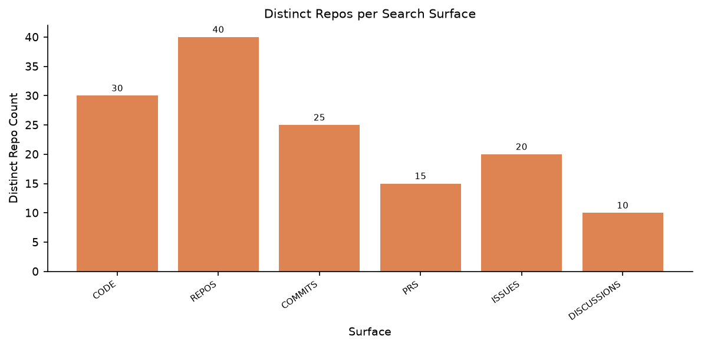

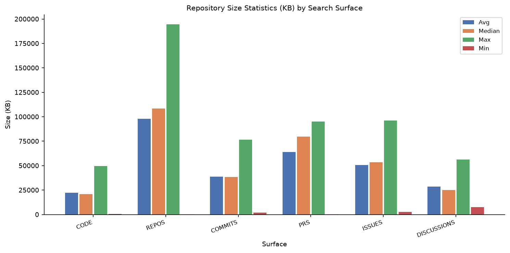

| Surface | Avg (KB) | Median (KB) | Max (KB) | Min (KB) | Std Dev | Count |
| --- | --- | --- | --- | --- | --- | --- |
| CODE | 22,162.5 | 20,987.5 | 49,630 | 525 | 13,422.6 | 30 |
| REPOS | 97,951.9 | 108,517.5 | 194,670 | 156 | 55,333.4 | 40 |
| COMMITS | 38,751.6 | 38,502.0 | 76,669 | 1,874 | 21,263.0 | 25 |
| PRS | 63,987.8 | 79,856.0 | 95,214 | 200 | 33,493.4 | 15 |
| ISSUES | 50,762.9 | 53,406.0 | 96,326 | 2,769 | 25,471.0 | 20 |
| DISCUSSIONS | 28,458.6 | 25,176.0 | 56,306 | 7,498 | 16,382.9 | 10 |
| **All (combined)** | 55,795.7 | 43,213.5 | 194,670 | 156 | 45,455.6 | 140 |

## 2. Search Keyword Hit Distribution

> **Data source:** Search phase — GitHub REST API hit counts per keyword per surface. Keywords from `inputs/mt_search_keywords.txt`.

> **Note on 'unique results':** GitHub's API may return the same repository under multiple keywords. 'Unique results' is the count of deduplicated items after merging all keyword runs for a surface. A single repo can appear in multiple surfaces.

### Total Search Hits per Surface

_Total search hits = sum of `total_count` returned by the API for all keyword queries on each surface (before deduplication). Reflects raw API exposure._

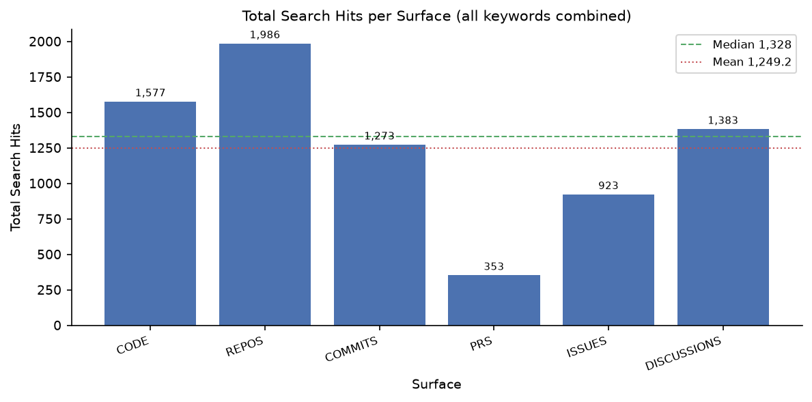

| Surface | Total Search Hits |
| --- | --- |
| CODE | 1,577 |
| REPOS | 1,986 |
| COMMITS | 1,273 |
| PRS | 353 |
| ISSUES | 923 |
| DISCUSSIONS | 1,383 |

### Unique Results per Surface

_Unique results = distinct items collected after deduplication within each surface._

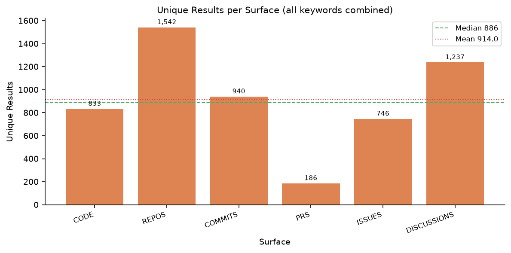

| Surface | Unique Results |
| --- | --- |
| CODE | 833 |
| REPOS | 1,542 |
| COMMITS | 940 |
| PRS | 186 |
| ISSUES | 746 |
| DISCUSSIONS | 1,237 |

### Keywords with ≥1 Unique Result per Surface

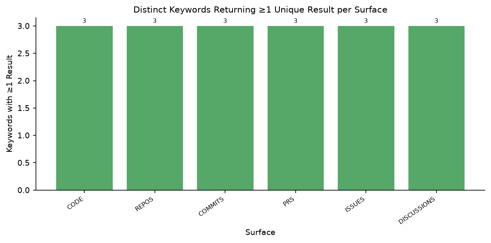

| Surface | Keywords with ≥1 Result |
| --- | --- |
| CODE | 3 |
| REPOS | 3 |
| COMMITS | 3 |
| PRS | 3 |
| ISSUES | 3 |
| DISCUSSIONS | 3 |

### Keyword Hits Across All Surfaces (Ranked)

_Each row is one keyword on one surface, ranked by unique results (highest first). All keyword × surface combinations are shown._

| # | Surface: Keyword | Search Hits | Unique Results |
| --- | --- | --- | --- |
| 1 | REPOS: MetamorphicTest | 490 | 460 |
| 2 | DISCUSSIONS: metamorphic testing | 282 | 250 |
| 3 | REPOS: metamorphic testing | 308 | 241 |
| 4 | CODE: metamorphic relation | 262 | 219 |
| 5 | CODE: metamorphic testing | 229 | 208 |
| 6 | COMMITS: metamorphic testing | 232 | 186 |
| 7 | CODE: MetamorphicTest | 231 | 185 |
| 8 | COMMITS: metamorphic relation | 220 | 140 |
| 9 | ISSUES: metamorphic testing | 125 | 110 |
| 10 | DISCUSSIONS: MetamorphicTest | 116 | 88 |
| 11 | DISCUSSIONS: metamorphic relation | 110 | 84 |
| 12 | ISSUES: metamorphic relation | 113 | 71 |
| 13 | COMMITS: MetamorphicTest | 58 | 54 |
| 14 | PRS: metamorphic relation | 37 | 30 |
| 15 | REPOS: metamorphic relation | 31 | 19 |
| 16 | PRS: MetamorphicTest | 20 | 15 |
| 17 | ISSUES: MetamorphicTest | 20 | 14 |
| 18 | PRS: metamorphic testing | 17 | 14 |

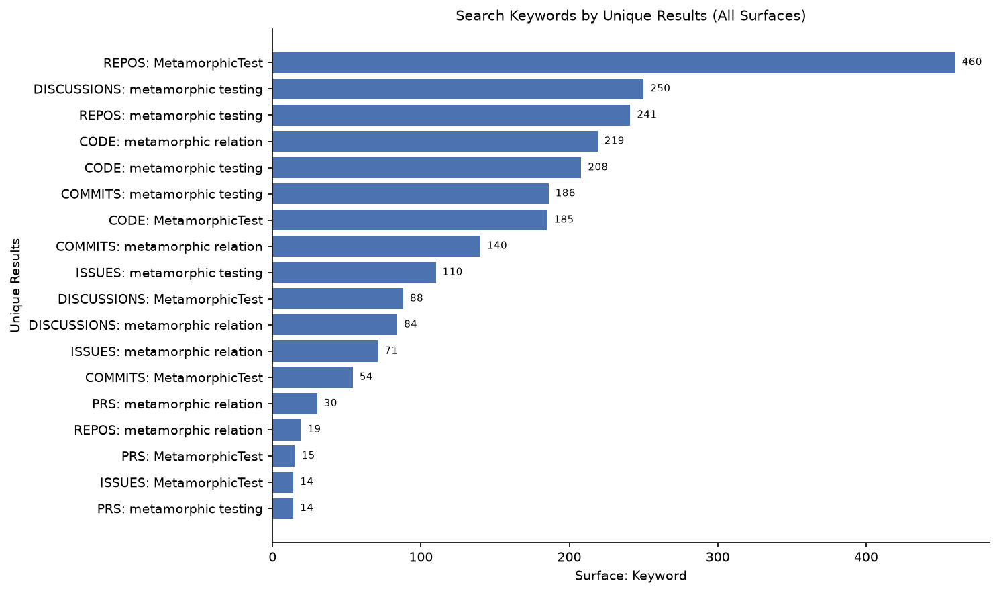

### CODE Surface

_Total unique items: 30_

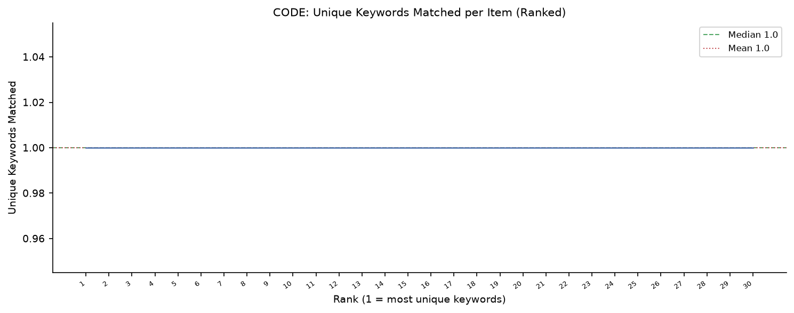

Keywords in CODE (all, ranked by unique results):

| # | Keyword | Search Hits | Unique Results |
| --- | --- | --- | --- |
| 1 | metamorphic relation | 262 | 219 |
| 2 | metamorphic testing | 229 | 208 |
| 3 | MetamorphicTest | 231 | 185 |

### REPOS Surface

_Total unique items: 40_

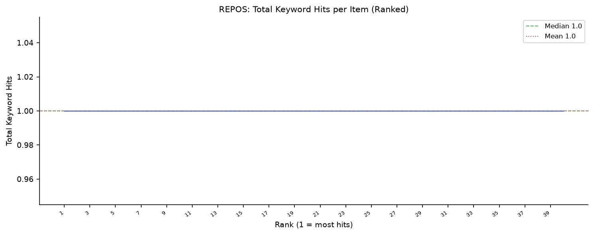

Keywords in REPOS (all, ranked by unique results):

| # | Keyword | Search Hits | Unique Results |
| --- | --- | --- | --- |
| 1 | MetamorphicTest | 490 | 460 |
| 2 | metamorphic testing | 308 | 241 |
| 3 | metamorphic relation | 31 | 19 |

Repositories ranked by keyword hits in REPOS body text:

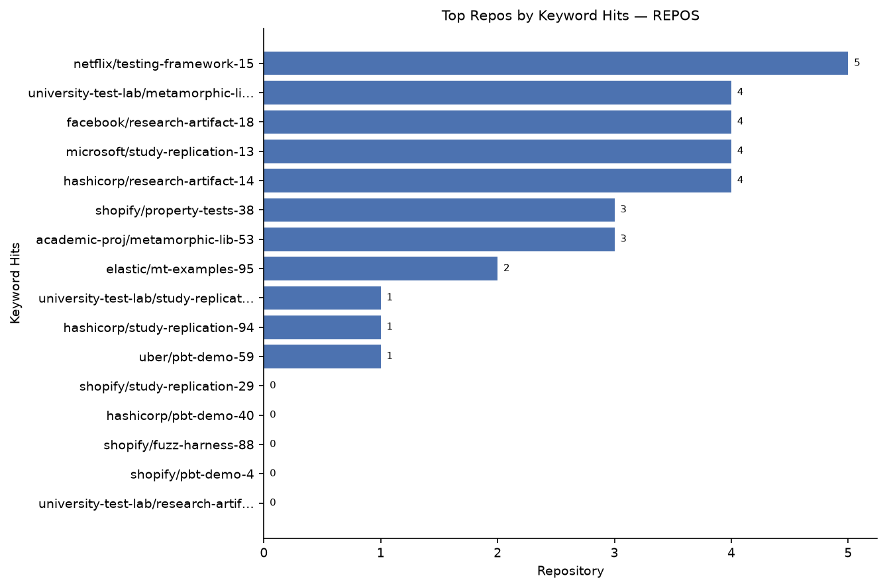

| # | Repository | Keyword Hits |
| --- | --- | --- |
| 1 | netflix/testing-framework-15 | 5 |
| 2 | university-test-lab/metamorphic-lib-56 | 4 |
| 3 | facebook/research-artifact-18 | 4 |
| 4 | microsoft/study-replication-13 | 4 |
| 5 | hashicorp/research-artifact-14 | 4 |
| 6 | shopify/property-tests-38 | 3 |
| 7 | academic-proj/metamorphic-lib-53 | 3 |
| 8 | elastic/mt-examples-95 | 2 |
| 9 | university-test-lab/study-replication-55 | 1 |
| 10 | hashicorp/study-replication-94 | 1 |
| 11 | uber/pbt-demo-59 | 1 |
| 12 | shopify/study-replication-29 | 0 |
| 13 | hashicorp/pbt-demo-40 | 0 |
| 14 | shopify/fuzz-harness-88 | 0 |
| 15 | shopify/pbt-demo-4 | 0 |
| 16 | university-test-lab/research-artifact-83 | 0 |

| Metric | Avg | Median | Max | Min | Std Dev | Repos |
| --- | --- | --- | --- | --- | --- | --- |
| Keyword hits per repo | 2.0 | 1.5 | 5 | 0 | 1.8 | 16 |

### COMMITS Surface

_Total unique items: 25_

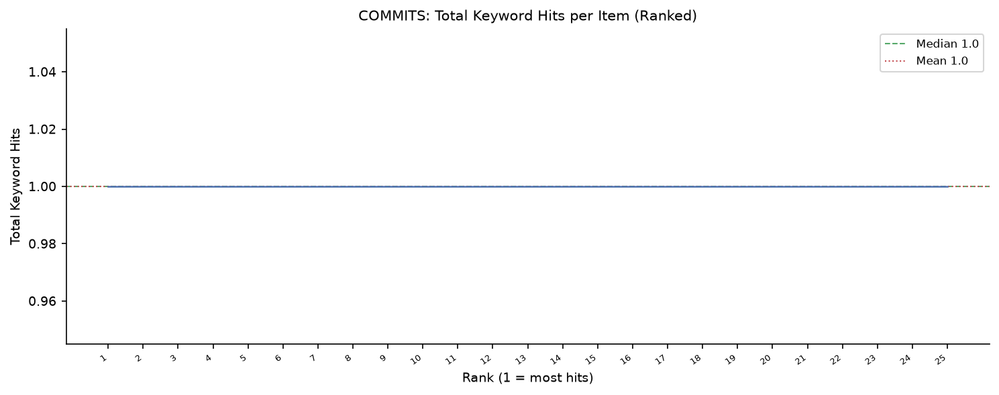

Keywords in COMMITS (all, ranked by unique results):

| # | Keyword | Search Hits | Unique Results |
| --- | --- | --- | --- |
| 1 | metamorphic testing | 232 | 186 |
| 2 | metamorphic relation | 220 | 140 |
| 3 | MetamorphicTest | 58 | 54 |

Repositories ranked by keyword hits in COMMITS body text:

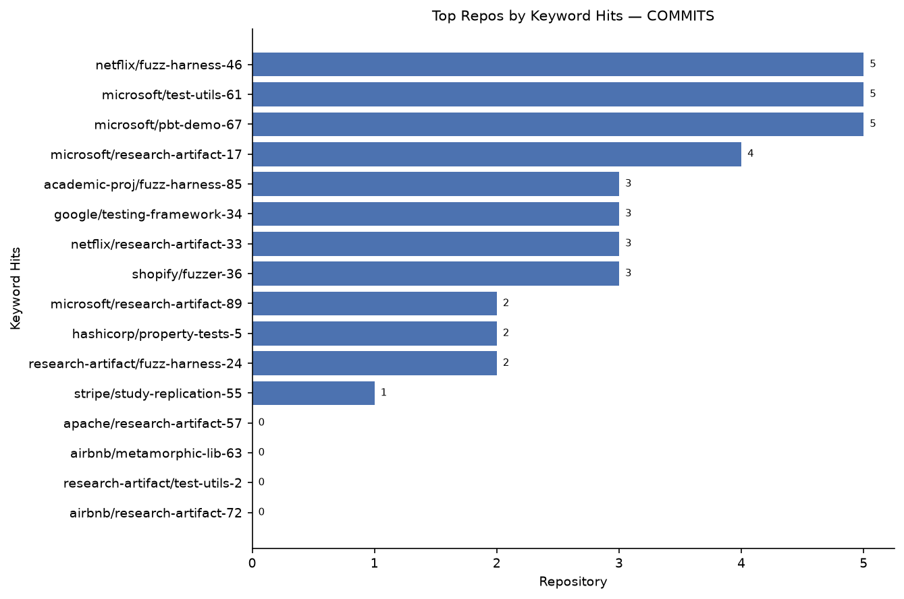

| # | Repository | Keyword Hits |
| --- | --- | --- |
| 1 | netflix/fuzz-harness-46 | 5 |
| 2 | microsoft/test-utils-61 | 5 |
| 3 | microsoft/pbt-demo-67 | 5 |
| 4 | microsoft/research-artifact-17 | 4 |
| 5 | academic-proj/fuzz-harness-85 | 3 |
| 6 | google/testing-framework-34 | 3 |
| 7 | netflix/research-artifact-33 | 3 |
| 8 | shopify/fuzzer-36 | 3 |
| 9 | microsoft/research-artifact-89 | 2 |
| 10 | hashicorp/property-tests-5 | 2 |
| 11 | research-artifact/fuzz-harness-24 | 2 |
| 12 | stripe/study-replication-55 | 1 |
| 13 | apache/research-artifact-57 | 0 |
| 14 | airbnb/metamorphic-lib-63 | 0 |
| 15 | research-artifact/test-utils-2 | 0 |
| 16 | airbnb/research-artifact-72 | 0 |

| Metric | Avg | Median | Max | Min | Std Dev | Repos |
| --- | --- | --- | --- | --- | --- | --- |
| Keyword hits per repo | 2.4 | 2.5 | 5 | 0 | 1.8 | 16 |

### PRS Surface

_Total unique items: 15_

Keywords in PRS (all, ranked by unique results):

| # | Keyword | Search Hits | Unique Results |
| --- | --- | --- | --- |
| 1 | metamorphic relation | 37 | 30 |
| 2 | MetamorphicTest | 20 | 15 |
| 3 | metamorphic testing | 17 | 14 |

Repositories ranked by keyword hits in PRS body text:

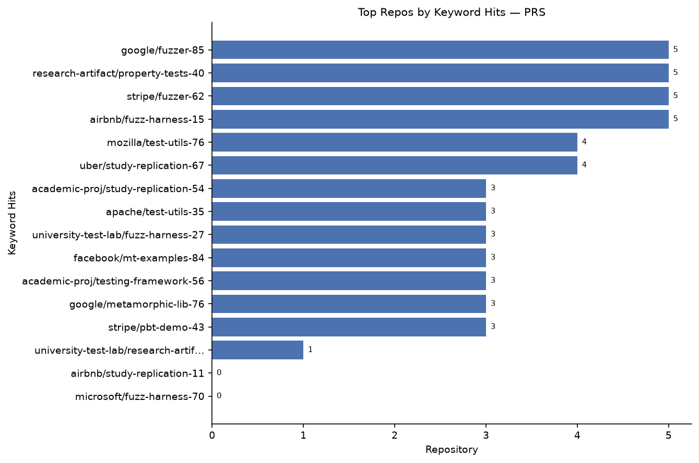

| # | Repository | Keyword Hits |
| --- | --- | --- |
| 1 | google/fuzzer-85 | 5 |
| 2 | research-artifact/property-tests-40 | 5 |
| 3 | stripe/fuzzer-62 | 5 |
| 4 | airbnb/fuzz-harness-15 | 5 |
| 5 | mozilla/test-utils-76 | 4 |
| 6 | uber/study-replication-67 | 4 |
| 7 | academic-proj/study-replication-54 | 3 |
| 8 | apache/test-utils-35 | 3 |
| 9 | university-test-lab/fuzz-harness-27 | 3 |
| 10 | facebook/mt-examples-84 | 3 |
| 11 | academic-proj/testing-framework-56 | 3 |
| 12 | google/metamorphic-lib-76 | 3 |
| 13 | stripe/pbt-demo-43 | 3 |
| 14 | university-test-lab/research-artifact-78 | 1 |
| 15 | airbnb/study-replication-11 | 0 |
| 16 | microsoft/fuzz-harness-70 | 0 |

| Metric | Avg | Median | Max | Min | Std Dev | Repos |
| --- | --- | --- | --- | --- | --- | --- |
| Keyword hits per repo | 3.1 | 3.0 | 5 | 0 | 1.6 | 16 |

### ISSUES Surface

_Total unique items: 20_

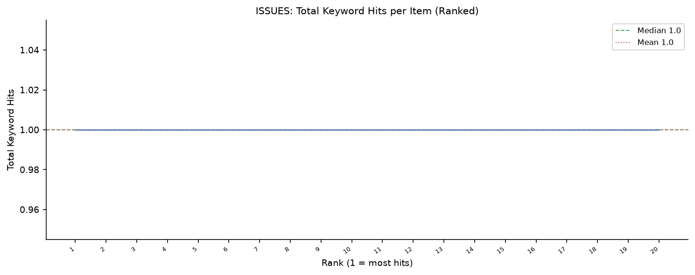

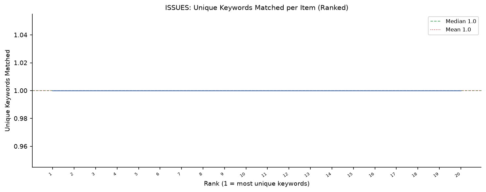

Keywords in ISSUES (all, ranked by unique results):

| # | Keyword | Search Hits | Unique Results |
| --- | --- | --- | --- |
| 1 | metamorphic testing | 125 | 110 |
| 2 | metamorphic relation | 113 | 71 |
| 3 | MetamorphicTest | 20 | 14 |

Repositories ranked by keyword hits in ISSUES body text:

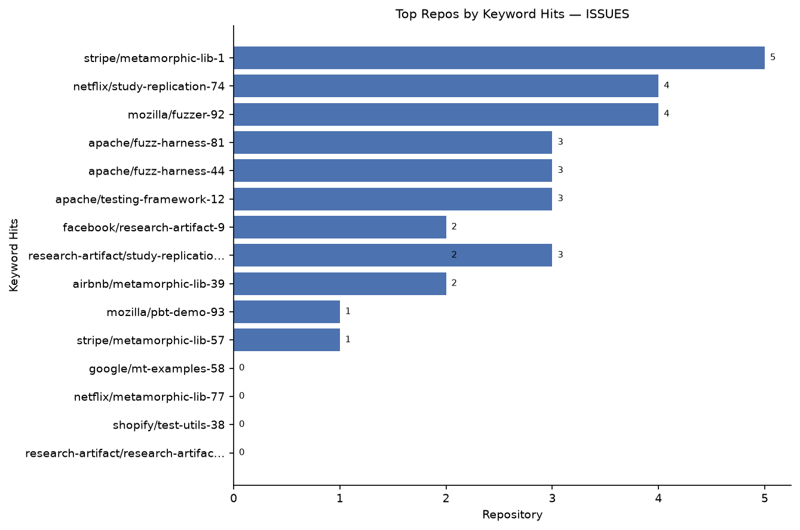

| # | Repository | Keyword Hits |
| --- | --- | --- |
| 1 | stripe/metamorphic-lib-1 | 5 |
| 2 | netflix/study-replication-74 | 4 |
| 3 | mozilla/fuzzer-92 | 4 |
| 4 | research-artifact/study-replication-35 | 3 |
| 5 | apache/fuzz-harness-81 | 3 |
| 6 | apache/fuzz-harness-44 | 3 |
| 7 | apache/testing-framework-12 | 3 |
| 8 | facebook/research-artifact-9 | 2 |
| 9 | research-artifact/study-replication-70 | 2 |
| 10 | airbnb/metamorphic-lib-39 | 2 |
| 11 | mozilla/pbt-demo-93 | 1 |
| 12 | stripe/metamorphic-lib-57 | 1 |
| 13 | google/mt-examples-58 | 0 |
| 14 | netflix/metamorphic-lib-77 | 0 |
| 15 | shopify/test-utils-38 | 0 |
| 16 | research-artifact/research-artifact-45 | 0 |

| Metric | Avg | Median | Max | Min | Std Dev | Repos |
| --- | --- | --- | --- | --- | --- | --- |
| Keyword hits per repo | 2.1 | 2.0 | 5 | 0 | 1.6 | 16 |

### DISCUSSIONS Surface

_Total unique items: 10_

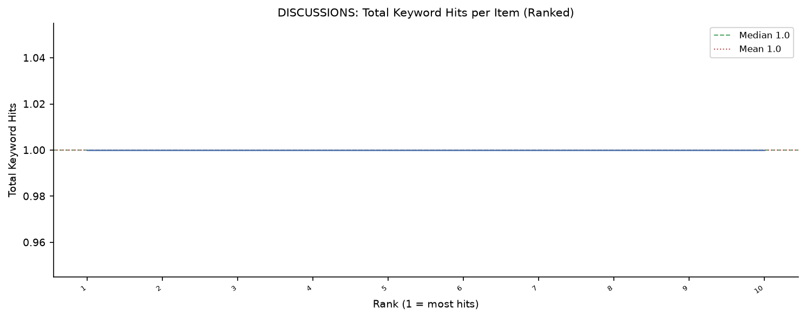

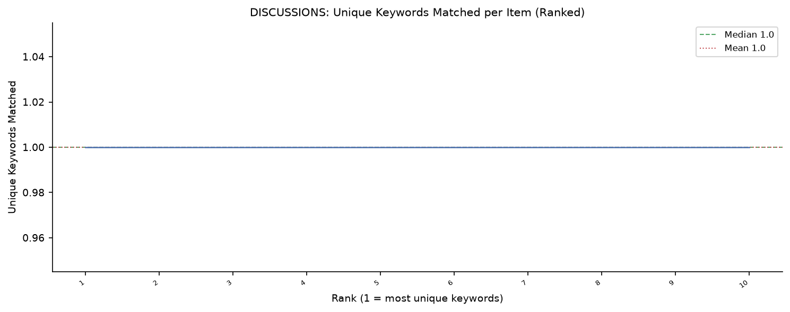

Keywords in DISCUSSIONS (all, ranked by unique results):

| # | Keyword | Search Hits | Unique Results |
| --- | --- | --- | --- |
| 1 | metamorphic testing | 282 | 250 |
| 2 | MetamorphicTest | 116 | 88 |
| 3 | metamorphic relation | 110 | 84 |

Repositories ranked by keyword hits in DISCUSSIONS body text:

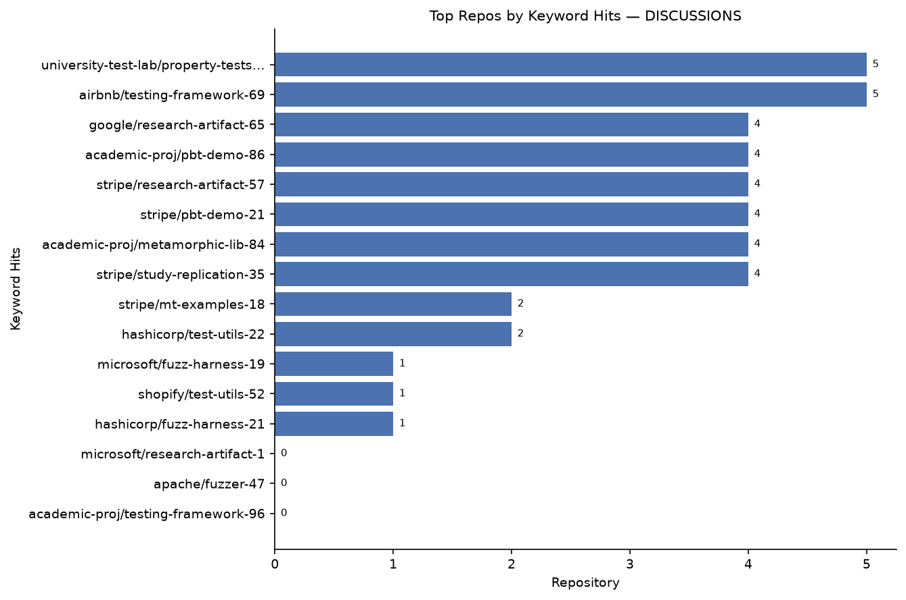

| # | Repository | Keyword Hits |
| --- | --- | --- |
| 1 | university-test-lab/property-tests-32 | 5 |
| 2 | airbnb/testing-framework-69 | 5 |
| 3 | google/research-artifact-65 | 4 |
| 4 | academic-proj/pbt-demo-86 | 4 |
| 5 | stripe/research-artifact-57 | 4 |
| 6 | stripe/pbt-demo-21 | 4 |
| 7 | academic-proj/metamorphic-lib-84 | 4 |
| 8 | stripe/study-replication-35 | 4 |
| 9 | stripe/mt-examples-18 | 2 |
| 10 | hashicorp/test-utils-22 | 2 |
| 11 | microsoft/fuzz-harness-19 | 1 |
| 12 | shopify/test-utils-52 | 1 |
| 13 | hashicorp/fuzz-harness-21 | 1 |
| 14 | microsoft/research-artifact-1 | 0 |
| 15 | apache/fuzzer-47 | 0 |
| 16 | academic-proj/testing-framework-96 | 0 |

| Metric | Avg | Median | Max | Min | Std Dev | Repos |
| --- | --- | --- | --- | --- | --- | --- |
| Keyword hits per repo | 2.6 | 3.0 | 5 | 0 | 1.9 | 16 |

## 3. Testing Technique Density

> **Data source:** Code analysis phase — repos cloned from the CODE search surface and scanned with regexes from `inputs/mt_analysis_keywords.json` and `inputs/shared_analysis_keywords.json`. Only repositories in `code_repos.json` contribute to this section.

**Counting rules:** Each regex match counts as +1 hit. Multiple matches on the same line each count as +1 hit, but only once toward the _hit line_ count. Keywords categorised `general_test` measure broad test presence; `specific_technique` keywords are the primary adoption metric.

### Analysis Keyword Hits (Code Repos)

_`specific_technique` keywords are the primary metric. `general_test` keywords measure baseline testing activity. All keywords shown._

| # | Keyword | Category | Total Hits |
| --- | --- | --- | --- |
| 1 | abbreviation MT | specific_technique | 366 |
| 2 | metamorphic test(ing) | specific_technique | 319 |
| 3 | metamorphic relation | specific_technique | 287 |
| 4 | assertRelation | specific_technique | 265 |
| 5 | class MetamorphicTest | specific_technique | 216 |

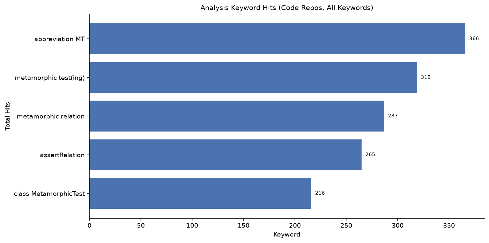

### Analysis Keyword Hits — Non-Code Surfaces (Cross-Surface Ranked)

_Keyword hits in non-code item bodies (issues, PRs, commits, discussions, repo descriptions), ranked highest to lowest across all non-code surfaces. All combinations shown._

| # | Surface: Keyword | Hits |
| --- | --- | --- |
| 1 | REPOS: metamorphic relation | 30 |
| 2 | ISSUES: metamorphic testing | 24 |
| 3 | COMMITS: metamorphic relation | 21 |
| 4 | ISSUES: MetamorphicTest | 21 |
| 5 | DISCUSSIONS: metamorphic relation | 18 |
| 6 | PRS: metamorphic testing | 17 |
| 7 | DISCUSSIONS: MetamorphicTest | 17 |
| 8 | COMMITS: metamorphic testing | 16 |
| 9 | COMMITS: MetamorphicTest | 16 |
| 10 | PRS: metamorphic relation | 16 |
| 11 | REPOS: MetamorphicTest | 12 |
| 12 | REPOS: metamorphic testing | 8 |
| 13 | PRS: MetamorphicTest | 7 |
| 14 | DISCUSSIONS: metamorphic testing | 6 |
| 15 | ISSUES: metamorphic relation | 5 |

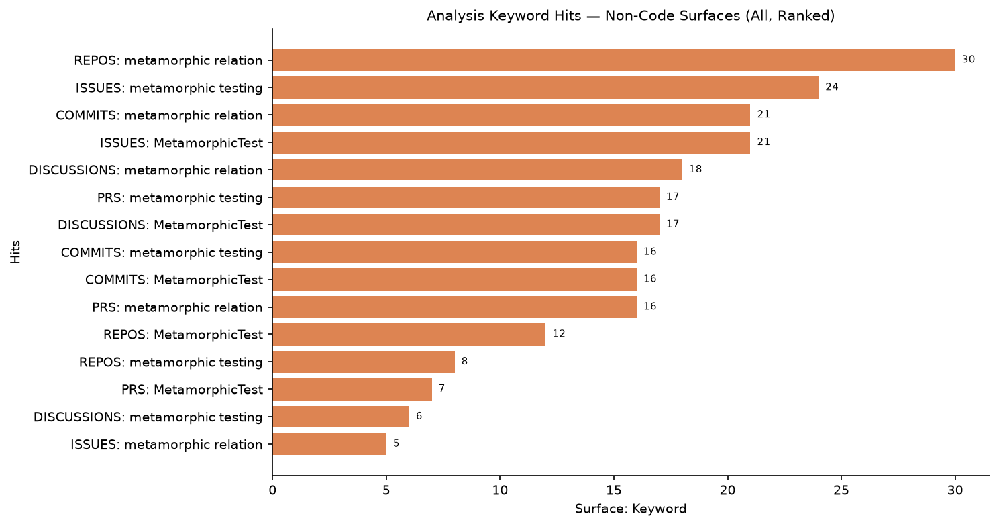

### Technique Density by File Label (10-Label Scheme)

Files are assigned one of 10 mutually-exclusive labels based on file type and keyword hits:

- **technique_\*** — ≥1 `specific_technique` hit (code / doc / config / other)
- **test_\*** — ≥1 `general_test` hit, no specific hits (code / doc / config / other)
- **non_hit_code** — code file with no keyword hits
- **non_hit_ncode** — non-code file with no keyword hits

_File class: code = test_code ∪ source_code, doc = docs, config = config, other = other._

#### Combined Density Table

| Label | Files | % of All Files | Lines | % of All Lines | General Hits | Specific Hits | Hit Line % |
| --- | --- | --- | --- | --- | --- | --- | --- |
| Technique Code (code file, ≥1 specific hit) | 527 | 26.9% | 129,048 | 26.3% | 2,498 | 2,404 | 2.5% |
| Technique Doc (doc file, ≥1 specific hit) | 23 | 1.2% | 6,591 | 1.3% | 30 | 93 | 1.4% |
| Technique Config (config file, ≥1 specific hit) | 21 | 1.1% | 5,485 | 1.1% | 32 | 99 | 2.1% |
| Technique Other (other file, ≥1 specific hit) | 1 | 0.1% | 174 | 0.0% | 0 | 3 | 4.6% |
| Test Code (code file, general-only hits) | 514 | 26.2% | 133,244 | 27.1% | 4,027 | 0 | 1.9% |
| Test Doc (doc file, general-only hits) | 56 | 2.9% | 13,835 | 2.8% | 456 | 0 | 2.0% |
| Test Config (config file, general-only hits) | 39 | 2.0% | 9,407 | 1.9% | 288 | 0 | 2.4% |
| Test Other (other file, general-only hits) | 15 | 0.8% | 4,969 | 1.0% | 125 | 0 | 1.9% |
| Non-Hit Code (code file, no hits) | 322 | 16.4% | 83,003 | 16.9% | 0 | 0 | 0.5% |
| Non-Hit Non-Code (non-code file, no hits) | 442 | 22.6% | 105,124 | 21.4% | 0 | 0 | 0.5% |

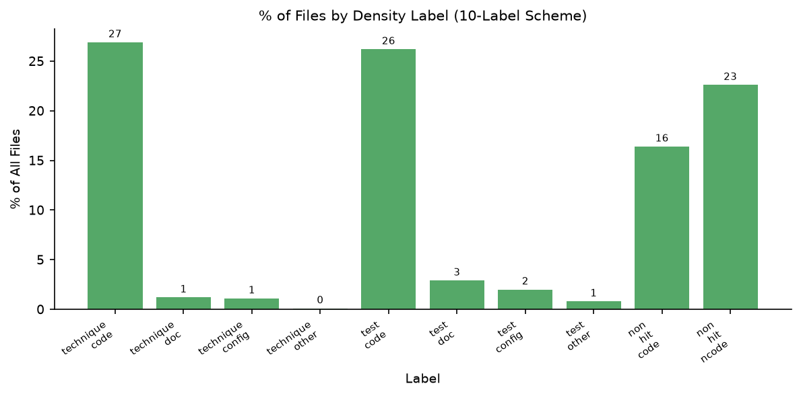

#### Hit File % Summary

_Percentage of files in each label that have at least one general or specific keyword hit._

| Label | Total Files | Hit Files | Hit File % |
| --- | --- | --- | --- |
| Technique Code (code file, ≥1 specific hit) | 527 | 527 | 100.0% |
| Technique Doc (doc file, ≥1 specific hit) | 23 | 23 | 100.0% |
| Technique Config (config file, ≥1 specific hit) | 21 | 21 | 100.0% |
| Technique Other (other file, ≥1 specific hit) | 1 | 1 | 100.0% |
| Test Code (code file, general-only hits) | 514 | 514 | 100.0% |
| Test Doc (doc file, general-only hits) | 56 | 56 | 100.0% |
| Test Config (config file, general-only hits) | 39 | 39 | 100.0% |
| Test Other (other file, general-only hits) | 15 | 15 | 100.0% |
| Non-Hit Code (code file, no hits) | 322 | 0 | 0.0% |
| Non-Hit Non-Code (non-code file, no hits) | 442 | 0 | 0.0% |

#### Hits per File — Extended Statistics

| Label | Files | Avg Gen Hits/File | Avg Spec Hits/File | Hit Line % | Total Gen Hits | Total Spec Hits |
| --- | --- | --- | --- | --- | --- | --- |
| Technique Code (code file, ≥1 specific hit) | 527 | 4.74 | 4.56 | 2.5% | 2,498 | 2,404 |
| Technique Doc (doc file, ≥1 specific hit) | 23 | 1.3 | 4.04 | 1.4% | 30 | 93 |
| Technique Config (config file, ≥1 specific hit) | 21 | 1.52 | 4.71 | 2.1% | 32 | 99 |
| Technique Other (other file, ≥1 specific hit) | 0 | 0.0 | 3.0 | 4.6% | 0 | 3 |
| Test Code (code file, general-only hits) | 514 | 7.83 | 0.0 | 1.9% | 4,027 | 0 |
| Test Doc (doc file, general-only hits) | 56 | 8.14 | 0.0 | 2.0% | 456 | 0 |
| Test Config (config file, general-only hits) | 39 | 7.38 | 0.0 | 2.4% | 288 | 0 |
| Test Other (other file, general-only hits) | 15 | 8.33 | 0.0 | 1.9% | 125 | 0 |
| Non-Hit Code (code file, no hits) | 322 | 0.0 | 0.0 | 0.5% | 0 | 0 |
| Non-Hit Non-Code (non-code file, no hits) | 442 | 0.0 | 0.0 | 0.5% | 0 | 0 |

#### Code Files Only

| Label | Files | % of All Files | Gen Hits | Spec Hits | Hit Line % |
| --- | --- | --- | --- | --- | --- |
| Technique Code (code file, ≥1 specific hit) | 527 | 26.9% | 2,498 | 2,404 | 2.5% |
| Test Code (code file, general-only hits) | 514 | 26.2% | 4,027 | 0 | 1.9% |
| Non-Hit Code (code file, no hits) | 322 | 16.4% | 0 | 0 | 0.5% |

#### Doc Files Only

| Label | Files | % of All Files | Gen Hits | Spec Hits | Hit Line % |
| --- | --- | --- | --- | --- | --- |
| Technique Doc (doc file, ≥1 specific hit) | 23 | 1.2% | 30 | 93 | 1.4% |
| Test Doc (doc file, general-only hits) | 56 | 2.9% | 456 | 0 | 2.0% |
| Non-Hit Non-Code (non-code file, no hits) | 442 | 22.6% | 0 | 0 | 0.5% |

#### Config Files Only

| Label | Files | % of All Files | Gen Hits | Spec Hits | Hit Line % |
| --- | --- | --- | --- | --- | --- |
| Technique Config (config file, ≥1 specific hit) | 21 | 1.1% | 32 | 99 | 2.1% |
| Test Config (config file, general-only hits) | 39 | 2.0% | 288 | 0 | 2.4% |

### Hit Line % per Repo (Ranked)

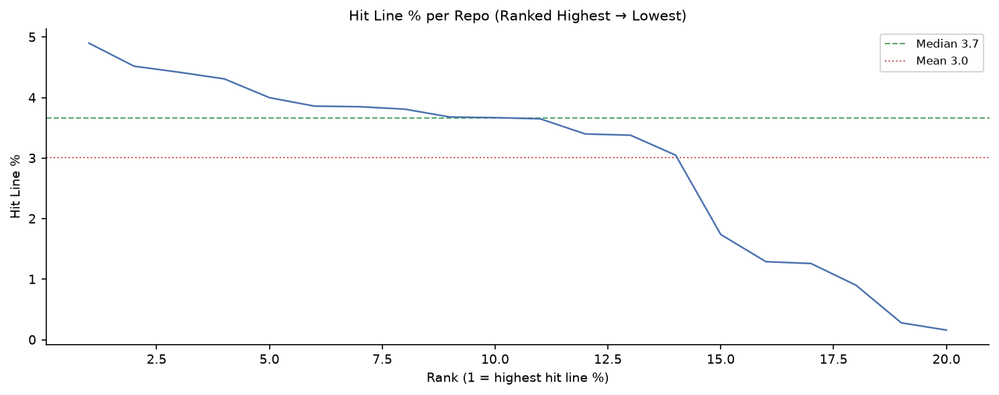

| Metric | Avg | Median | Max | Min | Std Dev | N Repos |
| --- | --- | --- | --- | --- | --- | --- |
| Hit Line % per repo | 3.0 | 3.7 | 5 | 0 | 1.5 | 20 |

### Hit File % per Repo (Ranked)

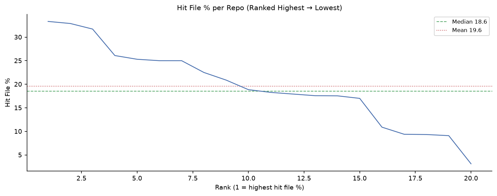

| Metric | Avg | Median | Max | Min | Std Dev | N Repos |
| --- | --- | --- | --- | --- | --- | --- |
| Hit File % per repo | 19.6 | 18.6 | 33 | 3 | 8.4 | 20 |

### Top 20 Repos by Specific Keyword Hits

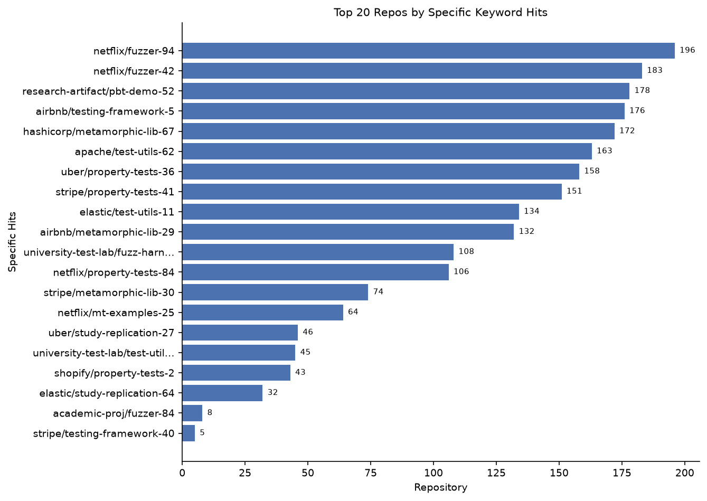

| # | Repository | Specific Hits |
| --- | --- | --- |
| 1 | netflix/fuzzer-94 | 196 |
| 2 | netflix/fuzzer-42 | 183 |
| 3 | research-artifact/pbt-demo-52 | 178 |
| 4 | airbnb/testing-framework-5 | 176 |
| 5 | hashicorp/metamorphic-lib-67 | 172 |
| 6 | apache/test-utils-62 | 163 |
| 7 | uber/property-tests-36 | 158 |
| 8 | stripe/property-tests-41 | 151 |
| 9 | elastic/test-utils-11 | 134 |
| 10 | airbnb/metamorphic-lib-29 | 132 |
| 11 | university-test-lab/fuzz-harness-71 | 108 |
| 12 | netflix/property-tests-84 | 106 |
| 13 | stripe/metamorphic-lib-30 | 74 |
| 14 | netflix/mt-examples-25 | 64 |
| 15 | uber/study-replication-27 | 46 |
| 16 | university-test-lab/test-utils-83 | 45 |
| 17 | shopify/property-tests-2 | 43 |
| 18 | elastic/study-replication-64 | 32 |
| 19 | academic-proj/fuzzer-84 | 8 |
| 20 | stripe/testing-framework-40 | 5 |

### Code Repo Density Summary Statistics

| Metric | Avg | Median | Max | Min | Std Dev | N Repos |
| --- | --- | --- | --- | --- | --- | --- |
| Specific keyword hits per repo | 108.7 | 120.0 | 196 | 5 | 63.7 | 20 |
| General keyword hits per repo | 312.4 | 218.5 | 861 | 10 | 231.8 | 20 |
| Files per repo | 98.0 | 100.5 | 197 | 23 | 46.1 | 20 |
| Hit files per repo | 17.9 | 18.0 | 36 | 3 | 9.8 | 20 |
| Lines per repo | 52,250.3 | 53,179.5 | 99,751 | 3,762 | 33,183.4 | 20 |
| Hit lines per repo | 1,429.7 | 925.0 | 3,547 | 41 | 1,199.2 | 20 |

## 4. Repo Classification

> **Data source:** Code analysis phase — decision tree applied to each cloned repo. Classifications are non-exclusive (a repo may satisfy multiple).

| Classification | Count | % of Code Repos |
| --- | --- | --- |
| research_artifact | 2 | 10.0% |
| framework | 4 | 20.0% |
| actual_usage | 13 | 65.0% |
| unclassified | 1 | 5.0% |

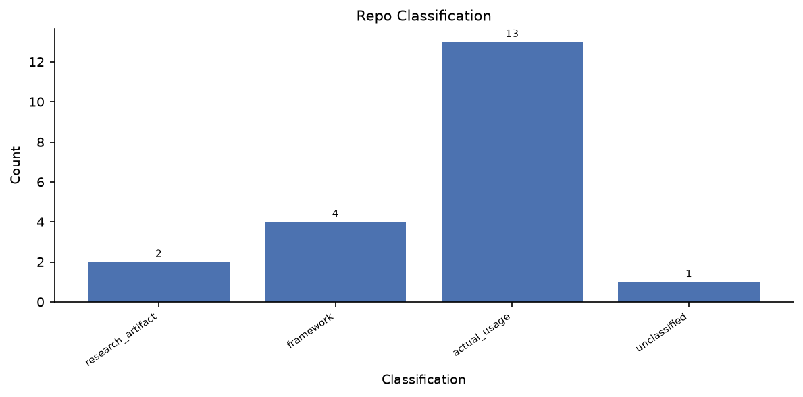

## 5. Technique File Extensions and Language Distribution

> **Data source:** Code analysis phase — file extensions and language counts restricted to files with ≥1 `specific_technique` keyword hit. Binary and image files are excluded. Language is derived from file extension. Language counts are deduplicated per repo (+1 per language per repo maximum).

_Total technique files (≥1 specific hit, non-binary): **571**_

### Technique File Extensions (Ranked)

| Extension | File Count | % of Technique Files |
| --- | --- | --- |
| .py | 86 | 15.1% |
| .cpp | 81 | 14.2% |
| .java | 77 | 13.5% |
| .ts | 77 | 13.5% |
| .rs | 71 | 12.4% |
| .rb | 68 | 11.9% |
| .go | 67 | 11.7% |
| .txt | 9 | 1.6% |
| .rst | 8 | 1.4% |
| .toml | 7 | 1.2% |
| .cfg | 7 | 1.2% |
| .md | 6 | 1.1% |
| .yaml | 5 | 0.9% |
| .json | 2 | 0.4% |

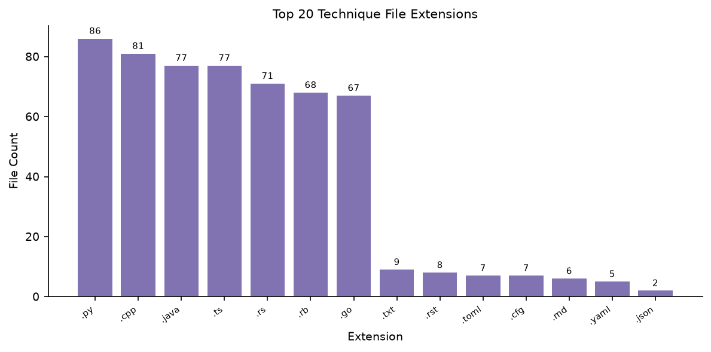

### Technique File Language Distribution (per-Repo Deduplicated)

_Each language counted at most once per repo (repos using Python + Java = +1 for each)._

| Language | Repos with Technique Files |
| --- | --- |
| TypeScript | 20 |
| Python | 20 |
| Ruby | 19 |
| Java | 19 |
| Rust | 18 |
| Go | 18 |
| C++ | 18 |

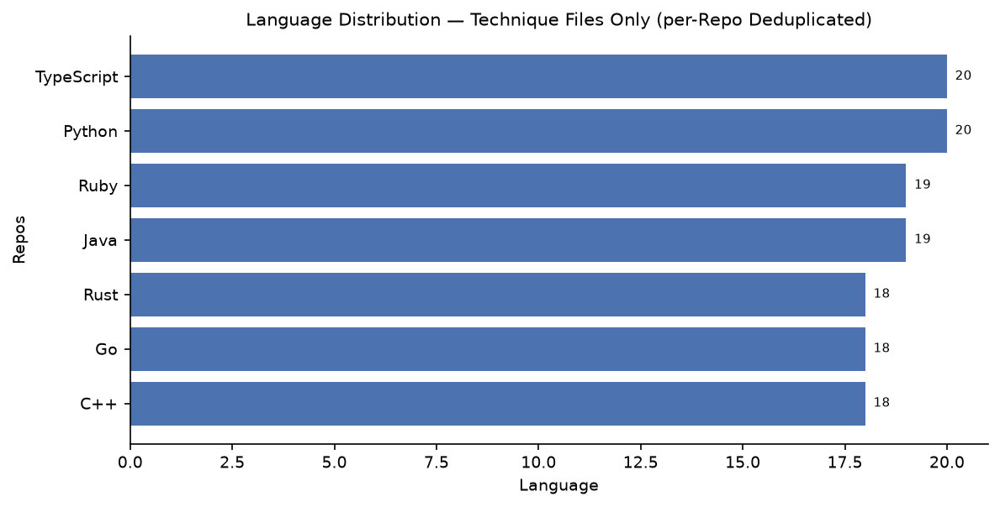

## 6. Language Distribution

> **Data source:** Code analysis phase — primary language of each cloned repo plus per-file language detection from the scan. Each language is counted once per repo it appears in.

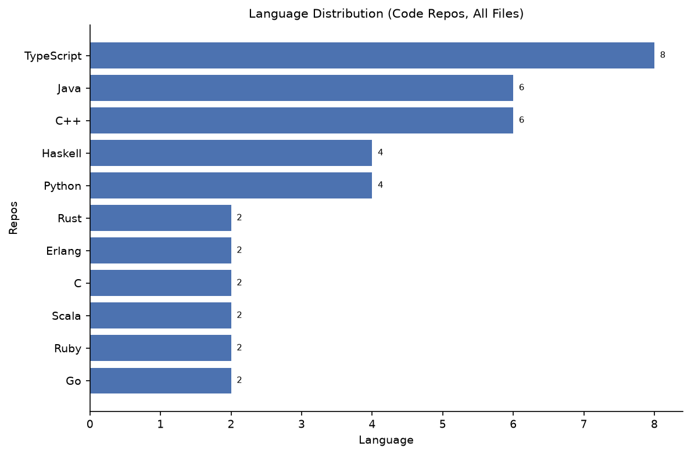

| Language | Repos |
| --- | --- |
| TypeScript | 8 |
| Java | 6 |
| C++ | 6 |
| Haskell | 4 |
| Python | 4 |
| Rust | 2 |
| Erlang | 2 |
| C | 2 |
| Scala | 2 |
| Ruby | 2 |
| Go | 2 |

## 7. Application Domain

> **Data source:** Code analysis and non-code analysis phases — domain keywords matched against repo name, description, and topics; word cloud from non-code surface body text.

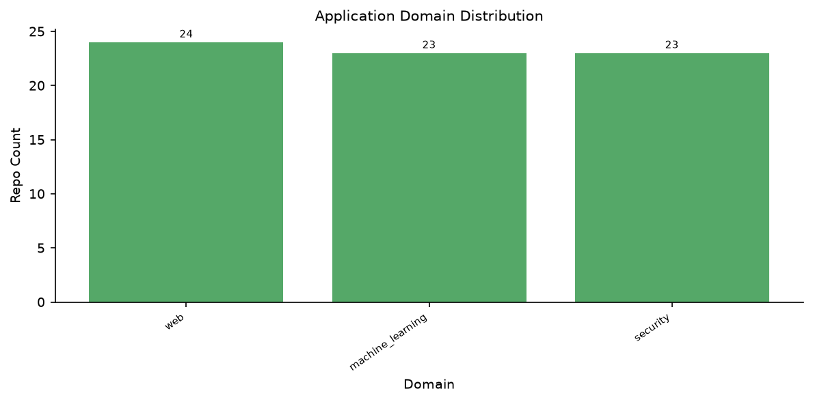

| Domain | Repos |
| --- | --- |
| web | 24 |
| machine_learning | 23 |
| security | 23 |

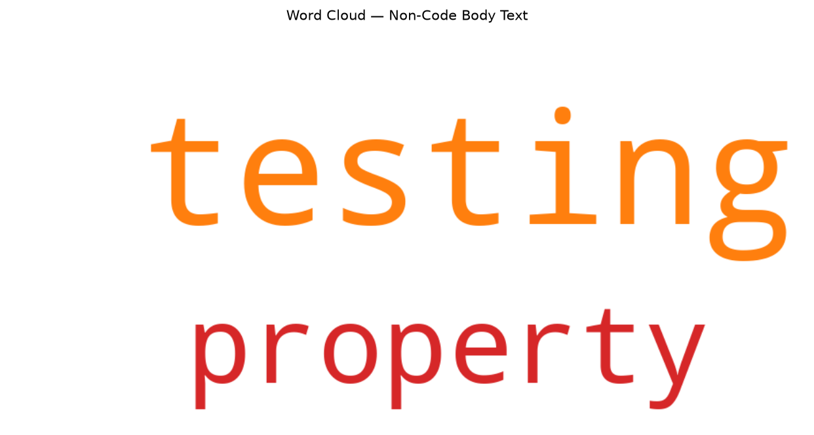

## 8. Timeline

> **Data source:** Code analysis phase — git commit history mined via PyDriller. Only commits from the local git history of cloned repos are counted. Technique commits are those touching files with ≥1 `specific_technique` hit. Creation dates from GitHub API metadata.

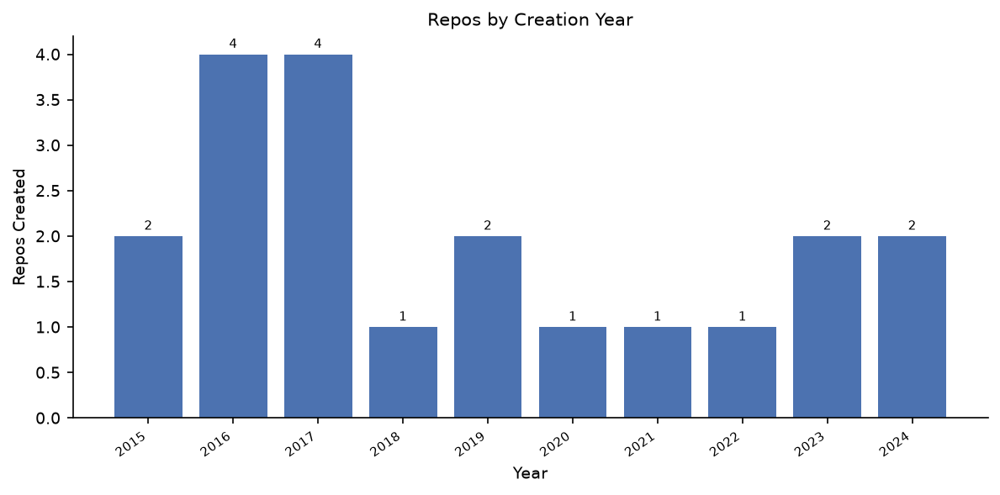

| Year | Repos Created |
| --- | --- |
| 2015 | 2 |
| 2016 | 4 |
| 2017 | 4 |
| 2018 | 1 |
| 2019 | 2 |
| 2020 | 1 |
| 2021 | 1 |
| 2022 | 1 |
| 2023 | 2 |
| 2024 | 2 |

### Technique Commit Span

_Technique Commit Span = total days between the first and last commit touching a technique file in each repo (mined from PyDriller git history)._

| Metric | Avg | Median | Max (days) | Min (days) | Std Dev | N Repos |
| --- | --- | --- | --- | --- | --- | --- |
| Technique commit span (days) | 1,429.9 | 1,293.0 | 2,951 | 119 | 769.9 | 20 |

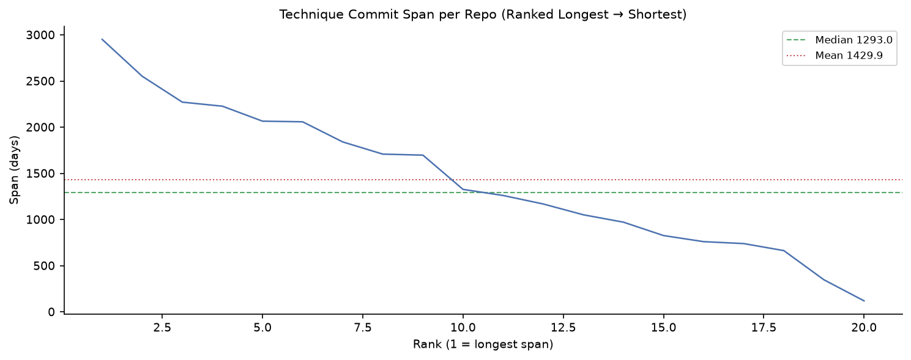

### Monthly Commit Activity (All Commits)

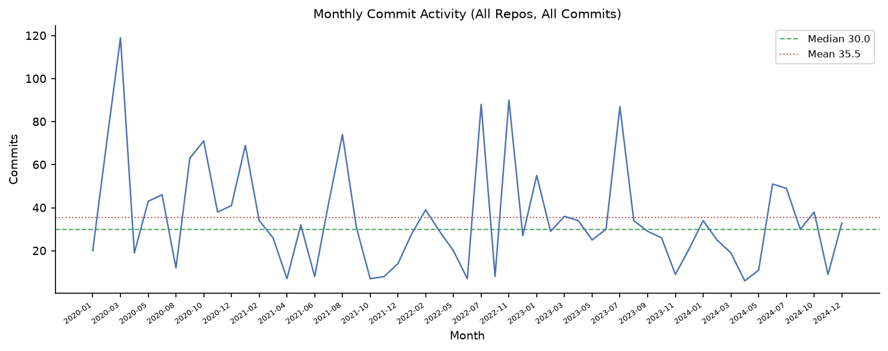

| Metric | Avg | Median | Max | Min | Std Dev | Months |
| --- | --- | --- | --- | --- | --- | --- |
| Commits per month | 35.5 | 30.0 | 119 | 6 | 24.6 | 55 |

### Monthly Technique Commit Activity

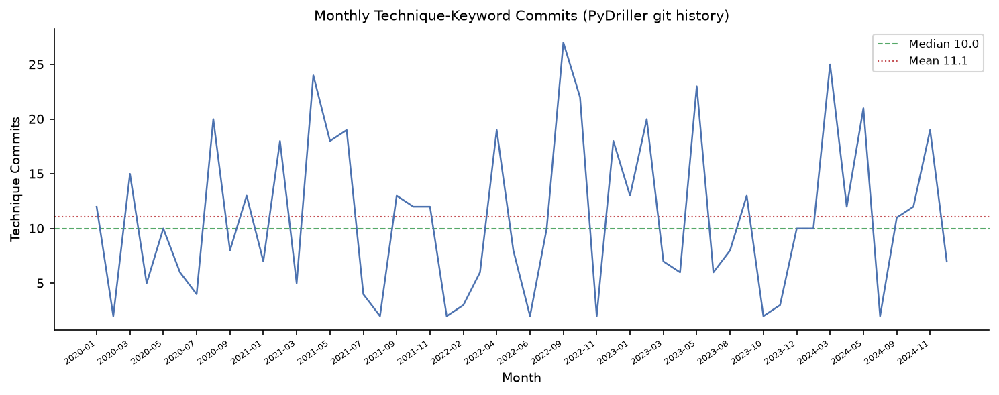

| Metric | Avg | Median | Max | Min | Std Dev | Months |
| --- | --- | --- | --- | --- | --- | --- |
| Technique commits per month | 11.1 | 10.0 | 27 | 2 | 7.1 | 52 |

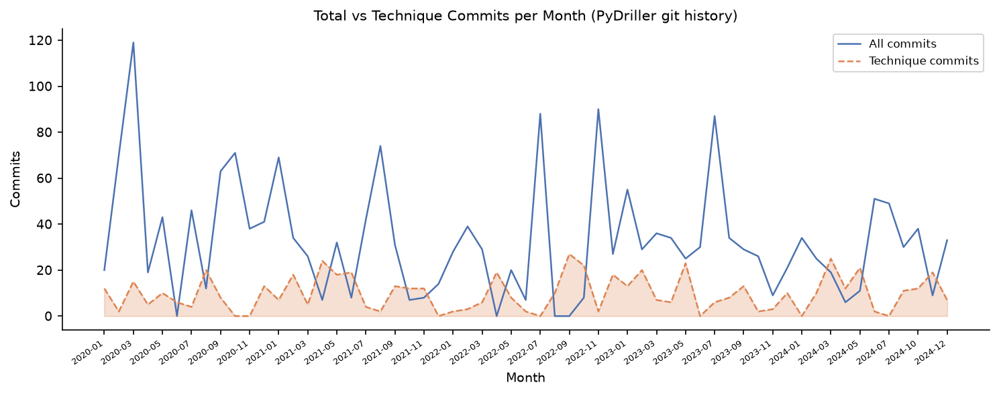

## 9. All Cloned Repositories

_20 repositories were cloned and analysed._

| # | Repository | Stars | Language | Files | Specific Hits | Hit Line % | Span (days) | Classification |
| --- | --- | --- | --- | --- | --- | --- | --- | --- |
| 1 | netflix/fuzzer-94 | 1,525 | Rust | 106 | 196 | 3.7% | 1,326 | actual_usage |
| 2 | netflix/fuzzer-42 | 4,805 | TypeScript | 48 | 183 | 3.7% | 826 | actual_usage |
| 3 | research-artifact/pbt-demo-52 | 2,560 | Java | 100 | 178 | 1.3% | 2,551 | actual_usage |
| 4 | airbnb/testing-framework-5 | 3,056 | Erlang | 102 | 176 | 0.2% | 971 | actual_usage |
| 5 | hashicorp/metamorphic-lib-67 | 4,965 | Scala | 150 | 172 | 0.9% | 1,708 | unclassified |
| 6 | apache/test-utils-62 | 4,637 | Java | 83 | 163 | 3.4% | 1,168 | actual_usage |
| 7 | uber/property-tests-36 | 2,973 | TypeScript | 114 | 158 | 4.5% | 347 | research_artifact |
| 8 | stripe/property-tests-41 | 3,680 | Go | 96 | 151 | 4.4% | 760 | research_artifact |
| 9 | elastic/test-utils-11 | 3,111 | Python | 76 | 134 | 1.7% | 739 | framework |
| 10 | airbnb/metamorphic-lib-29 | 284 | C++ | 41 | 132 | 3.8% | 2,058 | actual_usage |
| 11 | university-test-lab/fuzz-harness-71 | 1,102 | C | 197 | 108 | 4.9% | 1,697 | actual_usage |
| 12 | netflix/property-tests-84 | 711 | TypeScript | 122 | 106 | 3.7% | 2,271 | actual_usage |
| 13 | stripe/metamorphic-lib-30 | 2,323 | C++ | 154 | 74 | 4.0% | 1,840 | framework |
| 14 | netflix/mt-examples-25 | 192 | Ruby | 101 | 64 | 4.3% | 1,260 | actual_usage |
| 15 | uber/study-replication-27 | 3,244 | Haskell | 91 | 46 | 3.0% | 663 | actual_usage |
| 16 | university-test-lab/test-utils-83 | 3,257 | C++ | 40 | 45 | 3.4% | 2,227 | framework |
| 17 | shopify/property-tests-2 | 4,313 | Python | 148 | 43 | 0.3% | 119 | actual_usage |
| 18 | elastic/study-replication-64 | 1,189 | Java | 32 | 32 | 1.3% | 2,065 | actual_usage |
| 19 | academic-proj/fuzzer-84 | 4,712 | TypeScript | 136 | 8 | 3.9% | 1,051 | actual_usage |
| 20 | stripe/testing-framework-40 | 1,438 | Haskell | 23 | 5 | 3.8% | 2,951 | framework |
