# Fuzz Testing — Sections Report

_Generated 2026-10-16 09:51. Explicit technique-phrase search results only. Sections that need cloning (S3, A1a, A2–A5) use a random sample of 1,140 CODE-surface repositories (±3.0% at 95% confidence); A6/A7 use a random sample of verified non-CODE repositories. Caveats: [sections_issues.md](sections_issues.md) · repository lists: [sections_samples.md](sections_samples.md) · results treated as not found: [sections_excluded.md](sections_excluded.md)._

# Search

## S1. Search Hits per Search Surface

_Explicit technique-phrase search keywords only (16: `"fuzz testing"`, `"fuzz test"`, `"fuzzing"`, `"coverage-guided fuzzing"`, `"coverage guided fuzzing"`, `"greybox fuzzing"`, `"grey-box fuzzing"`, `"blackbox fuzzing"`, `"black-box fuzzing"`, `"grammar-based fuzzing"`, `"grammar based fuzzing"`, `"structure-aware fuzzing"`, `"structure aware fuzzing"`, `"fuzz target"`, `"fuzz harness"`, `"fuzz corpus"`). Raw = sum of GitHub `total_count` over these keywords (before deduplication); Unique = distinct items collected that are verified (non-CODE: title/body contains a technique phrase). CODE items are shown as found: they can only be verified by scanning, which is done on a sample (S2, A2)._

| Surface | Raw Search Hits | Unique Results | Retrieved ÷ GitHub total (capped slices) |
| --- | --- | --- | --- |
| CODE | 1,914,838 | 1,490,528 | 92.4% (76/2977 capped) |
| REPOS | 15,908 | 7,050 | 97.2% (2/37 capped) |
| COMMITS | 20,078,501 | 31,901 | 1.6% (268/380 capped) |
| PRS | 1,023,067 | 58,100 | 12.1% (74/159 capped) |
| ISSUES | 163,177 | 38,450 | 61.3% (32/135 capped) |
| DISCUSSIONS | 3,633 | 1,231 | 100.0% (0/22 capped) |

_GitHub returns at most 1,000 results per query; a date/size slice is **capped** when GitHub reported more. Surfaces with capped slices are **lower bounds** (see sections_issues.md)._

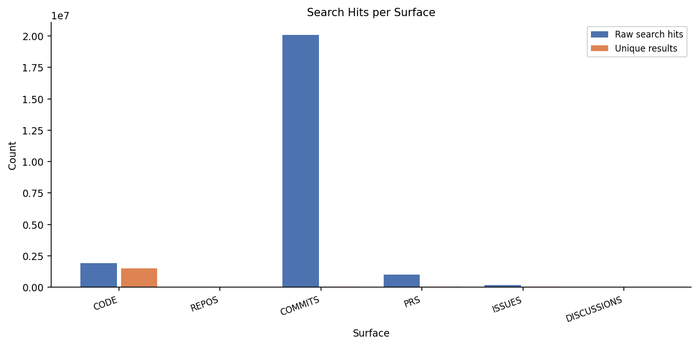

## S2. Distinct Repositories per Search Surface

_Verified repositories only (non-CODE: ≥1 item whose title/body contains a technique phrase; CODE: current snapshot has ≥1 technique hit). CODE is estimated from the random sample (A2): share of sampled repositories with a hit (1,051 of 1,149) × the 255,740 CODE repositories found by search; ± = 95% confidence interval._

| Surface | Distinct Repos |
| --- | --- |
| CODE | ≈ 233,928 ± 4,121 |
| REPOS | 7,050 |
| COMMITS | 13,355 |
| PRS | 29,251 |
| ISSUES | 12,519 |
| DISCUSSIONS | 561 |
| **Non-CODE surfaces (union)** | **55,281** |

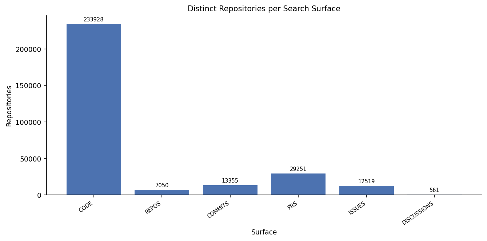

_Number of non-CODE surfaces each repository appears on:_

| Surfaces | Repos | % of union |
| --- | --- | --- |
| 1 | 49,253 | 89.1% |
| 2 | 4,719 | 8.5% |
| 3 | 1,196 | 2.2% |
| 4 | 108 | 0.2% |
| 5 | 5 | 0.0% |

## S3. Size of Analysed CODE-Surface Repositories

_1,051 CODE-surface repositories (verified, see A2). Files = scannable files; lines of code = lines in code files only._

_Random sample of the CODE population (see A2); ±3.0% margin for proportions; the statistics below describe the sampled repositories._

| Metric | Min | P25 | Median | Avg | P75 | Max | Std Dev | N | Total |
| --- | --- | --- | --- | --- | --- | --- | --- | --- | --- |
| Files per repo | 1 | 94 | 475 | 5,754 | 2,870 | 228,362 | 17,597 | 1,051 | 6,047,657 |
| Code files per repo | 0 | 24 | 165 | 3,337 | 1,251 | 97,612 | 10,866 | 1,051 | 3,507,000 |
| Lines of code per repo | 0 | 3,962 | 46,427 | 1,410,253 | 425,907 | 51,496,875 | 5,399,806 | 1,051 | 1,482,175,926 |

_P25 / P75 = 25th / 75th percentile: the middle half of repositories lies between them._

## S4. Keywords Without Results

All 16 search keywords that ran returned results on every surface.

# Analysis

## A1. Top Analysis Keyword Hits

_One hit = one line matching one technique regex (a phrase wrapped over two lines counts once). **⊂ parent** = comment/string variant also counted by its parent; excluded from totals._

_(a) uses the random CODE sample (A2); (b) uses every collected non-CODE item._

### (a) CODE surface — 1,051 analysed repositories

| # | Keyword | Hits | Files | Repos |
| --- | --- | --- | --- | --- |
| 1 | fuzzing | 18,281 | 7,206 | 909 |
| 2 | fuzz test(ing) | 4,042 | 2,396 | 411 |
| 3 | fuzz target | 3,563 | 2,092 | 128 |
| 4 | comment: fuzz test ⊂ fuzz test(ing) | 1,818 | 1,293 | 219 |
| 5 | fuzz harness | 627 | 516 | 38 |
| 6 | fuzz corpus | 423 | 342 | 45 |
| 7 | coverage-guided fuzzing ⊂ fuzzing | 181 | 166 | 61 |
| 8 | structure-aware fuzzing ⊂ fuzzing | 26 | 24 | 9 |
| 9 | grammar-based fuzzing ⊂ fuzzing | 21 | 17 | 5 |
| 10 | greybox fuzzing ⊂ fuzzing | 13 | 10 | 6 |
| 11 | blackbox fuzzing ⊂ fuzzing | 11 | 11 | 4 |

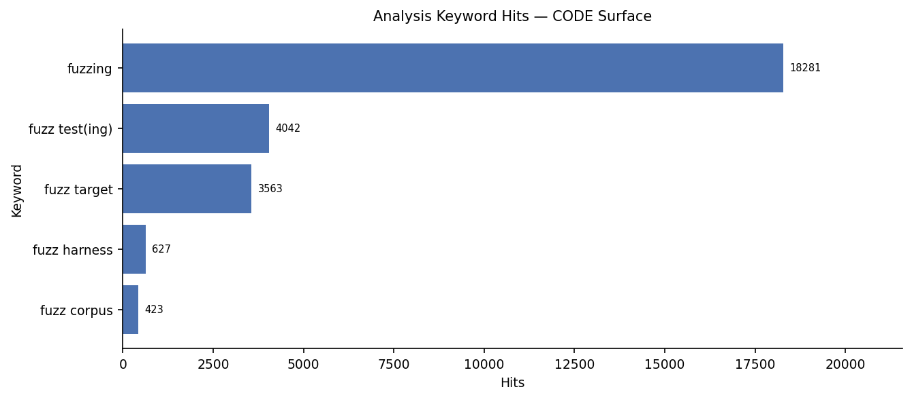

### (b) Non-CODE surfaces — 136,732 search-result titles and bodies

| # | Keyword | REPOS | COMMITS | PRS | ISSUES | DISCUSSIONS | Total Hits | Items |
| --- | --- | --- | --- | --- | --- | --- | --- | --- |
| 1 | fuzzing | 6,974 | 27,608 | 49,312 | 65,996 | 1,683 | 151,573 | 80,998 |
| 2 | fuzz test(ing) | 792 | 15,058 | 30,480 | 15,050 | 617 | 61,997 | 42,471 |
| 3 | fuzz target | 46 | 10,352 | 13,985 | 6,340 | 88 | 30,811 | 19,882 |
| 4 | comment: fuzz test ⊂ fuzz test(ing) | 4 | 845 | 10,127 | 1,704 | 109 | 12,789 | 11,191 |
| 5 | fuzz harness | 37 | 3,126 | 3,336 | 1,640 | 37 | 8,176 | 6,438 |
| 6 | fuzz corpus | 62 | 2,556 | 1,823 | 915 | 12 | 5,368 | 4,278 |
| 7 | coverage-guided fuzzing ⊂ fuzzing | 63 | 1,116 | 585 | 523 | 14 | 2,301 | 1,968 |
| 8 | structure-aware fuzzing ⊂ fuzzing | 8 | 249 | 93 | 123 | 1 | 474 | 402 |
| 9 | greybox fuzzing ⊂ fuzzing | 46 | 105 | 39 | 245 | 7 | 442 | 361 |
| 10 | blackbox fuzzing ⊂ fuzzing | 25 | 67 | 46 | 65 | 1 | 204 | 183 |
| 11 | grammar-based fuzzing ⊂ fuzzing | 22 | 61 | 16 | 38 | 0 | 137 | 127 |

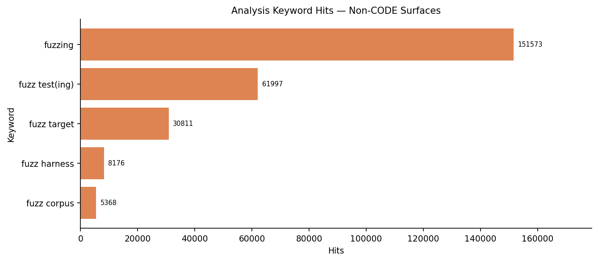

## A2. Cloned Repository Classification

_Usage = ≥1 code file (test or source, incl. `.ipynb`) with a technique phrase · Non-Usage = ≥1 technique hit, none in code files. Seeded random sample of the CODE-surface repositories; only sampled repositories whose current snapshot has a technique hit are included (the rest: sections_excluded.md). ± = 95% confidence interval._

| Population and sample | Repos |
| --- | --- |
| CODE-surface repositories found by search | 255,740 |
| Sample size needed for ±3% at 95% confidence | 1,063 |
| Random sample drawn (incl. extra for unavailable repos) | 1,149 |
| … excluded: no longer available (deleted / private / disabled) | 9 |
| … excluded: scan failed or not scanned yet | 0 |
| … excluded: no technique hit in the current snapshot | 89 |
| **Included (sample)** | **1,051** |
| Margin of error achieved (95%, worst case) | ±2.9% |

| Group | Repos (sample) | % of included (95% CI) | Estimated repos in population |
| --- | --- | --- | --- |
| Usage | 521 | 49.6% ± 3.0 | ≈ 115,962 |
| Non-Usage | 530 | 50.4% ± 3.0 | ≈ 117,965 |

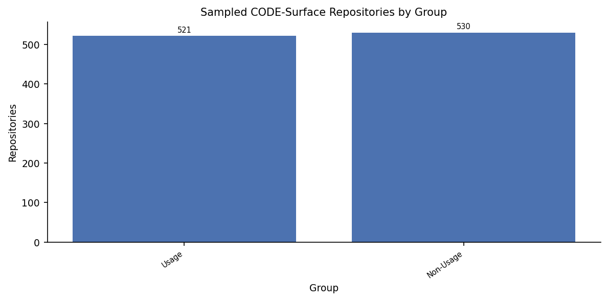

## A3. "Usage" Repository Code-File Classification

_521 usage repositories in the sample; **code files only**. Technique test = test file with a technique phrase · General test = test file without · Technique non-test = non-test code file with a phrase · Non-test = non-test code file without. % of the repo's code files, averaged across repositories._

| Category | Avg % of code files per Repo | Median % | Files (pooled) | % of Pooled Files |
| --- | --- | --- | --- | --- |
| Technique test | 0.6% | 0.0% | 1,329 | 0.0% |
| General test | 17.3% | 10.3% | 417,665 | 13.8% |
| Technique non-test | 3.5% | 0.2% | 2,083 | 0.1% |
| Non-test | 78.7% | 84.1% | 2,614,427 | 86.1% |

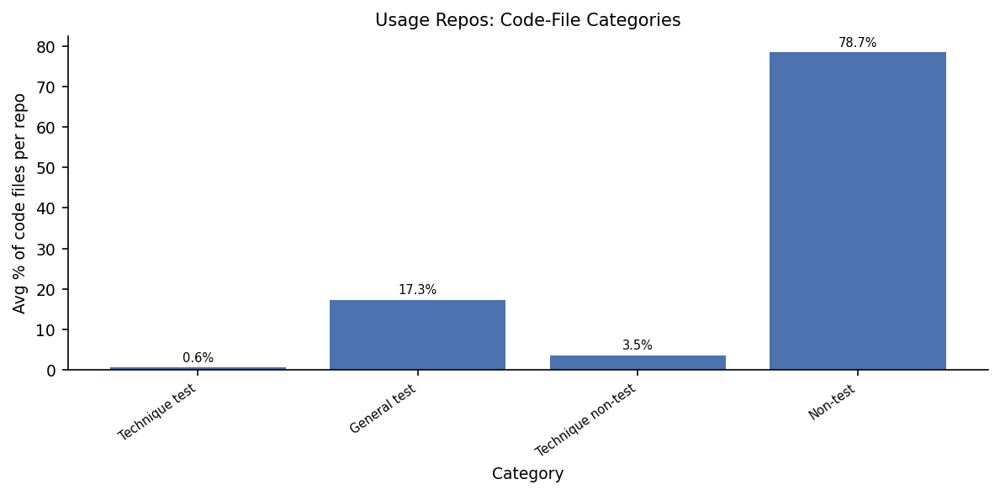

## A4. "Non-Usage" Repository File Classification

_530 non-usage repositories (≥1 technique hit, none in code files). Technique doc = doc file with a hit · General doc = doc file without · General technique = non-doc file with a hit · General = non-doc file without. % of all the repo's files, averaged across repositories._

| Category | Avg % of files per Repo | Median % | Files (pooled) | % of Pooled Files |
| --- | --- | --- | --- | --- |
| Technique doc | 4.0% | 0.4% | 970 | 0.1% |
| General doc | 26.3% | 13.4% | 165,071 | 12.7% |
| General technique | 1.1% | 0.0% | 3,593 | 0.3% |
| General | 68.6% | 83.1% | 1,133,016 | 87.0% |

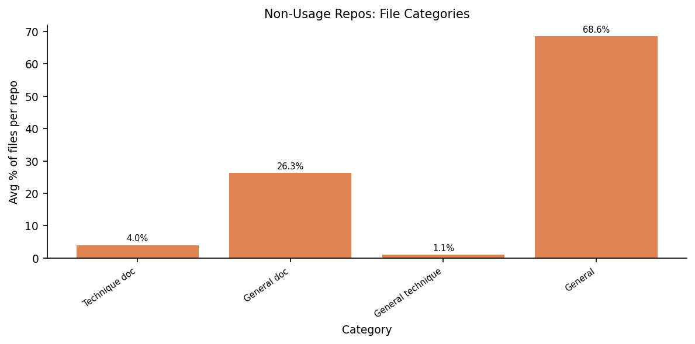

## A5. Primary Language

_Primary language (current GitHub metadata) of the 1,051 analysed sample repositories (62 have none). Shares carry a ±3.0% (worst-case) margin. Lift compares like with like over the 42 languages with a GitHub-wide count: share among our sample repositories in those languages ÷ share among the public repositories in those languages pushed since 2025-09-01; >1 = over-represented._

| Language | Repos | Share | Share (compared languages) | GitHub Share | Lift |
| --- | --- | --- | --- | --- | --- |
| Python | 204 | 20.6% | 21.0% | 18.54% | 1.13 |
| C | 160 | 16.2% | 16.5% | 1.31% | 12.61 |
| C++ | 110 | 11.1% | 11.3% | 2.26% | 5.02 |
| Rust | 92 | 9.3% | 9.5% | 0.81% | 11.72 |
| Go | 70 | 7.1% | 7.2% | 1.05% | 6.87 |
| TypeScript | 68 | 6.9% | 7.0% | 13.36% | 0.52 |
| HTML | 57 | 5.8% | 5.9% | 24.06% | 0.24 |
| JavaScript | 41 | 4.1% | 4.2% | 15.99% | 0.26 |
| Shell | 21 | 2.1% | 2.2% | 1.32% | 1.63 |
| Solidity | 19 | 1.9% | 2.0% | 0.09% | 22.25 |
| PHP | 18 | 1.8% | 1.9% | 1.61% | 1.15 |
| Jupyter Notebook | 14 | 1.4% | 1.4% | 4.19% | 0.34 |
| C# | 13 | 1.3% | 1.3% | 2.12% | 0.63 |
| CSS | 10 | 1.0% | 1.0% | 3.59% | 0.29 |
| Java | 10 | 1.0% | 1.0% | 4.94% | 0.21 |
| Perl | 6 | 0.6% | 0.6% | 0.02% | 29.81 |
| TeX | 6 | 0.6% | 0.6% | 0.16% | 3.75 |
| Swift | 5 | 0.5% | 0.5% | 0.43% | 1.19 |
| Kotlin | 4 | 0.4% | 0.4% | 0.88% | 0.47 |
| MDX | 4 | 0.4% | 0.4% | 0.11% | 3.68 |
| Starlark | 4 | 0.4% | 0.4% | 0.00% | 102.80 |
| Lua | 3 | 0.3% | 0.3% | 0.43% | 0.72 |
| Makefile | 3 | 0.3% | 0.3% | 0.11% | 2.68 |
| OCaml | 3 | 0.3% | 0.3% | 0.01% | 29.00 |
| Scala | 3 | 0.3% | 0.3% | 0.03% | 11.31 |

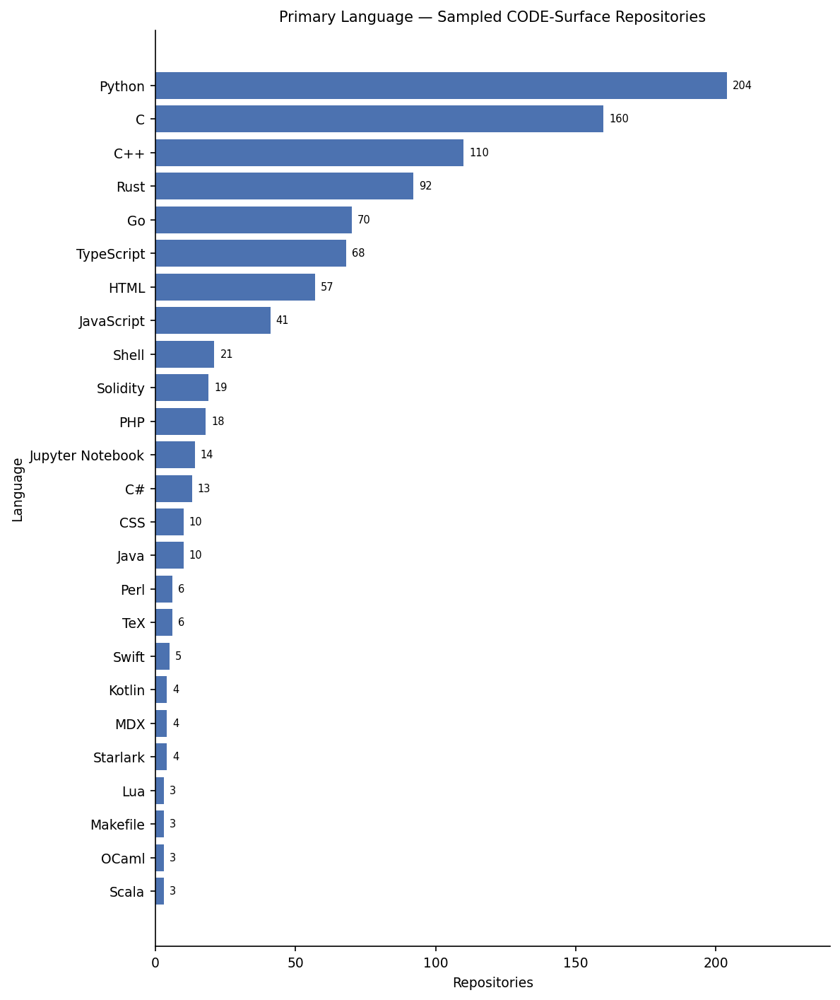

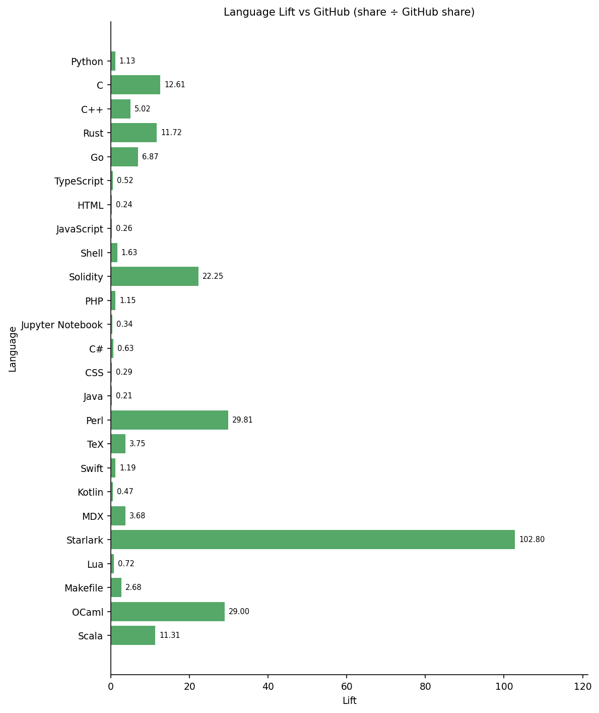

## A6. Application Domain

_Seeded random sample of 1,131 of the 55,281 verified non-CODE repositories; 1,126 still exist and are counted (±2.9% margin at 95% confidence)._

_1,126 non-CODE repositories with ≥1 relevant item (1,063 with a README); one count per repository, several domains possible; word-boundary keyword matching (`inputs/domain_keywords.json`). Description + topics: any domain keyword. + README: the README adds a domain only if it contains ≥3 different keywords of that domain._

| Domain | Repos (description + topics) | % | Repos (+ README) | % |
| --- | --- | --- | --- | --- |
| Web Api | 65 | 5.8% | 178 | 15.8% |
| Security Crypto | 73 | 6.5% | 153 | 13.6% |
| Database | 34 | 3.0% | 99 | 8.8% |
| Compiler Pl | 47 | 4.2% | 75 | 6.7% |
| Operating Systems | 20 | 1.8% | 70 | 6.2% |
| Finance | 38 | 3.4% | 60 | 5.3% |
| Machine Learning | 40 | 3.6% | 45 | 4.0% |
| Embedded Iot | 18 | 1.6% | 27 | 2.4% |
| Distributed Systems | 17 | 1.5% | 26 | 2.3% |
| Scientific Computing | 15 | 1.3% | 15 | 1.3% |
| Autonomous Robotics | 7 | 0.6% | 7 | 0.6% |
| Bioinformatics | 0 | 0.0% | 0 | 0.0% |
| _No domain matched_ | 817 | 72.6% | 621 | 55.2% |

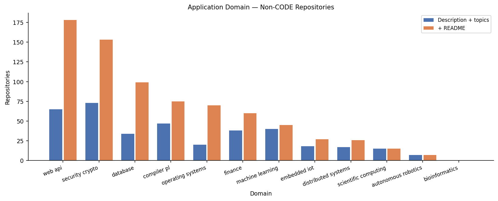

## A7. Word Cloud Analysis

_README + project description of the 1,126 sampled verified non-CODE repositories (1,063 with a README). Each word counts once per repository; stopwords removed; size ∝ √frequency._

### Domain vocabulary

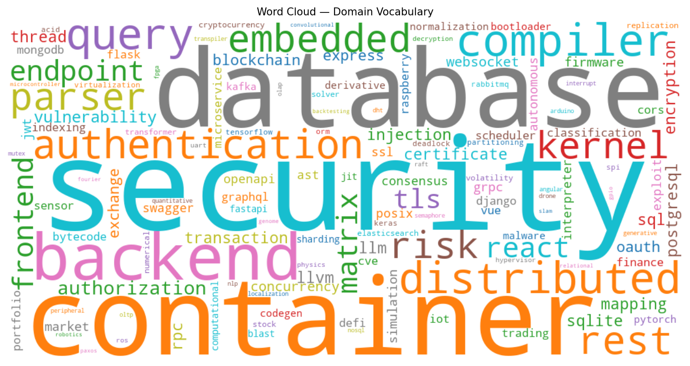

### All words

| # | Domain word | Repos | Word (all) | Repos |
| --- | --- | --- | --- | --- |
| 1 | security | 247 | license | 456 |
| 2 | database | 116 | install | 394 |
| 3 | container | 115 | development | 348 |
| 4 | backend | 101 | api | 330 |
| 5 | compiler | 95 | command | 300 |
| 6 | distributed | 84 | available | 298 |
| 7 | query | 82 | usage | 298 |
| 8 | authentication | 76 | following | 297 |
| 9 | rest | 69 | please | 283 |
| 10 | embedded | 62 | installation | 271 |
| 11 | parser | 60 | tests | 271 |
| 12 | kernel | 56 | running | 259 |
| 13 | risk | 55 | directory | 256 |
| 14 | endpoint | 52 | configuration | 255 |
| 15 | frontend | 52 | library | 254 |
| 16 | matrix | 52 | information | 251 |
| 17 | react | 51 | environment | 249 |
| 18 | tls | 43 | supported | 249 |
| 19 | authorization | 41 | security | 247 |
| 20 | vulnerability | 41 | details | 245 |
| 21 | sql | 37 | system | 244 |
| 22 | llm | 36 | server | 240 |
| 23 | rpc | 36 | linux | 232 |
| 24 | certificate | 35 | contributing | 230 |
| 25 | llvm | 35 | dependencies | 228 |
| 26 | sqlite | 35 | application | 221 |
| 27 | encryption | 34 | python | 221 |
| 28 | transaction | 34 | provides | 220 |
| 29 | injection | 33 | tools | 213 |
| 30 | mapping | 33 | img | 210 |
| 31 | postgresql | 33 | mit | 209 |
| 32 | thread | 33 | started | 207 |
| 33 | blockchain | 30 | rust | 206 |
| 34 | exchange | 28 | quick | 204 |
| 35 | oauth | 26 | building | 202 |
| 36 | express | 25 | access | 197 |
| 37 | concurrency | 24 | state | 197 |
| 38 | websocket | 23 | align | 195 |
| 39 | firmware | 20 | automatically | 193 |
| 40 | grpc | 20 | cli | 190 |

# Timeline (COMMITS surface)

## T8. Repositories by Year of Their First Commit Mentioning the Technique (COMMITS Surface)

_Each of the 13,355 repositories counted once, in the year of its earliest commit whose message contains a technique keyword. A commit message mentioning the technique does not mean the technique is in the code._

| Year | Repos (first commit mentioning the technique) | …that commit agent-marked |
| --- | --- | --- |
| 2010 | 132 | 0 |
| 2011 | 138 | 0 |
| 2012 | 171 | 0 |
| 2013 | 205 | 0 |
| 2014 | 241 | 0 |
| 2015 | 80 | 0 |
| 2016 | 210 | 0 |
| 2017 | 258 | 0 |
| 2018 | 371 | 0 |
| 2019 | 276 | 0 |
| 2020 | 299 | 0 |
| 2021 | 467 | 0 |
| 2022 | 697 | 0 |
| 2023 | 992 | 0 |
| 2024 | 1,195 | 0 |
| 2025 | 2,006 | 97 |
| 2026 | 5,617 | 1,002 |

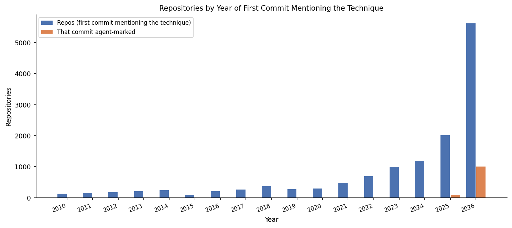

### Repository creation year

_Year each of the 13,355 repositories with ≥1 relevant commit was created on GitHub._

| Year | Repos created |
| --- | --- |
| 2009 | 10 |
| 2010 | 39 |
| 2011 | 75 |
| 2012 | 138 |
| 2013 | 177 |
| 2014 | 246 |
| 2015 | 232 |
| 2016 | 253 |
| 2017 | 290 |
| 2018 | 327 |
| 2019 | 309 |
| 2020 | 381 |
| 2021 | 472 |
| 2022 | 591 |
| 2023 | 914 |
| 2024 | 1,158 |
| 2025 | 2,350 |
| 2026 | 5,381 |

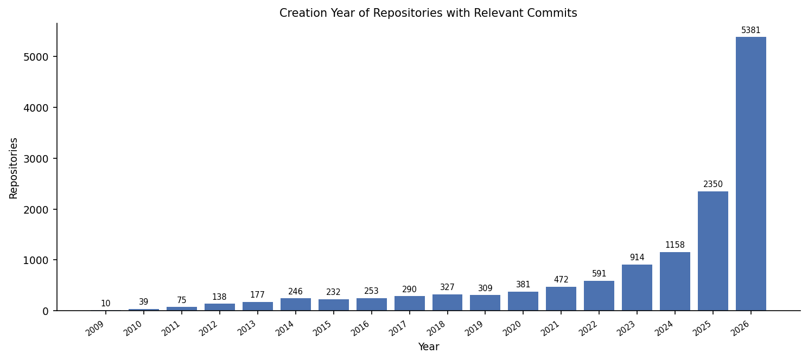

### Repositories by year of first commit mentioning the technique — corrected for the search cap

_Collected = first relevant commit in the downloaded data (a lower bound where the commit search was capped). Estimated = capped date ranges re-sampled (`--commit-sampling`): random time windows downloaded completely, each repository checked for an earlier relevant commit; ± = 95% confidence interval (0 = counted exactly)._

| Year | Collected (lower bound) | Estimated | 95% CI |
| --- | --- | --- | --- |
| 2020 | 299 | 1,955 | ± 382 |
| 2021 | 467 | 2,304 | ± 445 |
| 2022 | 697 | 2,695 | ± 528 |
| 2023 | 992 | 3,062 | ± 565 |
| 2024 | 1,195 | 3,500 | ± 286 |
| 2025 | 2,006 | 7,642 | ± 1,323 |
| 2026 | 5,617 | 31,180 | ± 2,471 |

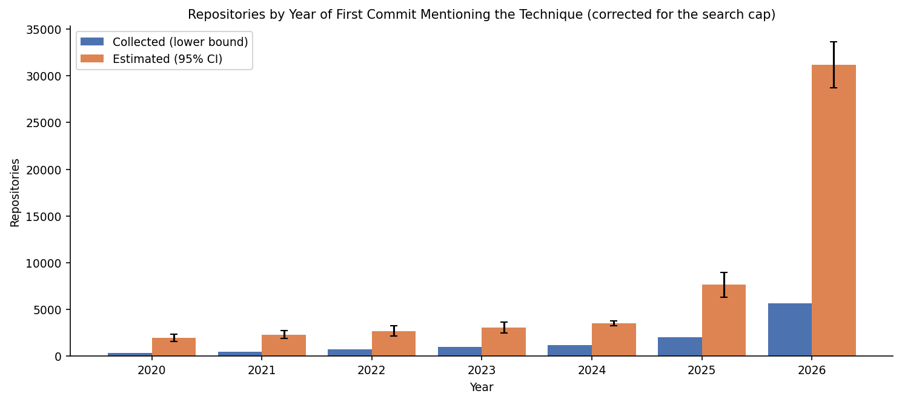

## T9. Commit Activity (COMMITS Surface)

_Relevant = message contains ≥1 technique keyword; Capped = ≤5 relevant commits per repository per month; Without top 10 = excluding the 10 repositories with most relevant commits; Agent-marked = message carries an AI-agent authorship line (lower bound)._

| Year | Relevant | Capped | Without top 10 | Agent-marked | Agent % | Repos | Repos with agent commit |
| --- | --- | --- | --- | --- | --- | --- | --- |
| 2010 | 248 | 248 | 248 | 0 | 0.0% | 132 | 0 |
| 2011 | 367 | 363 | 367 | 0 | 0.0% | 176 | 0 |
| 2012 | 427 | 397 | 427 | 0 | 0.0% | 217 | 0 |
| 2013 | 580 | 566 | 580 | 0 | 0.0% | 255 | 0 |
| 2014 | 557 | 526 | 557 | 0 | 0.0% | 308 | 0 |
| 2015 | 179 | 179 | 179 | 0 | 0.0% | 120 | 0 |
| 2016 | 373 | 369 | 371 | 0 | 0.0% | 254 | 0 |
| 2017 | 604 | 551 | 600 | 0 | 0.0% | 333 | 0 |
| 2018 | 972 | 937 | 946 | 0 | 0.0% | 459 | 0 |
| 2019 | 839 | 788 | 798 | 0 | 0.0% | 376 | 0 |
| 2020 | 1,120 | 1,084 | 988 | 0 | 0.0% | 406 | 0 |
| 2021 | 1,254 | 1,209 | 1,060 | 0 | 0.0% | 577 | 0 |
| 2022 | 2,227 | 1,904 | 1,872 | 0 | 0.0% | 878 | 0 |
| 2023 | 2,939 | 2,401 | 2,227 | 0 | 0.0% | 1,304 | 0 |
| 2024 | 3,635 | 2,995 | 2,833 | 0 | 0.0% | 1,550 | 0 |
| 2025 | 4,770 | 4,421 | 4,486 | 267 | 5.6% | 2,313 | 117 |
| 2026 | 10,810 | 9,425 | 10,472 | 1,867 | 17.3% | 5,886 | 1,105 |

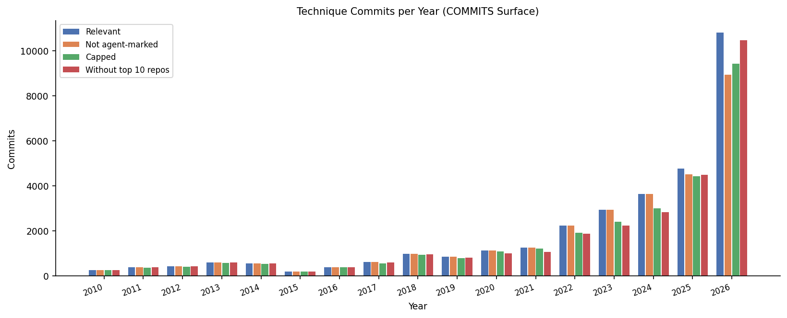

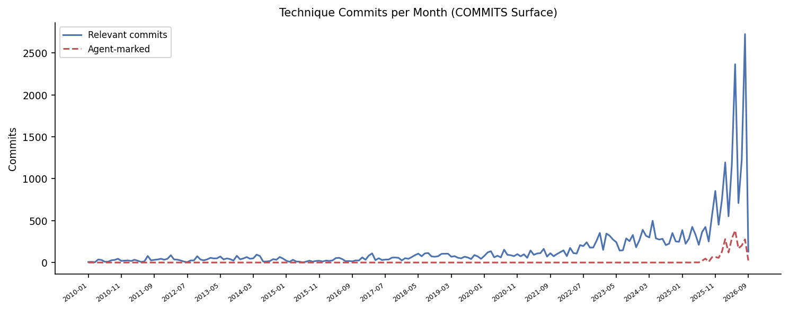

### Agent-marked share — corrected for the search cap

_Collected = share in the downloaded data. Estimated = capped date ranges re-sampled with random time windows (`--commit-sampling`); ± = 95% confidence interval in percentage points._

| Year | Collected share | Estimated share | 95% CI |
| --- | --- | --- | --- |
| 2020 | 0.0% | 0.0% | ± 0.0 pp |
| 2021 | 0.0% | 0.0% | ± 0.0 pp |
| 2022 | 0.0% | 0.3% | ± 0.6 pp |
| 2023 | 0.0% | 0.0% | ± 0.0 pp |
| 2024 | 0.0% | 0.0% | ± 0.0 pp |
| 2025 | 5.6% | 5.2% | ± 1.1 pp |
| 2026 | 17.3% | 27.5% | ± 2.1 pp |

### Commit-search completeness per year

_Retrieved ÷ GitHub's total_count for the commit-search slices of each year (slice midpoint). Years with capped slices are lower bounds; GitHub's total includes fork copies and loose word matches._

| Year | Slices | Capped | GitHub total | Retrieved | Retrieved % |
| --- | --- | --- | --- | --- | --- |
| 2010 | 12 | 7 | 109,019 | 8,414 | 7.7% |
| 2011 | 12 | 12 | 344,955 | 12,000 | 3.5% |
| 2012 | 14 | 12 | 850,154 | 12,364 | 1.5% |
| 2013 | 9 | 9 | 639,892 | 8,999 | 1.4% |
| 2014 | 14 | 10 | 793,456 | 12,073 | 1.5% |
| 2015 | 23 | 16 | 1,219,756 | 17,888 | 1.5% |
| 2016 | 25 | 18 | 1,970,442 | 20,363 | 1.0% |
| 2017 | 28 | 20 | 1,937,048 | 21,881 | 1.1% |
| 2018 | 26 | 18 | 1,731,353 | 19,120 | 1.1% |
| 2019 | 22 | 15 | 2,123,130 | 18,389 | 0.9% |
| 2020 | 34 | 30 | 2,032,831 | 30,142 | 1.5% |
| 2021 | 36 | 20 | 1,557,211 | 27,449 | 1.8% |
| 2022 | 28 | 18 | 1,004,991 | 22,117 | 2.2% |
| 2023 | 25 | 18 | 1,688,450 | 20,714 | 1.2% |
| 2024 | 25 | 17 | 563,458 | 20,249 | 3.6% |
| 2025 | 20 | 12 | 267,006 | 14,849 | 5.6% |
| 2026 | 21 | 16 | 582,961 | 19,931 | 3.4% |
