# Metamorphic Testing — Sections Report

_Generated 2026-10-16 09:50 from `overall.json` → `sections`. Caveats: [sections_issues.md](sections_issues.md) · repository lists: [sections_samples.md](sections_samples.md) · results treated as not found: [sections_excluded.md](sections_excluded.md)._

# Search

## S1. Search Hits per Search Surface

_Raw = sum of GitHub `total_count` over the search keywords (before deduplication; GitHub's own count, cannot be filtered). Unique = distinct collected items that are verified: non-CODE — the title/body contains a technique keyword; CODE — the repository's current snapshot has a technique hit. Unverified results are treated as not found (sections_excluded.md)._

| Surface | Raw Search Hits | Unique Results |
| --- | --- | --- |
| CODE | 49,948 | 28,268 |
| REPOS | 848 | 230 |
| COMMITS | 24,754 | 4,160 |
| PRS | 8,442 | 1,169 |
| ISSUES | 5,213 | 1,175 |
| DISCUSSIONS | 78 | 16 |

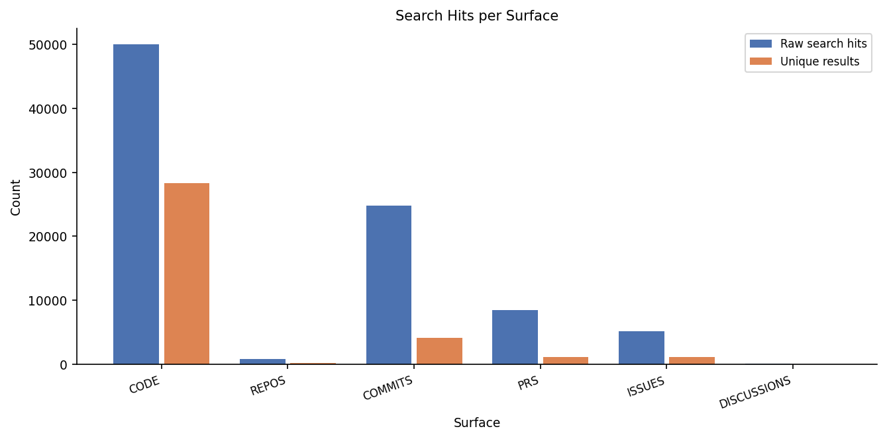

## S2. Distinct Repositories per Search Surface

_Each verified result counted once per owning repository (non-CODE: ≥1 item whose title/body contains a technique keyword; CODE: current snapshot has ≥1 technique hit). Repositories without a verified result are listed in sections_excluded.md._

| Surface | Distinct Repos |
| --- | --- |
| CODE | 5,879 |
| REPOS | 230 |
| COMMITS | 1,156 |
| PRS | 507 |
| ISSUES | 453 |
| DISCUSSIONS | 8 |
| **All surfaces (union)** | **7,060** |

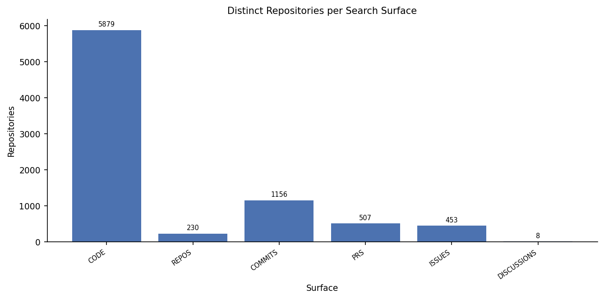

_Number of surfaces each repository appears on:_

| Surfaces | Repos | % of union |
| --- | --- | --- |
| 1 | 6,151 | 87.1% |
| 2 | 695 | 9.8% |
| 3 | 166 | 2.4% |
| 4 | 46 | 0.7% |
| 5 | 2 | 0.0% |

## S3. Size of Analysed CODE-Surface Repositories

_5,879 CODE-surface repositories (verified, see A2). Files = scannable files; lines of code = lines in code files only._

| Metric | Min | P25 | Median | Avg | P75 | Max | Std Dev | N | Total |
| --- | --- | --- | --- | --- | --- | --- | --- | --- | --- |
| Files per repo | 1 | 102 | 388 | 4,899 | 1,614 | 638,612 | 27,479 | 5,879 | 28,801,574 |
| Code files per repo | 0 | 12 | 79 | 907 | 401 | 250,708 | 6,227 | 5,879 | 5,330,852 |
| Lines of code per repo | 0 | 2,002 | 17,964 | 290,827 | 110,874 | 73,658,915 | 2,061,232 | 5,879 | 1,709,770,033 |

_P25 / P75 = 25th / 75th percentile: the middle half of repositories lies between them._

## S4. Keywords Without Results

Of the 18 search keywords, the following returned no results: **REPOS**: metamorphic groups, metamorphic oracle; **PRS**: metamorphic_relation, metamorphic_tests; **ISSUES**: metamorphic_relation, metamorphic_relations; **DISCUSSIONS**: metamorphic relation, metamorphic relationship, metamorphic relationships, metamorphic group, metamorphic groups, MetamorphicTest, MetamorphicRelation, metamorphic_relation, metamorphic_relations, metamorphic_test, metamorphic_tests.

# Analysis

## A1. Top Analysis Keyword Hits

_One hit = one line matching one technique regex (a phrase wrapped over two lines counts once). **⊂ parent** = comment/string variant also counted by its parent; excluded from totals._

### (a) CODE surface — 5,879 analysed repositories

| # | Keyword | Hits | Files | Repos |
| --- | --- | --- | --- | --- |
| 1 | metamorphic test(ing) | 46,334 | 19,913 | 4,370 |
| 2 | metamorphic relation | 28,358 | 13,005 | 2,346 |
| 3 | metamorphic_test* (snake_case) | 17,599 | 1,943 | 372 |
| 4 | identifier MetamorphicTest* | 15,050 | 4,089 | 236 |
| 5 | metamorphic oracle | 11,932 | 1,197 | 321 |
| 6 | comment: metamorphic test ⊂ metamorphic test(ing) | 8,959 | 5,749 | 1,516 |
| 7 | metamorphic_relation* (snake_case) | 8,354 | 956 | 192 |
| 8 | comment: metamorphic relation ⊂ metamorphic relation | 5,779 | 3,197 | 805 |
| 9 | identifier MetamorphicRelation* | 3,791 | 791 | 147 |
| 10 | metamorphic property | 3,341 | 2,381 | 1,000 |
| 11 | string literal: metamorphic test ⊂ metamorphic test(ing) | 2,558 | 925 | 214 |
| 12 | metamorphic_property/oracle/group* (snake_case) | 1,214 | 361 | 90 |
| 13 | metamorphic group | 904 | 161 | 67 |
| 14 | identifier MetamorphicProperty/Oracle/Group* | 508 | 205 | 60 |
| 15 | string literal: metamorphic relation ⊂ metamorphic relation | 211 | 153 | 74 |
| 16 | @metamorphic decorator | 93 | 46 | 9 |

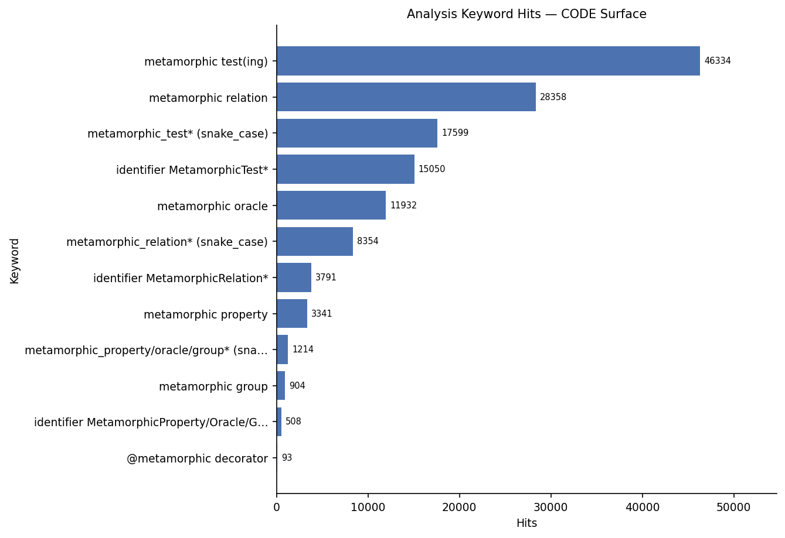

### (b) Non-CODE surfaces — 6,750 search-result titles and bodies

| # | Keyword | REPOS | COMMITS | PRS | ISSUES | DISCUSSIONS | Total Hits | Items |
| --- | --- | --- | --- | --- | --- | --- | --- | --- |
| 1 | metamorphic test(ing) | 203 | 2,973 | 970 | 1,170 | 15 | 5,331 | 4,397 |
| 2 | metamorphic relation | 32 | 1,310 | 274 | 314 | 3 | 1,933 | 1,679 |
| 3 | metamorphic property | 2 | 504 | 150 | 106 | 1 | 763 | 650 |
| 4 | metamorphic_test* (snake_case) | 17 | 215 | 37 | 131 | 0 | 400 | 299 |
| 5 | metamorphic oracle | 0 | 168 | 50 | 35 | 3 | 256 | 235 |
| 6 | comment: metamorphic test ⊂ metamorphic test(ing) | 0 | 37 | 37 | 143 | 2 | 219 | 211 |
| 7 | identifier MetamorphicTest* | 9 | 60 | 15 | 6 | 0 | 90 | 79 |
| 8 | comment: metamorphic relation ⊂ metamorphic relation | 0 | 13 | 17 | 56 | 1 | 87 | 84 |
| 9 | identifier MetamorphicRelation* | 2 | 43 | 34 | 4 | 0 | 83 | 52 |
| 10 | metamorphic_relation* (snake_case) | 1 | 29 | 10 | 1 | 0 | 41 | 40 |
| 11 | metamorphic_property/oracle/group* (snake_case) | 1 | 14 | 15 | 5 | 0 | 35 | 28 |
| 12 | metamorphic group | 1 | 8 | 4 | 4 | 0 | 17 | 16 |
| 13 | identifier MetamorphicProperty/Oracle/Group* | 1 | 7 | 0 | 6 | 0 | 14 | 11 |
| 14 | @metamorphic decorator | 0 | 6 | 0 | 0 | 0 | 6 | 5 |
| 15 | string literal: metamorphic relation ⊂ metamorphic relation | 0 | 2 | 0 | 1 | 0 | 3 | 3 |
| 16 | string literal: metamorphic test ⊂ metamorphic test(ing) | 0 | 0 | 1 | 1 | 0 | 2 | 2 |

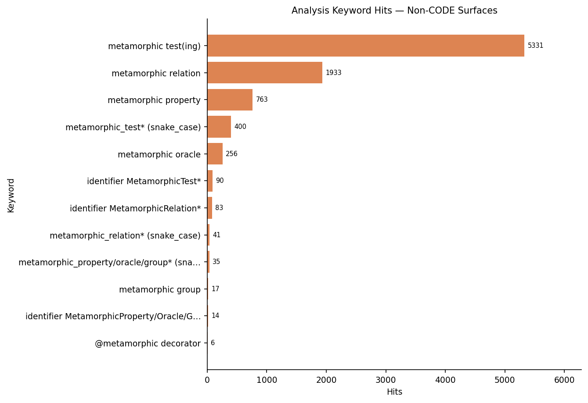

## A2. Cloned Repository Classification

_Usage = ≥1 code file (test or source, incl. `.ipynb`) with a technique hit · Non-Usage = ≥1 technique hit, none in code files. Only repositories whose current snapshot has a technique hit are included; the rest are listed with reasons in sections_excluded.md._

| CODE-surface repositories | Repos |
| --- | --- |
| Found by search | 6,117 |
| Excluded: no longer available (deleted / private / disabled) | 146 |
| Excluded: scan failed or not scanned | 2 |
| Excluded: no technique hit in the current snapshot | 90 |
| **Included** | **5,879** |

| Group | Repos | % of included |
| --- | --- | --- |
| Usage | 1,677 | 28.5% |
| Non-Usage | 4,202 | 71.5% |

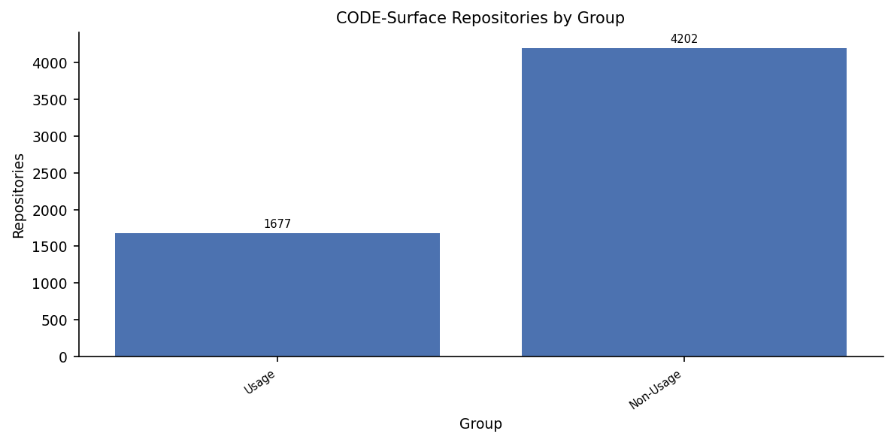

## A3. "Usage" Repository Code-File Classification

_1,677 usage repositories; **code files only** (non-code files ignored). Technique test = test file with a technique hit · General test = test file without · Technique non-test = non-test code file with a hit · Non-test = non-test code file without. % of the repo's code files, averaged across repositories._

| Category | Avg % of code files per Repo | Median % | Files (pooled) | % of Pooled Files |
| --- | --- | --- | --- | --- |
| Technique test | 1.3% | 0.1% | 3,702 | 0.2% |
| General test | 26.3% | 25.0% | 568,103 | 25.3% |
| Technique non-test | 4.1% | 0.1% | 3,333 | 0.1% |
| Non-test | 68.3% | 69.9% | 1,671,337 | 74.4% |

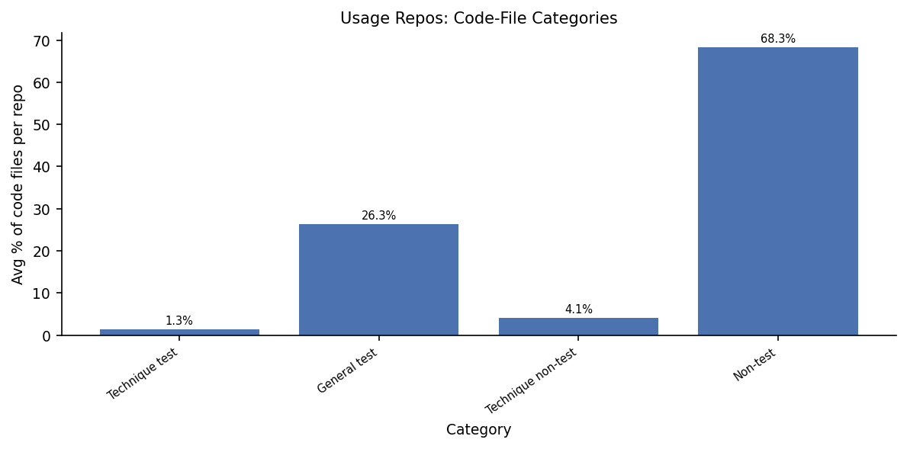

_1,677 usage repositories need manual classification (Actual Usage / Framework / Research Artifact-Tool / Unknown): list with evidence in `sections_samples.md` and `usage_repos_for_review.csv`._

## A4. "Non-Usage" Repository File Classification

_4,202 non-usage repositories (≥1 technique hit, none in code files). Technique doc = doc file with a hit · General doc = doc file without · General technique = non-doc file with a hit · General = non-doc file without. % of all the repo's files, averaged across repositories._

| Category | Avg % of files per Repo | Median % | Files (pooled) | % of Pooled Files |
| --- | --- | --- | --- | --- |
| Technique doc | 2.9% | 0.2% | 8,540 | 0.0% |
| General doc | 37.4% | 29.3% | 7,783,994 | 34.4% |
| General technique | 1.0% | 0.0% | 9,415 | 0.0% |
| General | 58.7% | 66.4% | 14,813,058 | 65.5% |

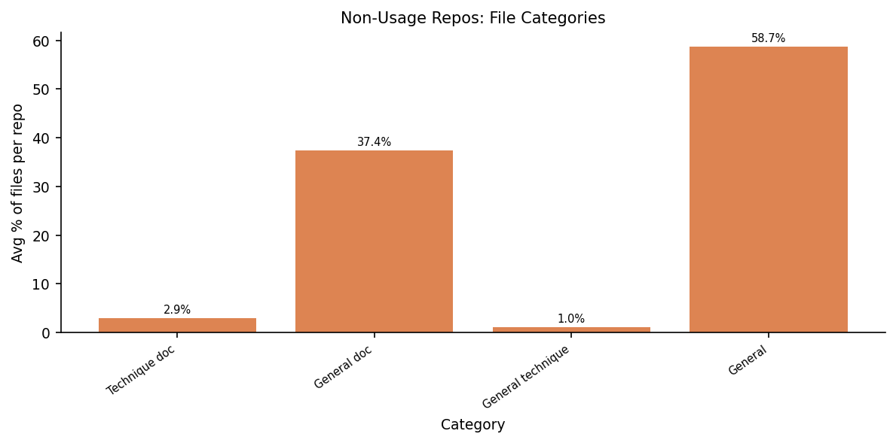

## A5. Primary Language

_Primary language (GitHub metadata) of the 5,879 verified CODE-surface repositories (319 have none). Share = of the repositories with a primary language. Lift compares like with like over the 30 languages with a GitHub-wide count: share among our 5,386 repositories in those languages ÷ share among the 73,255,947 public repositories in those languages pushed since 2025-09-01 (the same 'active in the last year' window as code search); >1 = over-represented._

| Language | Repos | Share | Share (compared languages) | GitHub Share | Lift |
| --- | --- | --- | --- | --- | --- |
| Python | 2,061 | 37.1% | 38.3% | 18.89% | 2.03 |
| TypeScript | 585 | 10.5% | 10.9% | 13.61% | 0.80 |
| HTML | 525 | 9.4% | 9.7% | 24.52% | 0.40 |
| Rust | 426 | 7.7% | 7.9% | 0.82% | 9.61 |
| JavaScript | 394 | 7.1% | 7.3% | 16.29% | 0.45 |
| Jupyter Notebook | 233 | 4.2% | 4.3% | 4.27% | 1.01 |
| TeX | 209 | 3.8% | 3.9% | 0.17% | 23.11 |
| C++ | 165 | 3.0% | 3.1% | 2.30% | 1.33 |
| Go | 150 | 2.7% | 2.8% | 1.07% | 2.61 |
| Java | 127 | 2.3% | 2.4% | 5.03% | 0.47 |
| Shell | 100 | 1.8% | 1.9% | 1.35% | 1.38 |
| C | 57 | 1.0% | 1.1% | 1.33% | 0.80 |
| C# | 57 | 1.0% | 1.1% | 2.16% | 0.49 |
| CSS | 52 | 0.9% | 1.0% | 3.66% | 0.26 |
| R | 29 | 0.5% | 0.5% | 0.31% | 1.75 |
| Haskell | 22 | 0.4% | 0.4% | 0.03% | 16.10 |
| Solidity | 21 | 0.4% | 0.4% | 0.09% | 4.36 |
| SCSS | 19 | 0.3% | 0.4% | 0.18% | 1.96 |
| Zig | 19 | 0.3% | 0.4% | 0.03% | 12.49 |
| Astro | 18 | 0.3% | 0.3% | 0.28% | 1.20 |
| Kotlin | 14 | 0.3% | 0.3% | 0.90% | 0.29 |
| Ruby | 14 | 0.3% | 0.3% | 0.22% | 1.16 |
| Elixir | 12 | 0.2% | 0.2% | 0.03% | 7.21 |
| Lean | 12 | 0.2% | 0.2% | 0.02% | 12.17 |
| MDX | 12 | 0.2% | 0.2% | 0.11% | 1.96 |

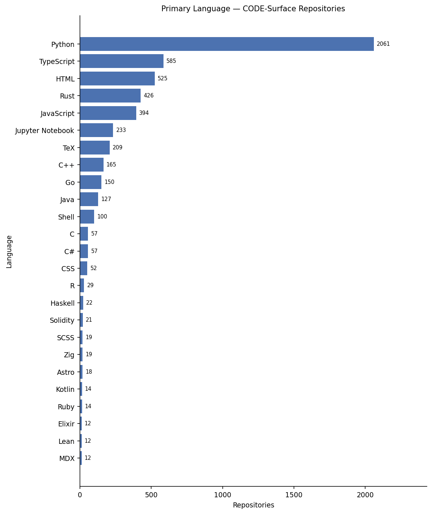

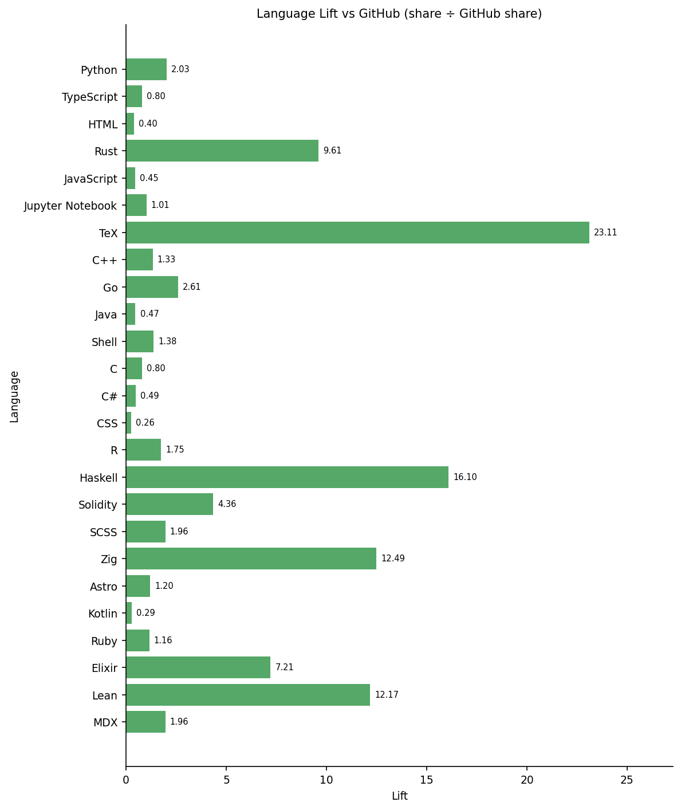

## A6. Application Domain

_1,948 non-CODE repositories with ≥1 relevant item (1,809 with a README); one count per repository, several domains possible; word-boundary keyword matching (`inputs/domain_keywords.json`). Description + topics: any domain keyword. + README: the README adds a domain only if it contains ≥3 different keywords of that domain._

| Domain | Repos (description + topics) | % | Repos (+ README) | % |
| --- | --- | --- | --- | --- |
| Web Api | 83 | 4.3% | 357 | 18.3% |
| Machine Learning | 227 | 11.7% | 349 | 17.9% |
| Database | 92 | 4.7% | 331 | 17.0% |
| Compiler Pl | 100 | 5.1% | 178 | 9.1% |
| Security Crypto | 69 | 3.5% | 170 | 8.7% |
| Scientific Computing | 84 | 4.3% | 131 | 6.7% |
| Operating Systems | 38 | 2.0% | 131 | 6.7% |
| Finance | 65 | 3.3% | 108 | 5.5% |
| Autonomous Robotics | 46 | 2.4% | 61 | 3.1% |
| Distributed Systems | 36 | 1.8% | 56 | 2.9% |
| Embedded Iot | 24 | 1.2% | 32 | 1.6% |
| Bioinformatics | 13 | 0.7% | 16 | 0.8% |
| _No domain matched_ | 1,317 | 67.6% | 869 | 44.6% |

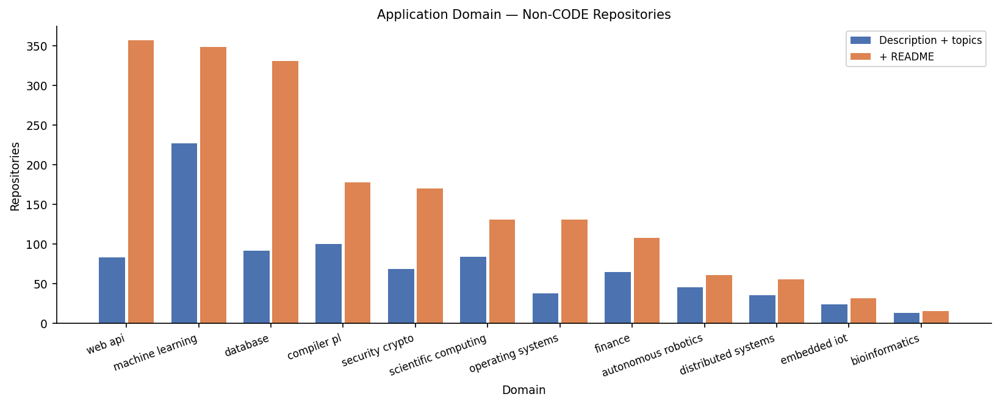

## A7. Word Cloud Analysis

_README + project description of the 1,948 verified non-CODE repositories (1,809 with a README). Each word counts once per repository; stopwords removed; size ∝ √frequency._

### Domain vocabulary

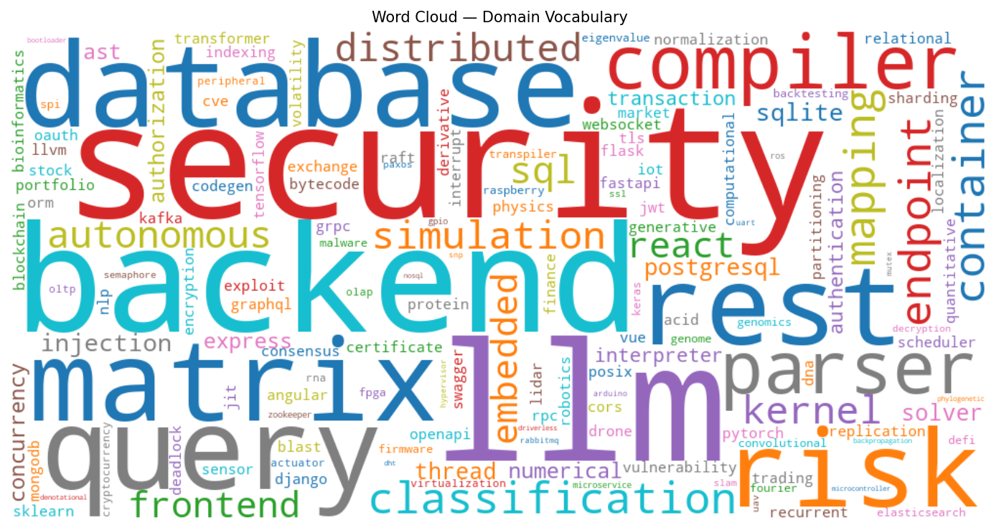

### All words

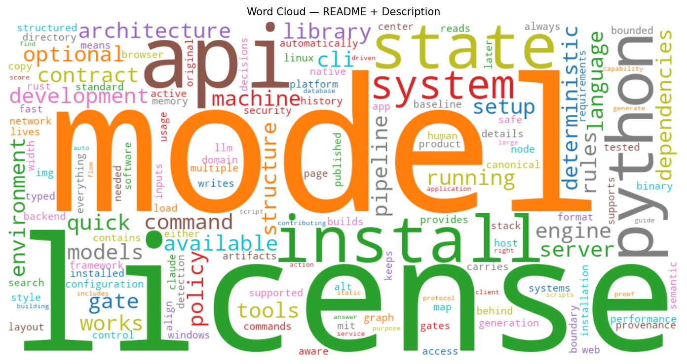

| # | Domain word | Repos | Word (all) | Repos |
| --- | --- | --- | --- | --- |
| 1 | llm | 375 | model | 950 |
| 2 | security | 340 | license | 842 |
| 3 | backend | 307 | api | 770 |
| 4 | database | 276 | install | 759 |
| 5 | query | 252 | python | 727 |
| 6 | matrix | 246 | state | 677 |
| 7 | rest | 233 | system | 649 |
| 8 | risk | 194 | development | 595 |
| 9 | compiler | 183 | command | 585 |
| 10 | parser | 168 | architecture | 565 |
| 11 | classification | 166 | running | 553 |
| 12 | container | 166 | cli | 524 |
| 13 | endpoint | 159 | machine | 519 |
| 14 | mapping | 150 | optional | 507 |
| 15 | simulation | 148 | available | 502 |
| 16 | kernel | 147 | quick | 502 |
| 17 | sql | 137 | deterministic | 501 |
| 18 | distributed | 135 | tools | 492 |
| 19 | autonomous | 130 | engine | 484 |
| 20 | frontend | 126 | library | 483 |
| 21 | react | 126 | gate | 478 |
| 22 | embedded | 122 | contract | 464 |
| 23 | injection | 116 | models | 463 |
| 24 | sqlite | 114 | environment | 459 |
| 25 | postgresql | 103 | language | 451 |
| 26 | solver | 94 | pipeline | 450 |
| 27 | thread | 94 | rules | 442 |
| 28 | express | 85 | works | 437 |
| 29 | ast | 82 | policy | 435 |
| 30 | numerical | 81 | structure | 433 |
| 31 | concurrency | 77 | setup | 425 |
| 32 | authorization | 76 | server | 424 |
| 33 | interpreter | 75 | dependencies | 414 |
| 34 | authentication | 73 | configuration | 412 |
| 35 | transaction | 73 | native | 412 |
| 36 | vulnerability | 70 | mit | 409 |
| 37 | indexing | 69 | directory | 404 |
| 38 | normalization | 65 | automatically | 403 |
| 39 | pytorch | 64 | framework | 403 |
| 40 | physics | 63 | control | 402 |

# Timeline (COMMITS surface)

## T8. Repositories by Year of Their First Commit Mentioning the Technique (COMMITS Surface)

_Each of the 1,156 repositories counted once, in the year of its earliest commit whose message contains a technique keyword. A commit message mentioning the technique does not mean the technique is in the code._

| Year | Repos (first commit mentioning the technique) | …that commit agent-marked |
| --- | --- | --- |
| 2013 | 3 | 0 |
| 2015 | 1 | 0 |
| 2017 | 6 | 0 |
| 2018 | 9 | 0 |
| 2019 | 22 | 0 |
| 2020 | 18 | 0 |
| 2021 | 19 | 0 |
| 2022 | 19 | 0 |
| 2023 | 20 | 0 |
| 2024 | 21 | 0 |
| 2025 | 81 | 14 |
| 2026 | 937 | 452 |

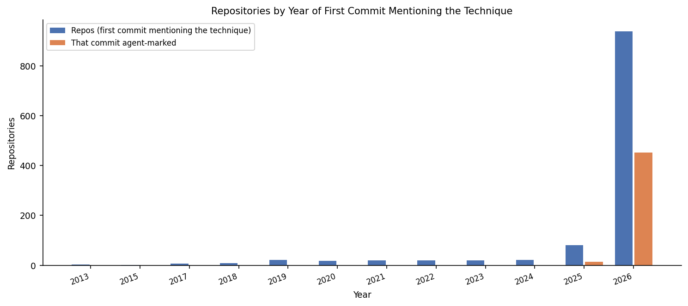

### Repository creation year

_Year each of the 1,156 repositories with ≥1 relevant commit was created on GitHub._

| Year | Repos created |
| --- | --- |
| 2011 | 2 |
| 2013 | 3 |
| 2014 | 5 |
| 2015 | 5 |
| 2016 | 4 |
| 2017 | 5 |
| 2018 | 19 |
| 2019 | 16 |
| 2020 | 19 |
| 2021 | 26 |
| 2022 | 26 |
| 2023 | 24 |
| 2024 | 52 |
| 2025 | 146 |
| 2026 | 804 |

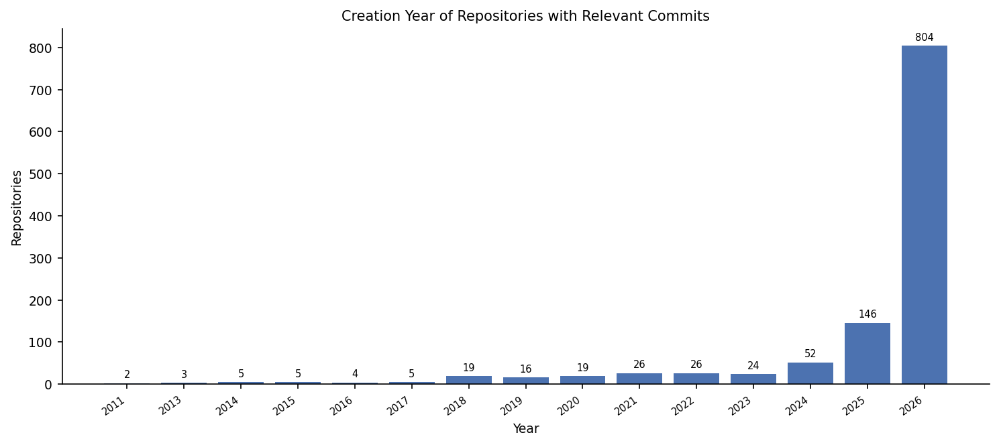

## T9. Commit Activity (COMMITS Surface)

_Relevant = message contains ≥1 technique keyword; Capped = ≤5 relevant commits per repository per month; Without top 10 = excluding the 10 repositories with most relevant commits; Agent-marked = message carries an AI-agent authorship line (lower bound)._

| Year | Relevant | Capped | Without top 10 | Agent-marked | Agent % | Repos | Repos with agent commit |
| --- | --- | --- | --- | --- | --- | --- | --- |
| 2013 | 5 | 5 | 5 | 0 | 0.0% | 3 | 0 |
| 2015 | 2 | 2 | 2 | 0 | 0.0% | 1 | 0 |
| 2017 | 8 | 8 | 8 | 0 | 0.0% | 6 | 0 |
| 2018 | 27 | 25 | 27 | 0 | 0.0% | 9 | 0 |
| 2019 | 68 | 60 | 57 | 0 | 0.0% | 24 | 0 |
| 2020 | 99 | 93 | 75 | 0 | 0.0% | 26 | 0 |
| 2021 | 64 | 58 | 62 | 0 | 0.0% | 25 | 0 |
| 2022 | 232 | 148 | 107 | 0 | 0.0% | 23 | 0 |
| 2023 | 136 | 117 | 73 | 0 | 0.0% | 30 | 0 |
| 2024 | 95 | 90 | 36 | 0 | 0.0% | 29 | 0 |
| 2025 | 243 | 216 | 198 | 39 | 16.0% | 85 | 15 |
| 2026 | 3,181 | 1,709 | 1,870 | 1,888 | 59.4% | 945 | 470 |

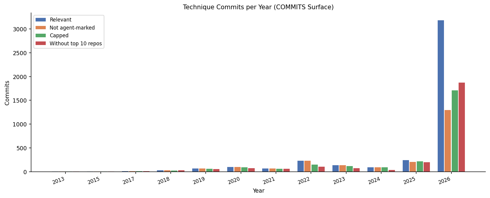

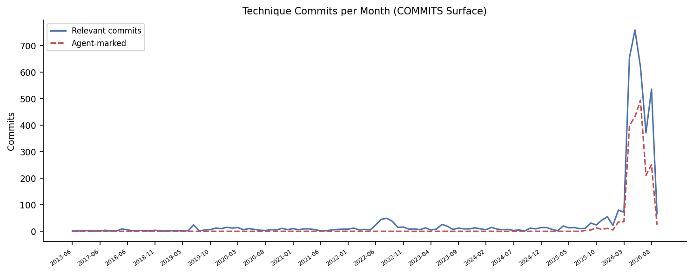
