# Property-Based Testing — Sections Report

_Generated 2026-10-16 09:50. Explicit technique-phrase search results only. Sections that need cloning (S3, A1a, A2–A5) use a random sample of 1,112 CODE-surface repositories (±3.0% at 95% confidence); A6/A7 use a random sample of verified non-CODE repositories. Caveats: [sections_issues.md](sections_issues.md) · repository lists: [sections_samples.md](sections_samples.md) · results treated as not found: [sections_excluded.md](sections_excluded.md)._

# Search

## S1. Search Hits per Search Surface

_Explicit technique-phrase search keywords only (6: `"property-based testing"`, `"property-based test"`, `"property-based tests"`, `"property based testing"`, `"property based test"`, `"property based tests"`). Raw = sum of GitHub `total_count` over these keywords (before deduplication); Unique = distinct items collected that are verified (non-CODE: title/body contains a technique phrase). CODE items are shown as found: they can only be verified by scanning, which is done on a sample (S2, A2)._

| Surface | Raw Search Hits | Unique Results | Retrieved ÷ GitHub total (capped slices) |
| --- | --- | --- | --- |
| CODE | 337,876 | 277,801 | 98.6% (2/814 capped) |
| REPOS | 4,759 | 1,205 | 100.0% (0/10 capped) |
| COMMITS | 205,684 | 10,706 | 33.3% (29/112 capped) |
| PRS | 172,659 | 15,207 | 37.1% (35/78 capped) |
| ISSUES | 41,765 | 7,119 | 60.2% (9/35 capped) |
| DISCUSSIONS | 1,056 | 280 | 100.0% (0/4 capped) |

_GitHub returns at most 1,000 results per query; a date/size slice is **capped** when GitHub reported more. Surfaces with capped slices are **lower bounds** (see sections_issues.md)._

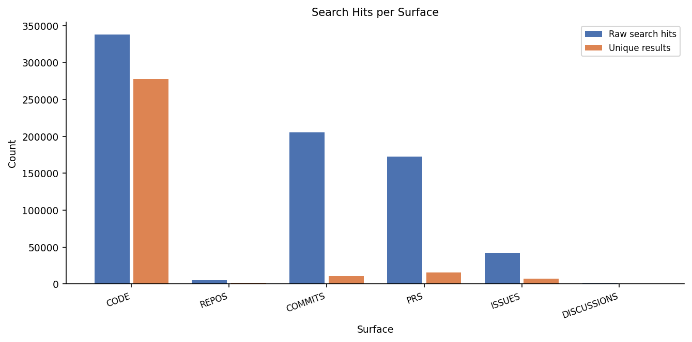

## S2. Distinct Repositories per Search Surface

_Verified repositories only (non-CODE: ≥1 item whose title/body contains a technique phrase; CODE: current snapshot has ≥1 technique hit). CODE is estimated from the random sample (A2): share of sampled repositories with a hit (1,078 of 1,138) × the 76,846 CODE repositories found by search; ± = 95% confidence interval._

| Surface | Distinct Repos |
| --- | --- |
| CODE | ≈ 72,794 ± 990 |
| REPOS | 1,205 |
| COMMITS | 6,710 |
| PRS | 6,555 |
| ISSUES | 4,373 |
| DISCUSSIONS | 140 |
| **Non-CODE surfaces (union)** | **16,370** |

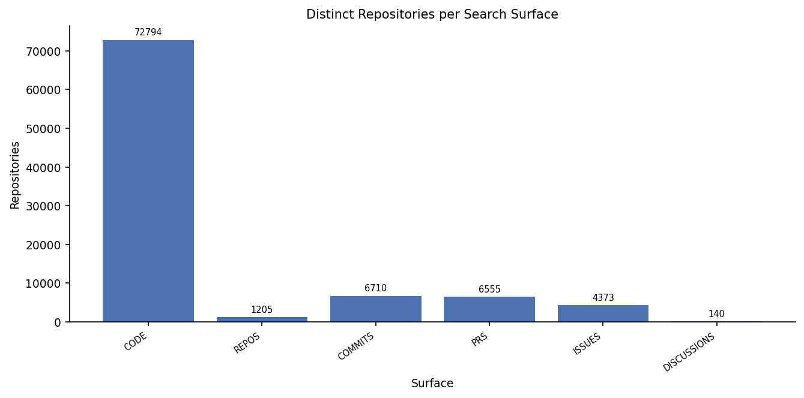

_Number of non-CODE surfaces each repository appears on:_

| Surfaces | Repos | % of union |
| --- | --- | --- |
| 1 | 14,140 | 86.4% |
| 2 | 1,866 | 11.4% |
| 3 | 345 | 2.1% |
| 4 | 19 | 0.1% |

## S3. Size of Analysed CODE-Surface Repositories

_1,078 CODE-surface repositories (verified, see A2). Files = scannable files; lines of code = lines in code files only._

_Random sample of the CODE population (see A2); ±3.0% margin for proportions; the statistics below describe the sampled repositories._

| Metric | Min | P25 | Median | Avg | P75 | Max | Std Dev | N | Total |
| --- | --- | --- | --- | --- | --- | --- | --- | --- | --- |
| Files per repo | 1 | 70 | 214 | 1,696 | 861 | 183,276 | 7,620 | 1,078 | 1,827,946 |
| Code files per repo | 0 | 21 | 93 | 821 | 344 | 107,969 | 4,633 | 1,078 | 885,246 |
| Lines of code per repo | 0 | 3,190 | 18,428 | 254,399 | 86,108 | 66,404,919 | 2,179,728 | 1,078 | 274,241,806 |

_P25 / P75 = 25th / 75th percentile: the middle half of repositories lies between them._

## S4. Keywords Without Results

All 4 search keywords that ran returned results on every surface. Not run (search error, not repeated): property-based test, property based testing.

# Analysis

## A1. Top Analysis Keyword Hits

_One hit = one line matching one technique regex (a phrase wrapped over two lines counts once). **⊂ parent** = comment/string variant also counted by its parent; excluded from totals._

_(a) uses the random CODE sample (A2); (b) uses every collected non-CODE item._

### (a) CODE surface — 1,078 analysed repositories

| # | Keyword | Hits | Files | Repos |
| --- | --- | --- | --- | --- |
| 1 | property-based test(ing) | 7,352 | 4,556 | 1,078 |
| 2 | comment: property-based test ⊂ property-based test(ing) | 2,185 | 1,820 | 530 |
| 3 | string literal: property-based test ⊂ property-based test(ing) | 55 | 47 | 30 |

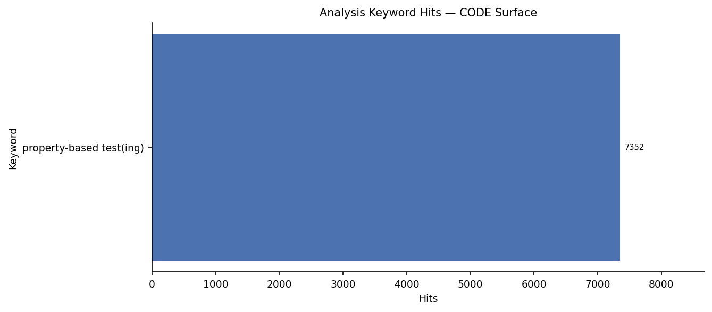

### (b) Non-CODE surfaces — 34,517 search-result titles and bodies

| # | Keyword | REPOS | COMMITS | PRS | ISSUES | DISCUSSIONS | Total Hits | Items |
| --- | --- | --- | --- | --- | --- | --- | --- | --- |
| 1 | property-based test(ing) | 1,326 | 13,768 | 22,372 | 11,049 | 350 | 48,865 | 34,517 |
| 2 | comment: property-based test ⊂ property-based test(ing) | 15 | 423 | 1,955 | 1,155 | 65 | 3,613 | 3,212 |
| 3 | string literal: property-based test ⊂ property-based test(ing) | 3 | 21 | 22 | 22 | 0 | 68 | 66 |

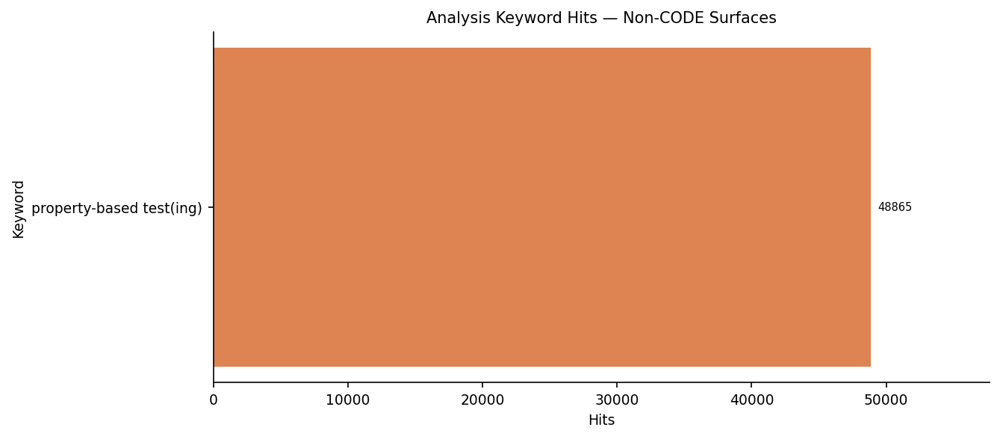

## A2. Cloned Repository Classification

_Usage = ≥1 code file (test or source, incl. `.ipynb`) with a technique phrase · Non-Usage = ≥1 technique hit, none in code files. Seeded random sample of the CODE-surface repositories; only sampled repositories whose current snapshot has a technique hit are included (the rest: sections_excluded.md). ± = 95% confidence interval._

| Population and sample | Repos |
| --- | --- |
| CODE-surface repositories found by search | 76,846 |
| Sample size needed for ±3% at 95% confidence | 1,053 |
| Random sample drawn (incl. extra for unavailable repos) | 1,138 |
| … excluded: no longer available (deleted / private / disabled) | 26 |
| … excluded: scan failed or not scanned yet | 0 |
| … excluded: no technique hit in the current snapshot | 34 |
| **Included (sample)** | **1,078** |
| Margin of error achieved (95%, worst case) | ±2.9% |

| Group | Repos (sample) | % of included (95% CI) | Estimated repos in population |
| --- | --- | --- | --- |
| Usage | 360 | 33.4% ± 2.8 | ≈ 24,310 |
| Non-Usage | 718 | 66.6% ± 2.8 | ≈ 48,485 |

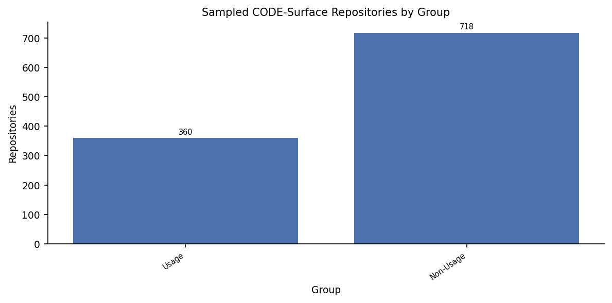

## A3. "Usage" Repository Code-File Classification

_360 usage repositories in the sample; **code files only**. Technique test = test file with a technique phrase · General test = test file without · Technique non-test = non-test code file with a phrase · Non-test = non-test code file without. % of the repo's code files, averaged across repositories._

| Category | Avg % of code files per Repo | Median % | Files (pooled) | % of Pooled Files |
| --- | --- | --- | --- | --- |
| Technique test | 2.4% | 0.5% | 1,466 | 0.3% |
| General test | 25.4% | 22.3% | 145,386 | 28.8% |
| Technique non-test | 1.2% | 0.0% | 324 | 0.1% |
| Non-test | 71.0% | 73.7% | 357,837 | 70.9% |

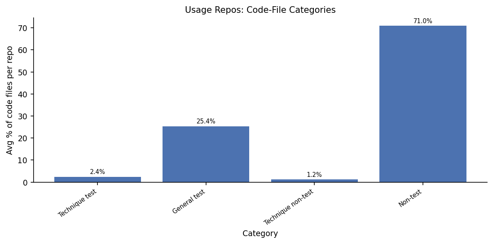

## A4. "Non-Usage" Repository File Classification

_718 non-usage repositories (≥1 technique hit, none in code files). Technique doc = doc file with a hit · General doc = doc file without · General technique = non-doc file with a hit · General = non-doc file without. % of all the repo's files, averaged across repositories._

| Category | Avg % of files per Repo | Median % | Files (pooled) | % of Pooled Files |
| --- | --- | --- | --- | --- |
| Technique doc | 3.1% | 0.6% | 1,497 | 0.1% |
| General doc | 29.4% | 18.9% | 212,460 | 20.7% |
| General technique | 0.6% | 0.0% | 214 | 0.0% |
| General | 67.0% | 78.0% | 812,026 | 79.1% |

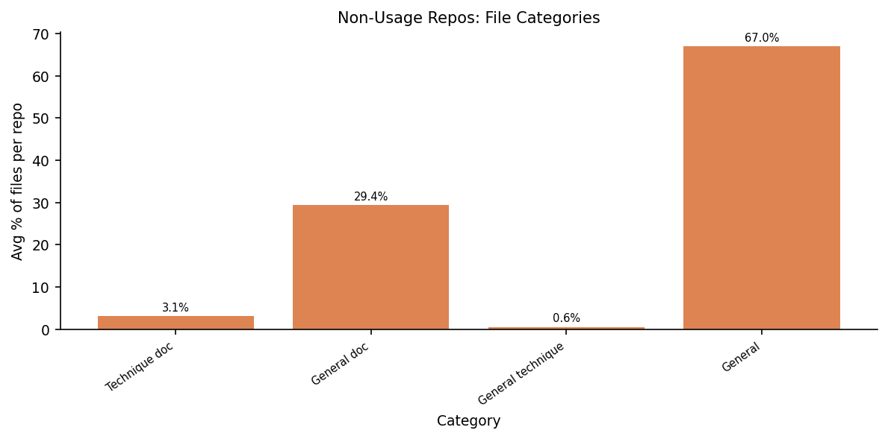

## A5. Primary Language

_Primary language (current GitHub metadata) of the 1,078 analysed sample repositories (47 have none). Shares carry a ±3.0% (worst-case) margin. Lift compares like with like over the 42 languages with a GitHub-wide count: share among our sample repositories in those languages ÷ share among the public repositories in those languages pushed since 2025-09-01; >1 = over-represented._

| Language | Repos | Share | Share (compared languages) | GitHub Share | Lift |
| --- | --- | --- | --- | --- | --- |
| Python | 289 | 28.0% | 28.6% | 18.54% | 1.54 |
| TypeScript | 175 | 17.0% | 17.3% | 13.36% | 1.30 |
| Rust | 125 | 12.1% | 12.4% | 0.81% | 15.31 |
| JavaScript | 67 | 6.5% | 6.6% | 15.99% | 0.41 |
| HTML | 45 | 4.4% | 4.5% | 24.06% | 0.18 |
| Go | 38 | 3.7% | 3.8% | 1.05% | 3.58 |
| Solidity | 31 | 3.0% | 3.1% | 0.09% | 34.90 |
| C# | 25 | 2.4% | 2.5% | 2.12% | 1.16 |
| C++ | 23 | 2.2% | 2.3% | 2.26% | 1.01 |
| Java | 20 | 1.9% | 2.0% | 4.94% | 0.40 |
| Jupyter Notebook | 20 | 1.9% | 2.0% | 4.19% | 0.47 |
| Shell | 20 | 1.9% | 2.0% | 1.32% | 1.49 |
| Elixir | 15 | 1.5% | 1.5% | 0.03% | 48.91 |
| Scala | 14 | 1.4% | 1.4% | 0.03% | 50.75 |
| Haskell | 13 | 1.3% | 1.3% | 0.02% | 51.63 |
| Dart | 10 | 1.0% | 1.0% | 0.86% | 1.16 |
| Erlang | 8 | 0.8% | 0.8% | 0.00% | 182.18 |
| C | 7 | 0.7% | 0.7% | 1.31% | 0.53 |
| Clojure | 7 | 0.7% | 0.7% | 0.01% | 55.76 |
| PHP | 7 | 0.7% | 0.7% | 1.61% | 0.43 |
| TeX | 7 | 0.7% | 0.7% | 0.16% | 4.20 |
| CSS | 6 | 0.6% | 0.6% | 3.59% | 0.17 |
| Kotlin | 6 | 0.6% | 0.6% | 0.88% | 0.68 |
| PowerShell | 6 | 0.6% | 0.6% | 0.20% | 2.96 |
| F# | 5 | 0.5% | 0.5% | 0.01% | 70.17 |

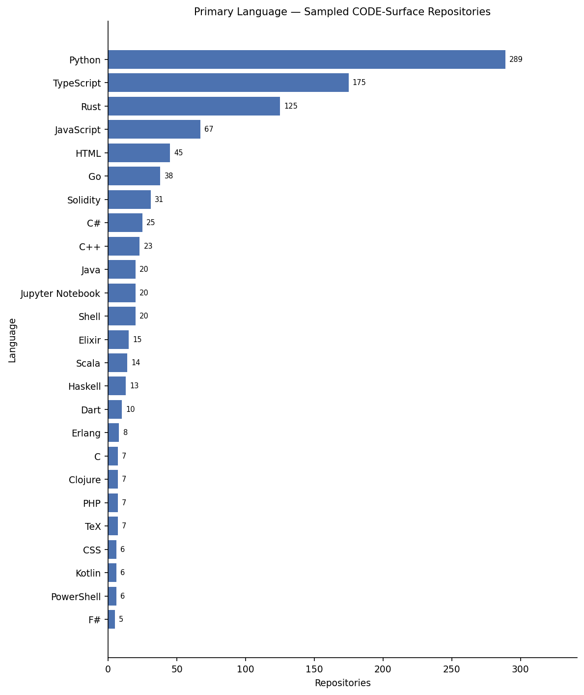

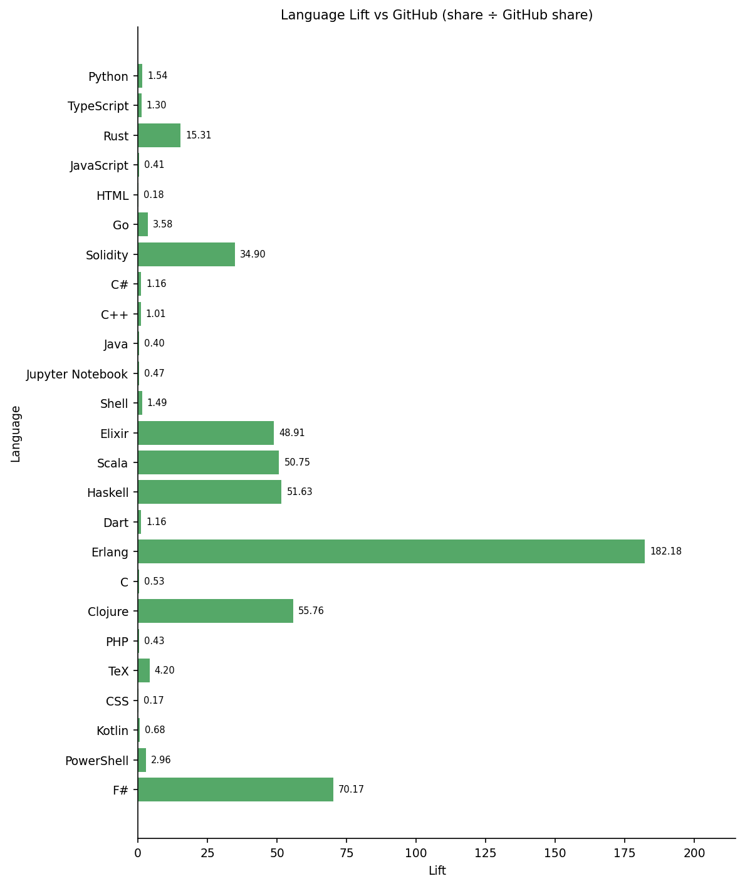

## A6. Application Domain

_Seeded random sample of 1,083 of the 16,370 verified non-CODE repositories; 1,073 still exist and are counted (±2.9% margin at 95% confidence)._

_1,073 non-CODE repositories with ≥1 relevant item (1,018 with a README); one count per repository, several domains possible; word-boundary keyword matching (`inputs/domain_keywords.json`). Description + topics: any domain keyword. + README: the README adds a domain only if it contains ≥3 different keywords of that domain._

| Domain | Repos (description + topics) | % | Repos (+ README) | % |
| --- | --- | --- | --- | --- |
| Web Api | 60 | 5.6% | 209 | 19.5% |
| Database | 36 | 3.4% | 148 | 13.8% |
| Security Crypto | 34 | 3.2% | 116 | 10.8% |
| Finance | 45 | 4.2% | 83 | 7.7% |
| Machine Learning | 40 | 3.7% | 70 | 6.5% |
| Operating Systems | 24 | 2.2% | 68 | 6.3% |
| Compiler Pl | 35 | 3.3% | 56 | 5.2% |
| Distributed Systems | 23 | 2.1% | 32 | 3.0% |
| Scientific Computing | 20 | 1.9% | 28 | 2.6% |
| Embedded Iot | 16 | 1.5% | 22 | 2.1% |
| Autonomous Robotics | 8 | 0.7% | 9 | 0.8% |
| Bioinformatics | 2 | 0.2% | 2 | 0.2% |
| _No domain matched_ | 802 | 74.7% | 563 | 52.5% |

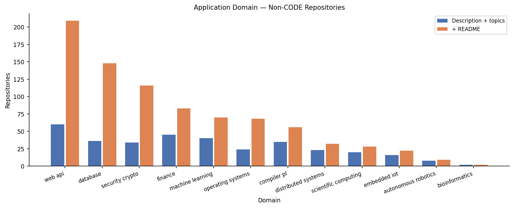

## A7. Word Cloud Analysis

_README + project description of the 1,073 sampled verified non-CODE repositories (1,018 with a README). Each word counts once per repository; stopwords removed; size ∝ √frequency._

### Domain vocabulary

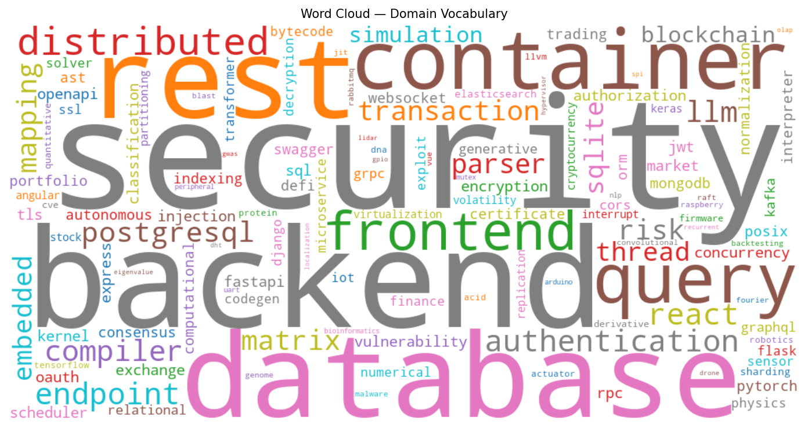

### All words

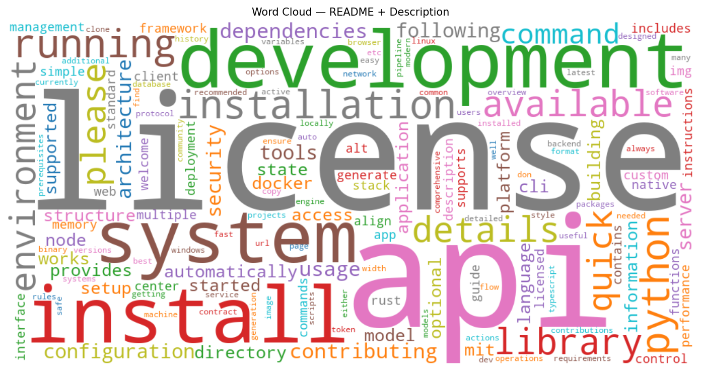

| # | Domain word | Repos | Word (all) | Repos |
| --- | --- | --- | --- | --- |
| 1 | security | 224 | license | 467 |
| 2 | backend | 141 | api | 406 |
| 3 | database | 116 | development | 394 |
| 4 | rest | 98 | install | 383 |
| 5 | container | 91 | system | 324 |
| 6 | query | 89 | installation | 303 |
| 7 | frontend | 85 | running | 301 |
| 8 | distributed | 81 | python | 300 |
| 9 | authentication | 78 | library | 281 |
| 10 | react | 74 | available | 276 |
| 11 | endpoint | 73 | details | 264 |
| 12 | compiler | 68 | environment | 263 |
| 13 | llm | 68 | please | 250 |
| 14 | postgresql | 59 | quick | 250 |
| 15 | matrix | 53 | command | 248 |
| 16 | transaction | 51 | contributing | 246 |
| 17 | risk | 50 | dependencies | 246 |
| 18 | mapping | 47 | usage | 245 |
| 19 | parser | 46 | configuration | 242 |
| 20 | sqlite | 42 | architecture | 234 |
| 21 | embedded | 41 | server | 227 |
| 22 | thread | 41 | tools | 227 |
| 23 | simulation | 40 | security | 224 |
| 24 | blockchain | 39 | following | 222 |
| 25 | vulnerability | 39 | automatically | 221 |
| 26 | authorization | 38 | model | 221 |
| 27 | encryption | 38 | setup | 220 |
| 28 | concurrency | 36 | cli | 217 |
| 29 | jwt | 36 | state | 217 |
| 30 | openapi | 36 | mit | 215 |
| 31 | market | 35 | provides | 212 |
| 32 | tls | 35 | directory | 205 |
| 33 | rpc | 34 | structure | 204 |
| 34 | sql | 34 | information | 203 |
| 35 | exchange | 32 | supported | 199 |
| 36 | express | 32 | application | 194 |
| 37 | injection | 32 | node | 192 |
| 38 | classification | 31 | started | 189 |
| 39 | kernel | 31 | optional | 188 |
| 40 | fastapi | 30 | building | 185 |

# Timeline (COMMITS surface)

## T8. Repositories by Year of Their First Commit Mentioning the Technique (COMMITS Surface)

_Each of the 6,710 repositories counted once, in the year of its earliest commit whose message contains a technique keyword. A commit message mentioning the technique does not mean the technique is in the code._

| Year | Repos (first commit mentioning the technique) | …that commit agent-marked |
| --- | --- | --- |
| 2011 | 5 | 0 |
| 2012 | 6 | 0 |
| 2013 | 22 | 0 |
| 2014 | 70 | 0 |
| 2015 | 200 | 0 |
| 2016 | 235 | 0 |
| 2017 | 287 | 0 |
| 2018 | 290 | 0 |
| 2019 | 347 | 0 |
| 2020 | 414 | 0 |
| 2021 | 388 | 0 |
| 2022 | 426 | 0 |
| 2023 | 469 | 0 |
| 2024 | 529 | 0 |
| 2025 | 1,431 | 204 |
| 2026 | 1,591 | 124 |

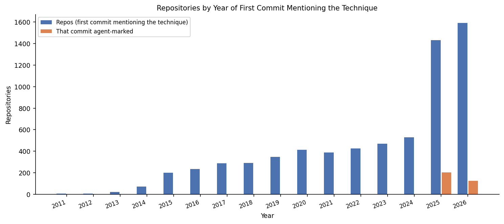

### Repository creation year

_Year each of the 6,710 repositories with ≥1 relevant commit was created on GitHub._

| Year | Repos created |
| --- | --- |
| 2009 | 4 |
| 2010 | 14 |
| 2011 | 31 |
| 2012 | 45 |
| 2013 | 58 |
| 2014 | 142 |
| 2015 | 188 |
| 2016 | 234 |
| 2017 | 262 |
| 2018 | 289 |
| 2019 | 349 |
| 2020 | 390 |
| 2021 | 373 |
| 2022 | 414 |
| 2023 | 412 |
| 2024 | 540 |
| 2025 | 1,514 |
| 2026 | 1,446 |

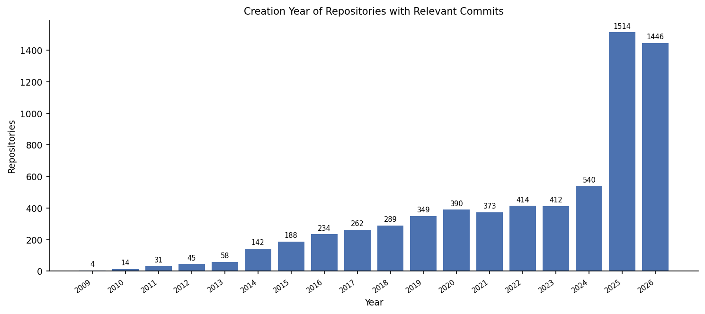

### Repositories by year of first commit mentioning the technique — corrected for the search cap

_Collected = first relevant commit in the downloaded data (a lower bound where the commit search was capped). Estimated = capped date ranges re-sampled (`--commit-sampling`): random time windows downloaded completely, each repository checked for an earlier relevant commit; ± = 95% confidence interval (0 = counted exactly)._

| Year | Collected (lower bound) | Estimated | 95% CI |
| --- | --- | --- | --- |
| 2011 | 5 | 5 | exact |
| 2012 | 6 | 6 | exact |
| 2013 | 22 | 22 | exact |
| 2014 | 70 | 70 | exact |
| 2015 | 200 | 200 | exact |
| 2016 | 235 | 235 | exact |
| 2017 | 287 | 287 | exact |
| 2018 | 290 | 306 | exact |
| 2019 | 347 | 361 | exact |
| 2020 | 414 | 413 | exact |
| 2021 | 388 | 388 | exact |
| 2022 | 426 | 425 | exact |
| 2023 | 469 | 469 | exact |
| 2024 | 529 | 529 | exact |
| 2025 | 1,431 | 3,796 | exact |
| 2026 | 1,591 | 12,479 | exact |

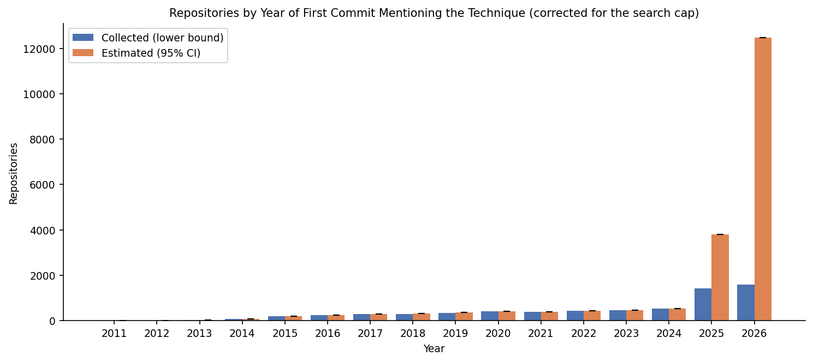

## T9. Commit Activity (COMMITS Surface)

_Relevant = message contains ≥1 technique keyword; Capped = ≤5 relevant commits per repository per month; Without top 10 = excluding the 10 repositories with most relevant commits; Agent-marked = message carries an AI-agent authorship line (lower bound)._

| Year | Relevant | Capped | Without top 10 | Agent-marked | Agent % | Repos | Repos with agent commit |
| --- | --- | --- | --- | --- | --- | --- | --- |
| 2011 | 5 | 5 | 5 | 0 | 0.0% | 5 | 0 |
| 2012 | 7 | 7 | 7 | 0 | 0.0% | 6 | 0 |
| 2013 | 29 | 29 | 29 | 0 | 0.0% | 22 | 0 |
| 2014 | 83 | 83 | 83 | 0 | 0.0% | 70 | 0 |
| 2015 | 261 | 247 | 261 | 0 | 0.0% | 201 | 0 |
| 2016 | 319 | 319 | 314 | 0 | 0.0% | 243 | 0 |
| 2017 | 487 | 463 | 487 | 0 | 0.0% | 299 | 0 |
| 2018 | 459 | 450 | 438 | 0 | 0.0% | 307 | 0 |
| 2019 | 607 | 583 | 559 | 0 | 0.0% | 385 | 0 |
| 2020 | 735 | 681 | 691 | 0 | 0.0% | 449 | 0 |
| 2021 | 710 | 645 | 644 | 0 | 0.0% | 425 | 0 |
| 2022 | 665 | 662 | 657 | 0 | 0.0% | 455 | 0 |
| 2023 | 786 | 732 | 770 | 0 | 0.0% | 507 | 0 |
| 2024 | 834 | 810 | 821 | 0 | 0.0% | 561 | 0 |
| 2025 | 2,438 | 2,239 | 2,311 | 350 | 14.4% | 1,475 | 216 |
| 2026 | 2,281 | 2,159 | 2,233 | 163 | 7.1% | 1,628 | 127 |

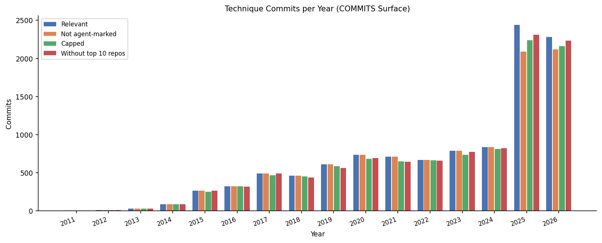

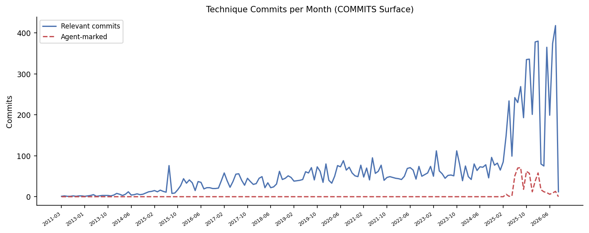

### Agent-marked share — corrected for the search cap

_Collected = share in the downloaded data. Estimated = capped date ranges re-sampled with random time windows (`--commit-sampling`); ± = 95% confidence interval in percentage points._

| Year | Collected share | Estimated share | 95% CI |
| --- | --- | --- | --- |
| 2011 | 0.0% | 0.0% | exact |
| 2012 | 0.0% | 0.0% | exact |
| 2013 | 0.0% | 0.0% | exact |
| 2014 | 0.0% | 0.0% | exact |
| 2015 | 0.0% | 0.0% | exact |
| 2016 | 0.0% | 0.0% | exact |
| 2017 | 0.0% | 0.0% | exact |
| 2018 | 0.0% | 0.0% | exact |
| 2019 | 0.0% | 0.0% | exact |
| 2020 | 0.0% | 0.0% | exact |
| 2021 | 0.0% | 0.0% | exact |
| 2022 | 0.0% | 0.0% | exact |
| 2023 | 0.0% | 0.0% | exact |
| 2024 | 0.0% | 0.0% | exact |
| 2025 | 14.4% | 23.3% | exact |
| 2026 | 7.1% | 30.8% | exact |

### Commit-search completeness per year

_Retrieved ÷ GitHub's total_count for the commit-search slices of each year (slice midpoint). Years with capped slices are lower bounds; GitHub's total includes fork copies and loose word matches._

| Year | Slices | Capped | GitHub total | Retrieved | Retrieved % |
| --- | --- | --- | --- | --- | --- |
| 2012 | 4 | 0 | 394 | 393 | 99.7% |
| 2014 | 4 | 0 | 710 | 710 | 100.0% |
| 2015 | 4 | 0 | 3,825 | 3,817 | 99.8% |
| 2016 | 4 | 0 | 2,368 | 2,368 | 100.0% |
| 2017 | 4 | 0 | 3,362 | 3,359 | 99.9% |
| 2018 | 12 | 4 | 9,841 | 6,186 | 62.9% |
| 2019 | 12 | 4 | 13,733 | 7,452 | 54.3% |
| 2020 | 12 | 0 | 6,724 | 6,707 | 99.7% |
| 2021 | 8 | 0 | 5,819 | 5,819 | 100.0% |
| 2022 | 8 | 0 | 4,579 | 4,565 | 99.7% |
| 2023 | 8 | 0 | 5,519 | 5,494 | 99.5% |
| 2024 | 8 | 0 | 5,811 | 5,811 | 100.0% |
| 2025 | 12 | 9 | 25,826 | 11,958 | 46.3% |
| 2026 | 12 | 12 | 141,523 | 11,999 | 8.5% |
